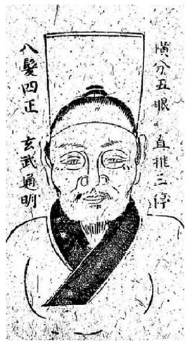
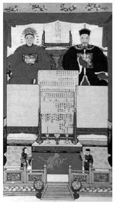

## 二 应用技法 (Part 2)

> [BREADCRUMB_CTX: 《考工记：工匠·功能·风格 (中国传统雕塑的复制与当代中国美术教育体系的建立系列丛书)》 > 二 应用技法 (Part 2)]

由于本章探讨的这些画像的主人皆早已作古，而草稿与成品同时留下的情况也极少（即便留下也不能证明草稿必然为真），因此我们缺少相互参照与比较的依据，故而无法从画面上看出作者曾经将相术的那些说法应用在画面的绘制上。日本学者小川阳一曾经在其研究中提到，明代的冯惟敏在60岁时，在一位通人相术的画家“林山上人”为他画的肖像画上写了一首散曲《六秩写真》，并从而论证了肖像画有根据相面术来画的例子。[70]以下，笔者希望通过其他一些相关材料，从雇主需求的角度，对画工是否依照相术进行遗像的绘制加以探讨。前文从对亲人追思的角度论证了祖宗像必须以肖似为前提，但是我们也必须注意到有些历史现象并非只遵循一种原则。通过面相来判断一个人的富、贵、寿、夭在中国是有其悠久传统的，早在汉代王充的《论衡·骨相篇》和王符的《潜夫论·相列》中，就有关于相术的系统理论，汉代焦延寿的《焦氏易林》中也有关于相面的记载与方法。相面术以古老的易术与阴阳五行为根基[71]，经由秦、汉“天人感应”理论的影响而形成了庞大的体系。王充在《骨相篇》中说：“人命禀于天，则有表候于体，察表侯以知命，犹察斗斛以知容矣。表候者，骨法之谓也。”[72]王符在《潜夫论·相列》中说：“诗所谓‘天生烝民，有物有则’。是故人身体形貌皆有象类，骨法角肉各有分部，以著性命之期，显贵贱之表，一人之身，而五行八卦之气具焉。”[73]五代的陈抟在《神异赋》中则言：“三停平等，一生衣祿无亏”，“天庭高耸，少年富贵可期”，“地阁方圆，晚岁荣枯定取”[74]。而疑为宋人依托后周王朴所作的《太清神鉴》则是集宋代以前中国相术之大成。[75]这些对面相的说法也渗透到了民俗文学之中[76]，例如在《金瓶梅词话》里有一段吴神仙相西门庆的剧情：“……天庭高耸，一生衣祿无亏；地阁方圆，晚岁荣华定取。”[77]以上诸多理论和民间小说的引用，显示出古代对于面相不仅相当重视，而且也相当普及。早在战国时代，孟子就曾说：“存乎人者，莫良于眸子。眸子不能掩其恶。胸中正，则眸子了焉﹔胸中不正，则眸子眊焉。听其言也，观其眸子，人焉瘦哉？”[78]这种经由观察人眼来判断一个人的“心”是否正直的说法，虽不能完全等同于相面之术，但是也说明了一个重要的观念：中国人认为内心的想法会不知不觉地反映在一个人的外貌上，而这种反映甚至会改变一个人的面相；反过来说，经由面相，也许也能改变一个人的“心”。而正与不正除了表现在无形的精神气质方面，也表现在有形画面中所谓的“八发四正玄武通明”上（见图3-14）。

图3-14 “八发四正玄武通明”

资料来源：摘自“丹青妙诀”《新锲全补天下四民利用便观五车拔锦》（第14卷）。

中国的宗教包含两大范畴：一是神灵；一是祖先。对于祭祀的家属而言，过世的先人往往与神灵具有相同的能力，祖先们对于家道的昌盛、子孙的兴旺还有很大的影响力。而画像作为一种祭祀对象的象征，并且几近于祖先在人世的分身，这种意识自古即有，并不奇怪。宋代李士云替王安石画像，王安石赠诗曰：“衰容一见便疑真，李氏挥毫妙入神。欲去钟山终不忍，谢渠分我死前身。”[79]这种将过度逼真的画像看作自己分身的感觉是很微妙的，而且这种特别的感觉也不一定只在人像上才发生，《画继》就曾记载道宏：“每往人家画土神，其家必富，画猫则无鼠。”[80]这种微妙感觉的产生，显然牵涉到一些巫术与禁忌。郑岩先生在他的研究中不止一次提到中国古代对于生前画像与忌讳画像这两件事似乎历来都是并行不悖的[81]，例如《画继》中记载“未满三十岁不可令朱待诏写真”的理由是“恐其夺尽精神也”[82]。如果从人类学的角度来看，原逻辑思维主导下的巫术信仰虽然有时看似矛盾，但确实是可以同时存在的；不过这也并不代表没有限制，而是必须要满足某些条件。基于不同的需求与目的，人们可以经由一些“名目”或“说法”来转换巫术信仰所造成的普遍适用性并使其合理化。生前能否画像涉及被画者的身份、年龄与画像的用途等，例如：帝王、后妃身份尊崇，为了让人瞻仰或是奉若神明而绘制的画像，称作“御容”；功成名就之人可以通过画像来彰显功德；满50岁之人即便没有什么了不起的作为，也可因年高德劭而画像，称作“喜容”，因为在崇老的观念下，活得久本身就是一种“德”的显现。但是，对于年纪尚轻，连“而立之年”都还未到之人而言，其人生才刚刚开始，既缺少可供画像的“名目”，也没有具体的目的性。在这时，传统习俗中对于巫术与禁忌的信仰就特别容易显露出来，尤其是以写实性技法为主、具有极强指涉性的肖像，就更容易让人感觉会分其精神、夺其血肉。当然，在针对这些问题进行探讨时，仍必须考虑到不同时代对于画像意涵及观点的转变。因为我们在本章最初已经提到“写真”的专业概念与它的通俗性的问题，并且也涉及画面形式所代表的意义。例如从严格的祖宗画像风格形式来说，它的写真目的是明确的，所以这对于年轻的被画像者来说则可能是有损的。但是一般的写像，虽然也被通俗地称为“写真”，但在不同的目的与情境下，关于那些禁忌的说法有时又未必起作用，例如《扬州画舫录》记载涂冬“居小秦淮，凡妓之来者，涂必摹其形，不下百数十人矣”。清代龚炜在《巢林笔谈》中提到一则故事：“宜兴周启隽立五，其始颧削颐逼，面槁色，盖薄像也。……梦一雉冠绛衣者，易其头去，其庞顿改旧观。……自是文思日进，寻登第入词林。”[83]另一个有趣的例子是：元代陈鉴如曾替赵孟頫（字子昂）写真，画完后赵子昂却“援笔改其所未然”，并曰：“唇之上何以谓之人中？盖自此而上，眼耳鼻皆双窍，自此而下，口暨二便皆单窍。三画阳，三画阴，成泰挂也。”[84]事实上，我们很难想象被夏文彦评为“精于写神，国朝第一手”[85]的陈鉴如会因为自身的“素描”功力不佳，而在描绘对象的比例上犯下了错误，从而必须由赵孟頫亲自修改并以指导的口吻告知其应当注意人中所处的位置与面部的关系这种基本常识。很显然，赵之所以援笔修改主要是因其关注于“泰”卦卦词所意涵的“泰，小往大来，吉亨”能否成“象”。也就是说，赵孟頫重视的并不是比例的准确与否，而是将面部的结构分布视为一种自然与人事相互关联，具有浓厚的形而上与象征意味的整体来看待。所以，他为了使画像符合这种理想，不惜与事实相左，并对陈鉴如说出一套与写实基础迥异的“文人”理论。泰卦在自然界表现为天地相交，二气相通；在人类社会表现为君臣志通，君子小人各得其位。[86]这对当时在异族朝廷有为官经验的赵孟頫而言显然很重要。《图绘宝鉴》中说陈鉴如之子芝田“能世其业”，可见他是以写神、画像为业的职业画家。既是如此，我们当可做出这样的判断，陈鉴如在当时所扮演的角色，是以满足雇主需求为首要前提的受雇性质的工匠而非艺术家。那么，或许他只有默默听从的份儿，也许还因此牢记在心，以便下次再替人传神时将这套理论转而述之。这样，既能取悦雇主，又能符合文人品味，而自己也可附庸风雅一番。从史料中我们看不出来陈鉴如为赵孟頫画的这张像是否为了“预写真容”而作，但是画工受雇主的要求违背了事实并有所修正则是可能的。这也显示出画工虽然在绘画技巧上拥有出众的技术，但也往往会在“理解”与“需求”上与雇主有所差异。

如果容貌能够主导或是改变一个人命运的观念，已经在大多数人的心里有着根深蒂固的认同，那么我们就很难相信人们会不顾念亲缘，而忍心让过世的亲人带着不好的相貌在阴间继续受苦。或许他们会为了让逝者在另一个世界有更好的生活，而在合理的范围内对其相貌做些微的增减与调整。更重要的是，基于容貌特征而发展出来的相面之学涉及的不只是一个人的祸福兴衰。在《相法妙诀》中提到的：“羊睛四白定孤霜……鼻头屈曲多孤独……人中斜曲主横死，上唇牵露多辛苦。左眼小而右眼高，久母必定幼年拋。右眼小而左眼反，家财宫中多破散。更须看眼与单重，再拜父母添宗族。”[87]对于活人而言，相术的主要功能在于趋吉避凶，是以预测未来为主。但是对于家属而言，容像则是逝者的化身，那么其面容恐怕也会对活着的人有所影响，而不能仅仅单纯地只为了追容一个目的。从这个角度思考，子孙又怎么能容许将先人的遗像画得危及后代？值得注意的是，有些祖宗像有时还并非只是一家出资，而是由全村集体出资聘请画师绘制。因为供奉的祖先一般是在五代，中国古代是大家族制，所以祖宗像的供奉与制作往往不是一家人的事，而是一个宗族共同的事情。在这种情形下所绘制的祖宗就很难达到每一个都肖似的目的，而对于绘制众人的共同祖先而言，就更不是宗族里面哪一个人的容貌所能代表的。在一个长期以家族富贵兴旺为愿望的传统环境中，姑且不论是否完全依照相书画像，但是一些流传已久成为习俗被认定为凶相的特征，总是必须避免的。出资者当然不会希望被一个早已不可知的容貌影响而让众子孙蒙受无妄之灾，因此就更有可能依照全体雇主的期待，加进一些世俗性的好相。而这对于那些熟悉相术的画工而言，也能以写实的方式加以结合，并且将这些虚拟的面貌画得栩栩如生（见图3-15）。

图3-15 祖先容像与历代牌位图（代图的另一种形式）

资料来源：摘自《美育》（肖像画专辑）。

笔者认为从上述这些例证中，可以窥见古代相术对写真的若干影响，让我们有理由相信基于某些原因，工匠们有可能受雇主的要求而不依照真实的容貌进行绘制。同时，相术的理论显然也为工匠提供了在与雇主针对画像的标准进行交涉时有力的依据和说法。