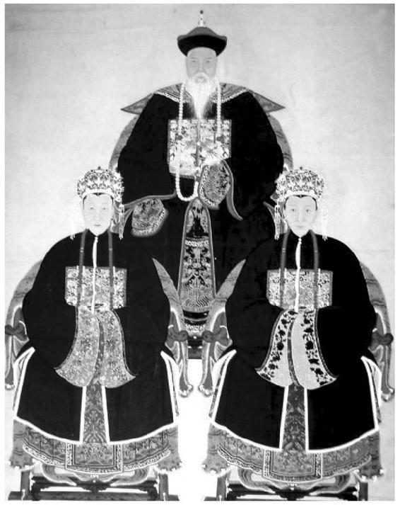
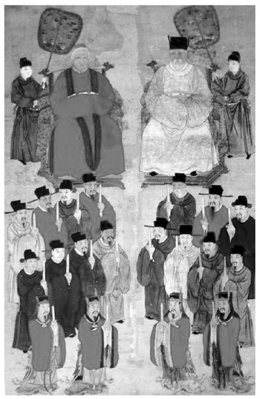
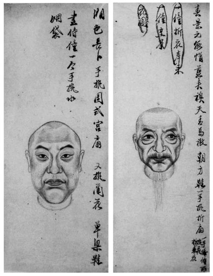
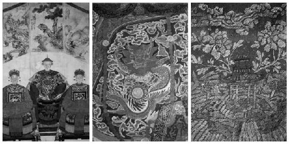
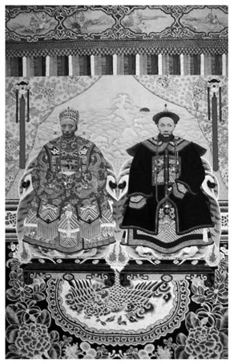
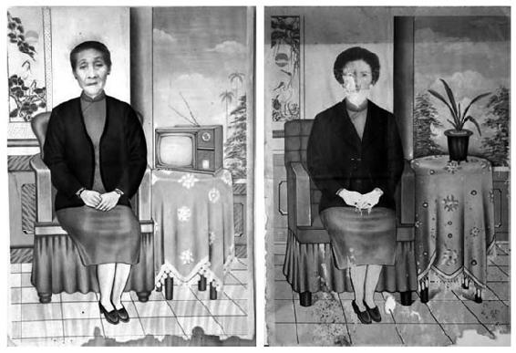
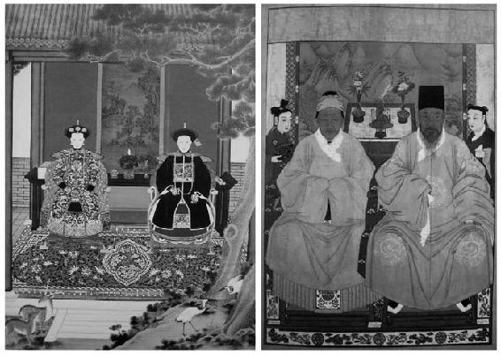

> [BREADCRUMB_CTX: 《考工记：工匠·功能·风格 (中国传统雕塑的复制与当代中国美术教育体系的建立系列丛书)》 > 三 色相美]

## 三 色相美

中国传统的丧葬仪式不仅过程繁复，还必须公告亲友，并甚至隆重地举办。[88]《杭俗遗风》云：“孝堂中悬神像。旁挂孝子挽联。灵桌供神主及男女佣人杯箸烛台之属。”[89]“影神”画就之后，先在孝堂悬挂，以供亲友吊祭，来自各方的挽联总是有许多对丧者生前品德的赞扬。出丧之时，“遗像”则放在“影舆”之上，随灵车而行。[90]通常祭祀行为不仅限于家族之内，诸如公祭与出丧都涉及公众层面，所以人死之后的“哀荣”是被特别重视的。从这个角度看，在这样一种场合，对于一个已经过世之人的画像，焉能不有所讲究？正因此，在没有照相机的时代里，遗像的绘制与这些行为之间就多少存在一些微妙的关系。此外，不管是为了“预写”还是“揭帛”，抑或是“追容”，这些画像作为“遗像”的预备，代表的也都是过世者的品德与体面。龚炜在《巢林笔谈》中说道：“为人作传状志铭，须如绘像肖其人方好。即加修饰，亦须存四五分真面目。”[91]对于刚刚逝去之人的遗容，或许基于亲属的记忆，还不至于有太大的更改，但是不管是替活人还是死人绘制容像，对画面容貌有所要求则应是人之常情。虽然未必一定与相术有关，但是对容像的刻意美饰与尽量肖似看来是同时存在的，而且这两者同样都属于世俗的需求，并不矛盾。

虽然遗像是以肖像写实为前提，但是前文也提到地域、风俗、习性也会造成遗像标准的多样性与复杂性。除了前文提到相术对画像的各种应用之外，也有人相学家曾经提及在中国传统中“相理美”与“色相美”的差异[92]，谓孔子曾说：“淡台子羽有君子之容，而行不胜其貌；宰我有文雅之辞，而智不充其辩”[93]，指出孔子看到的是“色相美”而非人相学意义上的“好相”。世俗之间通常也以外貌的美丑作为评价一个人的第一印象，而不一定是从相面的角度。小说《金瓶梅词话》描述应伯爵在韩先生对李瓶儿“揭帛”之前，特别提醒：“先生，此是病容，平昔好时，比此面容饱满，姿容秀丽。”[94]在小说《醒世姻缘传》中，晁源对画士所画遗像提出的要求是：“你不必管象与不象。你只画一个白白胖胖，齐齐整整，焌黑的三花长须便是。我们只图好看，哪要他像！”画士后来果然画了三幅看起来像是文昌帝君的像，而晁源还要求每一张的胡须都再加长数寸。[95]《扬州画舫录》中记载了丁义门替一富人宠姬画像的事迹：

鹤洲子以诚，字义门。传父业亦能精肖，四方来求者，远至数千里。某宠姬病，延之肖形，十余日改易六七次，姬视之，皆曰不肖。义门自视所画，则肖之极矣。明日至，不慕其形，自为绝色女子，姬笑曰肖矣，君真解人也。[96]

富人因为宠姬生病而延请画师为她画像时，想必已经病得不轻，面容或许已不是很好看。画师照着当时的容貌画，却再三被认为画得不像而被要求修改，最后终于领悟到宠姬的心意，以“不慕其形，自为绝色女子”之法，总算得到“君真解人也”的评语。这使笔者联想到汉武帝宠姬李夫人病重时说“夫以色事人者，色衰而爱弛，爱弛则恩绝”[97]的一段记载。我们虽不能将以上故事皆视为常态，但是被画之人不管是因为病重还是其他原因，希望留下一张美好形象永传于世（有时甚至不惜违背事实）则属人之常情。丁皋曾说：“写真之妙无法言传。”这个无法言传的部分大概也包含专业画师执业时，将会面临的那些来自不同世俗的需求及如何取舍的问题。为富人宠姬画像这一件事或许也让丁义门切身体会并感受到父亲丁皋那句话的深意吧！而对于那些在朝为官的人而言，朝廷授予的功名不仅是光宗耀祖的，且身着自己最华丽的官服，也对后代子孙起着激励的作用。这种隐然具有表彰功绩的含义，似乎又回到了古代“成教化”“助人伦”“明鉴诫”的用意上；不过却更着重于通过服饰的品级和正襟危坐的姿势来显示祖宗的威仪与功绩，从而取代了那些具有标准化象征意义的面容（见图3-16）。

图3-16 （清）兵部侍郎朱安沆夫妇容像

资料来源：摘自《徽州容像艺术》。

中国丧葬风俗铺张、越礼，自古而然。春秋战国时期，上至诸侯下至百姓，甚至以尚礼著称的儒家领袖孔子病危时，其弟子都预备以诸侯王的规格办理。[98]汉代明帝曾因此特意下诏：“……今百姓送终之制，竞为奢靡。生者无担石之储，而财力尽于坟土。伏腊无糟糠，而牲牢兼于一奠。糜破积世之业，以供终朝之费，子孙饥寒，绝命于此，岂祖考之意哉！……”[99]明代丘起凤于万历二十二年（1594年）在《风俗论》中说，当时“丧家全不考据典礼，镂花绘彩，极穷变工，且藻饰凉伞事，火炮狼烟，灼目震耳，不几怛化者乎！”[100]清代龚炜：“吴俗奢靡为天下最……家无担石之储，恥穿布素矣；团龙立龙之饰，泥金剪金之衣，编户僭之矣。”[101]清乾隆时，杨锡绂在《陈明米贵之由疏》中提到丧葬铺张现象不仅出现在通都大邑中，连荒郊农民也是如此。[102]清人阮葵生在《茶余客话》中记载了另一个有趣的故事：“淮上一明经病。其先代影帐皆庶人装。不壮观瞻。一日入肆。见门摊画片内有旧影像甚多，皆峨冠朱衣。作贵者装。明经流涕曰，此吾先代老祖也。捆载而归。岁时伏腊，装潢悬供，传示子孙，而家藏故物付之咸阳一炬。”[103]丧葬越礼的风气也连带反映在通俗小说里，如《醒世姻缘传》的第十八回中，晁源要求画士把“喜神”画穿攀肩蟒、玉带、金幞头，还说道：“我毕竟要另用一个款致，不要与那众人家一般才好。”画士道：“这却不难，我与画了三幅，一幅是朝服，一幅是寻常冠带，一幅是公服像。”最后晁源选择了其中衣着蟒衣幞头的供在灵前。[104]《醒世姻缘传》与《茶余客话》中的这两个故事虽看似荒唐，但不仅清楚地反映了古代丧葬奢靡风气所造成的越礼逾制与不计成本，更反映出中国传统观念中重视门阀、讲究望族的习气。姜伯勤先生在对敦煌邈真赞文与敦煌名族的研究中，就发现许多“虚引他邦，冒为几邑”的情形[105]，而这些种种因素所导致的现象也同时清晰地反映在祖宗画像上（见图3-17）。

图3-17 章子钧夫妇子孙容像

资料来源：摘自《徽州容像艺术》。

经由容像画稿，我们还能发现一些有趣的现象。从图3-18两件画稿中只有人物的头像来看，明确外貌显然是雇主最重视的基本的要求，外貌明确之后则是依照雇主的指定要求绘制画面中人物的穿着打扮，例如戴什么帽、着什么衣、穿什么鞋、手持何物之类，甚至还能见到要求画面中必须有花圃和侍仆。

图3-18 容像底稿

资料来源：摘自《徽州容像艺术》。

《金瓶梅词话》生动描写了西门庆对李瓶儿画像除了面容之外的其他要求：“俱要用大青大绿，珠翠围发冠，大红通袖五彩遍地金袍儿、百花裙……”[106]那些以画像为生的画匠们显然也深知其中窍要关键，从而尽量将画面画得富丽堂皇，以符合雇主的各种世俗欲求。有些甚至将衣服上织绣的痕迹都表现得相当清晰细腻（见图3-19）。不言而喻，而那些繁复的代表吉祥长寿的装饰图样不仅对于活人来说意义非凡，对于过世的亲人而言也能显示出一种威仪并且达到“壮观瞻”的效果（见图3-20）。对于画工而言，当然也可以表现出他们付出的心血与花费的工时，并由此获得更多的酬金。富丽堂皇的画面，也不必然就一定是虚荣的表现。中国传统注重吉祥、富贵、多子多孙等寓意，以图画的方式来象征这些意涵则是中国人所擅长的，例如牡丹代表富贵、松柏代表长寿或是高尚品德、鹿代表官运亨通、蝙蝠代表福气等。总之，福、禄、寿、喜越多越好，我们在这些祖宗画像里都可以感受到。而这些多种多样的寓意不仅满足了视觉，同时也经由视觉满足了雇主对于各种世俗的欲求。前文曾提到，画像的时机未必一定是等到人死之后，习惯上到一定岁数的老人，子弟也可以为他写真，一方面是为祝贺，如《颜氏家训》：“古人云：‘五十不为夭’”[107]，所以这种画像也被称为“寿像”以示吉祥[108]，另一方面当然也不免有点“预写生前真容”的用意。在另一个层面，这些画像中所表现的长寿、富贵与吉祥的象征，除了是对长辈的善颂善祷；根深蒂固的“人死有灵”的观念，也在此时起到一定的作用：即便是祖先已经死去，也希望他在另一个世界过得幸福美满。人们也总是希望穿上自己最体面的衣服或是值得夸耀的可以代表家族成就、富贵等的象征物以为纪念。像这些传统，一直到民国时代乃至当代都还能看到，例如在画面中画上一些代表吉祥的松鹤或是代表情操的兰花、代表平安的瓶子等图像。图3-21中的肖像画中则加入了电视机，电视机在此的意义显然不只是用来给画中的人观看，更多的反倒是转而变成一种体面的表现；随着时代需求的改变，也由此在传统画面形式中加入了新的元素。

图3-19 （清）朝服坐像与朝服画像

资料来源：摘自《央视论坛·收藏鉴宝》[109]。

图3-20 无款夫妇容像

资料来源：摘自《徽州容像艺术》。

图3-21 相片合成印刷肖像画

资料来源：摘自《台湾近代炭精笔遗像研究》。

前文也曾提及人们会将画像视为“分身”，而这种意识在那些被视为具有替代亲人功能的绘画上就更应该受到重视，并值得我们加以思考。在祖灵崇拜的信仰下，活人与亡灵之间的互惠行为被认为是存在的，有时甚至可以条件进行交换，例如周公在祭祖时就曾把祖宗当成谈判的对象：“尔之许我·我其以璧与圭归俟尔命·尔不许我·我乃屏璧与圭。”[110]又如《春秋左传》昭公七年：“鬼有所归，乃不为厉。吾为之归也。”[111]对祖先画像的安置除了孝思之外，同时意味着替亡魂建造一个安稳的居所以“聚其精神以求其嗜欲”。子孙不仅要时时祭奠，还要好吃好喝地侍奉。而那些祭奠之物也从现实空间中的供桌上逐渐转而进入画面之中，有些画像中甚至还加入了生活应用之物，如侍仆；画像从原本单纯的祖宗分身，变成了另外一种能够替代现实功能的虚拟空间（见图3-22）。

图3-22 双人夫妇容像

资料来源：摘自*Worshiping the Ancestors：Chinese Commemorative Portraits*。