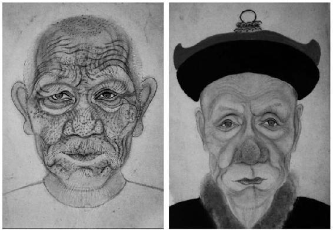
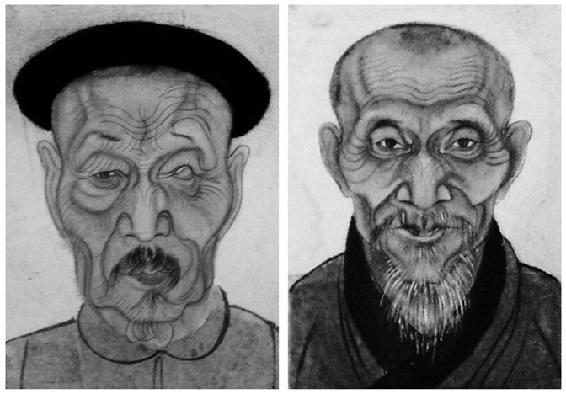

> [BREADCRUMB_CTX: 《考工记：工匠·功能·风格 (中国传统雕塑的复制与当代中国美术教育体系的建立系列丛书)》 > 四 对画稿的分析]

## 四 对画稿的分析

《徽州容像艺术》一书收集了许多画工遗留下来的容像底稿。经由对这些底稿的观察，可以发现画家不仅具有很强的写实能力，而且对画中人物面容的每一个特征都有极其详尽的描绘，有些甚至画得极为丑陋，使得肖像性的特征在这些底稿中表露无遗（见图3-23、图3-24）。虽然前文再三提到画稿必须如实照画的必要性，但是这种结果似乎不一定会全然地反映在完成品上，因为我们在那些正式的祖宗容像中没有发现任何一张达到像那些底稿一样极度写实的程度。我们怎么解释这种现象？

图3-23 容像底稿

资料来源：摘自《徽州容像艺术》。

图3-24 容像底稿

资料来源：摘自《徽州容像艺术》。

前文已经提及，画工常常只能是在短时间内对对象进行特征的把握与描绘，不一定能有宽裕的时间面对对象直到画像完成，往往是打完底稿之后再参照雇主的意见回去修改。如果从做工的角度和雇主与画工必要的沟通这两方面来看，在草稿阶段对外貌特征的如实记录甚至夸大，也许起着重要的作用或有重要的意义。

画工们能够轻易地利用相面术或是口诀解决基础性的比例问题，之后所要面临的主要困难实际上是来自雇主的审察，且进行审察的人往往还不止一个。《金瓶梅词话》中就描述韩先生画完李瓶儿的遗像底稿后，西门庆将底稿传阅，让其他人评论并发表意见。人多口杂自古而然，这对制作者来说显然是一个困扰与挑战。在众人对容貌的描绘都认可之后，接下来才是解决如何美化的问题，这再次深刻地体现出“不肖无足论”的重要性。在讲究“以形写神”的传统下，“形”与“神”最后该如何适当结合才能够让人感觉“似”？我们可以通过描写顾恺之画像后在“颊上加三毛，觉精彩殊胜”与僧惟真画曾鲁公时于眉后加三纹[112]所体现出来的道理可知，“似”的感觉主要来源于观者对一个人外貌特征或是性格特质的“印象”。由于有些业务必须凭借记忆或是在短时间内完成，所以对于画家而言，抓住对象的第一印象就相当重要。竹垞老人的一段话为我们提供了一些画工如何在第一时间把握对象的线索：“观人之神如飞鸟之过目，其去愈速，其神愈全。”[113]画工一方面要解决时间不足的问题，另一方面则要让雇主觉得“似”，那么在绘制底稿时刻意强调甚至夸张在这里就显示出有相当的必要性。经由强调，可以最直接地突显对象的外貌特征，这样不仅容易抓住顾客的认同心理，还可让顾客更易于提出一些比较具体的意见。从商品销售的角度来看，这不只是单纯为顾客着想，更多的是有利于画工自身的利益。模棱两可的意见不仅无法得出有效的结果，还会造成制作时间的延宕，更会增加两方闹得不愉快的风险，最后导致不欢而散。这对画价也许不会有影响，但是肯定会增加工时并使得画工丧失额外的奖赏和持续性的生意机会。还有一个重要的因素则是，俗语云“浙人像浙脸，吴人似吴装”[114]，在画稿上对这些特征的强调有助于画师离开绘制对象后继续作业，因为缺乏个性的面容在反复描绘修改之后便容易失真，对特征的强调能够在一定程度上让画工们在修改过程中适当地展现对象的个性。经由以上分析，并参看《徽州容像艺术》中的其他完成品，我们有理由相信画师或是雇主最后对画稿皆进行了一定程度的修饰与美化。