# 封面

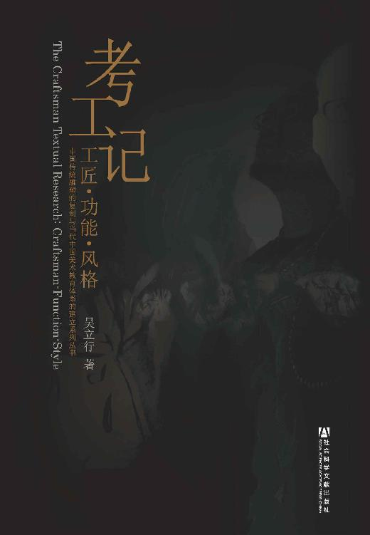

---

# 前折页

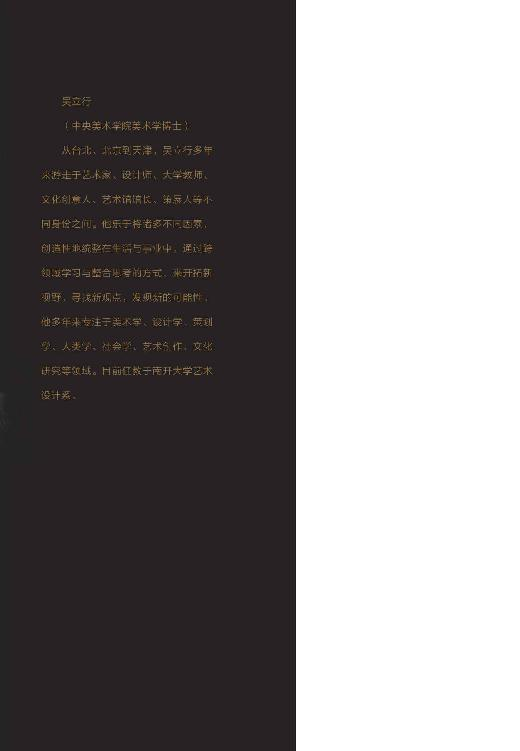

---

# 书名页

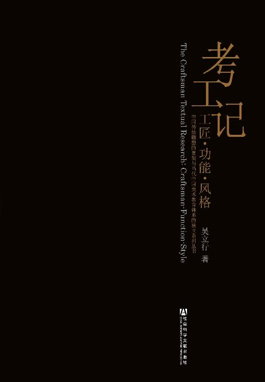

---

# 文前彩插

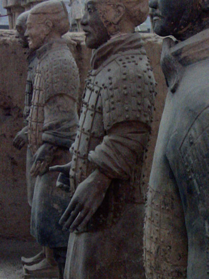

高真实度的手

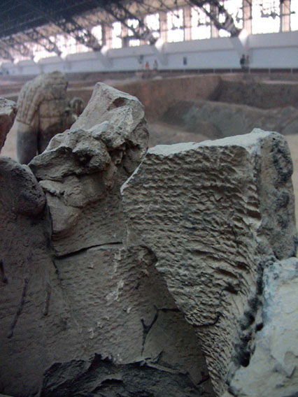

麻绳盘筑痕迹

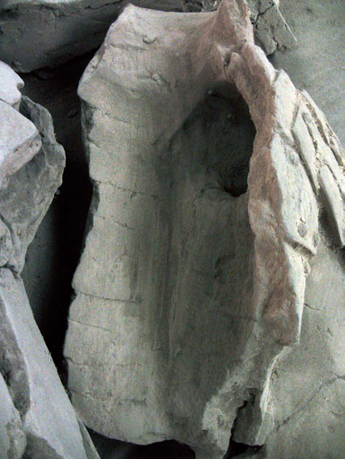

泥条盘筑痕迹

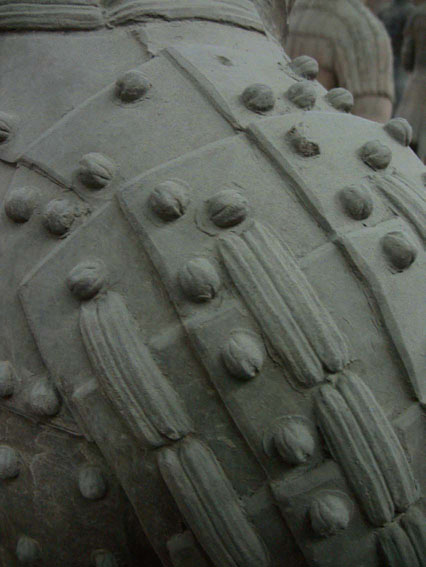

披膊特写

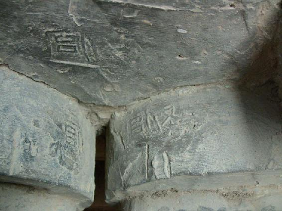

物勒工名

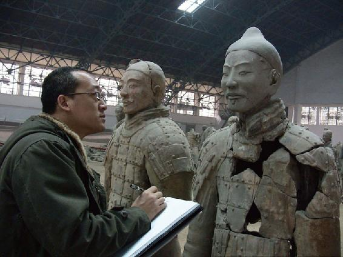

现场考察

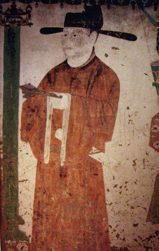

五代 榆16 甬道 曹议金官服

图片来源：《敦煌石窟全集·服饰画卷》，商务印书馆（香港）有限公司，页204

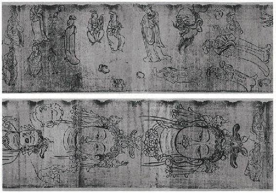

《画稿》Pel.chin.2002V°

图片来源：法国国家图书馆

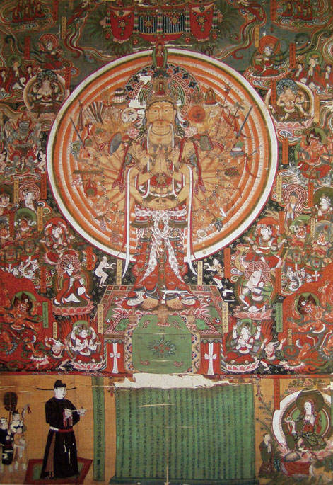

敦煌：绢画千手千眼观音图——施主樊继寿与仆从

图片来源：《敦煌石窟全集·藏经洞珍品卷》，商务印书馆（香港）有限公司，页148

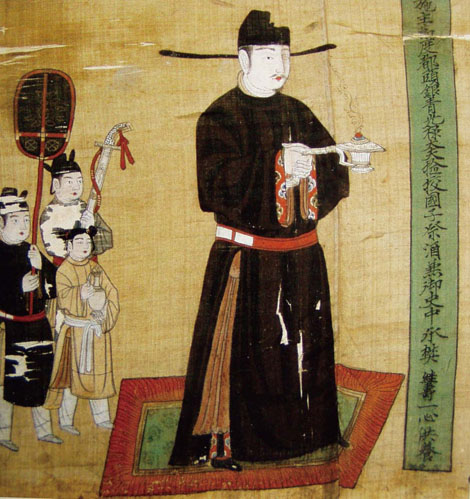

敦煌：绢画千手千眼观音图（局部）——施主樊继寿与仆从

图片来源：《敦煌石窟全集·藏经洞珍品卷》，商务印书馆（香港）有限公司，页148

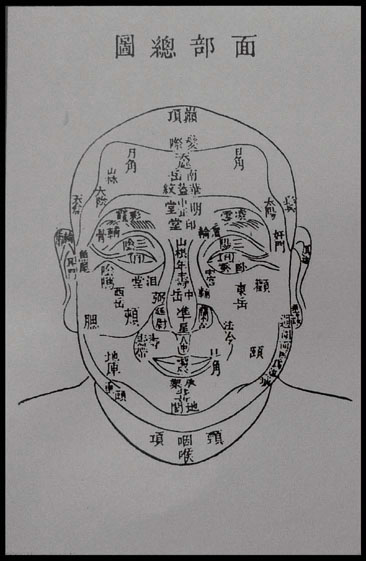

传真心领-浑元一圈图

图片来源：《徽州容像艺术》，安徽美术出版社

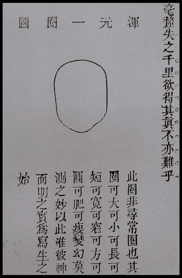

传真心领-面部总图

图片来源：《徽州容像艺术》，安徽美术出版社

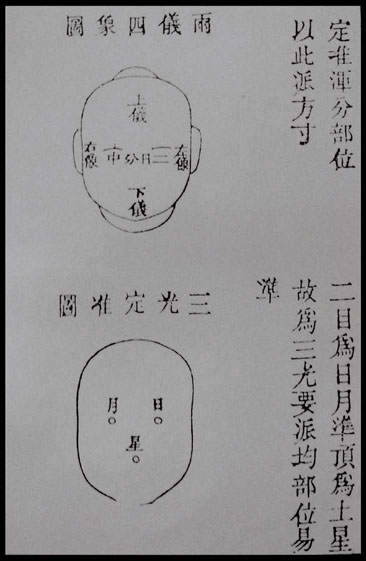

传真心领-两仪四象、三光定准图

图片来源：《徽州容像艺术》，安徽美术出版社

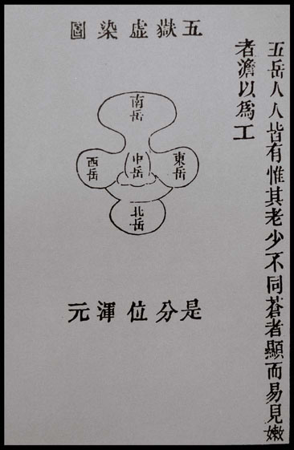

传真心领-五岳虚染图

图片来源：《徽州容像艺术》，安徽美术出版社

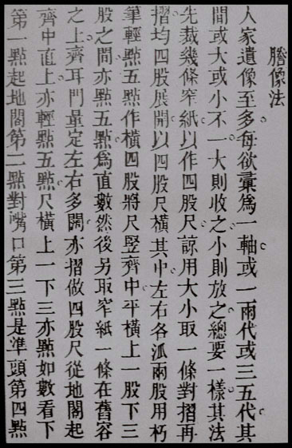

传真心领-謄像法

图片来源：《徽州容像艺术》，安徽美术出版社

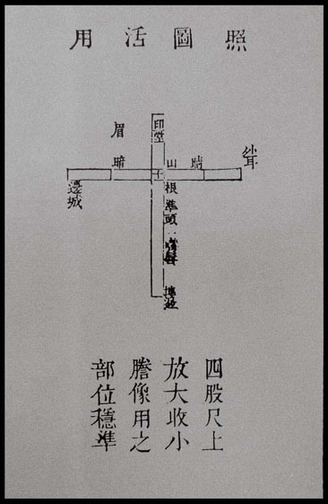

謄像法-四股尺

图片来源：《徽州容像艺术》，安徽美术出版社

---

# 自序

美国当代著名政治理论家塞缪尔·亨廷顿（Samuel P.Huntington）曾在1993年指出，继政治与经济意识形态之后，未来国际最普遍、最重要和最危险的冲突是文化领域的冲突。[1]实际上，文化战略的意识与实施，在人类文明发展历程中早已有诸多案例。较为艺术界所熟悉的，莫过于代表欧洲正统文化精神重建的“文艺复兴”与“新古典主义”。而美国“抽象表现主义”之兴起，并以此为标志，一举将世界艺术文化中心由欧洲转移到美国，则可视为其对自身文化精神创建的典范。文化战略的发动，似乎从来不只是基于单纯的文化诉求而出现。在当前世界各国（族群）对所谓“全球化”现象的诸多争议与忧虑的应对思考下，系统和策略性地营销文化，创造文化，掌控文化发言权，并以之作为在国际舞台上获取“政治”“经济”“科技”“人才”等各方面综合利益的方式来考量，显然就有其不言自明的价值与意义。更严肃地说，这也暗示了一场看不到硝烟的意识形态之争、世界创意人才之争、文化产业化之争，同时，还是一场全新的战略、战术与战争形态的转型之争。从这个层面来看，一旦将“文化”的发展“战略化”，也就或多或少表明了“艺术”的动向——将与国家文化发展的方方面面密切关联。近十几年来，有意识且系统地借鉴外国的经验，将文化建设上升为一种战略化需求，并将之作为专题进行研究，从而作为辅助国家发展与在世界舞台竞争的强大助力，似乎逐渐成为一股风潮，并受到文化、艺术、设计等相关领域的重视。

人类在生产方式、传播方式上的改变，虽然为各种不同文化与文明提供了更多交流的途径，然而，这些改变也使得原本地域文化间的平衡产生了微妙的变化。另外，“贸易”与“经济”需求所带来的文化多样性并存与全球化现象，则彻底改变了某些地区的原有文化结构。以上皆使人们在不同层面意识到文化危机存在的事实。笔者在2001年的研究中曾经提出与泰勒·考恩相近的理论[2]，即“同质化意味着有一群从共同的外界渠道接受共同信息的消费者，外界渠道可以是报纸、电视或互联网。然而，一旦这些个体进入拥有高度发达交流渠道的公共池（common pool），他们就会化分成为更加精细与多样的群体……气质的分化和局部气质的产生发展不需要消除同质化，它们能与同质化共存”[3]。但是，对于泰勒·考恩基于密涅瓦模式[4]，认为全球化对文化小区（cultural smaller）的伤害力较大，但是，小规模社会即便失去了自身的独特性，还是会以黑格尔式手法融入更广阔的文化潮流，从而丰富留存下来的较大文化实体，使其拥有复杂和多样的内在运作模式这一观点上，笔者却认为显然他有意地为以“创造性破坏”为前提的全球化所造成的实质文化伤害开脱。笔者之所以这么认为，是因为他所指的“创造性破坏”只是使某种文化在一个有限的空间当中，维系这个文化成就的表象层面。但是实际上，某几种文化的融合或消亡，显然无法作为提供给我们判断其是否可被替代或是可被预期的，以及在文化共存状况下孰优孰劣的参照。另外，文化的优劣与其是否能够得以延续之间，亦不存在绝对的因果关系。而最无法为我们所忽视的现实是，在经济、信息全球化后，文化的多样性并存现象虽然有许多来自地域性的创造，但是即便如此，许多族群也正面临原有文化及文明表述逻辑、环境消失的事实，例如现存的6000种语言，至少有一半可能在22世纪消失。[5]未来我们将如何看待那些失去了自身语言的传统文化与文明？而它们又将何以自处？

一种内容的消失不外乎两种原因，其一是文化小区自身竞争力的不足，其二则是对文化的自我舍弃。“现代传统是依作为价值标准的‘新’之诞生而开启的，因为‘新’在过去从来就没有被当作过价值的标准，而‘对新的迷信’使得现代崇拜紧紧包围着‘新’，并迫使人们疲于更新。”[6]这种对“新”的信仰，诚然使得人类文化在其自身的发展轴线中开辟出一条新的道路，并以人类文明得以更进一步而自豪。但值得思考的是，即便我们用“存在即是合理”这样的方式来理解并接受其存在的事实，但也应该在意这条所谓新的、进步的道路，有可能导致人们仅仅为了求“新”，而专注甚或是习惯于采取对过去进行片面的分割或是抽离的方式，并视其为一种进步的象征，使得在这样一往直前的线性思维中，视“突变”为一种绝对价值的忧虑。其结果则正是奥克塔维奥·帕斯（Octavio Paz）所言：“现代的传统就是调转头来否定自身的一种传统。……它在肯定艺术的同时又在对其加以否定，同时宣告了艺术的生命与死亡，崇高与堕落。”[7]实际上，哲学意义上的“艺术”是否死亡，虽然是值得深入探讨的议题，但也还只是关于艺术的创造“模式”与“性质”问题。在现实生活中，人类对艺术的需求与渴望并没有因此而减少，因为“艺术”的定义及版图不断地在变动与扩展，所以“艺术世界”在当今依然发展蓬勃；事实证明艺术不仅无处不在，还更加多样化。从理论上来说，人类显然无法完全抛弃过去的经验而进行纯粹的创新。那么，或许我们要随时思考，什么是艺术发展成就的决定性指标？如果说对传统知识的研究是创造行为中不可被忽视的一环，那么“新”及“进步”是否存在必然关联？还是只是其中的一种价值判断标准？我们应该站在一个什么样的角度来看待所谓的“进步”？或者以更开阔的视野来理解并反思艺术的“多样性”？并时时回望那些曾经为人类提供过美好心灵与物质生活的伟大艺术成就？艺术之所以死亡，恐怕是因为我们所遵循的一种价值体系导致我们无视艺术的其他价值并对它加以弃绝，而不是因其自身的终结。真正应该忧虑的，反倒是透过此命题体现出的这种线性思维方式所具备的跨越自身发展轴线并导致其他文化传统价值消亡的力量。

著名的德裔美籍格式塔心理学、美学代表人物鲁道夫·阿恩海姆（Rudolf Arnheim）在其对艺术与视知觉关系的研究中，对人类如何把三度视觉概念转化成两度的形式这样的难题进行探讨时，曾经引用了英国学者沙夫尔论述埃及艺术时所提出的观点，认为埃及人、巴比伦人、古希腊人、依特拉斯坎人并非如当时的学者们所认为的那样是因为透视缩短法对当时的学者来说过于困难而不知使用。他们之所以没有采用此种科学的方法，而偏好垂直投影法，是因为这种表现方式在真实再现视觉概念的层面上，更优于从一个固定观察点描摹或构造一个物体的形象的方法，因为它不仅能够同时表现人物双肩的对称性，还能够在脸的侧面展示眼睛的正面形象。而埃及人恰恰是在表现那些僵硬的、无生命的石头雕像时，反而选择运用了被当时的艺术教师们奉之为最能表现生命力的透视缩短法。鲁道夫·阿恩海姆对此的结论及观点是：“对于一个现代鉴赏家来说，埃及画中的那些人像，可能看上去是不自然的，其原因并不在于埃及人不能够把人体原原本本地复制出来，而是因为这些鉴赏家批评这些作品时，参照的是适合另一种方法的标准。一旦鉴赏者从这些偏见中解放出来，他们就再也不会轻率地宣布埃及绘画方法是错误的了。”[8]伟大的文明成就差点在一种单一的认知价值体系下面临消亡的危机。但值得庆幸的是，在几个不同领域的努力下，现代派艺术家及艺评家基于这样或那样的理由开始对儿童或不同民族的观照态度、表现方式加以重新认识与思考。从这一点来看，即便是现在，能够用理解的方式及勇气去接受不同标准的人依然是少数。而西方学者在自身文明遭遇困境及有其需要的时候，适时地跨出了探索与接纳的这一步，不得不让我们为之佩服。也难怪强势文化能够有效地利用甚或是挪用那些有价值的内容，整合进自身的文化气质中。

上述的文化现象显然也发生在中国近两百年的现代化过程中，甚至可以说中国现在正处于这样一个过程的后期阶段。文化战略的需求已经明显地浮出台面；从国家利益的角度而言，显然有必要从自身传统中寻找养分或者创造身份，并建构这种条件，以形成竞争优势。而这种优势如果不从自身的传统中寻找，就必须重新建构。中国在造型艺术上的成就具有厚实的文化竞争力基础，且经由考古学者的努力，至今仍然不断地发掘出令世人为之瞩目与惊叹的文物，可惜的是，发生在近百年中国的文化失落现象，却并非因为自身文化小区竞争力的不足，反倒恰恰是对于自身某一部分文化的蔑视与自我舍弃。如今，大多数人都承认中国艺术的价值，但是审美判断体系及审美教育体系却显然已经出现了断层。中国人自身几乎已经丧失了读懂自身民族艺术语言的能力，这不仅发生在一般民众中，相信也发生在专业的美术院校的教师团队中。在这个大的前提下，我们过去做什么已经不重要了，重要的是我们现在开始要做什么？因为我们已经走出19、20世纪混乱的过去，现在“要做什么事”变成我们所要进行的。回到以前是不可能的，但是我们应该把有价值的东西还原出来。在文化传承这个问题上，笔者认为应该思考怎样将传统保留下来，然后让年轻的一辈去继续延伸下去，这才是文化传承的意义，而不是一直维持那些所谓的传统形式。抛开当前文化政策的诉求，即使我们是在一种重新认识自身文化的基础上，采取透过美术教育的方式来重新发现文化价值，这对于文化传承、文化创新、文化竞争力的自觉训练而言，也依然是相当具有策略性眼光与必要性的。现在，考古成果为我们提供了许多新的内容，我们应该如何利用这些新的发现对其进行研究，并以之重新认识、发现更多的可能性？笔者认为建构一套系统的认识中国自身艺术语言的教学体系，其重要性是不容忽视的，且显然有其紧迫性，尤其在造型语言的解读与训练方法上。虽然传统造型具有指标性，然而我们也不应该片面地停留在那上面，应该是从文化的层面与造型语言的探索切入，而不仅仅是外形与工艺。传统艺术语言与教学体系的建构只是我们获取文化发言权的一个阶段，也就是说：从传统的格式进入现代生活这个意义。我们若要介入这个环境，就必须思考它的背景，我们不能一意用我们的心态而不考虑整个环境。艺术与文化研究如果脱离环境的配合的话，或许是一个很特别的感觉，虽然在整个环境的变迁下，什么都有它的可能性。任何的思考也都有它初期的不成熟与后期的成熟面，这只能让时间来建构，而每一个年代应该有它自己的思维。思维的方式则是建立在生存的空间之下的，如果我们有机会接触那些珍贵的文化遗存而有认同并有依据的对象，我们才可以建立；如果没有舞台，那就完全没有概念，文明也就不可能继续存在。

随着“艺术”涵盖的范围越来越广，中国古代的工匠与那些他们制作的具有各种不同功能的“文物”，也陆续被分门别类地列入“艺术”的范畴，并越来越受到艺术界以外的学界关注。实际上，不管工匠在当时或今日是否被视为“艺术家”及其制作物是否被评断为“艺术品”，我们仍然能敏锐地感受到工匠群体与工匠作品具有大量且丰富的艺术与造型方面的议题。目前，传世的工匠作品不仅数量庞大、种类繁多，而且随着考古活动的持续进行，仍不断有大量的“文物”出土。经由那些考古的新发现，我们对工匠的历史及其作品有了新的理解和看法。

本书的写作思路在一开始，就是希望透过某种途径来思考跨学科间相互关联与协作的可能性，并期望能够在研究方法、研究内容上对美术学有所助益。于是，笔者开始尝试以制作者的视角为出发点，着手从造型外观与制作工艺方面对工匠作品进行观察和分析。然后，循着实践过程中可能会遇到的问题及作品外貌所展现的线索，进一步深入寻找较为合理的答案。在此过程中，不可避免的，笔者需要借鉴历史学、考古学等相关领域的研究成果，同时也需要参考其他诸如社会学、经济学、材料学等看似无关的领域来加以关联。因为笔者的目的并不在于建构一个体系，所以本书并非“史”的研究，不打算采用传统艺术史的编年与陈述方式。因此，在本书的整体架构上，笔者设定了从官方需求、制度化宗教与世俗性需求三个不同层面对工匠进行观察。对应的材料则是秦俑、敦煌画稿及明清时期的部分祖宗容像。每一组材料着重展示的是工匠活动的不同侧面，是对工匠的作品在“功能”与“风格”之间到底是一种什么“关系”的探讨，而非绝对的“因、果”关系的探讨。笔者期望透过这种观察方式来寻找、发现、思考古代工匠阶层在制作技法延续、思想传承的外在条件与内在动因间存在关联性的可能性。经由不同层面的揭示，逐渐丰富结论，逐步勾画出工匠这一艺术文明发展范畴中重要群体的轮廓。最终，这实际上是对古代工匠研究在方法上的一种反思与尝试。同时，也以此来重新审视作者和作品、作品与社会之间复杂的相互依存关系。

---

[1] 〔美〕塞缪尔·亨廷顿（Samuel P.Huntington）著《文明的冲突与世界秩序的重建》，周琪、刘绯、张立平、王圆等译，新华出版社，1998，第7页。

[2] 吴立行著《演变中的中国传统绘画——重构传统造型后在创作中显现的新表征》，台北市立师范学院学位论文，2004，第30页。

[3] 〔美〕泰勒·考恩著《创造性破坏——全球化与文化多样性》，王志毅译，上海人民出版社，2007，第79页。

[4] 〔美〕泰勒·考恩著《创造性破坏——全球化与文化多样性》，王志毅译，上海人民出版社，2007，第67～80页。密涅瓦模式是指文化的最初交流会产生创造力的繁荣，在从贸易中获利的同时，随着时间的流逝，大文化逐渐打乱小文化的内部平衡，次级文化因此开始调整其喜好，最后失去自身的独特气质，导致文化的衰落。

[5] 〔美〕泰勒·考恩著《创造性破坏——全球化与文化多样性》，王志毅译，上海人民出版社，2007，第76页。

[6] 〔法〕安托瓦纳·贡巴尼翁著《现代性的五个悖论》，商务印书馆，2005，第3页。

[7] 奥克塔维奥·帕斯：《会聚点》，载〔法〕安托瓦纳·贡巴尼翁著《现代性的五个悖论》，商务印书馆，2005，第2页。

[8] 〔美〕鲁道夫·阿恩海姆等著《艺术与视知觉》，滕守尧、朱疆源译，四川人民出版社，1998，第131～134页。

---

# 目录

* 引言
* 第一章 官方需求对“工匠”制作技术与风格的影响
  + 一 对秦俑外貌的观察
  + 二 官方的需求
  + 三 制作者的选择与身份
  + 四 秦俑的制作方式与工匠的造型意识
  + 五 关于秦俑“千人千面”及其制作方式的思考
  + 六 小结
* 第二章 制度化宗教对“工匠”制作技术与风格的影响
  + 一 敦煌遗画《头像》
  + 二 敦煌遗画《白画供养人物稿》
  + 三 敦煌对工匠在“量”与“质”上的需求
  + 四 工匠的经济状况与自我提升
  + 五 雇主的需求与经济能力对工匠的影响
  + 六 小结
* 第三章 世俗性需求对“工匠”制作技术与风格的影响
  + 一 写实的需求
  + 二 应用技法
  + 三 色相美
  + 四 对画稿的分析
  + 五 小结
* 结语
* 附录 中国古代“工匠”研究的现状与回顾
* 参考文献
* 致谢

---

# 引言

随着“艺术”涵盖的范围越来越广，中国古代的工匠与那些他们曾经为了不同目的而制作出来的具备各种不同功能的“文物”，也越来越受到与艺术相关的不同学科领域的关注。之所以如此，不仅在于工匠作品所透露出来的大量信息印证了文献的记录，弥补了文献的不足，而且在更大程度上因为它们直接以文物的身份存有，让我们觉得它们比文字来得更加真实。姑且不论工匠的制作目的与其制作物在当时是否被视为“艺术”，仅从工艺或是审美的角度来看，我们仍然能敏锐地察觉与感受到其中存在着大量丰富的艺术与造型，甚至制作者的情感表现等方面的议题。也正因为如此，它们被陆续且分门别类地列入了“艺术”的范畴。实际上，传世的工匠作品已然数量庞大、种类繁多，而且随着考古活动的持续进行，仍不断有大量的“文物”出土，而经由那些考古的新发现，我们对工匠的历史及其作品也有了新的理解和看法。笔者认为这值得我们对制作者及其作品加以探讨、研究。本书写作的动机主要来源于对以下两个方面的思考。

（1）基于艺术创造的需要。古代文物所显示出来的艺术或是造型与古代工匠的制作有密切的联系是不可否认的事实，虽然不能就此将艺术家与工匠完全等同起来，但是基于对存在于古代文物中的艺术特质的关注，笔者很自然地对工匠系统的运作机制、制作动机、思想方法、环境与社会的互动和作品风格之间的关系产生了兴趣。对这些问题的探讨，有助于笔者对“文化”、“传统”、“社会”与“艺术”之间的关系有较深刻的思考，并对艺术创造起到积极的作用。

（2）基于对工匠研究方法的思考。古代工匠们的制作动机、制作性质与制作目的总是基于特定的供需关系而展开。在传统的美术史中，对工匠作品的风格谈得较多，但是对于作者，相对来说谈得较少。主要原因还是在于工匠大多名不见经传，更遑论能够在古代文献中找到像文人画史、画论那样对个人生平进行详尽且系统的记载。我们虽然总是能够经由大量的工匠作品感受到工匠的真实存在，但是我们对工匠的理解却大部分建立在制作物上，而不是制作者本身上。从这一方面来看，工匠对于大多数人而言，有时就像是一个缺乏“个性”的“虚体”，而非真实存在的“实体”。我们在传统的美术史、鉴藏史、品评中也可以发现，撰写者往往不是他们所谈论对象的作者或实际从事制作的人，更不属于工匠系统的一分子。他们论述的方式更多的是采取一种后者的观点、使用者的身份或他者的眼光来看待工匠的制作物并对其进行论述。若从《历代名画记》这样的美术史著作来看，其架构以作者和作品为主，但是现有的大量的考古材料，有很多作品没有作者。我们应如何衔接这两个系统？我们怎样去理解这些新出土材料风格的意义？现在的考古学或美术史研究对于这些材料较少谈论作者的问题，我们有没有可能受王国维“双重论证法”研究的启发，对古代文物进行更深入的考察，然后把“人”的因素加进去？这样或许有助于这两个系统之间的整合。

本书是以中国古代工匠为主体的研究。“工匠”这个名词本身具有一种宽泛与变动的特性；之所以宽泛，在于中国现存成书年代最早的手工艺专著《考工记》[1]，已经将社会组成概略划分为六种职类：“王公”、“士大夫”、“百工”、“商旅”、“农夫”与“妇功”[2]，所有从事制造生产的行业几乎都归为百工。《文子·征明篇》将天地之间分为二十五等人，其中的“次五等人”为“士人”“工人”“虞人”“农人”“商人”，“工人”位列第二。[3]P.2518号敦煌文献——唐代后期的《二十五等人图并序》中对“工人”的定位是：

工人者艺士也，非隐非仕，不农不商，虽有操持之劳，信谓代之妙；或专粉缋之最，或在医巫之能，百伎无妨，济身之要，华他（陀）负千右（古）之誉，般业有百代之名；祿在其中，工人之上，虽无四（士）人之业，常有济世之能，此工人之妙矣。[4]

上文认为工人是具有某种特殊技术的艺士，同时承认这一类人就如同士人或其他职业者，同样拥有济世的能力。这里对工人的界定虽然未必与《考工记》中的“百工”完全相同，但显然有相当一部分的重叠。如果我们从其所拥有的社会价值来看，即使是在现代社会，百工仍然是维系社会建设与运作的重要组成部分。综合上述，“工匠”这一名词是一种统称，泛指具备特殊制作技术的人才或以其制作技术为职业的阶层。若从制作的动机与目的来看，工匠的制作行为大多出于统治阶层的授命或应出资者的“需要”而“供应”，呈现出明显的“职业性”与“被动性”。不过，我们也不能忽略工匠的制作仍牵涉到一定程度的商业行为。从商品的角度来看，技术的高低和制作是否精美虽是两个概念，但同样都是能否吸引顾客的关键，一个关系到应用技术，另一个则关系到“审美”，而这些显然都不是只出于单方面的。此外，社会本身就是一个具有变动性与多元性的综合体，内含着促使工匠进步的多方面因素。工匠作为社会的一部分，必然受到大环境的多方面影响，工匠制作的那些传世作品及考古发掘出土的文物所展示的高超技术与精湛的造型能力，提醒我们必须格外谨慎，不能轻易地将工匠定位在缺乏自主性与创造性的阶层。值得注意的是，当制作者的制作行为与制作目的脱离了原本社会对制作者所定位的身份阶层特质时，代表作者身份的意涵也会随之产生微妙的变化，明显的例子如敦煌遗书《乾德四年（966）五月九日归义军节度使曹元忠夫妇修北大像功德记》（CH.00207）[5]中有关当时的河西节度使在五、六月间组织重修莫高窟北大像96窟前五层楼阁下两层的记载：

……助修勾当，应管内外都僧统辩正大师紫赐钢惠、释门僧正愿启、释门僧正信力、都头知子弟虞侯索幸恩、一十二寺每寺僧二十人；木匠五十六人、泥匠十人……

通过此段记载可以看出，施工人员不仅有木匠与泥匠，还有更多的僧人。显然，我们不能说那些帮忙的僧人是工匠，但有趣的是，就当时的行为本质而言，那些僧人确实无异于工匠，虽然他们的社会身份并不会因此而改变。而当那些僧人暂时从属于工匠系统时，我们也有理由相信，他们必须听命于工匠中的高层，而且在技术层面甚至还逊于一般工匠。另一个耳熟能详的案例则是关于唐代阎立本的记载：

立本虽有应务之才，而尤善图画，工于写真，《秦府十八学士图》及贞观中《淩烟阁功臣图》并立本之跡也，时人咸称其妙。太宗尝与侍臣学士泛舟于春苑，池中有异鸟随波容与，太宗击赏数四，诏座者为咏，召立本令写焉。时阁外传呼云：“画师阎立本。”时已为主爵郎中，奔走流汗，俯伏池侧，手挥丹粉，瞻望座宾，不胜愧赧。退诫其子曰：“吾少好读书，幸免墙面，缘情染翰，颇及侪流。唯以丹青见知，躬厮役之务，辱莫大焉！汝宜深诫，勿习此末伎。”立本为性所好，欲罢不能也。[6]

正是因为在当时，阎立本的身份因为行为的意义被改变，让他瞬间变成了一个工匠，所以他也因此认为“辱莫大焉”。关于工匠的社会地位，我们在此暂且不论。如果仅从行为意义这个角度来看，那么对于制作者身份的归属问题，我们或许可以从另一种角度加以思考。文人作品通常总是与社会保持一段距离，但工匠作品不同，它们更多的是基于一种供需关系而产生。从这一点来看，工匠的制作更多的是对整个社会不同需求与制度的多方面反应。从行为的本质加以界定的方式，可以让我们暂时将制作者到底是否为工匠放在一旁，直接通过文物本身的制作痕迹、所属功能、造型风格与当时的社会环境所提供的各方面线索对制作者进行探讨。另外，社会对制作者的不同称呼，例如“画家”“画师”“画匠”等，似乎也会对本研究对工匠的界定造成影响。不过《历代名画记》中记载吴道子、韩干等人，在画寺院壁画时，常常是勾了线稿以后由弟子或其他画工进行填色。例如张彦远对吴道子画净土院院内次北廊向东塔院内西壁、韩干画宝应寺填色的评价为：“吴画金刚变，工人成色，损。”“佛殿东西二菩萨，亦干画，工人成色，损。”[7]这表明就算是填色也有高低之分。从这个角度来看，笔者认为“工匠”这个名词是具有变动性的，工匠系统显然有许多不同的层次。本研究是从制作行为的本质来加以认定工匠的，并将之视为一个大的社会群体来理解，不同的称谓在此并不影响对工匠身份的认定，即便整个制作过程必须依靠一个群体或多个群体才能完成。

笔者的目的并不在于建构一个体系，也不在于撰写艺术史，而是从艺术实践中所遇到的问题出发，期望借历史学、考古学及相关学科的研究成果做到以下几点。

（1）重新审视艺术工作者和作品以及作品与社会之间复杂的相互依存关系。

（2）对古代工匠制作技法延续、思想传承的外在条件与内在动因进行思考。

（3）对古代工匠研究在研究方法上进行反思与尝试。

对于本研究的可行性，笔者的观点主要来源于以下两个方面。

（1）工匠与文人艺术的系统不同。像《历代名画记》这样的艺术史，其组成结构是“人”“作品”“风格”；文献（文字）的重要性当然无可置疑，但是文献本身也有其局限性与片面性，它所能提供的只是某个时代某个阶层的某种观点。工匠系统是与以文献证据为主所构筑出来的文人系统互相并列且具有同等重要性的另外一个系统。既然有关工匠的记载不见于以前的文献，那么或许我们也不能寄望将来会有新的记载被发现。在记载几乎不会再增加的前提下，研究限制也许不在于文献的不足，而在于我们未在观念、视角、思路以及操作方式上加以转换。如果加以转换，那么这个研究就可以成立，否则永远不能研究，而这正为我们提供了采取不同于传统文人画系统研究方法的合理性。

（2）作品本身便具备成为证据的条件。目前对商周青铜器或秦汉漆器的研究，都通过对作品及其周边遗存的观察直接为工匠活动提供了不同于文献的实证材料，使我们对当时的工匠活动有了更深入的了解。当我们对缺乏文献材料的领域，尤其是对作者进行研究时，作品本身显然扮演了举足轻重的角色。通过对作品本身、制作者所留下的痕迹、工匠活动的各个侧面加以分析、整理，扩大“文献”概念的范围，或许能提供有别于文字证据的研究依据。

本书的取材与研究方法

本书不是对“史”的研究，所以也不以“史”的形态呈现，而是以问题的方式列出可能具有影响力的因素，并对作品依工匠所处环境、时间、地域分布等进行比较与观察。如此，每一组材料着重展示的将是工匠活动的不同侧面，偏重的将是对工匠作品功能与风格之间的关系的探讨，而不是对“因、果”关系的探讨。笔者将针对若干可能影响工匠作品风格的要素，选择较具代表性的题材进行观察并提出问题，再通过若干分组材料来揭示不同层面，最后经过对这些不同层面的揭示，逐渐丰富结论。笔者之所以选择具有“象人”功能的人物作品作为对工匠进行研究的媒介，主要有以下五点理由。

（1）这类“形”“象”具有悠久的发展历史与深厚的文化底蕴。

（2）这类“形”“象”必须经由雇主的认可与授权才能具备生命。它们还必须存在于特定的场域才能发挥其功能。以此为研究媒介能够丰富此艺术研究在人类学、社会学、文化思想史与哲学上的意义。

（3）这类“形”“象”都是以人为对象，以雇主的需求为前提而制作，而且被要求具备“人”的特征与属性，在某种程度上可以说是雇主和工匠的共同创造。这为理解雇主与工匠双方的微妙互动关系提供了另一种特殊的、不同于文字的观察途径。

（4）人类对于类似自身的“形”“象”，在感受与理解上必然比较敏感。从工匠的角度而言，在“形”“象”的表现过程中易于产生共感与移情作用；从雇主的角度而言，在“形”“象”的造型要求上应该会比较精细和明确；从研究者的角度而言，有利于对“形”“象”的风格进行多层次的解读。

（5）这些“形”“象”所表现的对象及内容都与当时的人、事、物关系密切。这有助于扩大文字材料的搜集范围，并为与当时的社会生活、思想史进行交叉比对与相互印证提供了可能。这为我们了解古代工匠怎么处理与理解“人”的问题提供了丰富的材料。

本研究过程中遇到的最大困难是缺乏有关工匠的文献材料以及在研究方法上可能出现对历史的片面切割与撷取。以下将对这两点的解决方法进行说明。

（1）实证性：直接针对作品本身进行深入的实证与定量的观察、统计和比较，包括对其数量、大小、重量、样式、风格、制作环境、制作程序、运作机制、社会关系进行考察。经由这些分析，可以得到不同于文字的实证材料，将原本存在于作品中却不以文字形式呈现的证据数据化、文字化。本研究拟选择性地采用田野调查模式直接对作品进行考察，避免推想的成分，增强论述的实证性与合理性。

（2）旁证与推衍：除了借鉴美术史与考古研究成果之外，本书还将结合文化史、文明史、思想史、社会史、经济史、工业史等研究成果对实证性研究结果进行验证与补充。

（3）以共性推导个性：经由实证与旁证推衍所得的结果，形塑出的是一个集团或一个群体的年谱与风格，以共性代替了个性。这样有助于在写作过程中与传统的研究模式进行相互的参照，因为传统的文人画研究系统有其完整且独特的学术传统与论证方法，这必然有助于写作过程中对方法的思考与问题的解决。

（4）转换取材的标准：聚焦于“形”“象”的共同特质，以作品的功能作为取材的标准。这么做的原因在于可以扩大材料的时空范围，尝试以此解决每一种作品制作者文献记载不足的缺憾，并减少对本研究方法中取材过于宽泛的质疑。

本书章节结构的安排可以从纵向的取材和横向的展开这两个交叉的层次加以说明。纵向的取材首先是确定以中国古代工匠作为研究对象，其次选择具有“象人”功能的人物作品作为对工匠进行研究的媒介，再次则是通过工匠所面临的不同处境（环境）对其进行观察。横向的展开则是基于工匠所处的环境进行观察而做的更具体的选择与取材，选择的三个案例分别是“秦俑”、“敦煌画稿”与“明清祖宗像”。从文化的角度来看，思考跨度涵盖墓葬与陪葬、宗教及祖灵崇拜三方面。从社会学的角度来看，则是对工匠所处的官方集权体制、严格意义下的制度化宗教及世俗社会三个不同层次的条件背景进行考察，观察其间的差异对工匠这一领域所造成的不同层面影响。总的而言，秦俑的制作更多的是涉及一个人死后的需求，其存在的空间是封闭性的，制作者是在相对短的时间内被官方组织起来完成这项任务的。敦煌的画像则具有一种持续不断地替功德主积累功德的作用，它并非是为了满足功德主在死后世界的需求而作，反倒是为了帮助功德主脱离死后的世界，涉及的是对另一种更好的生命形态的愿望。而敦煌的工匠，无论是个人还是团体，都是在一个对作品题材类型的需求相对长久、稳定且长时间具有严格意义的制度化宗教的环境下而存在的。祖宗像则象征着活着的人与亡者之间的另类“沟通”方式。雇主与画中人物不仅有相当近的亲缘关系，而且基于孝思和祭祀的礼仪，家属必须经常面对画像，整体而言反映出更多世俗化与生活化的层面。祖宗像的制作者大多是以个体为单位，并且处在一种更加开放的环境下，以更独立、灵活的方式作业。笔者期望经由这样的交叉对比，能够更多地体现出“作者”“作品”“社会”“风格”之间的关系，并透过材料，对那些可能造成工匠制作及影响制作风格的线索进行观察与比较，同时给予此研究以较充分的合理性和较广泛的论述空间。在这里，作品所具备的共同“功能”成为衔接每组材料的重要媒介，而那些对作品的各种不同“需求”则是基于作品的“功能”而产生。采取这种方式的理由是，笔者希望整个思考过程是由材料来引导，而不是套用一种理论模式之后得出一个预设结论。最终，经由不同案例中的作品所显示的结果，逐步勾画出工匠的一部分特质与轮廓。虽然从严格的身份定位与名词意义来说，艺术家与工匠显然并不能等同，但不可否认的是，他们都是实际的制作者，即便从是否具有原创性这一点来看，他们确实也仍有许多互相重叠且不容易区分的部分。正因为如此，笔者认为若是从作者的角度对作品与其制造过程之间的关系进行观察与解读，也许能够寻求一种有别于传统的视角，并在一定程度上跳脱习惯的观看模式。就学术而言，这将有利于新观点的产生。

对于本书各章节的具体内容所涉及的相关研究，笔者将在每一章节前选择与论述内容关系最密切的成果加以简单介绍，其他引用或参考研究论述则详见于各章节注释。作为后学之人，笔者期望利用前贤在各方面的研究成果来尝试解决这个时代所面临的问题。

---

[1] 据闻人军先生考据，《考工记》成书于战国初期。但也有持其他看法的，如郭沫若认为《考工记》成书于春秋末年，梁启超认为成书于战国后期等。参见闻人军《〈考工记〉成书年代新考》，载闻人军译注《考工记译注》，上海古籍出版社，1993，第144～153页。

[2] 闻人军译注《考工记译注》，上海古籍出版社，1993，第117页。

[3] 王利器撰《文子疏义》，中华书局，2000，第337页。

[4] 《二十五等人图并序》（4-3），载上海古籍出版社、法国国家图书馆编《法藏敦煌西域文献》（第15册），上海古籍出版社，2001，第68页。断句及括号内释文参见马德《〈敦煌工匠史料〉补遗与订误》，载香港新亚研究所敦煌学会编《敦煌学》（第25辑），香港新亚研究所敦煌学会，2004，第297～298页。

[5] 中国社会科学院历史研究所、中国敦煌吐鲁番学会敦煌古文献编辑委员会、英国国家图书馆、伦敦大学亚非学院编《英藏敦煌文献（汉文佛经以外部分）》（第14卷），四川人民出版社，1995，第183页。

[6] （后晋）刘昫等撰《旧唐书》（第8册），中华书局，1975，第2680页。

[7] （唐）张彦远撰《历代名画记》（卷3），载于安澜编《画史丛书》（第1册），上海人民美术出版社，1963，第41、43页。

---

# 第一章 官方需求对“工匠”制作技术与风格的影响

——以秦俑为例

古代有一些工匠是专门从属于宫廷机构或地方官府作坊的，在某些特殊的情况下，一些官方的重要工程也会征召民间工匠参与。在以官方需求为主要考虑因素的前提下，工匠们往往必须遵循一套普遍、共同的标准和规范进行制作；当然，也可能因某些特殊的需求，他们必须借鉴其他领域的经验，或开发一些自己并不熟悉的技术来完成任务。而这或许对制作技术、运作方式的发展及作品风格的产生起到直接或间接的重要作用。秦始皇陵兵马俑便是符合此条件且极具代表性的例子之一。

目前，在制作工艺方面对秦俑进行了最为详尽的研究的著作包括：始皇陵秦俑坑考古发掘队和陕西省考古研究所在总结1974～1984年对秦始皇陵兵马俑坑一号坑的考古成果后合编的《秦始皇陵兵马俑坑一号坑发掘报告》（上、下册）[1]、袁仲一先生著的《秦始皇陵兵马俑研究》[2]及张卫星、马宇先生合著的《秦甲胄研究》[3]。此外，王学理先生的《秦俑专题研究》[4]则主要是对秦俑所显示的军事、兵器、军阵制度等有相当详尽的探讨，虽然其中也有部分内容涉及相关的制作工艺，但他是从造型艺术的角度对秦俑与汉代陶俑之间的差别和延续性进行了分析。以上这些具有代表性的著作，为秦俑的研究提供了相当丰富的参考资料及重要的数据；但遗憾的是，这些研究在对秦俑制作工艺进行探讨时，所运用的图像材料大多是线描稿而非照片。从考古的角度而言，采用线描的方式当然有其学科特性与专业上的必要意义，但是线描无法表现体量感、质感、真实感、临场感及制作者在制作过程中运用手或工具时的微妙变化和一些更细微的痕迹，例如那些经由器物刮削形成的线条的深度与斜度、转折或停顿，都不能完全依靠线条说明清楚。这些限制就使得从制作的痕迹入手对工匠的制作状态进行考察存在某种程度的困难。为了对此议题有更深入的观察，笔者亲自对兵马俑一号坑修复区中的部分陶俑进行了实地考察、搜集标本，并借助前贤的研究成果，探讨工匠在官方需求下的运作方式对作品所造成的影响，并进一步思考其中所显示出的古代工匠解决问题的能力和工匠系统中一种非自觉性因素所造成的风格形式及来源依据的可能性。

---

## 一 对秦俑外貌的观察

在进入讨论前，对秦俑的观察是必要与重要的。笔者将对一号坑修复区的陶俑进行观察，然后列出一些问题并以实际考察所得的照片作为后续论证的依据。当我们直接面对一群类似真人大小的陶俑时，制作工艺的优劣是不容易立刻被辨识的，但是比例外观的差异却非常容易在第一时间被眼睛所察觉。王学理先生在其研究中曾经提及一些秦俑在造型比例上异常的例子，如短颈压肩、窄胸猿臂、手大特甚、臂短及腰之类，但可惜都没有图片参照。[5]《秦始皇陵兵马俑坑一号坑发掘报告》（上册）也提到了这种现象[6]，但是下册的图录在这一方面也只有少量的图片。目前对于这一类普遍被认为是瑕疵品的陶俑，人们似乎并没有给予特别关注，也没有发行系统的专门图录。笔者在一号坑的修复区进行考察时，发现三件在制作比例上差异极大的陶俑。第一件是编号为T22.G9∶12的中级军吏俑。它的头部制作并不细致，跟其他的陶俑比起来甚至可以说是简略，不过五官端正，颇有点儒士的气息。依照整体的比例来看，它的头部显得特别小，身体与头部在比例上失调，手臂也显得特别长（见图1-1）。第二件编号为T20.G11∶32的铠甲步兵俑则是手臂看起来相当短，下身则显得过长（见图1-2）。第三件编号为T22.G9∶9，同样是铠甲步兵俑。它有一个看起来过大的头、一对过短的双臂（尤其是上臂）和过大的双手，其左手掌平伸，手掌长度几乎占去手臂长度的八分之五。这三件陶俑虽然在某些部位的制作比例上显得极度不协调，但是从制作的细腻度而言，都相当用心，尤其是T22.G9∶9号陶俑那只平伸的左手掌在皮肤与骨骼的质感上表现得相当写实细致（见图1-3、图1-4）。

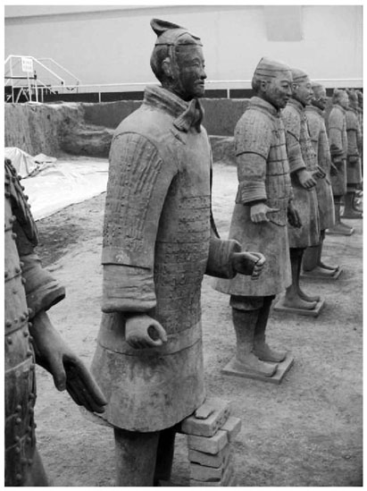

图1-1 中级军吏俑（编号T22.G9∶12）

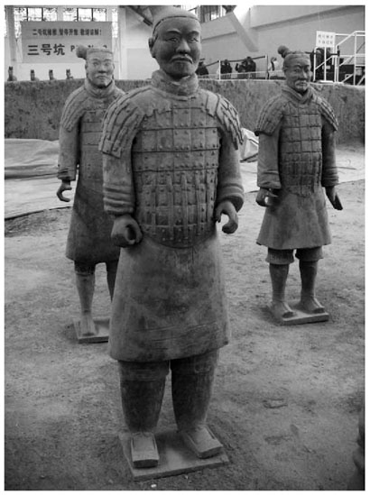

图1-2 铠甲步兵俑（编号T20.G11∶32）

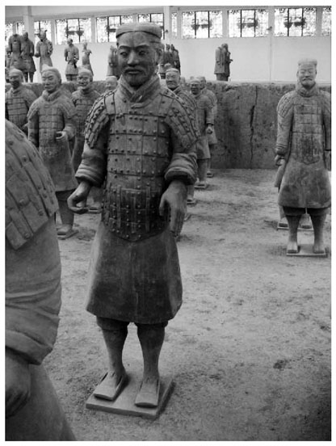

图1-3 铠甲步兵俑正面（编号T22.G9∶9）

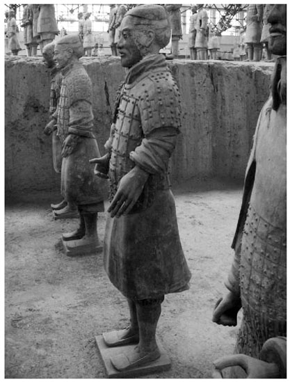

图1-4 铠甲步兵俑侧面（编号T22.G9∶9）

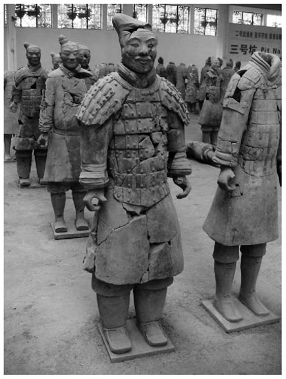

图1-5 铠甲步兵俑（编号T2.G7∶17）

在对俑体的比例进行观察和讨论前，我们不得不考虑俑坑曾经遭受人为及自然因素破坏的事实。[7]而这在发掘过程中，显然增加了考古工作人员对俑体破片进行重整与归类的困难，并连带影响了陶俑修复的结果。对一些破碎较严重的陶俑（例如T2.G7∶17号陶俑，见图1-5）进行观察，可以发现那些修复接合的痕迹很明显，而从破片与破片之间形状的吻合度来看，可以判定它们属于同一个陶俑。有些陶俑因为存在严重的残缺而由修复人员重新塑造补上，例如T.22∶97号陶俑的右臂（见图1-6），我们可以看出它与图1-5中陶俑的差异是十分明显的。前文提到的三个比例特异的陶俑，并没有重新塑造、接合的迹象，完整度较高，虽然也有破裂的痕迹，但破裂处并不在那些会直接影响比例的地方。此外，中级军吏俑在陶俑中并非多数，王学理先生在其研究中提到身着此类装束且披膊特长者仅有四尊。[8]从T22.G9∶12号陶俑所穿铠甲的特殊样式与头戴的单梁双板式长冠来看，这些是符合其身份的，所以错接的可能性并不大。基于以上理由，笔者认为因为修复因素而造成比例外观不合的可能性在此可以被排除。将可能在修复过程中出现的错接问题排除后，笔者关注的是：是什么原因造成了这种结果？从造型的角度来看，比例的不协调反映的是作者对比例的把握能力不强，属于技术层面的问题。但是，若从制作方式的角度进行思考，则可能涉及制作过程中的不同层面，并因此造成在比例外观上出现误差。《秦始皇陵兵马俑坑一号坑发掘报告》及袁仲一先生的研究，对秦俑的制作顺序已经有充分的说明。考古研究结果显示：秦俑大致分为头、躯干、四肢、手掌与足踏板五大部件，并采用分开制作的方式完成。[9]接下来，笔者将对秦俑可视的细部构件外观所显示的不同制作痕迹加以观察，并进一步提出假设。

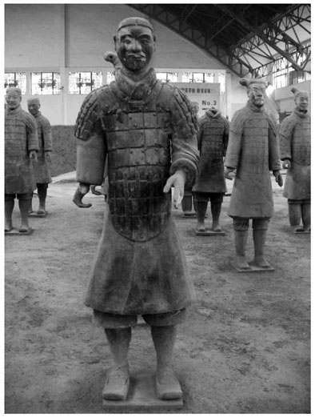

图1-6 铠甲步兵俑（编号T.22∶97）

笔者在一号坑修复区中发现，陶俑披膊部分采用了两种不同的制作方法。编号为005660的陶俑[10]（见图1-7）和编号为T1.G1∶54的陶俑（见图1-8）所穿着的铠甲都属于大方甲，前者的披膊采用长条陶板，以横向的方式一层一层地贴合而成；后者的披膊则采用整片陶板，直接粘在肩部及上臂以刻画的方式表现甲片。最明显的证据是，编号为005660的陶俑披膊的背面呈现与正面相同的阶梯状，而编号为T1.G1∶54的陶俑的披膊背面呈现的是一整块平面。分开制作的方式，最大的优点是易于塑型，而且可以避免陶板与臂膀粘接时因为被过度弯曲出现变形所产生的空隙。采用较薄的陶板则是为了降低重叠时由于陶板高度不同所出现的空隙。这都有助于陶板与肩、臂部更为紧密地接合，避免了将来容易脱落的问题。这种做法让披膊的面积可以比较大，并且也方便表现甲片的层次感。如果用整片陶板制作披膊，为了刻画甲片的层次，就必须使用比较厚的陶板，而为了接合的牢固性和降低重量就必须做得比较小。

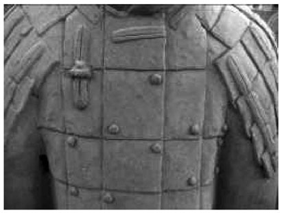

图1-7 铠甲步兵俑铠甲局部（编号005660）

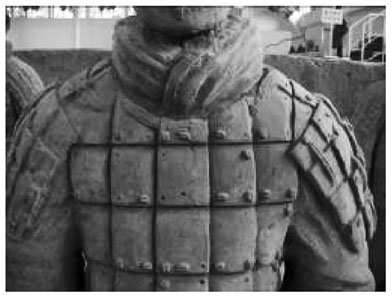

图1-8 铠甲步兵俑铠甲局部（编号T1.G1∶54）

陶俑铠甲甲片之间的连缀方式是用几股绳索串穿不同甲片，在陶俑上的呈现形式则为甲钉与连甲绳。不同陶俑铠甲上的甲钉显示出：有些甲钉是由多股绳索编缀而成，有些则由较少绳索编缀而成。这并非随意制作，而是依据特定的编缀方式与铠甲类型。[11]我们从陶俑身上可以发现，在多数铠甲上都遗留有甲钉脱落后的粘黏痕迹，显示出甲钉跟铠甲不是同一块材料制作的。甲钉的制作方式也有多种，经观察可知分为以下两种：一种是粘黏上去之后用模型压制成型（见图1-9、图1-10）。我们从陶俑身上可以明显地看到那些压印的痕迹。另一种方式是直接用手将甲钉捏成形，制作者遗留下来的指纹至今都还清晰可见（见图1-11）。那些脱落的痕迹显示甲钉的粘黏也采用了不同的方式：有些是用三角形或圆形的器物先在甲片上制造出一个洞（见图1-12）；有些则是先将甲钉做好再置入已经挖好的孔眼中（见图1-13）；或是用利器在上面刮出粗糙的痕迹以利于甲钉黏合（见图1-14）；甚至有些是什么都不做而直接将甲钉以按压的方式固定（见图1-15），采用这种按压方式粘黏的甲钉，脱落情况比较严重（见图1-16）。还有一些因为孔眼挖得太大，甲钉与甲片的附着面不够牢固而有大量脱落的情形（见图1-17）。过小而深的孔眼同样也会导致多数甲钉脱落（见图1-18）。

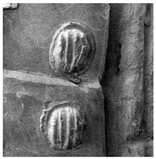

图1-9 编号T22∶97

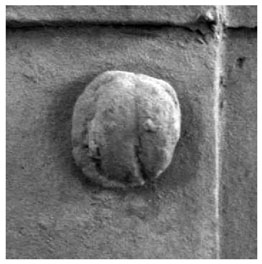

图1-10 编号T21.G10∶19

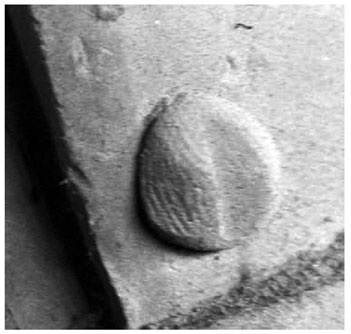

图1-11 编号T2.G1∶42

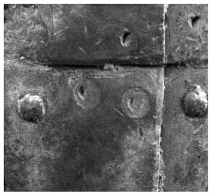

图1-12 编号005448

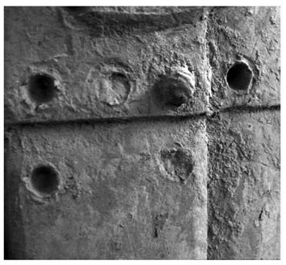

图1-13 编号T1.G1∶54

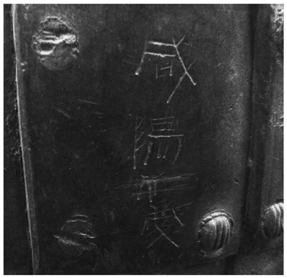

图1-14 编号T22∶97

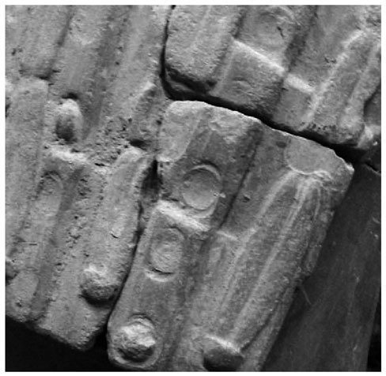

图1-15 编号T20.G7∶27

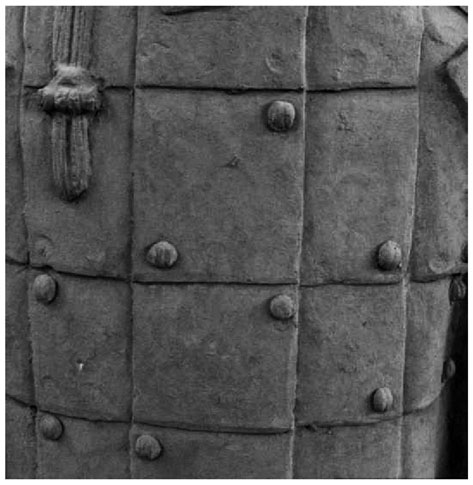

图1-16 编号T.21.10∶19

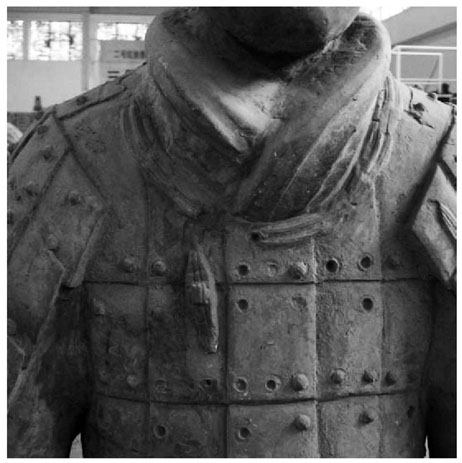

图1-17 编号T1.G1∶54

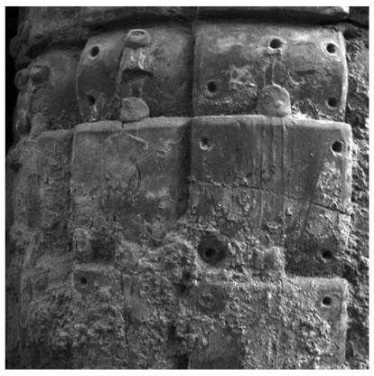

图1-18 编号T2.1.∶42

连甲带也是以粘黏的方式与铠甲分开制作的，这在很多陶俑身上可以看得很清楚（见图1-19、图1-20），采用不同的方式制作连甲带是非常明显的，而连甲带的不同样式牵涉到真实铠甲中所使用的不同材质。[12]有些连甲带是直接在泥条上面进行刻画（见图1-21），有些则明显是经由模具成型后再与铠甲黏结的（见图1-22）。制作者使用的模具也有精粗之分，一些依靠模具成型的连甲带在造型上已经脱离写实而倾向于图案化（见图1-23）。

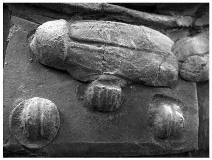

图1-19 缺编号

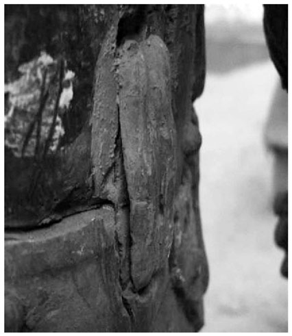

图1-20 缺编号

虽然以上仅就某些部件进行观察，对于秦俑制作的每个部分之间的关系未必都是清楚的，但从以上的观察可以发现：制作方式的差异直接影响到造型的精致度和是否坚固耐久。这些迹象显示出制作者为了制作的方便而发展出一套固定流程的可能性，例如：经过对铠甲与手臂的关系加以观察可以确认铠甲一定是先贴于躯干上，之后才将所有铠甲上的附件进行黏结。秦俑的手臂是最后才接上的，因为手臂跟铠甲的距离很近，如果不在接上手臂之前将甲钉、甲绳先行黏结，那么过于局促的空间将使制作者没有办法进行组装（见图1-24、图1-25）。

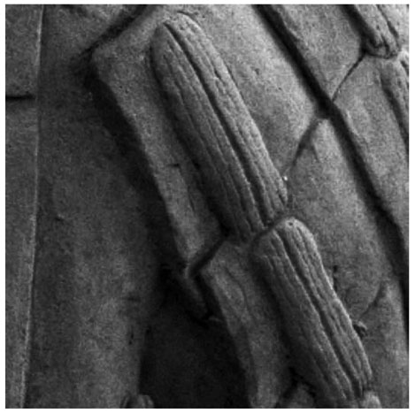

图1-21 编号T21.10∶19

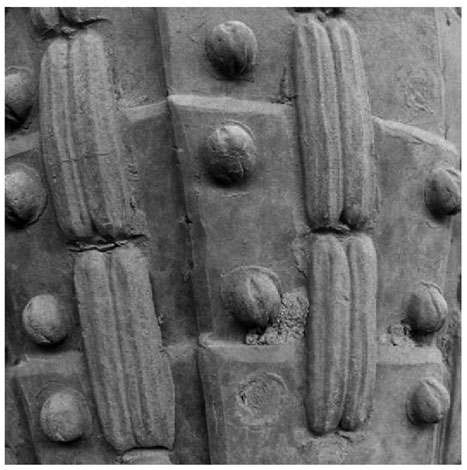

图1-22 编号T22.G9∶9

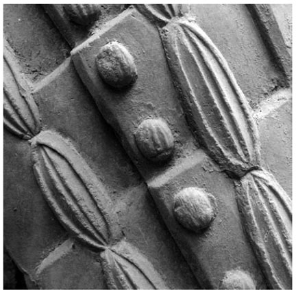

图1-23 编号T2.G7∶17

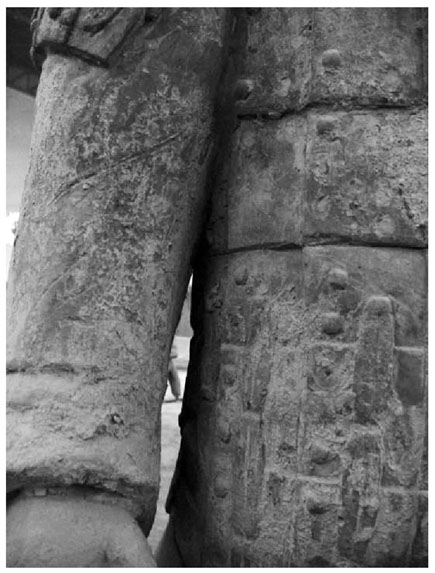

图1-24 编号005448

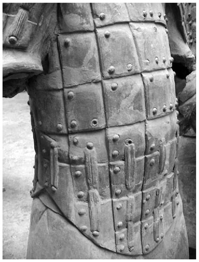

图1-25 编号005667

---

## 二 官方的需求

依照秦律《工律》中的“为器同物者，其小大、短长、广亦必等”[13]，我们可以从出土兵器的高度规格化证明它们是符合此规定与标准的；但是对秦俑细部进行观察后，笔者首先对制作精致度和制作方法之间的极大差异感到奇怪，同时也感觉到在这些差别之外，似乎存在着另一种要求：秦俑与兵器的制作或许并不是采用同一种标准，因为尽管制作者受到真实铠甲的型制与制作程序之类的限制而在造型上采用了简化的手法，或在接合技术及方式上使用不同的方法进行制作，但就每一个对象存在的必要性却显得一丝不苟，如从前文提到的秦俑手臂与铠甲之间的甲钉和甲绳都被非常完整地制作出来的事实来看，对这些细部制作的坚持反映出当时制作者对每一个组成部分的特征属性格外认真与重视，而铠甲的完整与否则可能涉及其是否能发挥应有的功能。这就让我们感受到，作者似乎并不满足于表象的真实，更多的迹象显示出他们期望通过对现实进行模拟能如真实般发挥其“功能性”的强烈欲求。我们很难将这种普遍存在的对真实的高度标准化结果归于工匠的自觉，尤其像秦俑这种经由官方计划组织的工程及秦俑所显示出的大量普遍相似的结果。工匠受命于某种特殊需求并遵循一些不可逾越的原则，官方在此所扮演的角色也许至关重要，而这将是以下所要加以探讨的。

《孟子·梁惠王篇第一》：“仲尼曰：‘始作俑者，其无后乎！’为其象人而用之也。”[14]孟子明白地指出，陪葬的人偶称为“俑”是因为必须做得接近真的人；这意味着只要做得越像真人就越符合成为“俑”的条件与标准，也更能发挥其功能。秦俑具有高度模拟真实的特点已经是公认的事实。就表象的“真”而言，最明显的表现首先是其数量与军阵规模的庞大、个体大小与真人近似及面部容貌的写实。其次则是对于细部的刻画、装备的齐全以及对质感的追求，例如：秦俑铠甲的规格不仅依照兵种分类，也比照真实铠甲，甚至每一片甲片四周都加以抹棱，铠甲上的甲钉也并不满足于存在就好，而是依据真实铠甲的编缀方式与位置如实地进行制作。此外，制作者对于手掌的掌纹、俑靴的缝合线与鞋底的针脚也都仔细地加以表现，并不因为看不到或是不显眼而有所忽略。对于这些细部的追求并非只在部分陶俑身上存在，而是几乎存在于每一个陶俑身上。袁仲一先生在其《秦始皇陵兵马俑研究》一书中，曾经总结了秦始皇陵兵马俑在整体造型特征上的三个特点：“大”，“多”，“真”。[15]严格来说，“大”与“多”的实现，可以视为官方在对“真”的需求与坚持下所做的决定。虽然秦俑的制作形象相对来说缺乏动态与表情，这或许是延续了史前及商周陶塑作品普遍讲究左右均衡对称的传统[16]；不过如果从秦俑是模拟部队的角度来看，过度的活泼显然也并不符合部队的气质。

秦俑代表的是一支部队，部队的统一性、服从性、纪律性，甚至战斗力都必须经由整体的观看才能显现出来。相同的动作、整齐的队形、多样的服色[17]，尤其是真实的兵器，都显示出一支部队所应具备的条件并呈现出现实中的秦军。就整体而言，秦俑所展示的是一种部队的观念，而部队的任务是攻击。对于军人而言，值得夸耀的是其赫赫的战功，尤其在秦军之中“上首功”风气盛行。[18]若单就军人的特质而言，秦俑在这里所代表的意涵不能简单地看作消极的防御功能，它既具备护卫秦王领土的功能，也肩负着受到威胁时随时准备出击的责任。《史记·张仪列传》中如此形容秦军：“秦人捐甲徙裼以趋敌，左挚人头，右挟生虏”，“虎贲之士跿跔科头，贯颐奋戟者，至不可胜计”[19]。若以一向骁勇善战的秦人观念来看，他们拥有宁可舍弃防护装备也要致力于攻击、为了攻击可以舍弃一切的决心。也或许因为此，秦俑的所有制作材料都能够使用陶土，但是唯有兵器，设计者舍弃了“模拟”，而直接采用真实兵器。兵器所代表的能动性与功能性在这时候更大于“为其象人而用之”的象征性。“象征的真实”与“实用的真实”在不同意义层次下必须分开但却同等重要。官方的要求很明确：既要模拟“真实”，也要模拟“现实”！

既然是模拟真实与现实，那么对于这些配件的制作，最简单的方法莫过于直接将做好的陶俑如同所持的真实兵器一样，配上八千具铠甲与其他成套的真实用品，这对于当时这样浩大的工程来说，并不能说是很大的消耗，从财力上来看也应该是可行的。《史记》中记载秦国每次发动战争所屠人数之众，动辄上万的例子比比皆是。[20]并吞六国后，秦国甚至还因天下兵器过多而尽集咸阳并铸造了12金人，南击百越（始皇二十八年，前219年）动用50万士兵[21]，北击匈奴（始皇三十二年，前215年）动用30万士兵[22]。成本的计算在这里很难将人道的因素考虑进去，因为从事例来看，很多是基于政策的需要，似乎是不计成本的。而从资源的角度来看，并吞六国后的秦国应该是非常富裕的；之所以不用在陶俑身上，问题或许不在于对成本有所顾忌，而是除了出于模拟真实与现实之外，还出于对施工时间与保存期限的双重考虑。我们从《史记》中记载秦始皇嬴政从13岁登基（前247年）时即开始大张旗鼓地修建陵墓，共动用约70万人，历时近40年[23]来设想，他一方面不得不承认人的生命有限，所以当他统一六国后曾这样说：“……朕为始皇帝。后世以计数，二世三世至于万世，传之无穷”[24]，他将王朝的延续寄望于自己的后代子孙直到千万世；另外，他渴望永生，直到死前几个月，他还为了寻求蓬莱仙药而“梦与海神战”[25]。我们可以想见，当他面对着自己陵墓的修建并等待其完成时，那种既迫切又矛盾的心理。或许我们能这么设想：对于嬴政而言，那种对永恒生命的渴望，无论是在“生”的世界还是“死”的世界，同样都是他追求的终极目的。因此，他对于追求现世永恒生命的不确定转而具现化在那个他可以掌控的自己死后世界的建造上也是完全可以理解的。既然如此，他就更断不能忍受消耗如此巨大人力、物力所完成陵墓中的任何一部分，在短短几世之内就因年久毁坏而不堪使用；因为任何一部分的毁坏对他而言都意味着对他自身的永恒生命造成某种程度的危害。在这双层意义下，对成本的精确掌握与计算也就显然有其必要性与必然性。总结以上的分析，可以归纳出官方认为秦俑的制作必须遵循的三个原则。

（1）在表现方式上必须遵循“真实原则”（涵盖“真实”“现实”）。

（2）在制作方法上遵循“效率原则”。

（3）在材料应用上遵循“稳定原则”。

---

## 三 制作者的选择与身份

早在战国时代的文献就记载了为官方从事生产督造或制造的工匠为了质量的控管而必须“物勒工名”以示负责[26]，我们在秦俑身上也能发现一部分基于这种规定所遗留下来的作者信息。据目前的研究成果：在秦俑身上用印者多为官署的工匠，而冠以地名的工匠则可能是从地方征调而来。有些工匠姓名不仅出现在陶俑身上，也同时出现在俑坑或宫殿的砖瓦上，这显示出这些工匠是以制陶为主的陶工。[27]从上述官方需求的角度来看，之所以选择陶工来完成这项任务的理由是显而易见的。从制作材料的特质来看，陶是众多物质里面比较符合以上三个条件的最佳选择。其一，泥土取得容易，而且是相当廉价的材料，它不像金属那样昂贵难得，也不像木材与石料那样搬运困难。依据考古报告，陶俑所用的泥土和秦始皇陵附近骊山北麓的土和砂的成分相同[28]，这更证明陶土的方便易得性。其二，泥土不仅可塑性高，也易于修改，堆、捏、刻、划都不受限制，造型方法既可加又可减，而且省时省力，在制作过程中只要控制好陶土中的水分，就可以保持长时间持续地制作。它也不像木材、石料与金属那样难以修改。其三，秦始皇陵的建造共历时近40年，将近半个世纪的准备期已经足够使许多材料有自然损坏之虞；经由烧制而成的陶，除了容易破碎之外，既防火也防水，不像铜铁器容易锈蚀或木材易于腐烂，稳定性相当高，是保存时效相当长的物质。其四，嬴政在位的37年中[29]，在都城咸阳有一直持续不断的建筑工程。[30]例如：《史记》中提到的“秦每破诸侯，写放其宫室，作之咸阳北版上……”，始皇二十七年（前220年）“焉作信宫渭南，已更命信官为极庙，象天极。自极庙道通骊山，作甘泉前殿。筑甬道，自咸阳属之。是岁，赐爵一级。治驰道”，始皇三十五年（前212年）“乃营作朝宫渭南上林苑中。先作前殿阿房，东西五百步，南北五十丈，上可以坐万人，下可以建五丈旗”，“发北山石椁，乃写蜀、荊地材皆至。关中计宫三百，关外四百余”，都显示出秦国当时对建筑方面的工匠有大量的需求。其他研究者认为，秦陵的工程在当时动用到的工匠主要就是这些属于建筑专业的陶工，因为这些陶工必须提供秦陵所需的大量砖瓦（见图1-26、图1-27），所以他们有足够的人力、经验与专业来解决秦俑的烧制问题。[31]其五，中国自古对于使用陶土进行形塑或模制有极为丰富的经验。我们在仰韶文化遗址中的陶塑或是商、周时期的石雕、青铜器上，都能发现中国很早就有制作人像的传统；尤其是铸造青铜器所使用的陶范更与陶土的使用关系密切。这些技术有可能为制作者提供了很好的借鉴。《韩非子·显学》曰“象人百万，不可谓强”[32]，足可证明当时制作“象人”的明器已经非常兴盛。虽然同时代出土的俑在体量上并没有发现像秦俑这种规模的，但是工匠以人为对象进行制作的经验应该已经十分丰富，而这显然也有助于工匠们对于面部的刻画训练。其六，从制陶的流程来看，即使原料容易取得，整个过程也仍然是相当复杂的。后代专门描述官窑作业的《景德镇陶图记》描绘了陶工的不同分工流程：从取土开始直到最后烧炉（见图1-28）。[33]

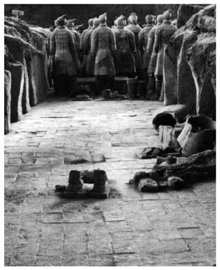

图1-26 俑坑地面

资料来源：摘自《秦始皇陵兵马俑》。

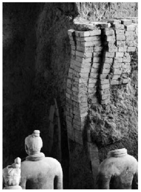

图1-27 俑坑墙面

资料来源：摘自《秦始皇陵兵马俑》。

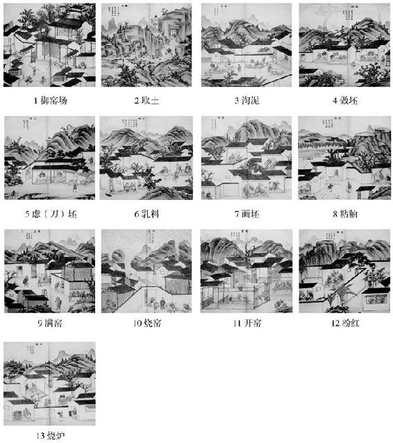

图1-28 《景德镇陶图记》

资料来源：摘自《中国陶瓷》（第1册）。

图1-28虽然以呈现瓷器的制造过程为主，与陶俑的制作分工并不完全一样，不过《秦始皇陵兵马俑坑一号坑发掘报告》对陶质、陶色的研究显示，兵马俑所用陶土似乎也经过了筛选、淘洗以去掉杂物的程序。[34]仅从这一层面上看，两者是大同小异的，而这些过程也并不容易。陶土的备制从取土开始，必须经过晾晒、破碎、筛分、混匀、加入适量的水分、搅拌等程序，软硬适度后，还必须反复拍打、搓揉，经过较长时间的定性后，才具备良好的成形性和湿强度[35]；实际制作时又必须分成好几个阶段进行，都不是一个人可以单独完成的。而且我们也知道，陶俑都曾经上过色，过程亦相当繁复细腻，并非如我们现在所见只是素烧的结果。借由《景德镇陶图记》至少说明了一点：即使陶土的使用具有许多优势，也并不代表制作过程是简单的，尤其是制作秦俑这样庞大的工程，由具有丰富分工经验的陶工来完成是很好的选择。遗留在陶俑身上的陶文表明，工匠不仅出自宫廷，也来自地方。[36]虽然我们目前不能确定这些陶文所代表的工匠是否实际参与了陶俑的制作，但是依照官方生产兵器的刻文惯例来看，一件器物上的铭文大多分为两类，一是督造者，一是制作者。从俑坑出土兵器的铭文可以发现，在器物的制作上有详细的权责区分：中央一级，由相邦代表国家监造；郡县一级，由郡守代表政府监造；领导工匠、主管生产者为“寺工”“工师”“丞”等；直接从事生产者则为“工”[37]（在《睡虎地秦墓竹简》中“丞”与“工”之间还有“曹长”[38]）。也就是说，对于官府生产的器物而言，其督造者都应该是具有官职者。我们在某些兵器上也会见到仅有制作者的名字，例如始皇三年、二十五年、二十七年的上郡守戈铭有“工城旦□”“工鬼薪戠”“工鬼薪”[39]。“城旦”“鬼薪”都是受刑服劳役人员的名称。既然这些人都是受刑人，当然他们不可能负责监工督造，而是实际的制作者。反过来看秦俑身上的刻文，有“咸阳衣”“栎阳重”“安邑□”“临晋”之类以地名为主的工匠刻文。若依照兵器上物勒铭文的惯例，这些地方征召而来的工匠既非刑徒，恐怕也非官员，应当是自由民。而从目前还没有在同一个陶俑身上发现两个不同刻名的情况来看，笔者认为那些刻上了地方名字的工匠既必须实际参与制作，又必须对整个陶俑的质量负责，而那些刻有官府单位名称者应该也都是实际参与制作并必须对其所做的每一个俑具体负责的官方工匠。此外，在秦俑中还发现一尊俑留有朱笔所书工匠名字的痕迹[40]，这或许可以解释为什么没有在每个陶俑身上都发现“物勒工名”的痕迹。

---

## 四 秦俑的制作方式与工匠的造型意识

秦国当时在度量衡、文字、货币、车轨上的标准化追求足以表明，无论是在制造技术、管理制度还是在分工流程方面，秦国都拥有足够的经验。我们无法想象一个耗时近40年、动用70万人的浩大皇家工程会不从以上方方面面总结经验并加以运用。虽然从实际的秦俑制作痕迹来看，有些大型采取了模制的方式，但在这里我们或许也会提出一个质疑，即分工的细致程度与必要性到底是以什么为标准？直接对铠甲或是其他的细部进行完整的模制难道不会更简单、更省时？在这个问题上，我们可以借鉴古代青铜器的铸造工艺经验来作为思考的参照。[41]

从模制的技术来看，可以有两种方法：一是灌浆；二是压制。这中间还有三个关键因素：（1）“外范”的制作与材料的选择。（2）“卡模”与“脱膜”。（3）翻制后的具体成型。在使用以上两种制作方法时，都必须先有一个“模”作为原型。我们以陶范的“外范”为例。“外范”在成型前必须做出一个初胎（原型），也就是“模”，将泥覆盖于“模”上按照一定的方法将泥切开，取下之后还可以合在一起，这就成为“外范”。如果初胎过于复杂，内角部分过多，就会造成“卡模”，使得“范”无法取下；解决的办法是必须将“外范”分成许多不同的部分分别取下。我们在秦俑的外形上随处可见这种会造成“卡模”的地方，尤其是躯干或披膊铠甲的弧度甚至脸部都会造成“脱模”的困难。这表明要制作一个秦俑的“范”显然非常麻烦。即便“范”制作成功并用以制作秦俑，接下来的问题仍会层出不穷：首先，无法采用灌浆的方式，因为泥浆不像金属冷却以后就会变硬成型，它必须透过水分的挥发才会变硬，而陶范的吸水性不强，以秦俑这么大的体量，要等到泥浆的水分挥发到能够取出势必将花费相当长的时间，所以第一种灌浆的方式并不可行。其次，第二种压制的方式似乎更为实际些，但是采用较干的黏土直接就着单模进行部分的翻制后，再将每个部件加以组装也同样麻烦，因为“脱模”之后的“范”并不是规则与完整的，也就是说，这样做反而会增加接合面的总体面积量及接合的难度，直接影响接合后的美观，最后还得花费大量的时间处理合模留下来的痕迹（合模线），这就使得制作工序变得更加复杂。这种制作方式显然大大违背了“效率原则”。因此，与其利用单模制成粗胚再分别进行加工，倒不如直接以陶板或手塑成型的方式进行制作。而单模的使用只适合秦俑身上单纯且数量大的部件，并且是采用压印成型的方式才有意义。考古人员在发掘过程中就曾发现用来制作连甲带的陶模两件（见图1-29），但经由前文对秦俑的观察，我们发现并非所有的工匠都会选择采用这种压印的方式制作。[42]

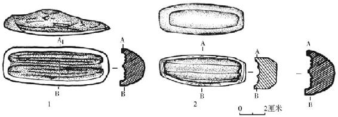

图1-29 1.编号T19.G11∶01414 2.编号T19K∶01367

资料来源：摘自《秦始皇陵兵马俑坑一号坑发掘报告》（上册）。

秦俑的大型主要采用泥条盘筑法或大片陶板制作。从目前已发掘出土的秦俑断面处，可以得知其制作采用了组装的方式进行，大体可以分为“头”“躯干”“手臂”“手掌”“腿”“足踏板”六大部分。值得注意的是，我们不能将这种组装制作方式轻易地与多人分工生产的组装意识相等同（虽然后面将证明确有这种意识存在）。就整体大型而言，秦俑的制作方式是以材料的性质及最终是否烧制成功为主要考虑因素，而这关系到材料所能采用的最佳制作方式的选择。之所以采用组装的方式，是陶土本身的特质条件使然，因为湿泥较软而且比较重，如果不分开制作，那么手臂、腿部、躯干就会因为泥土过重而受压变形或脱落。另外，工匠们为了确保在烧制时温度分布均匀，对于某些过厚的地方就必须挖空，而分开制作也比较有利于挖空的动作。秦俑主要是依靠泥条盘筑或是泥板建构出来的[43]，这是一种从没有体量到逐渐成型的做法。它不像雕塑，雕塑可以先有一个整体或是一个骨架，然后在可预期的范围内进行符合比例的制作。秦俑的造型意识与雕塑存在着很大的不同。虽然它也采用像雕塑一样对细部进行修整的“雕”与“塑”的技巧，但是秦俑的整体基本上是采用层层加叠的观念制作的，这就如同积木之间的组合，它从个别的大型依序组装，然后加上衣服、铠甲、甲钉、甲绳、兵器等，最后才在外部加以更细腻的刻画，而这与雕刻的意识是截然不同的。秦俑的制作者所考虑的是如何经由陶土组装成一个“人”的外形，它是缺乏结构的。不同材料的制作者通常有不同的造型意识：石匠考虑的是如何利用石头本身的造型以最少的浪费达到最佳的造型；冶铸与制模师傅考虑的则是如何解决造型所造成的翻制的困难，以使其能顺利铸造成功；而秦俑的制作方式则符合陶工制作陶器时的造型意识。秦俑的表现方式基本上可以简单地分为两种：一种是“减法”，主要以刻、刮、削的方式处理，例如秦俑的绑腿与鞋底的针脚。另一种则是“加法”，以泥块、泥板粘黏的方式制作，例如领巾、铠甲、甲钉、甲带、腰带、带扣等。除了少数配件是用刻画的方式外，绝大多数都采用外加的方式。这显示出制作的意识是一种以外形为主的拼装理念。制作者先把构成一个秦俑的所有元素进行分解，再将每个部件依照恰当的程序加以组装。工匠们采取这种做法，当然有基于材料特性的必要性，但同时这种做法也非常利于分工合作。虽然至今还没有发现在同一个俑体上有两个不同工匠的陶文，但是从前文对秦俑制作痕迹的观察来对其制作过程和造型意识加以思考，秦俑很有可能是由不同的人对不同部分分别进行制作。笔者在编号T21.G10∶16陶俑上发现，该俑左、右披膊上的甲钉采用不同的方式粘接，左肩披膊上的甲钉是先以圆棒挖洞再粘上（见图1-30），而右肩披膊上的甲钉则不进行事前的加工直接往上粘（见图1-31）。两种完全不同的制作手法同时存在于一具陶俑的披膊上，这显示出当时的工匠在制作工序上不仅采用组装的方式，而且可能采取多人分别制作的方式。一个工匠同时制作好几个相同的部分或是每一个部分由不同的工匠分头进行制作，最后再加以组合拼装。虽然这个案例并不足以强而有力地证明秦俑必然由不同的工匠制作[44]，但是也确实增加了在对相同零件进行组装时多人分工的可能性，或者至少说明了工匠制作方式的复杂性。分工的方式确实能够提高效率，但是对于分头制作的人来说，在比例的掌握上显然也容易出现偏差，而秦俑在组装以后若要进行大的修改，除了重做以外没有其他的办法。更有利于这个推论的证据是，从制作工艺的精致度来看，我们可以发现前文提到的三尊比例怪异的陶俑在个别部位上显现的技巧与精细度的差别并不很大，有些部件甚至还制作得相当细致准确。例如T22.G9∶9号俑（见图1-3、图1-4），虽然手掌与手臂的比例关系非常怪异，但是从手掌的制作来看，制作者对于手部质感及造型的把握却极为细腻（见图1-32）。若要说一个具有熟练制作技巧的工匠会对这种比例上极端明显的不协调视而不见，相信这是不合情理的。从以上的分析来看，前文提及的那三尊比例格外不协调的陶俑会出现那样的错误，似乎就可以归因于分工制作。正是因为采取了分工制作的方式，所以有些秦俑的个别部位工艺精湛，但是整体看来却又比例失调。

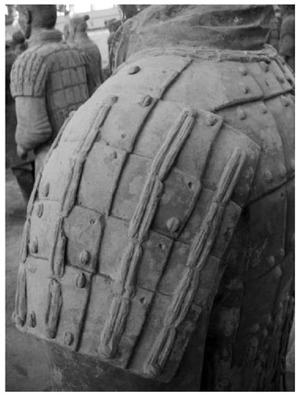

图1-30 陶俑左肩（编号T21.G10∶16）

大批工匠对每一个部分进行分工制作的做法，虽然看起来麻烦、费事，但从造型意识角度而言，这在制作理念上反而是简单的。例如对铠甲进行制作时，第一道工序是将大片泥板附在躯干上，再以利器割划出甲片，然后贴上甲钉、甲带。制作者不需要一边刻画甲片一边思考预留甲钉的位置，也不用担心甲带的长度与数量；制作过程中所有的观念都是单纯而简单的。这种周到的设想就是专门为了在最短的时间内帮助一些技术含量不高的工匠而设计的。而从效率与质量控管的角度而言，分工不仅能够节省时间，还可以让每个人专心负责一种工作或是几种部件，尤其是像铠甲的编织方式未必每个人都能熟悉，若由一批固定的人专门对铠甲进行加工或许更加省事。分工与流水线生产，是在决策者确定采用陶土进行制作之后，工匠们为了因应“效率原则”所采取的最佳选择。

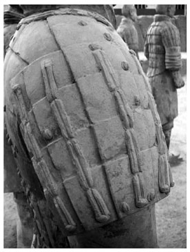

图1-31 陶俑右肩（编号T21.G10∶16）

图1-32 左手掌（编号T22.G9∶9）

在坚守“效率原则”的同时，制作者还必须兼顾“真实原则”。而当“真实原则”与“效率原则”相抵触时，“真实原则”往往是优先的选择。对于“真实原则”的必要性，我们可以在秦俑的各个部分发现，诸如前面章节提到的鞋底针脚、掌纹、铠甲的编制顺序与形制、甲钉的方向等。对于这些细部的制作显然相当花费工夫，但是这也的确让每一个俑更逼真，同时也连带增强了俑的“象人”功能。同时一号坑发掘出土的铜甬钟（见图1-33）上的精致花纹表明，当时制作“模”“范”的工匠有绝对的能力进行非常精细的制作，他们当然也具备将现实模拟得非常真实的能力。我们在其他地方所发现的同时代的陶模可以证实当时的工匠在制作水平上具有一定程度的普遍性（见图1-34）。有趣的是，当我们再次回顾那些秦俑铠甲的甲钉与连甲绳的多样性做法和那三尊比例不相称的陶俑时，却隐约感到当时秦国的规格化经验似乎更多的是反映在秦俑整体的制作程序和实用对象的形制上更甚于反映在秦俑本体上。

图1-33 铜甬钟（编号T19G9∶01302）

资料来源：摘自《秦始皇陵兵马俑坑一号坑发掘报告》（下册）。

图1-34 河南新郑冯庄东周制陶作坊遗址出土战国蛟龙文陶壶盖模与云纹壶盖

资料来源：摘自《中国重要考古发现（2003）》。

虽然外貌的“真”是必要的，但并不是绝对的，例如前文所列的不相称的比例与图案化的甲带之类。制作的像与不像以及存在精细度的差别，表明在一定的范围和前提下，差异是被容许的，“精”“粗”之分在这里或许并不是这项庞大工程所最关注的。同时，这些必要的部件并没有受到严格统一的造型规定约束也是显而易见的。无论是在造型上还是技法上，制作者们采取自己认为恰当的方式进行制作。这种自主性通过陶俑身上那些必不可少部件的粘黏及其制作方式上的明显差异表现得很清楚。这让我们感到，制作秦俑的工匠对于“真实原则”并不以表象的精致为主要诉求，而是以从“功能性”出发的真实感为主。以上所列举的这些部件并不同于脸部特征或是毛发样式能够经由不同的表现方式呈现出相应的具体个人特质。不同的做法与其说是对部件外观微妙差异的表现，不如说是工匠基于“时效”与“真实”两大需求对制作方式的把握。德国雷德侯（Lothar Ledderose）曾将秦俑的各部件进行类型化的比较，并对秦俑的制作提出了“模件”（module）的概念。[45]从某种程度来说，笔者认为“模件”的概念在这里并不完全意味着使用模具制作。因为当我们对实际的陶俑进行标准化的判断时，不能忽略部队的组成本身就是一个非常讲究标准化的事实。这种标准化的要求不仅仅是对军种的规定，而且是在整个制度上对标准化的普遍要求，例如《秦律杂抄》中对于供乘骑的军马要求高五尺八寸以上[46]（约1.34米）[47]。类似的这些标准化规定在同一个时代不只显现在秦军中，也显现在其他国家对部队的要求上。例如据传为依照齐国制度而著述的《考工记》[48]记载：“故兵车之轮六尺有六寸，田车之轮六尺有三寸，乘车之轮六尺有六寸。”[49]这种制度化要求有效地达到了方便管理、节省成本、提高效率的目的，“模件”概念在这里更可以扩大为一种“规范与制度”的意义。若我们将视野再扩大一点，秦俑所显示的庞大军阵规模、严密的布局、多样的兵种、森严的阶级及种类繁复的兵器等，都表明在制作过程中模拟的不仅仅是“表象”部分，而且是经由“表象”所显示出的制度与规范；而制度与规范的产生是为了保证整体运作机能的有效。当我们把秦俑坑中的每一个部分分开来看时（甚至可以包含整个秦始皇陵），工匠们似乎在“效率原则”与“真实原则”的规范下，无意识地被另一种更广义的“模件”概念所支配。

综合以上，可以看出工匠制作的方式在当时并不在官方标准化的范畴之列，官方所重视的标准化更多的是关注作为一个士兵所需具备的一切要素是否齐备。至于这些要素如何从制作的角度予以周全则是工匠的问题，虽然中间不乏一些失败的技术。

---

## 五 关于秦俑“千人千面”及其制作方式的思考

依照目前普遍的看法及对秦俑头部照片的比较（见图1-35）[50]，秦俑具有“千人千面”的特点。这个特点主要表现在两个层面：（1）头型的多样。（2）情态的多样。这样结果的产生是出于质量控管能力不足的意外还是有意的人为？作为秦始皇陵重要组成部分的兵马俑坑，其内含有将近6000尊数量庞大的陶武士俑[51]及相应的必要对象、设施等。从复原的结果来看，当时即使是一砖一瓦的制作也是很有制度与规范的。而督造者或是制作者以相似的思考模式，并选择采取系统流程与标准化方式对陶俑进行制作，来提高效率和保证质量也是很合理的；这也是秦人们所擅长的。虽然在多人分工的方式下，要维持固定的标准并不是一件容易的事情，但是从俑坑出土的兵器向我们所展示出的高度标准化与分工经验来看[52]，当时的秦国具备足够的能力与技术做出上千个一模一样的陶俑，可是他们并没有这么做。如果前文对官方需求的论证是合理的，那么笔者认为，官方对于制作的标准化要求就不会局限在斤斤计较于统一的造型层面，而是转向符合整体军阵的排列、大小、姿态、职能、比例、色彩，并最终以能够顺利进行烧制为主要关注的重点。就这一点来说，我们不能不承认这也是一种对于标准化的严格要求。从前文有关“真实原则”的观点而言，制作秦俑的工匠对于“真实原则”并不以表象的精致为主要条件，而是通过一种以“功能性”为出发点的真实感来加以理解的。尤其不容忽视的是，秦兵马俑中对于“俑”的需求不是一个，而是一群，不是满足于一种能力，而是群策群力，那么拥有具个人特征的面部或许就是很重要的，这也多少透露出原设计者并不希望所有陶俑看起来都相同的意图。以下，笔者将在前文论证的基础上对秦俑的“千人千面”现象进一步加以讨论。

图1-35 秦俑多样的头型与面型

资料来源：摘自《秦始皇陵兵马俑》。

《史记》中对于秦陵的记载为：“宫观百官奇器珍怪徙臧满之”，“以水银为百川江河大海，机相灌输，上具天文，下具地理”[53]。可见秦始皇对于其陵墓的要求之高、涉及的范围之广，尤其是对于模拟“现实”的坚持。从这个角度思考，对秦始皇而言，秦陵的每一个部分都代表着秦陵自身的完善，缺少任何一个环节都不能构成一个完整的现实世界，每一个迹象都暗示我们不能只从附属的概念来认识每一个组成部分，兵马俑虽然看似并非主体，也没有出现在任何史料与文献记载之中，但是就视线范围所及，秦俑坑本身仍是一个完整的部分。秦俑的存在是秦陵不可缺少的重要组成部分，它代表了秦始皇至高无上的皇权与强大的军事力量，而这正是现实世界中的秦始皇所最值得夸耀的。在这里，最不需要花费精力去要求的恐怕就是同一种面孔，它完全不需要在人像上要求统一的规格，因为它已经拥有了被视为一支“部队”所应具备的性格与特征。依据前贤研究者对秦俑的面型进行的分类归纳，秦俑符合中国民间画论中“像之大概，不外八格”[54]的说法及民间将人的脸形分为“国”“风”“目”“田”“由”“申”“甲”等基本形态的归纳（见图1-36），更显示出官方在“真实原则”下对不同面型、神态的要求是出于刻意。在这里，对于具有替代真人性质的俑而言，对每个俑在面相上所提出的“个性”要求并非是对“标准化”的削弱，反而是基于“真实原则”，对“标准化”概念的延伸与强化！而以上所言，正符合前文所论，官方对“真实原则”的需求是基于“功能性”而出发的，并不仅止于概念化的“象人”。

图1-36 “十格”《锲王氏秘传知人风鉴源理相法全书》

资料来源：王耀廷著《肖像·相势·相法》，载台湾艺术教育馆编《美育》（肖像画专辑）（第99期），台湾艺术教育馆，1998，第26页。

袁仲一先生在其研究中提到在一号兵马俑坑T1和T10探方出土的陶俑中，有10余件头型和面型基本相同的“冉字俑”。[55]虽然我们无法知道这个叫做“冉”的工匠所负责的到底是模型的制作还是整个制作流程，但是既然以“冉”作为记号，基于“物勒工名”的传统，可以知道当时确实存在着对于质量的控管。不过，目前在一号、二号俑坑出土的秦俑头部大型呈现明显的差异及其面部存在各种不同造型的胡子、眉毛、发髻和以上各部位有多种加工表现方式表明，秦陵兵马俑的设计者与监造者对于所有俑头的基本大型、制作方式、细部刻画并没有统一且严格的规范。因为“冉字俑”的存在，意味着不同于其他类型陶俑的秦俑却能够通过审查标准的事实是不容置疑的。如果说确实存在对于造型的标准化要求，那恐怕也仅止于以组为单位。在粗胎成型期，为了保证大型在长、宽、高上大致符合标准，或因为模型的关系及工匠自身对造型的惯性、高级工匠对一般工匠进行指导等原因所出现的初期的标准化，或许是一种看似经过质量管理的假象。无论如何，这一时期的标准化很显然不是秦俑设计者所最关切的，因为我们在细部加工方面对俑头进行观察时，仅从胡子造型的多样性，就可以发现他们有意打破了粗胎期的标准化。质量控管的目的或许并不在于规范他们制作得一样，而是出于对制作精度与最终烧制结果的考虑；同时或许也透露出主事者对于“千人千面”的要求是基于“真实原则”的刻意。笔者认为，虽然秦俑头部的制作是以“真实原则”为前提的，但是正如前文所述，它还必须兼顾“效率原则”。秦俑头部的制作流程可以简略地分为四个步骤：（1）制作粗胎；（2）对细部进行加工；（3）烧制；（4）上彩。依据考古报告的结果，制作方式有两种：（1）合模法（比较多）；（2）面部用粗模（外范），后脑壳为捏塑（仅见于一类俑：“冉字俑”）。[56]得出这种结论最主要的依据是，在挖掘过程中发现很多俑头面部与后脑壳分开的案例（见图1-37），头部内侧则有明显的指压及划抹痕迹。[57]我们从大量生产的条件需求来思考，制作者采用模制的方式似乎确实比较方便而且快速。

图1-37 T10.G5∶1俑头合模缝和T1.G4∶11俑脸与脑壳的粘接面

资料来源：摘自《秦始皇陵兵马俑坑一号坑发掘报告》（下册）。

从造型的角度来看，虽然我们也可以用分类的方式将秦俑的头型归纳为八类，并以此加强其采用模制的论证；不过这种对于面型的分类，即便是用在真人的脸上也能够成立，但我们却不能说真人是模制的结果。如果我们对陶俑的面型、胡须、发式、鞋子、盔甲进行分类的目的是对制作方式或样式加以归纳，那么这种分类的结果就容易偏向于一种失去个性并朝着标准化制作方向的结论。分类有助于我们对秦俑的样式进行归纳，但是若要以此对工匠是否采用“外模”翻制俑头的做法进行判断却是不足的。若从制作者的角度思考，对俑头进行严格意义的模制后再加以塑型与修整，使其形成不同的面貌，是相当困难与费事的，因为“模制”意味着“统一”，这样的结果显然会限制制作者对造型修改的随意性。这不禁令笔者对工匠们选择采用模制的方法产生怀疑。若是从制作者具有陶工的身份来考虑，如前所述，出土陶文表明，他们中间有许多是专门烧制砖瓦的宫廷匠人，而砖瓦大部分都是将炼好的土以陶板的形式制作或是采取模制的方式使之成型。但是不可忽略的是，就造型的经验而言，砖瓦上的图像经过模制完成后就等于完成，不需再刻意做得与众不同；秦俑的头部则不然，它们的最终目的是呈现秦俑面部各具特征。而前文提及的面部“卡模”与“脱模”问题则使得制作者只能采用粗模成型方法；那么我们不禁要问，经由模制成型的简单粗胚与揉好一块泥后直接以手塑而得的简单头型之间的差别与意义何在？这就好比砖瓦上的图案经由模制成功后，又要将其修改成各具特色一样令人感到麻烦，倒不如直接在砖瓦上造型来得简单有效率。正因如此，笔者不得不怀疑以模型制作面部粗胚的必要性。采用外范（外模）这种做法似乎并不是最好的选择，因为这显然不符合“效率原则”和“真实原则”；直接对俑的头部进行捏塑可能反而更简单。

秦始皇兵马俑一号坑共出土1087件各类武士俑，陶马32匹。截至1984年，共修复714件各类武士俑，陶马28匹。[58]总共发现192件有工匠的刻文或印文，排除相同的人名，共有64位工匠。依据2007年12月袁仲一先生提供的信息，到目前为止已经发现约93个工匠。[59]若将这些工匠与1087件武士俑取平均值（依据考古报告，目前已经出土的一号坑陶俑与工匠刻名的关系显示，不同工匠的制作在军阵中并没有相近的摆置区域），可以粗略地估算出一个工匠制作10～11尊陶俑（即使将32匹陶马全部加入，也不会对这个数值有太大的影响）。因此，虽然就整体而言，秦俑的数量是庞大的，但是经由平均值来看，对工匠而言似乎并不是很大的负担，因此数量的庞大，在这里似乎就并不能作为工匠们因此而采用模制方式来制作头部的有力理由。那么我们怎么解释脸部与后脑壳接合的事实与存留在其内部的指压的痕迹？一般陶土在烧制之前的收缩率为百分之十左右，烧制之后还会再缩小。[60]经过实际考察，秦俑的头部比常人的头部大[61]，所以在正常情况下，不太可能以真人的脸进行直接翻制（见图1-38）。

图1-38 笔者实地考察对比

直接手塑成型之后，为了避免头部陶土过厚导致的烧制失败，制作者必须再将做好的头部切开并加以挖空，这种做法当然会将指压的痕迹留在俑头内面。另一种制作方式是先在俑头内部埋藏一个内模（也可以是稻草或麻布之类），等塑型之后将其切开取出；如果不取出来，则容易在烧制过程中因为收缩率的不同而造成俑头表面的龟裂，从而导致失败。袁仲一先生在其研究中发现，为了使胎壁受火均匀排气方便，有些制作者在陶俑头顶开了一个1～1.5厘米的小孔，或把双耳窝挖成透孔与脑壳相通，以利于通气直接烧制[62]（见图1-39）。秦俑的烧制温度为900～1050℃[63]，在这样的温度下，麻绳类材质的内模将化为灰烬不复存在，烧制过程中空气的对流也会将灰烬排出陶俑体外。以上这种推论可以通过一号坑修复区中发现的陶俑手臂和躯干内侧得到证实（见图1-40）。从这件标本内侧可以看出明显且分布均匀的麻绳类材料的痕迹，然后从外部以陶板或陶土塑型之后再从外部或内部敲实陶土。这说明陶俑的躯干内部曾经采用类似内模的方式来控制躯干的体量。或许头部的制作也有一部分会采取这种方法。

图1-39 陶俑头部通气孔（编号5667）

图1-40 秦俑残片（秦兵马俑一号俑坑修复区）

在对陶俑的头部是否采用模制这一问题进行探讨时，陶土的特性与烧制之间的关系是不可回避的问题，毕竟陶俑最终由土烧制成为陶之后才算成功。俑头断面的痕迹显示，俑头内层采用粗泥，外部采用细泥。分成两种泥进行制作的理由很明确：首先，粗泥含硅量高，烧制时温度分散较为均匀，同时也能降低收缩率。其次，粗泥的结构性比较强，有利于制作大体积的陶器。大型采用粗泥成型显然是为了增强俑体的结构和提高烧制成功率。二次覆泥用的是细泥，泥土越细收缩率越大，但是细泥的质地细密、黏度大，可塑性高，可以弥补粗胚时期粗泥在造型细腻表现上的缺点。[64]考古报告中提到，从俑头面部侧面断裂的地方观察，里外为两层泥，外层为细泥，内层为粗泥（见图1-41）[65]，并且两层泥中间有明显的指痕。造成这种痕迹的做法是，先将细泥压进粗模内，然后再置入粗泥并用手按压桩实。按压桩实显然是为了将两种不同密度的陶土依靠压实的动作使空气含量均匀，以提高烧制的成功率。所以当面部细泥剥落时可以在细泥背面看见明显的指压痕迹，这当然有可能成为俑头采用模制方法的原因与证据。但是换一个角度来思考，二次覆泥剥落的事实意味着两层泥土的压实也有失败的结果，那么我们就不能因此将它视为曾经采用模制方法的充分证据。或许将这个失败看作不曾使用模制方法的证明反而更具说服力，因为在非模制的俑头上，二次覆泥时为了造型的需要，同样也可能在细泥背面留下指痕。

由于在现阶段的秦俑挖掘中，还未发现制作俑头的模具出土，所以以上对于俑头制作方法的分析也只是一种推测。探讨的目的并不在于否定模制的可能性，而是在于对制作痕迹所呈现出的有多种制作方式这一事实进行延伸思考。从陶塑技法来看，捏塑加锥画的方法是东周以来普遍沿袭的方法。[66]从所观察到的秦俑细部存在的各种制作方式来看，制作的“精致度”涵盖在两种不同的标准下：有些做法特别关注造型问题，有些则更重视烧制后是否坚固耐用。某些工匠采用烦琐的方式是希望使作品更耐用美观，但结果并不如预期，反而简单的方法效果更好。这是很有意思的事情，同时这也使我们不能排除某些工匠基于求好心切而采用模制的方法，但是这不表示所有的陶工都如此细心。[67]

图1-41 俑头剖视图（编号T20.G9∶103）

说明：①表层泥；②内部泥层；③内部泥层及指抹纹。

资料来源：摘自《秦始皇陵兵马俑坑一号坑发掘报告》。

---

## 六 小结

一般以文献为主的观点是，史料中并没有留下制作类似秦俑的先例的任何记录。关于当时秦国曾经制作类似人像的记载仅有少数几条，例如：秦统一六国后收天下兵器所铸的12金人与渭河桥上乌获、孟贲等力士的石制形象。而这些都是基于官方的需求才得以建造，对当时的百姓而言根本没有需求与能力制作这样的人像。很显然，工匠们也不会有太多经验与机会来制作这样大型的人像。对于秦俑的制作者，我们总是抱持一种疑问：陶工如何能够熟练地制作人像？对秦俑的制作痕迹进行观察的结果表明，这种忧虑在当时或许并不存在。从官方需求的角度进行思考，显示出官方依照需求选择合适的工匠，而工匠们则凭借自己对于材料特性的专业开创出符合需求的技术。不同做法的呈现，一方面反映出官方虽然有分工与规格化的经验，但是有关这样大型群像制作的标准还没有成熟。另一方面，失败的例子反映出制作者的预期与结果有差异，同时也让我们看到工匠们为此而开发新技术的各种案例。现实情况下所反映出来的是：制作秦俑的工匠们必须具有很强的适应能力，并具备过人的经验及解决问题的能力。即便这批工匠是专门为了制作秦俑而特意训练的，即便这批工匠存在的时间是短暂的，但是为了这种需求所开发出来的技术与经验，却不会因为不再有机会制作这样大型的陶俑而被舍弃。经由技艺的传承，工匠们不断地充实、积累各方面的经验，并随时准备面对将来可能会遇到的不同难题。

虽然以上对工匠的观察总是围绕着官方的需求而展开，但是从秦俑的制作结果来看，仍然可以发现一些制作的特例。例如在观察过程中发现有些秦俑的袖子衣纹做得非常简单，有些却折痕繁复而逼真（见图1-42）。从流水线生产制作的观点和以“效率原则”及“真实原则”为主轴的概念来看，无法解释工匠在配合整体工作时，为何愿意花费更多的心思对一个已经足以表明意义的袖管进行更多的描写。对于袖子来说，简单与烦琐都不阻碍其成为衣服的一部分，而且制作者也没有必要为了更突出地表现衣服的质感而花费更多的时间来增加自身的工作量。也就是说，在一个部分消耗过多的时间，必然连带影响到整个制作流程，会增加其他人的负担。这并不同于前文所讨论的诸如铠甲甲钉的多样化，因为这些配件的制作无法脱离铠甲的编制方式。秦代对工匠的制作与养成有明确的奖惩制度，在《秦律》中有：

新工初工事，一岁半红（功），其后岁赋红（功）与故等。工师善教之，故工一岁而成，新工二岁而成。能先期成学者谒上，上且有以赏之。盈期不成学者，籍书而上内史。[68]

图1-42 编号005448（左）和编号005667（右）

制作优异与学习快速者，师傅与徒弟都能因此受到奖励。或许这引发了工匠之间的相互竞争与各显技艺之心。此外，笔者认为也不能排除这些原本对制作人像并不熟悉的陶工们，在反复制作的过程中，将自身对于真实追求的理解与表现，最终反映在对各部分造型细腻化的追求上。以上显示了工匠的制作牵涉到许多更复杂的层面，毕竟当我们试图以群体的概念来理解工匠时，仍不能否定该整体是由众多不同个体组成的事实。而在高层（官方）意识绝对大于低层（工匠）意识的情况下，我们更不能忽略每个个体都拥有独立情感与审美判断的因素。即便秦俑的制作使用了模具概念与技巧，但是总的来说，整个过程仍然需要利用双手进行塑造与成型。而当我们企图对表象尽一切可能地进行复制、模拟时，“真实”这一概念所彰显的意义就不能仅被理解在单纯的表象上，它转而提醒我们这是一种对“存在”的态度与观念的显现。秦俑在此则成为了最好的写照。秦俑之所以长期以来受到众人的关注，原因不仅在于其制作的时间及动用的人力、物力，更在于其对“真”的实现，在于它引领我们从对表象的赞叹回归到对“存在”本身的再思考。

经由对秦俑“千人千面”现象的探讨，笔者联想到在另外一个时空另一批工匠却创造出了八千多个以“千人一面”著称的敦煌供养人画像。两者之间具有明显的风格差异（见图1-43），让我们无法以秦俑的分析结果来看待那些制作者和制作物。不过，有趣的是它们同样具有“象人”功能。这不禁令我们进一步思考，秦朝在官方的需求下创造了一批制作秦俑的工匠，而敦煌这样一个长期受到严格意义的制度化宗教影响的地区，又有可能对工匠造成什么影响？

图1-43 秦俑与敦煌供养人像比较

---

[1] 陕西省考古研究所、始皇陵秦俑坑考古发掘队编著《秦始皇陵兵马俑坑一号坑发掘报告》（上、下册），文物出版社，1988。

[2] 袁仲一著《秦始皇陵兵马俑研究》，文物出版社，1990。

[3] 张卫星、马宇著《秦甲胄研究》，陕西人民出版社，2004。

[4] 王学理著《秦俑专题研究》，三秦出版社，1994。

[5] 王学理著《秦俑专题研究》，三秦出版社，1994，第444页。

[6] 陕西省考古研究所、始皇陵秦俑坑考古发掘队编著《秦始皇陵兵马俑坑一号坑发掘报告》（上册），文物出版社，1988，第156页。

[7] 陕西省考古研究所、始皇陵秦俑坑考古发掘队编著《秦始皇陵兵马俑坑一号坑发掘报告》（上册），文物出版社，1988，第46～51页。

[8] 王学理著《秦俑专题研究》，三秦出版社，1994，第174～176页。

[9] 陕西省考古研究所、始皇陵秦俑坑考古发掘队编著《秦始皇陵兵马俑坑一号坑发掘报告》（上册），文物出版社，1988，第163～183页。袁仲一著《秦始皇陵兵马俑研究》，文物出版社，1990，第330～343页。

[10] 笔者在秦始皇兵马俑一号坑修复区进行标本采集时，发现陶俑身上标示有两种编号，一种是清楚注明陶俑出土时所在探方、过道的编号，另一种则仅以数字表示。因为有些注明陶俑所在确切位置的编号已经模糊不易辨识，所以笔者采用数字编号加以注明。

[11] 张卫星、马宇著《秦甲胄研究》，陕西人民出版社，2004，第327～334页。

[12] 张卫星、马宇著《秦甲胄研究》，陕西人民出版社，2004，第327～334页。

[13] 睡虎地秦墓竹简整理小组编《秦律十八种释文注释》，载睡虎地秦墓竹简整理小组编《睡虎地秦墓竹简》，文物出版社，1990，第43页。

[14] 王云五主编、史次耘注译《孟子今注今译》，台湾商务印书馆，1978，第9页。

[15] 袁仲一著《秦始皇陵兵马俑研究》，文物出版社，1990，第303页。

[16] 汤池著《齐讴女乐 曼舞轻歌——章丘女郎山战国乐舞陶俑赏析》，《文物》1993年第3期。

[17] 考古的实际发现显示，秦俑服色是多样的。参见王学理《秦俑专题研究》，三秦出版社，1994，第526～533页。另湖北省云梦县睡虎地四号秦墓出土的写在木牍上的家信，说明了秦军的服装由个人自备。信中写道：“遗黑夫钱，毋操夏衣来。今书节（即）到，母视安陆丝布贱，可以为禅裙襦者，母必为之，令与钱偕来。其丝布贵，徙（以）钱来，黑夫自以布此。黑夫等直佐淮阳，攻反城久，伤未可智（知）也，愿母遗黑夫用勿少。”参见湖北孝感地区第二期亦工亦农文物考古训练班《湖北云梦睡虎地十一座秦墓发掘简报》，《文物》1976年第9期。可见秦俑军阵中服饰颜色多样，并强烈地反映出官方对真实的需求。

[18] （汉）司马迁著《史记》（第8册），中华书局，1959，第2461页。

[19] （汉）司马迁著《史记》（第7册），中华书局，1959，第2293页。

[20] 例如《秦始皇本纪第六》《张仪列传第十》，参见（汉）司马迁《史记》（第1、7册），中华书局，1959。

[21] 据葛剑雄先生考据，秦始皇征南越行动可能开始于始皇二十八年，最迟不晚于始皇三十年；关于动用的部队人数，则在《淮南子·人间训》有详细记载。参见葛剑雄《先秦至魏晋南北朝时期》，载葛剑雄主编《中国移民史》（第2卷），福建人民出版社，1997，第71～74页。

[22] （汉）司马迁著《史记》（第1册），中华书局，1959，第252页。

[23] 陕西省考古研究所、始皇陵秦俑坑考古发掘队编著《秦始皇陵兵马俑坑一号坑发掘报告》（上册），文物出版社，1988，第1页。

[24] （汉）司马迁著《史记》（第1册），中华书局，1959，第236页。

[25] （汉）司马迁著《史记》（第1册），中华书局，1959，第263页。

[26] “物勒工名，以考其诚。工有不当，必行其罪，以究其情。”——《礼记·月令》。王云五主编、王梦鸥注译《礼记今注今译》（上册），台湾商务印书馆，1978，第234页。

[27] 秦陵出土砖瓦上发现“宫疆”“宫得”“宫系”三个名字和秦俑身上印文相同。参见陕西省考古研究所、始皇陵秦俑坑考古发掘队《秦始皇陵兵马俑坑一号坑发掘报告》（上册），文物出版社，1988，第199页。

[28] 陕西省考古研究所、始皇陵秦俑坑考古发掘队编著《秦始皇陵兵马俑坑一号坑发掘报告》（上册），文物出版社，1988，第193页。

[29] 万国鼎编《中国历史纪年表》，中华书局，1978，第18页。

[30] （汉）司马迁著《史记》（第1册），中华书局，1959，第239～256页。

[31] 袁仲一著《秦兵马俑的作者》，载袁仲一等编《秦俑研究文集》，陕西人民美术出版社，1990，第183～207页。德国雷德侯先生在其研究中认为，秦俑的制作者是专门制作秦宫室下水管道的陶工。参见〔德〕雷德侯（Lothar Ledderose）《神奇的始皇帝大军》，载〔德〕雷德侯著《万物》，张总、钟晓青、陈芳、韦正、赵州译，三联书店，2005，第98～101页。

[32] （清）王先慎撰《韩非子集解》，钟哲点校，中华书局，1998，第460页。

[33] 《景德镇陶图记》收录于台北“故宫博物院”书画处第九十号箱丽字一八六之2号陶瓷谱，首页为文字叙述，次页为御窑厂图，其后治瓷程序共计十二图。参见谭旦冏《中国陶瓷》（第1册），光复书局，1980，第11～24页。

[34] 陕西省考古研究所、始皇陵秦俑坑考古发掘队编著《秦始皇陵兵马俑坑一号坑发掘报告》（上册），文物出版社，1988，第192～193页。

[35] 刘诗中著《中国青铜时代采冶铸工艺》，江西科学技术出版社，1997，第120～121页。

[36] 陕西省考古研究所、始皇陵秦俑坑考古发掘队编著《秦始皇陵兵马俑坑一号坑发掘报告》（上册），文物出版社，1988，第199～203页。

[37] 王学理著《秦俑专题研究》，三秦出版社，1994，第386～387页。

[38] 袁仲一著《秦始皇陵兵马俑研究》，文物出版社，1990，第200页。原文参见《睡虎地秦墓竹简·秦律杂抄》：“省殿，赀工师一甲，丞及曹长一盾，徒络组廿给。省三岁比殿，赀工师二甲，丞、曹长一甲，徒络组五十给。”参见睡虎地秦墓竹简整理小组《秦律杂抄释文注释》，载睡虎地秦墓竹简整理小组编《睡虎地秦墓竹简》，文物出版社，1990，第83页。

[39] 袁仲一著《秦始皇陵兵马俑研究》，文物出版社，1990，第200页。

[40] 关于朱笔记名一事，在袁仲一先生的研究中有提及，但是在一号坑发掘报告中却没有记载。参见袁仲一《秦始皇陵兵马俑研究》，文物出版社，1990，第360页。

[41] 刘诗中著《中国青铜时代采冶铸工艺》，江西科学技术出版社，1997，第117～147页。

[42] 袁仲一先生的研究显示，光是手掌就分别存在翻制、捏塑、雕刻成型或是其中几种互相结合的方式制作。参见袁仲一《秦始皇陵兵马俑研究》，文物出版社，1990，第339页。

[43] 陕西省考古研究所、始皇陵秦俑坑考古发掘队编著《秦始皇陵兵马俑坑一号坑发掘报告》（上册），文物出版社，1988，第56页。

[44] 受研究条件的限制，笔者只能在一号坑的修复区进行观察，而这一案例是笔者在一号坑修复区所仅见。

[45] 〔德〕雷德侯（Lothar Ledderose）著《神奇的始皇帝大军》，载〔德〕雷德侯著《万物》，张总、钟晓青、陈芳、韦正、赵州译，三联书店，2005，第75～107页。

[46] 睡虎地秦墓竹简整理小组编《秦律杂抄释文注释》，载睡虎地秦墓竹简整理小组编《睡虎地秦墓竹简》，文物出版社，1990，第81页。

[47] 王学理著《秦俑专题研究》，三秦出版社，1994，第146页。

[48] 戴吾三编著《考工记图说》，山东画报出版社，2003，第1页。

[49] 闻人军译注《考工记译注》，上海古籍出版社，1993，第118页。

[50] 关于秦俑头部图片的选择依据的是秦俑面部的十种造型，图片取自于天为编著的《秦始皇陵兵马俑》（中国旅游出版社，1983）。图片的选择涉及笔者的论点或下意识，但是为了突显问题，选择面容差异大的标本是有必要的，而八种基本面型中同一种面型又存在极大差异，这也足以证明了秦俑面型的多样性。

[51] 陕西省考古研究所、始皇陵秦俑坑考古发掘队编著《秦始皇陵兵马俑坑一号坑发掘报告》（上册），文物出版社，1988，第159页。

[52] 王学理著《秦俑专题研究》，三秦出版社，1994，第386～388页。

[53] （汉）司马迁著《史记》（第1册），中华书局，1959，第265页。

[54] 陕西省考古研究所、始皇陵秦俑坑考古发掘队编著《秦始皇陵兵马俑坑一号坑发掘报告》（上册），文物出版社，1988，第142～143页。

[55] 袁仲一著《秦始皇陵兵马俑研究》，文物出版社，1990，第330页。

[56] 袁仲一著《秦始皇陵兵马俑研究》，文物出版社，1990，第330页。

[57] 陕西省考古研究所、始皇陵秦俑坑考古发掘队编著《秦始皇陵兵马俑坑一号坑发掘报告》（上册），文物出版社，1988，第177～181页。

[58] 陕西省考古研究所、始皇陵秦俑坑考古发掘队编著《秦始皇陵兵马俑坑一号坑发掘报告》（上册），文物出版社，1988，第10页。

[59] 笔者于2007年12月19日与袁仲一先生的访谈时，他说：“据现在初步统计发现的不同工匠大概93个，过去有80多个，后来又发现了一些。”

[60] 陶土的收缩率一般是以陶土的成分及掺和料的比例为判断的标准，10%左右的收缩率只能作为一般常识性的参考，在正式的考古发掘报告中并没有明确的数据。可以确定的是，陶土经过水分的挥发会有收缩的现象。这一点可以通过未烧制过的陶模在碰到水后会产生湿膨胀的现象得到证明。参见李文杰《中国古代制陶工艺研究》，科学出版社，1996，第32页。

[61] 笔者的身高为1.73米。按照比例来看，图1-38中陶俑的头部在烧制之前至少还必须再增加其大小。

[62] 袁仲一著《秦始皇陵兵马俑研究》，文物出版社，1990，第352页。

[63] 陕西省考古研究所、始皇陵秦俑坑考古发掘队编著《秦始皇陵兵马俑坑一号坑发掘报告》（上册），文物出版社，1988，第328页。另朱君孝、宋远茹的研究中提到了三种不同的结果：一为950～1050℃；二为800～900℃；三为利用“热膨胀法”测定一、二、三号坑共19个陶片烧成温度，结果为730～1000℃。参见朱君孝、宋远茹《试论秦始皇兵马俑的工艺技术渊源》，《考古与文物》2005年第2期。

[64] 李文杰著《中国古代制陶工艺研究》，科学出版社，1996，第1～2页。

[65] 陕西省考古研究所、始皇陵秦俑坑考古发掘队编著《秦始皇陵兵马俑坑一号坑发掘报告》（上册），文物出版社，1988，第178～179页。

[66] 汤池著《齐讴女乐 曼舞轻歌——章丘女郎山战国乐舞陶俑赏析》，《文物》1993年第3期。

[67] 李文杰先生在对甘肃秦安大地湾一期制陶工艺的研究中认为，模具敷泥法有两个优点：（1）借助模具可以克服成型的困难。（2）模具可以多次使用。同时他认为也有缺点：（1）生产效率低。（2）废品率较高。（3）器物型制单调。他还认为模具敷泥法是一种比泥条盘筑法更原始的成型方法。参见李文杰《中国古代制陶工艺研究》，科学出版社，1996，第35～36页。

[68] 睡虎地秦墓竹简整理小组编《秦律十八种释文注释》，载睡虎地秦墓竹简整理小组编《睡虎地秦墓竹简》，文物出版社，1990，第46页。

---

# 第二章 制度化宗教对“工匠”制作技术与风格的影响

——以敦煌遗画为例

作为社会阶层的重要组成部分，工匠的形成、建构、规模与种类都脱离不了其所处的社会环境。在敦煌这样一个明显受到严格意义的制度化宗教影响的地区，很显然当地工匠系统的建构与发展也会受到一定的影响。不过，由于本书并不是以敦煌为主的研究，因此笔者并不拟对敦煌的整个工匠历史进行全面的历史性论述，而是先从敦煌工匠所遗留下来的一些图像材料入手，然后才借由文献与前贤的研究成果，就这种制度化宗教环境下工匠的发展及其所处的社会关系进行另一个面向的观察。虽然我们不能否认敦煌曾经存在具有奴隶性质[1]、隶属于“都司”配属各寺的寺户[2]或是从属于官方作坊、画院的工匠[3]，也不能否认某些僧侣、贵族从事类似的工匠行为[4]，但是就他们的行为本身而言，基本上是相同的；当然，我们也不能否认因为封建制度而存在的阶级不平等的事实。但是，本章仍希望先将工匠阶层是一个受到压迫与奴役的社会团体的观点放在一旁。

有关敦煌工匠的记载，散见于浩如烟海的敦煌遗书中各种类型的官府和寺院收支账目及营造佛窟的碑、铭、赞和相关的工匠题记中。对这些材料的查找与释读对于有心研究敦煌工匠的人而言，是相当不容易且庞大的工作。马德先生的《敦煌工匠史料》[5]，则是目前将敦煌工匠遗存的历史文字材料辑录与整理得最为详尽齐全的重要基础工具书。本章相关工匠史料多出自《敦煌工匠史料》，但也同时尽可能寻找含原文微缩胶片或照片的著述、图录加以对照后引用。此外，还有许多学者从各种不同层面对工匠的生活、制作与等级制度进行了专文的研究论述，如郑炳林、姜伯勤、胡素馨、沙武田等[6]，笔者在此不一一列举。马德先生将古代敦煌的工匠分为两类：第一类是为人们提供劳动工具和为人们的食、衣、住、行需要服务的各行业工匠。第二类则是以从事文化艺术活动为主的工匠，并以画匠、塑匠为代表。[7]广义地来说，第一类工匠当然也有可能在器物上有艺术的表现，但就目的而言，艺术表现仍属于次要，因此不在本章的讨论之列。笔者认为，第二类工匠是以造型的方式透过视觉达到一些形而上的目的，诸如审美感受、宗教的虔敬思想等，所以与第一类工匠的制作物是经由使用达到目的不同。对敦煌工匠的观察，笔者以第二类工匠中的画匠为主。不过，就通俗的工匠概念而言，画匠、塑匠在古代与其他类型的工匠属于同一社会阶层，而非现代意义的艺术家。敦煌文献中专门针对画匠、塑匠的文字材料不多，造成研究过程中存在一定的困难，所以笔者也将其他相关的工匠记载作为论述的参考。在以敦煌为模型进行探讨前，本研究拟先就编号Pel.chin.4514及Pel.chin.2002V°两件敦煌遗画的一部分做一些观察与分析。

---

## 一 敦煌遗画《头像》[8]

图2-1 《头像》Pel.chin.4514（14）

资料来源：法国国家图书馆。

敦煌遗画《头像》Pel.chin.4514（14）的内容基本可以分成两大部分：一部分是女子的头像，另一部分则是围绕在女子周围众多的眼睛（见图2-1）。若排除因为画幅破损而缺失整体判断的因素，按照一般观画与绘画的习惯，女子处于画面中央，应该是主题。但有趣的是，整张画面中最引人注目的却是主题之外那些不断被反复描绘的眼睛。因为在敦煌遗画及敦煌的其他绘画中并没有发现相类似的组合。虽然在某些特定的菩萨或佛像、尊像绘画中，会出现多双眼睛，但这些特定造像的眼睛所依附的形象和形式与此画面有很大的差异。而从这张画面中的人物形象来看，描绘的显然并非尊像而是世俗常人。无论如何，从画面呈现的形态而论，笔者都比较倾向于它的习作特征更大于一件完整的作品。而依照女子像旁边画了这么多的眼睛来看，这似乎是一张专门针对绘制眼睛进行的习作。如果依绘画习惯与难度的大小，我们至少可以先做出一个粗略的判断，画面正中女子的外轮廓先完成的可能性比较大。因为外轮廓线的确立将有助于各部分的定位，而且从那些眼睛与女子像并没有明显重叠的痕迹来看，也更能增加此推测的合理性。至于女子的五官与周遭那些眼睛的绘成先后顺序就不太容易判断了，那些眼睛有可能是为了画女子眼睛而事先做的练习，也有可能是其他的原因。必须注意的是，我们不能排除作者先由女子的眼睛部分开始起笔，直到整个外形确定的可能性。不过，在这里讨论眼睛绘制的先后顺序已经没有多大意义，因为前面的分析只是为了更有力地证明它是一张习作。

如果我们对画面进行更深入的观察，就会发现一些有趣的事。首先，将女子与女子身旁的眼睛进行比较，可以很明显地发现这两部分眼睛的画法是不一样的（尤其是对于对毛笔的运用与线条的变化较有经验的人而言）。女子眼睛的大型比较准确地掌握了与脸部其他部位的关系，例如两只眼睛在靠近眼角时的弧度较大，往眼尾收的时候逐渐细小。眼角与眼尾的两个交接点连成一线时，眼睛的斜度稍稍偏上。从观者的角度看，右眼角与右鼻翼的线条比较细，左眼角与左鼻翼的线条比较粗，这或多或少有点暗示脸部阴面与阳面的意思。两只眼睛上眼皮的弧度在靠近眼角的地方有比较明显和强烈的转折，而且有分为两笔进行描绘的可能，这使得眼睛的形态与体量之间的结构关系比较明确。两只眼睛的眼珠显示出作者下笔时的落点偏上，笔尖稍微回锋或旋转并且稍作停顿，这样使得眼珠上方看起来有一部分被上眼皮覆盖。而对两边的下眼睑进行描绘时，作者则将两端略偏斜上，并且位置都不超过上眼睑的眼角，这使得眼皮的弧度增加并且增强了眼窝的深度，同时也使得鼻梁的高度增加了。以上的特点显示出，作者对眼睛的形态与面部的关系有深刻的认识，虽然画面简单，但有理有据，是知其然而为之。反观女子周遭的眼睛，虽然作者反复对眼睛进行描绘，但结果显示作者只着重对眼睛进行个体的练习，因此把握不好两只眼睛与面部整体的对称关系。每只眼睛几乎都缺少眼角与上眼皮的转折，使得眼睛只像是简单地由两条弧线构成，忽略了眼睛本身的体量感及其与鼻梁的关系。在对眼珠进行描绘时，也大部分是不得要领，落笔轻浮又草草收笔，有些甚至没有回锋，这使得眼珠总是画得偏长又歪歪斜斜，其结果是表现不出眼珠漆黑圆润的造型特征，甚至看上去并不像“人”眼。从这个方面来看，这也多少反映出古代画论中强调的“四体妍蚩，本无关妙处，传神写照，正在阿堵之中”[9]那种对于“点睛”重要性的讲究以及如何传“人”之“神”与现实技法间一些直接的关系。画面中与人物眼睛平行的左上部有较多的眼睛往右上倾斜，右下角有几只眼睛则往下倾斜，表明作画者与纸张之间的位置关系可能是固定的。画者没有因为其所画纸张部位的不同，而考虑移动身体或纸张，而是起笔与收笔时重时轻。这表示他对于用笔的力度掌控得并不熟练，证明他还没有足够的能力控制手腕与驾驭毛笔。从以上对现存画面的分析，可以做出一个假设，画女子眼睛的人与其他眼睛的作者并非同一人，而这个学习者为了练习描绘眼睛，花了相当的时间与心思。《头像》可能不是一张单纯的个人习作，而是一张遗留着指导者与学习者互动过程痕迹的重要文献。

---

## 二 敦煌遗画《白画供养人物稿》[10]

由于敦煌遗画Pel.chin.2002V°篇幅过大，《法藏敦煌西域文献》将其分成7个部分，并依内容分为6个主题。《白画供养人物稿》实际上是整张画第3部分的第2个主题，内容以人物为主。画中人物或坐或站，姿态与角度都不相同，而且几乎有一半的人脸是空白的。画中有几个仅仅描绘出头像外轮线就不再继续画的头型，由此或可以推断作者是先将头型画出，然后才接着画其他部分的。头部是一个人物的重点部分，对画者而言其失败率很明显是比较高的，也因此导致某些人物还没画完就被放弃了。从整体来看，作者似乎试图针对人物不同的姿态进行描绘，而从各自独立的人物造型及空白的面部看，很明显此幅图画的很多部分有明显的习作特征。

图2-2 《白画供养人物稿》（7-3）Pel.chin.2002V°（2）

资料来源：法国国家图书馆。

经过仔细审视之后，我们发现画中存在两种差异极大的绘画风格。在画的右侧有三个五官与脸形方向极为怪异的人物出现。我们由图2-3、图2-4、图2-5所列出的三张脸孔来看，很明显，问题出在脸形与五官位置相互之间不协调。不管作者什么身份，这都说明画者对脸形与五官关系的掌握能力不足。从图2-3右边的耳朵来看，作者应该是要画一个侧面的脸，但是只有鼻子具备了侧面的造型特征，很显然作者对眼睛与嘴巴侧面造型的不熟悉使得整个脸看起来非常不自然。从画法上来看，作者更像是基于一种印象，将五官的造型特征以直观的方式如实描绘后填进轮廓里，并没有考虑到头部整体呈现是否合理的问题。图2-4与图2-5中的两个脸也都出现相似的问题。在以上三个怪异脸的上方还有一个另一种风格的女子半身像，其脸的画法明显不同于前面三个五官不协调的怪脸（见图2-6）。画者对人物脸形与五官方向的把握极为熟练，尤其对五官的描绘遵循同一个角度，对于五官侧面的造型采取了简约概括的方式，表现得非常准确。这两组风格差异极大的画像让我们没有办法相信是出自同一个人的手笔。

图2-3

图2-4

图2-5

图2-6

清人丁皋在其《写真秘诀·附起稿先圈说》[11]中提到：

画像先作一圈……则当未圈之先，必先以己之灵光与人之眉宇，互相凝结，然后因物赋物各肖其神。若但置一空圈于此，而后思若何安排？若何点缀？则所谓差之毫厘，失之千里，欲得其真，不亦难乎？

这段话旨在强调画像高手与一般画人的区别在于“起稿先圈”之前，作者不仅要对各部分与整体之间有足够的认识与理解，更要在画像之前与对象达成某种程度的共鸣才有可能得其所绘对象之“真”。这实际上已经涉及绘画过程中几个不同的层面，包含技术层面与心理层面。从技术层面来看，画家一般在对描绘对象的外部造型进行归纳与简化之后，采取“起稿先圈”的方式作画，以方便控制构图、避免整体的变形或是对象移动后对五官造型的掌握不当所造成的不合理性。这种“先圈”的技巧是一种沿用已久的普遍习惯，我们在一些唐代壁画留下来的起稿线中可以发现这种“先圈”方式的痕迹（见图2-7）。

通过Pel.chin.2002V°中的练习稿，我们可以明显地发现这种“起稿先圈”手法的应用。这种技巧最大的好处是能够帮助画者在短时间内把握对象的外貌共性及范围尺度，所难之处是把握了大型之后，如何处理人物五官外貌的特征及眉目神情之间的呼应关系。这种对人物的把握不是随机的或是被动的迁就画面需要的创造，而是必须先心存人物然后诉诸笔端、表现于纸上，从而达到心手合一的“写真”。这恐怕就是丁皋所认为的高手与一般画匠的差别。虽然我们很难判断这些头像是否为写真的目的而画，但是作为一种绘画入门的方法来说，却具有共通性。从以上Pel.chin.4514和Pel.chin.2002V°两件作品中练习者的痕迹来看，这些绝对不是立体主义（cubism）式的对艺术理念及观看方式的创新与修正，充其量只能说是刚开始对面部绘画的入门练习而已。再看看这些指导者（如果指导者确实存在），如果从精致度上看，似乎并不能说他们达到了高手的程度；但是若换一个角度，从画“理”来看，很显然，画面是很精微的。表象精致与否关涉的只是花费时间的多寡与熟练程度的问题，但是对于绘画的人来说，更重要的是对对象内在规律与外在呈现的把握与认识。这种“理”的重要性远胜于画的“工”（制作时间与制作精度）！指导者对细微部位的认识，让我们对他具备足够的能力将画面画得更细致这一点无法怀疑。当然，以上两件习作不能代表敦煌绘画工艺的水平，因为敦煌还有许多制作非常精湛的作品，而且风格与此迥然不同。对以上两张习作的分析向我们展示出一些可能的线索：

图2-7 （唐）懿德太子墓前室南壁东侧《宫女图》

资料来源：摘自《神韵与辉煌——陕西历史博物馆国宝鉴赏》（唐墓壁画卷）。

（1）敦煌的工匠是必须经过长时间循序渐进的训练的。

（2）训练的行为涉及“师傅”与“徒弟”的身份关系。

（3）暗示了专业工匠或工匠队伍存在的可能性。

（4）工匠们会基于不同需求及条件而采取不同的画法与练习方式的可能性。

以下笔者将根据敦煌遗画的实际情况、文献材料及前贤的研究成果对上述线索加以探讨。

---

## 三 敦煌对工匠在“量”与“质”上的需求

敦煌遗书《乾德四年（966）五月九日归义军节度使曹元忠夫妇修北大像功德记》（CH.00207）[12]中有关于宋乾德四年五、六月间河西节度使曹元忠与夫人翟氏因见莫高窟北大像96窟前五层楼阁下两层林木损折而组织重修的记载：

……廿十三日下手拆……六月二日功毕……助修勾当，应管内外都僧统辩正大师紫赐钢惠、释门僧正愿启、释门僧正信力、都头知子弟虞侯索幸恩、一十二寺每寺僧二十人；木匠五十六人、泥匠十人……

在这历时不到半个月的工程里，总共动用了310人，其中包含66名木匠与泥匠，及12个寺院的240名僧侣，再加上钢惠、愿启、信力、索幸恩。这不仅仅提供给我们当时敦煌一件较大工程所需要动用的人力数据，还给予我们当时一件工程所需花费时间极有价值的参考依据。郑炳林先生的研究显示，在晚唐、五代、宋归义军政权时期，敦煌总人口数为三万到四万[13]；也就是说，在一个有三万多人口的地区，仅仅一件工程就至少动用了66名工匠，而这当中还未涉及画匠。虽然这是当时敦煌最高首长所组织的助修活动，我们不能将此当作常态来加以判断，但这仍然提供了一个很好的参数并有助于我们对敦煌的工匠数量进行评估。目前，敦煌莫高窟遗留下来存有壁画、塑像的石窟从最早的北凉到最晚的民国时期，共有492窟。[14]依照前贤对莫高窟所进行的考古断代及统计，隋以前共开凿84窟[15]；隋代共开凿81～94窟[16]；唐代共开凿279窟[17]［据史载，在武周（初唐）时已号称有“窟龛千余”[18]］；五代较少，仅开凿26窟[19]；北宋开凿15窟[20]；沙洲回鹘时期开凿1窟[21]；西夏开凿14窟[22]；元开凿8窟[23]；清开凿1窟[24]。从统计数字来看，似乎在北宋以后，敦煌的开窟造像之风渐趋没落；但这是否表示当地对工匠的需求量减少了？或许并不必然。因为学者们在对石窟进行保护及断代时，还发现有些石窟因为老旧或其他原因有曾经被翻修的记录与证据[25]，且统计的结果显示这并非少数，例如唐时共重修了62窟[26]，五代时期重修了151窟[27]，北宋重修了97窟[28]，沙洲回鹘时期重修了15窟[29]，西夏重修了87窟[30]，蒙元共重修了19窟[31]，甚至清代还曾经对218个石窟进行重修[32]（以上统计数字引自《敦煌学大辞典》[33]）。也就是说，开窟造像少的时期并不一定对工匠的需求量也小。除此之外，值得我们一并考虑的是，敦煌当地对工匠的需求并不只限于对石窟壁画进行绘制和泥塑，还有寺院、佛堂、兰若等基于宗教性质的建筑也需要工匠进行施工，例如文献中就有记载僧侣慈灯曾聘请汜英振为自己建造佛堂一事。[34]此外，敦煌遗书中的大批写真、邈真画像赞文显示，当地还盛行请画家预写生前真容以供子孙、门人祭祀瞻仰的习俗。[35]另一个值得我们关注且不应被忽视的事实是，由于开窟造像的经费较高，且工程庞大，并非一般中下阶层所能独立负担，所以在敦煌还盛行单独聘工匠将画像绘制于麻、棉、绢、帛、纸张上，甚至有些是预先画好的只待供养者入施后即可题名于上的供养画像[36]（虽然他们能以组织邑社的方式共同出资开窟造像[37]，但毕竟需要经过一段筹备期，远不如单独聘请工匠依照私人诉求进行绘制来得方便）。若是将这些工匠一并加入计算，我们有理由相信敦煌长期以来对工匠的需求量是极大的，且存在于敦煌的工匠数量比例也是相当高的。

在敦煌，开窟造像作为对佛教信仰的虔诚表现的现象，不仅存在于官方，也存在于寺院和民间。我们从许多文献中对良工巧匠的赞颂来看，很难想象那些经由世家大族或邑社合资兴建的佛窟，会不经挑选而随意聘雇未经考核的工匠进行这样耗资巨大的工程。做工是否精美固然是选择工匠的一个重要指标，但是就现实而言，佛窟的开凿牵涉到各个不同层面的专业需求与众多出资者的利益与期望。从这个角度来看，技艺所包含的范围就绝不仅止于制作的精美。敦煌遗书中有关工匠的赞文为我们提供了一窥当时雇主们对于一个好的工匠所持观点的机会。

……不逾数稔，良工斯就，内素并华。[38]（P.4640）

……李都料绳墨难过，算截本无弃者……张博士不曾道病，到来便如琢如磨。施工才经半月，楼层上接天河。[39]（P.3302V°）（933年）

便募良工立制，俄成□□□□。□□□□□□，钻龙刻凤金鸾。不似人间匠制，……[40]（S.3905V°）

从这三条赞文可以看出，雇主们对于良工的标准强调了四个方面、两个重点。第一个方面是时间：“不逾数稔”，“施工才经半月”，“俄成”，显示雇主非常在意施工耗时的多寡。第二条赞文则显示了另外两个方面：材料的消耗与敬业程度。“绳墨难过，算截本无弃者”是对李都料充分利用材料，避免造成过多浪费的夸奖；“不曾道病，到来便如琢如磨”是对张博士的敬业精神表示满意。第四个方面即雇主对工匠制作技术优异过人表示赞誉的三条赞文中分别提到的“内素并华”“楼层上接天河”“不似人间匠制”。很明显，从雇主的角度而言，对一个优秀工匠的评断，除了制作精良外，很显然还必须包括其掌控工程制作时间、材料用度所需以及是否敬业等其他相应的因素。前文已提及，石窟的建造是耗资巨大的工程，而且涉及多方面的工程用度与资源调配。工匠的制作结果同时还必须承担与满足出资者在物质与精神方面的期待。这些都会影响雇主对于工匠在“量”与“质”上的需求标准。若要满足这种多层次的要求，如果工匠采取单独作业的方式显然会相当吃力，而组织可用的人力并培养学徒也许是很好的办法。不管是出于工匠的自觉还是雇主的组织，具有专业性的工匠、工匠队伍及同业公会的产生显然有其必要性，而且也有利于处理这种对“质”和“量”的需求。敦煌存在由民间集合的众多同业（行侣）公会性质的“画行”便清楚地说明了这一事实。[41]当把开窟造像所用工匠作为一个结合了各种不同专长工匠的有机整体来看待时，“分工”与“师徒”制度显然必须确立。马德先生曾经对敦煌文献中各种对工匠的不同称呼，如“都料”“博士”“师”“先生”“匠”“生”“人夫”等加以整理并说明。[42]对工匠的不同称呼直接反映出敦煌存在着制度化的工匠系统，也间接反映出在不同的称谓下，此系统中的工匠存在不同的职能与社会地位。关于这一点，姜伯勤先生通过编号为S.3929的敦煌遗书《节度押衙董保德建造兰若功德颂》文稿的草稿中，描述画行都料董保德征询画行行侣众人上下，对于共修功德之意时的一段文字——“寻即大之与小，尊之与卑，异口其欢，同音共办”，认为这种尊卑、上下、大小的区别与公会内不同称谓的工匠所显示的等级差异有关系。同时，他也通过寺院账目举证了多笔“画师”与“画匠”、“塑师”与“塑匠”在同一账目中有所区分，推测“画师”“塑师”应是其所属行业中专门教授生徒的师傅。[43]尽管目前各界对于敦煌工匠的不同阶级与名称还存在不同的看法[44]，但就以上所述，笔者认为已经足以说明系统的专业工匠队伍与师徒制度有存在的可能性。

如果一个石窟的开凿与施工总是以团队为主，高级工匠的请假则意味着其手下匠人将失去领导，直接导致的后果将是有一部分工匠的作业可能因此延误，同时雇主必须额外付出更多的伙食（后叙）。我们回头看看前述对良工巧匠的赞文，张博士能够被专门记录下来并以“不曾道病”为由受到表扬。从“如琢如磨”这一句话推测，他应该是负责泥、塑之类的主要工匠，或许也有一定数量的学徒或帮手在他的指挥下进行制作。敬业的张博士如在施工过程中生病请假，当然有可能延长施工的时间。另外，李都料对材料用度的妥善掌握也能避免多余的开销，雇方当然乐观其成。以上分析表明，施工时间与材料的掌握和敬业精神都直接与雇主的预算有密切的关系。也就是说，除了对制工的精美度有要求外，经济因素关系甚大，开销少与做工精美是衡量优秀工匠的两个关键指标。

---

## 四 工匠的经济状况与自我提升

从职业的角度来看，工匠的收入状况必然与其系统结构、制作方式密切相关，这当然也就成为对工匠与其所处社会关系进行观察所必须考虑的问题。据姜伯勤先生的研究，唐代中叶，内地已经出现将雇匠称为“博士”的情况，至归义军时期，敦煌地区的“寺户匠”已经逐渐消失于记载中，取而代之的是“博士”，以称呼具有特殊技艺的匠人。[45]而且姜先生认为在唐五代封建商品经济的发展下，工匠在完成配役或经由“纳资”代役后，也可在个人经营中收取雇价。[46]我们从文献中确实也可以发现敦煌有一部分工匠收取工价的记录（也就是文献中所载的“手功”“手工”或“缠盘”[47]），例如：

马都料方□且空，绳墨不遵师难。若得多少工价，进行布施与□。[48]（S.3905）（901年）

1-2“豆一石五斗史都料打佛艳手工用。”[49]（P.3234V°7）（10世纪中期）

13“博士手功价物柒。”[50]（S.4705）（10世纪）

16-17“六月二日，出粟七硕，付荣清等充仰泥手工。同日，出粟叁硕，麦壹硕伍与王庶子仰泥手功。”[51]（S.6829V°）（806年）

从敦煌遗书中的“马都料”“史都料”“博士”或其他称呼来看，这一类具有专门技术的工匠不管其等级、职称如何，都曾依靠工作来获取工价。另外，在许多寺院和官府的账籍中也记载着施工期间雇方提供饭食的证据。既然如此，笔者认为“供食”与“工价”理所当然地应该合在一起看，只有这样才能体现出工匠的总体工价。此外，在9～10世纪归义军时期，官府及寺院的各类“入历”“破历”中还留有许多雇方在施工期间供给食粮与酒水的记录，表明雇主到工地视察时往往不会空手而去，总会对工匠们有一些慰劳或招待（“屈”或“看”）。例如S.2474号文献有如下记载：

18-21“六日供城东园造作画匠五人，塑匠三人，逐日早上各面一升，午时各胡并两枚，至八日午时吃料断，中间三日，内一日塑匠三人全断，计给面四斗二升。”[52]（980～982年）

S.1366号文献记载：

4-5“八日，供造鼓床木匠九人，逐日早上各面一升，午时各胡并两枚，至十五日午时吃料断，中间八日，用面一石四斗四升。”[53]（980～982年）

八天的工程总共消耗1石4斗4升，合计为144升，每天消耗18升。每天供应木匠九人早、午两餐，所以每人每天消耗2升，也就是说午餐与早餐的供给量一样，皆为1升。我们由此也可以得知，一个胡饼相当于半升。此外，在寺院的各种“破历”中还可以看到记载着花在工匠身上与工价无关的其他一些开销，例如遇到节庆有相应的馈赠、雇主在视察工地时往往会有不同程度的“屈”或“看”（即慰劳与招待[54]）。有些记载甚至让我们感觉到，寺院似乎有责任对施工期间工匠的丧、伤等意外加以慰问或抚恤（在寺院的“入历”“破历”中会发现许多这样的记载），虽然并没有写明是施工期间的慰问，但可以确定的是，当工匠遇到丧葬事件时，寺院会给予慰问和不同程度的丧仪。这也许是身为寺院的义务，也或许是不成文的惯例。此外，在施工期间还有些额外的福利（如果我们愿意这么看待的话），在这个被制度化宗教特色影响的地区，工程的制作过程常会基于宗教的需要，而举行相应的仪式显得特别重要，例如：

222-223“粟壹，塑匠造佛焰胎日酤酒用。粟贰，佛焰初使胶布两日看塑匠用。”[55]（P.2049V°）（931年）

51“酒壹斗，亦赛神看博士用。”[56]（P.3875V°）（976年或916年）

招待：

9-14“一石二斗屈工匠用……六斗看博士用……六斗看木匠用。”[57]（P.3165V°）（10世纪）

11-12“面拾肆硕玖·贰胜，八月十四日以后至九月十一日，看木匠泥匠铁□及人夫等用。”[58]（P.2040V°）（10世纪）

丧葬慰问：

425-426“布叁尺，康博士女亡吊孝用”[59]（P.2049V°）（931年）

401“布三尺，油梁博士母亡吊用。”[60]（P.2032V°）（10世纪）

81-82“布二尺五寸，康都料孙子亡吊孝用。”[61]（P.2040V°）（10世纪）

我们从这些有关供给食粮的数量、期限与“屈”“工匠”的详细记录，能看出施工期间的伙食是由雇方供应，而施工时间的长短关系到雇主必须供应多少粮食。显然，我们不能因为这些详细的记载而轻易将其解读为这是出于对工匠过于苛刻或是为了剥削其劳动力的斤斤计较；但这些记载可以证明的是，雇方显然相当重视经费的使用状况，因为这毕竟事关出资者的权益。在敦煌，许多石窟的开凿或是功德，是由民间组成的“邑社”组织合资完成的，而这些成员的身份与经济能力也都不尽相同，所以详细记录开销就成为理所当然的必要。例如在《金山国时期修文坊巷社在缉上祖兰若，标画两廊大圣功德赞并序》[62]中：“厥有修文坊巷社敦煌耆寿王忠信、都勾当伎（技）术院学郎李文进之社众等计□捌人，抽减各己之财，造斯功德。”不过，从有关“屈”“工匠”的记载来看，雇主对于工匠在工价之外有额外付出是明显的事实，笔者认为这反而成为工匠们受到一定程度重视的有力证明。

姜伯勤先生在其研究中就列举了在净土寺账目中有多笔替木匠“康都料”吊亡的记载，认为“康都料”应是与净土寺有密切往来并受到重视的高级工匠。[63]马德先生在其《敦煌工匠史料》一书中整理了许多不同工匠的供食记载。[64]这些详尽的记载说明当时对于工程的供食开销有着普遍而统一的行情，显示当时存在一个相当稳定的市场。这或许也提供了一种可能的信息：当时的工匠并非一般人所普遍认为的总是受到压迫与奴役的阶层。若从每天单个工匠所消耗的粮食热量来加以计算，我们甚至可以发现雇主所供应的粮食足以达到一个成人每餐饱食的量。也正因此，前列文献中的供食计量，才无需因为不同的工种而有相异的供量标准。依据法国学者童丕（Éric Trombert）的研究，1公斤的小麦或大麦约可以提供3000千卡的热量。[65]吐蕃时期的度量单位为“驮”，1驮相当于42公斤，汉人的度量单位为“硕”（shi），相当于0.87驮，也就是说1硕等于36.54公斤。1硕为10斗，1斗为10升，1硕相当于100升[66]，经由换算1升约为0.3654公斤，相当于1096.2千卡。我们比照法国学者童丕所说的1789年法国大革命前夕，巴黎一个成年穷人一天最低生活所需的热量为2000千卡来看[67]，敦煌的雇方大多一天提供两餐，每餐为1升，也就是说敦煌的工匠每天两餐所获得的热量约为2192.4千卡。从这个结果来看，敦煌工匠每天似乎只能勉强获得生活所需的最低标准热量。但是，我们并不能简单地将这些工匠等同于1789年巴黎的穷人，因为我们不能忽略工匠还有工价的收入。唐耕耦等在《丁丑年（公元九七七年？）金银匠翟信子等状并判词》中提到：

1-4“金银匠翟信子、曹灰子、吴神奴等三人状。右信子等三人，去甲戌年，缘无年粮种子，遂于都头高康子面上寄取麦叁硕。”[68]（北图106∶4757）（977年？）

郑炳林先生认为有关工匠间借贷种子的记载显示，他们在从事手工业的同时还耕种一部分土地，工匠能够拥有自己的田地表明即使是工匠家庭也有副业，这同时也显示出当时的手工业与农业并未完全脱离。[69]而童丕也提到在敦煌还有大量的饲养业与大规模种植次要榖物，这也提示我们工匠在工作以外，应该还会经营其他副食或副业以增加收入来源。值得重视的是，笔者在一些供食的文献中发现，除了有施工期间供应工匠早晚两餐的供食记载之外，还有供应夜餐的记载，例如《辛亥年四月三日起首修法门寺使白面历》（P.3505V°）[70]（后周广顺元年，951年）[71]中记载从四月四日开始到五月二十九日几乎每天都供应早、中、晚三餐：

46“十六日午、夜面伍升。”

48“十七日早料壹柒升，午料陆，夜料三伍升。”

50“十九日早料壹伍升，午料陆伍升，夜料四。”

51“廿日早料肆伍升，午料捌升，夜料肆柒升。”

《后晋时代净土寺诸色入破历算会稿》（P.2032V°）[72]更突出有力地证明供应晚餐并非仅仅针对劳动强度大的工匠，而是不分工种、职业，所有参与者都可以得到一份供食：

193-194“面两石壹五升、并调灰粗面壹石、油壹胜半、粟两石叁伍。升，卧酒沽酒，钟楼上灰泥画匠塑匠及众僧三时食用。”

我们从《庄子·逍遥游》“适莽苍者，三餐而反，腹犹果然……”[73]和南宋诗人陆游在诗中提到的“疾行逾百步，健啖每三餐”[74]，可以看出古代中国人一天三餐的习惯。虽然佛教中也存在过午即不食的戒律，但是未必所有的工匠都是佛教徒。笔者认为，这或许显示出当时敦煌有吃三餐的习惯。在遗留下来的当时一般寺院的《破历》和官府的账籍中，经常见到每餐两个胡饼的记录。在其他的《破历》中，也会发现早、午餐的供食标准普遍都是一升的记录。这显示出这是当时一般的粮食供给标准。而经由简单的计算，我们可以轻易地知道一个胡饼即相当于半升，这样的供食标准虽不能说宽裕，但笔者相信这至少不能说是一个刻薄的数字。理由在于，依据童丕的研究，现代成年人一天消耗的热量为3500～4000千卡[75]，而前文提及敦煌的工匠每天两餐所获得的热量约为2192.4千卡，如果按照一天三餐来计算，那么敦煌工匠一天摄取的最低热量一下子变成将近3288.6千卡。把以上这些工价之外的收入与工匠通过劳动所获得的工价结合来看，笔者认为当时的工匠在生活上或许不一定富裕，但也不能说他们过得很艰苦。虽然在敦煌P.3964号（935年）的借贷契约中有关于塑匠都料赵僧子典儿的记载[76]，但这是敦煌借贷文书中唯一一条有关都料典儿的记录。笔者认为不能因此而轻易地认为这是工匠生活艰苦的证据，因为我们在其他的借贷文书中也看到其他不同阶层身份的人也在从事借贷，其中还包括僧侣[77]，当然我们也并不能因此就做出僧侣属于贫困阶级的结论。[78]

经由以上的分析，我们可以把敦煌工匠视为处于制度化宗教需求氛围下的商品经济市场中的特殊技术人才。一个区域市场的大小直接影响到工匠存在的数量，同时也连带影响到对于工匠的选择标准，并因此推动工匠制度的发展、师徒关系与制作方式等相关机制的产生。前文已经提到，敦煌对画匠或是塑匠的需求并不限于开窟造像，还有许多为了因应个人需求而选择私人聘请工匠制作或购买现成作品的行为。这就把敦煌的工匠市场区分成两种不同的性质。前者是需要由各种不同专业技术人员所组成的团队一同施工，相互之间在配合度与协调性上都必须比较谨慎。后者则是只要买方与卖方两造单纯的交易或经由协商，就能够达成具有共识性的相对单纯的商业行为。从敦煌的遗迹来看，以上两种性质的工程都提供了庞大的市场并成为许多工匠赖以生存的经济来源。就这两种类型的出资者而言，其范围涵盖官方、寺院、富商大贾、名门望族、由民间组成的邑社，以及以个人名义聘雇工匠的各阶层。可以想见其间因为牵涉到资金的多寡与身份的不同而连带影响到制作的规模与等级，甚至是做工的精致程度。而不同技术水准的工匠与不同规模的工匠队伍所能承接的不同工程等级，对工匠的收入必然也产生直接的影响。当然，我们不能否认在吐蕃时期的工匠大多属于寺户身份，受到官方、寺院管辖及世袭服役的情形[79]，但这同样不能抹杀工匠经由自身努力而改善生活、获得地位的事实。至少在9～10世纪的瓜、沙归义军时期，工匠已经组织了各种行会，尽管这些组织在某种意义上仍受到官府的控制。[80]

既然敦煌本身拥有如此数量庞大的工匠，其在人才供应上理当不虞匮乏，但事实证明这个地区对工匠的选择似乎并非封闭与自足的。遗留下来的题记还表明某些工程曾聘请敦煌当地以外的工匠，例如：榆林窟第12窟曾聘请临洮画师刘世福[81]、榆林窟第19窟曾聘请甘州画师高崇德[82]、元代曾聘请甘州画师史小玉绘制第3窟和第444窟壁画的题记记录[83]，以及塑匠马报达于辛未年六月一日在伊州作客写记的题记[84]。不管聘雇外地工匠的理由为何，工匠是一种社会群体的统称，并以工价作为其收入的主要来源，外地工匠的介入，势必会对本地工匠的经济市场造成一定程度的影响。当技艺成为一种职业并成为工匠们赖以维生、养家糊口的工具时，不管是以作坊的形式承揽工程还是凭借个人的名气独立制作，对客源的争取理所当然成为工匠最关切的问题，工匠之间存在竞争恐怕也是不可避免。这种竞争虽然在敦煌的文献中没有显示出来，但是在历史上却不乏因为名、利等各种因素而出现工匠个人或派系之间相互竞争的案例。最著名的例子就是唐代吴道子认为皇甫轸“其艺逼己，募人杀之”[85]。这个案例虽出自笔记小说，不一定真有其事，但也反映出当时可能有类似的事情发生。派系之间竞争的案例则如张彦远所记载：“圣历后，有神英法师令何长寿扫却，欲重描。神英京兆，党何生；洛下众僧党刘行臣。时人以何生虽善山水，至于画神不如刘。与西京长寿齐名，洛下之意，抑何进刘，不许神英之请，还遣行臣之子茂德续其父画……”[86]为了具备足够的条件及能力争取较大的工程或是更高的工价来满足雇主在“质”与“量”上的需求，某些能力较强的工匠会转而思考以团体的形式来承接工程，这很显然有其合理性；教学收徒可以解决人手不足的问题，画稿、粉本的收集与使用也有利于制作或授徒。而技术的提升成为工匠扩展业务、增加收入的必要手段与条件。虽然大多数工匠看似被动地承接了工程，但是被选择承揽工程的条件本身却很明确；很显然，文献中也透露出工匠们确实可以凭借努力尽可能地为自己创造更多增加名声与财富的机会。通过对敦煌文献中有关工匠的工价进行考察，可以发现，如果工匠是单人受雇，那么他通常是一个技艺精湛的工匠，其工价并不是以市场的定价（雇价）来计算，而有可能是工匠与雇主之间经过“平章”（协商）之后议定。马德先生认为契约中的行文不使用“雇”而使用“平章”，说明技艺较高的工匠拥有一定的地位并受到尊重。[87]这显示出某些工匠具有优势条件，可以与客户进行对等议价，甚至是采取高于雇主的姿态，凭借精湛技艺和众多客源而获取更多的收入。以吐蕃时期（822年）僧慈灯雇汜英振泥匠修建佛堂为例，“……造前佛堂，断作麦捌汉硕。其佛堂外面一丈肆尺，一仰汜英振垒，并细泥一遍”[88]，仅是砌墙并敷细泥一遍，其工价就为麦捌硕（石）。此外，还有一些其他的记载：

13“博士手功价物柒”[89]（S.4705）（10世纪）

16“六月二日，出粟柒硕，付荣清等充仰泥手工。

17同日，出粟三硕，麦壹硕五，与王庶子仰泥手功。

21廿一日，出粟肆硕，麦壹硕五，与王庶子仰倪守功。”[90]（S.6829V°）（806年）

178-179“粟玖硕与画人手工用。”[91]（P.2032V°）（10世纪）

依照法国学者童丕的研究，以当时一个农民一年平均种地的所得为13.05硕，一家四口（成年人）每人每天3升的量计算，其工价则相当于66.6天生活所需的粮食。[92]如从这个角度来理解手工的价值，那么“捌硕”就不啻是一个惊人的数字。我们在编号为P.2032V°的文献中另看到有以下记载：

179“福子面上卖录丹青粟伍斗。”

181-182“画人边卖（买）录用。粟两石，索像友边卖（买）录用”[93]（10世纪）

可见材料费与手工是分开计算的。就这么高的工价而言，可以想象工匠为了提高自己的技术以利于招揽客户，必然在制作的技巧上各显神通，并且有所竞争。这个工价看似与农民平均收成量差异极大的例子，不禁让我们对这种高价的原因感到奇怪，从而对其所处的社会环境进一步深入思考：在这种制度化宗教盛行的地区，跟宗教有关的绘画或工程所具有的价值与意义和单纯观赏性的绘画或一般性质的工程并不相同。而这是否也表示，一个画家所画的宗教画比较容易被流传并容易受到社会更多的关注？东晋时的顾恺之在画维摩诘像于瓦棺寺时曰：“将欲点眸子，乃为寺僧曰：‘第一日观者请施十万，第二日可五万，第三日可任例责施。’及开户，光照一寺，施者填咽，俄而得百万钱。”看来这似乎是顾恺之精湛的技艺所造成的结果。但是在此之前，当顾长康“打剎注百万”时，却因为“长康素贫”而“众以为大言”，这似乎又表明顾恺之画技虽好，却连“小康”的生活条件都达不到，而是“素贫”[94]。其原因何在？若从上述角度来理解，这是否可以被视为对于一个画家来说，或许画佛画比较容易获取较高工价的参考？也就是说，虽然技术本身依然是重要因素，但是具宗教意义的制作或许更能够提高工匠与作品的价值。工匠们为了获取更多的工价与客源，在制作上各逞神通，不仅是合理的，也是说得通的。我们从一些文献中也可以看到那些对工匠制作极尽华丽能事的赞美：

35、43“乃召巧匠，选工师，穷天下之谲诡，尽人间之丽饰……旁求巧妙，广选名匠。陈彼钩绳、凿斯岩嶂。”[95]

“每遇月初旦朔，僚佐乘参，燕会高宾，厅馆阻壁。乃命巧匠缔构新楼。邀鲁国之良（名）贤，请丹青之上客。于是巍峨入汉，雕暗牖以踈风；峻节淩云，镇飞廉而障日；壁雾染琉璃之瓦，丹霞粧玳瑁之粉。奇异多般，不可备载。”[96]（P.2481V°）

所谓“穷天下之谲诡，尽人间之丽饰”，即是说穷尽人间已经拥有的各种美丽装饰。所谓“奇异多般”，另一方面表明其制作内容种类多样，另一方面既然“奇异”，也就是说超出世俗概念之外。这些溢美之词，当然有可能是功德主为了表示自己虔诚敬佛、不计成本的夸大，但是这些对工匠的赞美中有不止一篇对工匠做工与众不同的赞扬，这也从另一个侧面反映出雇主品味在世俗的欲求下，直接成为激励工匠们在竞争激烈的环境中，各逞技艺与发挥创造力以博得美名的动力源泉。

另一方面，从敦煌工匠所处的整体地域特性来看，敦煌的石窟或壁画是在特定地区与特定背景下长时间形成的。前人修建的石窟理所当然会成为后来的出资者用以比较与参考的依据，同时也成为工匠间相互学习的范本。巫鸿（Wu Hung）在对敦煌第9窟、30年后绘制的第98窟和五代时期的第53窟中的三幅根据《贤愚经》中的降魔故事所绘制的《劳度叉斗圣》（《降魔》）壁画题记进行比较后，认为较晚的画家似乎有意避免重复早期绘画所选取的变文段落。此外，经由将画面和《贤愚经》与“变文”加以比较后，还发现有增加了新的画面内容和情节的现象。[97]他又通过对敦煌172窟两幅《观无量寿经变》壁画各自偏向不同的色调，及图像绘画性（painterly）和线条性（linear）风格的分析，认为：“不同的用色用笔和不同的整体视觉效果显示出艺术家独立的风格取向。在这种意义上，他们不再是装饰同一石窟的合作者，而是为了表现自己的卓越艺术而在相互竞争。”[98]另一个有价值的案例表现在归义军节度押衙马千进绘制的《千手千眼观音菩萨图》（MG.17775）（后晋天福八年，943年），首次采用在供养人对面绘菩萨的构图，并在中部发愿文中认为马千进此举为“创此新图”[99]。这说明工匠具有创造力，并且有一定的权限能够将自身的创新运用到作为商品的作品中，而我们从题记中也可以看出雇主相当赞赏这一点。基于以上事实的推论是，有一部分工匠会开始思考如何运用自己的经验与智慧得到更多的认同，并从而使自己成为富商大贾或是官方争相延揽的大师。在编号P.2481V°的文献中，“每遇月初旦朔，僚佐乘参，燕会高宾，厅馆阻壁。乃命巧匠缔构新楼。邀鲁国之良（名）贤，请丹青之上客”的一段记载，正可以视作画师凭借出众的技艺而成为官府贵族席间嘉宾的明证。敦煌文献中所说的都料大多数是技艺高超的工匠，或是有足够能力掌握工程进度、调度所需资源的专家。[100]称赞画行都料董保德的赞文中称其“……故得丹青巧妙，粉墨希奇，手迹及于僧瑶，笔势邻于曹氏，画蝇如活，佛铺妙似于只园，邈影如生……”[101]可见身为都料的董保德不仅能够统筹整个石窟壁画的运作与安排，而且其自身就是一个高手画师（依照社会现实而言，当然也有可能是因为其社会关系优于一般工匠，因为都料一般多由官府任命[102]）。无论如何，他们凭自身优异的技术与外交手腕慢慢得到官方与同侪的认同，并最终获得都料的位置甚至官衔。他们的努力是不能被否定的。例如匠人雷延美在大晋开运四年（947年）丁未岁七月十五日的两件题记（P.4514和EO.1218D）上的署名还是“匠人雷延美”，但是在天福十五年（950年）己酉岁五月十五日的两件题记上已经署名为“雕版押衙雷延美”[103]。这显示出工匠试图超越社会对其身份阶层的认知与定义所做的努力，而这种现象即使单纯从市场经济的角度来看也并不奇怪，在一定程度上还可以理解为工匠有机会凭借自身努力来成就自己的社会地位。

---

## 五 雇主的需求与经济能力对工匠的影响

本章最初观察的两张作品所显示的四种迹象，循序引导笔者对敦煌工匠与其所处社会的关系进行了相关的探讨。现在，笔者将回归到作品本身，对工匠基于不同需求及条件采取不同画法和练习方式的可能性进行思考。《头像》Pel.chin.4514（14）明显地采取了一种简单概括的方式绘制，而经由前文对此画的分析，也已经表明画面主体的绘者对于人物五官结构的把握有深刻的体会，并非没有能力进行更细致的描绘。就前文分析得出《头像》是一张习作的角度来看，师傅也有可能选择简单的画法进行课徒的训练。对于绘画而言，简单的画法并不代表比较容易，但是从教学的角度来说，简单的图形在造型训练上确实比较容易入手，而学习者也往往会选择看似简单的图形进行临、摹、描、绘。循序渐进虽然是造型训练的一种有效过程，但是我们也不能因此而简单地将这张画的画法看作专门针对课徒才使用的画法。因为我们在编号为Pel.chin.4523的《地藏十王图》（见图2-8）中发现了与《头像》和《白画供养人物稿》（见图 2-9）极为相似的风格与画法。这说明这是练习者基于实际能成为商品的绘画风格所进行的训练。

画工能画精致却不画，这涉及的问题可能比较复杂。马德先生认为中国古代手工业在培训、考核到产品规格、样式、标准，以及对不合格产品及其制造者的惩罚等方面一直有详细严格的管理规定。而敦煌的画行受到与其他手工业等同的对待，说明它们与其他手工业一样，受手工业管理制度的制约，因此造成同一个时期内大师的作品与工匠的作品在艺术水平方面没有多大的差距。[104]前文中已经说明，在敦煌这个具有制度化宗教性质的大社会环境下，雇主拥有各种不同的身份，来自不同的阶级，这些差异也同时表明他们在经济能力上存在差异。对于以工价为生的工匠而言，现实是很重要的。虽然S.3905（901年）号文献[105]的记载显示，也有工匠基于信仰的因素，将工价所得完全奉献出来作为“功德”，如“马都料方□且空，绳墨不遵师难。若得多少功价，尽行布施与□”，但对于以工价为生的工匠而言，显然不能将这视为常态。

图2-8 《地藏十王图》（7-3）Pel.chin.4523

资料来源：法国国家图书馆。

图2-9 《白画供养人物稿》（局部）（Pel.chin.2002V°）

沙武田先生在其研究中提到，在敦煌大量的画稿中，最常见的现象和基本技法绝大多数为简笔特征的画法。[106]工价既然可以经由甲、乙双方相互协商决定，那么工价的多寡必然与做工的精巧程度有密切的关联，而这很显然也是双方协商的重点。社会的需求包含雇主的需求、经济能力及工程的大小，这直接关系到雇主对工匠的选择，当然也会影响到工匠决定采用什么方式施工。虽然画稿并不能等同于完成品，但是通过画稿的精致度，我们可以看出一个工匠所花费精力的多寡，而且通过画稿采用的风格、运用的技法，也可以看出其与完成品之间的差别。从以上的角度来看，工匠是否愿意在做工上多花心力有可能取决于工匠自身对信仰的虔诚度，同时也取决于工价的多寡和一些不成文的习惯。笔者认为这种制约也许确实存在，但是对于一个同业公会的画行而言，对于不同画法应该同时存在不同的标准，否则我们没有办法解释上述两种具有明显差异的作品为何能同时存在。

图2-10 编号Pel.chin.4522V°

资料来源：法国国家图书馆。

编号为Pel.chin.4522V°[107]的敦煌遗画中的三个头像（见图2-10）与前述两张习作及《地藏十王图》在绘画技巧与风格上存在另一种明显的差异。Pel.chin.4522V°采用了比较写实的风格绘制。从作者不断地对脸部的线条进行修改、对面部的肌肉进行描绘，几个部位具有相同特征看，此图是作者对于如何表现同一个人不同精神气韵的反复揣摩。[108]此图三个人的眼睛、鼻子、人中的深浅与嘴形基本都是不变的，所不同之处在于眼睛的斜度、瞳仁的深浅、眉毛的斜度与浓淡及脸上皱纹的位置。这种修改很显然是针对一个人精神气韵的思考；也就是说，这是一张以肖像性质为主的画稿。作者所考虑的是描绘对象在不同年龄所显示的特征及性格，而不是对不同对象的描写（这是笔者从绘画经验的角度所进行的判断，虽然未必每一个具有绘画经验的人都会有相同的看法，但是关系到整个论证的继续，笔者将自身的立场交代清楚是必要的）。前文已经提及，《头像》和《白画供养人物稿》两件画稿并不能代表敦煌工匠的制作风格与水平。而Pel.chin.4522V°这张画稿除了显示出工匠间存在技术的差别之外，也显示出他们可能针对不同需求在制作的方式上有不同的选择。敦煌壁画中存有大量的供养人画像、民俗题材画、佛教尊像画等，虽然画像功能在性质方面不尽相同，但是这些以人物形象为主的绘画取向也使得敦煌工匠有极为丰富的人像绘制经验。我们在敦煌遗书中看到的92件邈真赞文显示，在当时的敦煌，在生前或死后绘制邈真像的习俗有一定的普遍性。[109]“邈真”也称“真容”，主要是指放置在寺院、道观、陵墓或家庙的“真堂”（影堂）中作为死后葬礼或后人供奉、祭祀、瞻仰之用的遗像。[110]邈真采用的是以写实为前提的具肖像性质的绘画方法。《汜福高赞》（P.3556）：“故我大师图形留教，弟子固合奉行；遂慕良匠，丹青乃绘生前影质。日掩西山之后，将为虔仰之真仪；月流东海之昏，状表平生之法会。”像这样具有重要功能的遗像，肯定需要画行都料董保德那样具有“邈影如生”和“画蝇如活”高超技术的工匠来进行制作。而有关董保德的记载也显示他必然曾应雇主的需求绘制此类邈真、写真画像。目前，在敦煌遗留下的绘画中并没有发现与众多邈真赞文相对应的画作，但是我们通过第217窟中的洪辩真容像可以一窥这种类型的绘画对于写实性的要求（见图2-11）。

图2-11 莫高窟 五代 217窟 东壁北侧 洪辩像

资料来源：摘自《敦煌艺术之最》。

Pel.chin.4522V°画稿显示出它符合敦煌邈真赞文中对写实的要求标准，同时也与第217窟中的洪辩邈真塑像具有相类似的表现风格。此外，我们从明清的写真肖像（见图2-12）中也可以发现Pel.chin.4522V°与这些真实作品的相似性。如果将其与《头像》《白画供养人物稿》和《地藏十王图》中供养人明显不同的表现风格加以比较，其写实的特征与表现的意图就更加清晰。虽然这仍不能够作为证明Pel.chin.4522V°就是邈真像的论据，但是这里主要表明的是风格的差异与作用二者间的关系。笔者认为这足以说明工匠对于不同需求必须采取不同的制作方式。而对于要求逼真的画像、塑像，那就更需要如同董保德那样的良工巧匠来专门进行制作，不能简单地依靠粉本和画稿了。同时，这也必然会影响到师傅对徒弟进行训练的方式。

图2-12 明清人物肖像

资料来源：摘自《明清人物肖像画选》。

---

## 六 小结

敦煌的遗迹与藏经洞遗画的出土，都显示出它们与宗教信仰有密切关联。这些制作物并不同于一般生活用品或是装饰品，它们的意义在于：其存在关系到出资者对于现世与来生的愿望能否实现，而其质量也涉及出资者世俗性的需求。相关研究显示，敦煌的借贷之风非常盛行，从敦煌的借贷文书中可以发现，借贷的范围非常广泛，借贷的方式也非常多样，甚至典当人力也算是借贷的一种方式。[111]从种种借贷文献来看，借贷者的身份涉及各种不同的阶层。总的来说，敦煌在生活上并不富裕，这种贫富差距也很明显地表现在工匠之间，例如画行都料董保德与塑匠都料赵曾子就有截然不同的生活境遇（前文已述及不能将此当作整个阶层都贫困的证据）。我们也不能将工匠的阶级作为其生活是否富裕的绝对评价标准。在这种制度化的宗教社会下，敦煌的遗存一方面反映了当地一种固定的、表示虔诚的方式，以及对某一类工匠的特殊需要，另一方面也反映了工匠在商业化的环境中采用了不同的画法来面对不同的需求。敦煌的状况不同于秦始皇兵马俑，兵马俑是基于统治者的需求而具有强制性，敦煌的工匠相对来说与雇主的关系则更具有平等性。

经由前文对工匠所处的社会关系的探讨，可以认为工匠采用何种画法在很大程度上取决于雇主的经济能力。洞窟中大量的供养人像也涉及不同经济能力的出资者。同时，画面的精致度也直接影响到工价。以宗教信仰来说，供养人画像并非佛窟的主体部分，为了节省开销，不在其上花过多的时间也许是有道理的。另外，德罗绘认为佛教肖像画和雕塑更突出人物名分，不但对于捕捉外貌特征，就连对于捕捉精神特征都更不经心。[112]在敦煌，供养人画像或画在绢、麻、纸本一类之上的功德活动则更具消费性，更多的是功德主表示的一种愿心，并不一定需要照本人容貌绘制，所以往往是先由工匠画好，再由功德主题名即可。这与第一章中的秦俑存在明显的不同。秦俑虽是以部队的形式出现，但是对于以“真实原则”为主的秦俑而言，它之所以强调各具特色的每一个“人”，是为了增强部队的真实性，同时也为强化其功能性。对于秦俑而言，“真实”的意义从属于整体而非个体，它的制作是基于陪葬的“功能”的，是为了服务于一个特定对象的“需求”而制作，个人的主体性在秦兵马俑中并没有意义，所以无需题上具体的人名。供养人画像则不然，具体所指由谁供养涉及功德主的“功德”是否被确认。身份的认定是以题名或是题记的方式，借由公告社会大众后得到认同而成立。“文字”在这时的力量比“图像”更大，“图像”被观看后，只能在脑中成为一个印象而无法言传，而在社会上人与人相处的规则是，对于具体某一个人的确认更多的是经由另一种符号系统——文字（姓名）。这或许是供养人画像必须在功德主入施以后经由题名才能产生作用并被认同的理由之一。所以即使大部分供养人画像呈现“千人一面”特征，但是经由名字的确认，“图像”便产生了不同于一般的力量，并达到“象人”的功能。我们从敦煌的文献和文物中，也能发现大量功德主对于世俗欲求的线索，尤其在五代归义军时期，家窟俨然成为家庙并具备了祠堂的性质。这种性质的转变使供养像同时变成一种“预写生前”或是“忌日画施”的遗像。对于已经过世的亲人的遗像，某些功德主也会要求尽量写实；因为这种供养人画像的性质已经不再是单纯的表达一份愿心，而是起到一种“思亲”的作用。沙武田先生的研究显示，供养人画像在佛窟的位置与大小及其成员在不同程度上显示出了这些绘画为了应功德主的世俗性需求而有所改变[113]，尤其是从某些石窟逐渐转变为家庙来看，佛教明显受到世俗化、人间化的影响。经由对遗画发愿文的考察，张培君先生认为施主绘制供养人画像的动机、愿望可以分为三类：一是为亡者追福；二是为生者祈福；三是既为亡人又为生者祈福。此外，在敦煌高僧的邈真像中也发现一些世俗化的痕迹，高僧画像背后的侍仆反映出敦煌在制度化宗教下同时存在着世俗需求的另一面。以上种种显然都对工匠的制作及作品风格产生了一定的作用，这是有关工匠研究的另外一个面向。而中国的祖宗像则在这一方面为我们提供了更多线索，让我们能够从世俗需求的角度，对工匠的制作与作品风格受到的影响继续加以探讨。

---

[1] 姜伯勤认为寺户仍可拥有少量家畜和小农具，他们并不等同于奴隶。参见姜伯勤《唐五代敦煌寺户制度》，中华书局，1987，第59～67页。

[2] 姜伯勤著《唐五代敦煌寺户制度》，中华书局，1987，第279页。

[3] 姜伯勤著《敦煌的“画行”与“画院”》，载姜伯勤著《敦煌艺术宗教与礼乐文明》，中国社会科学出版社，1996，第26页。

[4] 马德著《敦煌工匠史料》，甘肃人民出版社，1997，第29～30页。姜伯勤著《敦煌的“画行”与“画院”》《论敦煌的“画师”、“绘画手”与“丹青上士”》，载姜伯勤著《敦煌艺术宗教与礼乐文明》，中国社会科学出版社，1996，第13～49页。

[5] 马德著《敦煌工匠史料》，甘肃人民出版社，1997。

[6] 郑炳林著《唐五代敦煌手工业研究》，《敦煌学辑刊》1996年第1期。姜伯勤著《唐五代敦煌寺户制度研究》，中华书局，1987。姜伯勤著《敦煌的“画行”与“画院”》《论敦煌的“画师”、“绘画手”与“丹青上士”》，载姜伯勤著《敦煌艺术宗教与礼乐文明》，中国社会科学出版社，1996。〔美〕胡素馨（Sarab E.Fraser）著《模式的形成——粉本在寺院壁画构图中的应用》，唐莉芸译，《敦煌研究》2001年第4期。沙武田著《敦煌画稿研究》，民族出版社，2006。

[7] 马德著《敦煌工匠史料》，甘肃人民出版社，1997，第7～8页。

[8] 《头像》Pel.chin.4514（14）为敦煌遗画编号Pel.chin.4514的一部分。参见上海古籍出版社、法国国家图书馆《法藏敦煌西域文献》（第31册），上海古籍出版社，2005，第253页。

[9] （唐）张彦远撰《历代名画记》（卷5），载于安澜编《画史丛书》（第1册），上海人民美术出版社，1963，第68页。

[10] 由于Pel.chin.2002V°篇幅过大，《法藏敦煌西域文献》（第1册）将此画分成7个部分，并依内容分为6个主题：（1）《白画金刚像》；（2）《白画供养人物稿》；（3）《白画菩萨像》；（4）《白画协侍菩萨像》；（5）《白画人物稿》；（6）《白画相扑图稿》。《白画供养人物稿》（Pel.chin.2002V°）参照上海古籍出版社、法国国家图书馆《法藏敦煌西域文献》（第1册），上海古籍出版社，1995，第22～25页。

[11] （清）丁皋撰《写真秘诀·附起稿先圈说》，载俞剑华编著《中国古代画论类编》（上册），人民美术出版社，1998，第547页。

[12] 中国社会科学院历史研究所、中国敦煌吐鲁番学会敦煌古文献编辑委员会、英国国家图书馆、伦敦大学亚非学院编《英藏敦煌文献（汉文佛经以外部分）》（第14卷），四川人民出版社，1995，第183页。

[13] 郑炳林先生的研究结果认为，当时敦煌人口应当为3万～4万。参见郑炳林《晚唐五代敦煌地区人口变化研究》，《江西社会科学》2004年第12期。另据方广锠、张国刚释读敦煌遗书《达多等状？》（S.11345）记载：“达多等沙州郡敦煌平时三万余口……”收录在方广锠著《宣宗关于归义军的诏敕》，《敦煌研究》2003年第3期。原文参见中国社会科学院历史研究所、中国敦煌吐鲁番学会敦煌古文献编辑委员会、英国国家图书馆、伦敦大学亚非学院《英藏敦煌文献（汉文佛经以外部分）》（第13卷），四川人民出版社，1995，第232页。

[14] 李永宁《敦煌石窟》词条，载季羡林主编《敦煌学大辞典》，上海辞书出版社，1998，第8页。

[15] 季羡林主编《敦煌学大辞典》，上海辞书出版社，1998，第9页。

[16] 樊锦诗、关友惠、刘玉权确定隋开皇元年至唐武德九年（581～626年）间凿建81窟。参见樊锦诗、关友惠、刘玉权《莫高窟隋代石窟分期》，载敦煌文物研究所编《中国石窟——敦煌莫高窟》，（中国）文物出版社、（日本）平凡社，1984。敦煌文物研究所则确定为581～618年凿建94窟。参见敦煌文物研究所《敦煌莫高窟内容总录》，文物出版社，1982。

[17] 敦煌文物研究所整理《敦煌莫高窟内容总录》，文物出版社，1982。

[18] 季羡林主编《敦煌学大辞典》，上海辞书出版社，1998，第8页。

[19] 敦煌文物研究所整理《敦煌莫高窟内容总录》，文物出版社，1982。

[20] 敦煌文物研究所整理《敦煌莫高窟内容总录》，文物出版社，1982。

[21] 刘玉权著《关于沙洲回鹘洞窟的划分》，载段文杰主编《敦煌石窟研究国际讨论会文集（石窟考古编）》，辽宁美术出版社，1990，第1～29页。

[22] 刘玉权著《敦煌莫高窟、安西榆林窟西夏洞窟分期》，载敦煌文物研究所编《敦煌研究文集》，甘肃人民出版社，1982，第273～318页。

[23] 敦煌文物研究所整理《敦煌莫高窟内容总录》，文物出版社，1982。

[24] 敦煌文物研究所整理《敦煌莫高窟内容总录》，文物出版社，1982。

[25] 参见敦煌研究院《敦煌莫高窟供养人题记》，文物出版社，1986。

[26] 敦煌文物研究所整理《敦煌莫高窟内容总录》，文物出版社，1982。

[27] 敦煌文物研究所整理《敦煌莫高窟内容总录》，文物出版社，1982。

[28] 敦煌文物研究所整理《敦煌莫高窟内容总录》，文物出版社，1982。

[29] 刘玉权著《关于沙洲回鹘洞窟的划分》，载段文杰主编《敦煌石窟研究国际讨论会文集（石窟考古编）》，辽宁美术出版社，1990，第1～29页。

[30] 此统计依据敦煌文物研究所编《敦煌莫高窟内容总录》，文物出版社，1982。另外，刘玉权著《敦煌莫高窟、安西榆林窟西夏洞窟分期》确定1036～1227年凿建1窟，重修60窟。载敦煌文物研究所编《敦煌研究文集》，甘肃人民出版社，1982。本书以《敦煌莫高窟内容总录》为准。

[31] 敦煌文物研究所整理《敦煌莫高窟内容总录》，文物出版社，1982。

[32] 敦煌文物研究所整理《敦煌莫高窟内容总录》，文物出版社，1982。

[33] 季羡林主编《敦煌学大辞典》，上海辞书出版社，1998，第9～10页。

[34] 编号北图59∶500背。参见唐耕耦、陆宏碁《寅年（822年）汜英振承造佛堂契》，载《敦煌社会经济文献真迹释录》（第2辑），全国图书馆文献缩微复制中心，1990，第54页。

[35] 郑炳林著《敦煌写本邈真赞所见真堂及其相关问题研究——关于莫高窟供养人画像研究之一》，《敦煌研究》2006年第6期。沙武田著《敦煌画稿研究》，民族出版社，2006，第372页。

[36] 张培君著《敦煌藏经洞出土遗画中供养人图像初探》，《敦煌研究》2007年第4期。

[37] 姜伯勤著《敦煌的“画行”与“画院”》，载姜伯勤著《敦煌艺术宗教与礼乐文明》，中国社会科学出版社，1996，第20～21页。

[38] 马德著《敦煌工匠史料》，甘肃人民出版社，1997，第44页。

[39] 马德著《敦煌工匠史料》，甘肃人民出版社，1997，第19页。原文参见上海古籍出版社、法国国家图书馆《长兴元年河西都僧统依宕泉建龛一所上梁文》（5-4），载上海古籍出版社、法国国家图书馆编《法藏敦煌西域文献》（第23册），上海古籍出版社，2002，第126页。

[40] 马德著《敦煌工匠史料》，甘肃人民出版社，1997，第44页。

[41] 笔者赞同画行不仅指一种行业或店肆，更倾向一种同业组织的说法。参见姜伯勤《敦煌的“画行”与“画院”》，载姜伯勤著《敦煌艺术宗教与礼乐文明》，中国社会科学出版社，1996，第19页。

[42] 马德著《敦煌工匠史料》，甘肃人民出版社，1997，第9～13页。

[43] 姜伯勤著《敦煌的“画行”与“画院”》，载姜伯勤著《敦煌艺术宗教与礼乐文明》，中国社会科学出版社，1996，第17页。

[44] 姜伯勤先生认为“博士”是一般“工匠”，在工程中与都料属于上下级的关系，与学徒厮役之间则存在一种尊卑关系。参见姜伯勤《敦煌的“画行”与“画院”》，载姜伯勤著《敦煌艺术宗教与礼乐文明》，中国社会科学出版社，1996，第18页。郑炳林先生认为从敦煌账籍类文书记载看，唐、五代把“工匠”称作“博士”是一种普遍现象。参见郑炳林《唐五代敦煌手工业研究》，《敦煌学辑刊》1996年第1期。马德先生认为9世纪以后的敦煌文献显示，“博士”是区别于一般“工匠”的高级“工匠”。这有可能是因为“工匠”队伍的庞大而从技术上区别出高级施工“工匠”和一般施工“工匠”。参见马德《敦煌工匠史料》，甘肃人民出版社，1997，第13页。笔者认为，无论“博士”属于什么样的等级，至少我们可以确定，“博士”是具有一定技术水准的“工匠”，或具备独立作业的能力，而不同于学徒或只需要力量的工人。

[45] 姜伯勤著《唐五代敦煌寺户制度》，中华书局，1987，第279页。

[46] 姜伯勤著《敦煌艺术宗教与礼乐文明》，中国社会科学出版社，1996，第28页。

[47] 姜伯勤著《敦煌艺术宗教与礼乐文明》，中国社会科学出版社，1996，第16页。

[48] 马德著《敦煌工匠史料》，甘肃人民出版社，1997，第68页。原文参见中国社会科学院历史研究所、中国敦煌吐鲁番学会敦煌古文献编辑委员会、英国国家图书馆、伦敦大学亚非学院《唐天复元年（901）十二月十八日金光明寺造窟上梁文》，载《英藏敦煌文献（汉文佛经以外部分）》（第5卷），四川人民出版社，1992，第198页。

[49] 马德著《敦煌工匠史料》，甘肃人民出版社，1997，第73页。原文参见唐耕耦、陆宏碁《诸色入破历算会稿》，载《敦煌社会经济文献真迹释录》（第3辑），全国图书馆文献缩微复制中心，1990，第442页。

[50] 马德著《敦煌工匠史料》，甘肃人民出版社，1997，第75页。原文参见唐耕耦、陆宏碁《诸色斛斗破历算会稿》，载《敦煌社会经济文献真迹释录》（第3辑），全国图书馆文献缩微复制中心，1990，第289页。

[51] 马德著《敦煌工匠史料》，甘肃人民出版社，1997，第59页。原文参见唐耕耦、陆宏碁《丙戌年（公元八六年）正月十一日已后缘修造破用斛斗布等历》，载《敦煌社会经济文献真迹释录》（第3辑），全国图书馆文献缩微复制中心，1990，第146页。另外，马德先生辑录的文字为“……六月二日，出粟七，付荣清等充仰泥手工。同日，出粟叁，麦壹硕伍·与王庶子仰泥手功”，与原文对照不符。

[52] 马德著《敦煌工匠史料》，甘肃人民出版社，1997，第63页。原文参见唐耕耦、陆宏碁《庚辰-壬午年间（公元八九-九八年）归义军衙内面油破历》，载《敦煌社会经济文献真迹释录》（第3辑），全国图书馆文献缩微复制中心，1990，第279页。

[53] 马德著《敦煌工匠史料》，甘肃人民出版社，1997，第51页。原文参见唐耕耦、陆宏碁《年代不明（公元八九-二年）归义军衙内面油破用历》，载《敦煌社会经济文献真迹释录》（第3辑），全国图书馆文献缩微复制中心，1990，第281页。

[54] 姜伯勤著《唐五代敦煌寺户制度》，中华书局，1987，第289页。

[55] 唐耕耦、陆宏碁编《后唐长兴二年（公元九三一年）正月沙洲净土寺直岁愿达手下诸色入破历算会牒》，载《敦煌社会经济文献真迹释录》（第3辑），全国图书馆文献缩微复制中心，1990，第369页。

[56] 唐耕耦、陆宏碁编《丙子年（公元九七六或九一六年）修造及诸处伐木油面粟等破历》，载《敦煌社会经济文献真迹释录》（第3辑），全国图书馆文献缩微复制中心，1990，第220页。

[57] 唐耕耦、陆宏碁编《年代不明（公元十世纪）某寺入破历算会牒残卷》，载《敦煌社会经济文献真迹释录》（第3辑），全国图书馆文献缩微复制中心，1990，第540页。

[58] 唐耕耦、陆宏碁编《后晋时期净土寺诸色入破历算会稿》，载《敦煌社会经济文献真迹释录》（第3辑），全国图书馆文献缩微复制中心，1990，第401页。

[59] 唐耕耦、陆宏碁编《后唐长兴二年（公元九三一年）正月沙洲净土寺直岁愿达手下诸色入破历算会牒》，载《敦煌社会经济文献真迹释录》（第3辑），全国图书馆文献缩微复制中心，1990，第369页。

[60] 唐耕耦、陆宏碁编《后晋时代净土寺诸色入破历算会稿》，载《敦煌社会经济文献真迹释录》（第3辑），全国图书馆文献缩微复制中心社，1990，第455页。

[61] 唐耕耦、陆宏碁编《后晋时期净土寺诸色入破历算会稿》，载《敦煌社会经济文献真迹释录》（第3辑），全国图书馆文献缩微复制中心，1990，第406页。

[62] 唐耕耦、陆宏碁编《金山国时期修文坊巷社在缉上祖兰若，标画两廊大圣功德赞并序》，载《敦煌社会经济文献真迹释录》（第1辑），书目文献出版社，1986，第385页。

[63] 姜伯勤著《唐五代敦煌寺户制度》，中华书局，1987，第286页。

[64] 马德先生认为这些记载显示，无论工匠工种为何，雇方所供的主食定量皆同，没有考虑劳动强度和劳动时间的长短，表明当时官府或寺院对工匠采取的是一种奴役的态度。参见马德《敦煌工匠史料》，甘肃人民出版社，1997，第32～33页。

[65] 〔法〕童丕（Éric Trombert）著《敦煌的借贷：中国中古时代的物质生活与社会》，余欣、陈建伟译，中华书局，2003，第46页。

[66] 1硕（石，读作shi）相当于60升。1硕有10斗，1斗有10升。参见〔法〕童丕（Éric Trombert）《敦煌的借贷：中国中古时代的物质生活与社会》，余欣、陈建伟译，中华书局，2003，第85页。

[67] 〔法〕童丕（Éric Trombert）著《敦煌的借贷：中国中古时代的物质生活与社会》，余欣、陈建伟译，中华书局，2003，第46页。

[68] 唐耕耦、陆宏碁编《丁丑年（公元九七七年？）金银匠翟信子等状并判词》，载《敦煌社会经济文献真迹释录》（第2辑），全国图书馆文献缩微复制中心，1990，第258页。

[69] 郑炳林著《唐五代敦煌手工业研究》，《敦煌学辑刊》1996第1期。

[70] 唐耕耦、陆宏碁编《敦煌社会经济文献真迹释录》（第3辑），全国图书馆文献缩微复制中心，1990，第179～181页。

[71] 李正宇《法门寺》词条，载季羡林主编《敦煌学大辞典》，1998，第632页。

[72] 唐耕耦、陆宏碁编《后晋时代净土寺诸色入破历算会稿》，载《敦煌社会经济文献真迹释录》（第3辑），全国图书馆文献缩微复制中心，1990，第465页。

[73] （清）王先谦撰《庄子集解·庄子集解内篇补正》，刘武撰，沈啸寰点校，中华书局，1987，第2页。

[74] 《老景》：“老死知无日，天公偶见宽。疾行逾百步，健啖每三餐。身瘦短裁褐，发稀低作冠。年来更小黠，不据伏波鞍。”参见（宋）陆游《陆放翁全集》（第3册），中国书店，1986，第965页。

[75] 〔法〕童丕（Éric Trombert）著《敦煌的借贷：中国中古时代的物质生活与社会》，余欣、陈建伟译，中华书局，2003，第46页。

[76] 唐耕耦、陆宏碁编《乙未年（公元九三五年）赵僧子典儿契》，载《敦煌社会经济文献真迹释录》（第2辑），全国图书馆文献缩微复制中心，1990，第50页。

[77] 〔法〕童丕（Éric Trombert）著《附录七·粮食借贷的借贷人》，载〔法〕童丕著《敦煌的借贷：中国中古时代的物质生活与社会》，余欣、陈建伟译，中华书局，2003，第215页。

[78] 马德先生认为典儿给亲家应该是古人出于对自然现象的认识，是暂避“灾祸”的处理方式。参见马德《〈敦煌工匠史料〉补遗与订误》，载香港新亚研究所敦煌学会编《敦煌学》（第25辑），香港新亚研究所敦煌学会，2004，第300页。

[79] 姜伯勤著《唐五代敦煌寺户制度》，中华书局，1987，第279页。

[80] 马德著《敦煌工匠史料》，甘肃人民出版社，1997，第11页。

[81] 榆林窟第12窟：“临洮府后学待诏刘世福到此画佛殿一所记耳。”参见马德《敦煌工匠史料》，甘肃人民出版社，1997，第62页。

[82] 榆林窟第19窟：“乾祐廿四年□□□日画师甘州住户高崇德小名那征到此画密室记之。”参见马德《敦煌工匠史料》，甘肃人民出版社，1997，第62～63页。

[83] 莫高窟第3窟：“救苦救难观世音菩萨上报四恩下资三愿息□□□□甘州史小玉笔。”莫高窟第444窟：“至正十七年正月十四日甘州桥楼上史小玉烧香到此”，“至正十七年正月六日来此记耳，史小玉到此”。参见敦煌研究院《敦煌莫高窟供养人题记》，文物出版社，1986，第3、169页。

[84] 罗福苌著《古写经尾题录存》，载马德著《敦煌工匠史料》，甘肃人民出版社，1997，第66页。

[85] （唐）段成式撰《酉阳杂俎》（续集），中华书局，1981，第259页。

[86] （唐）张彦远撰《历代名画记》（卷3），载于安澜编《画史丛书》（第1册），上海人民美术出版社，1963，第51页。

[87] 马德著《敦煌工匠史料》，甘肃人民出版社，1997，第29页。

[88] 编号北图59∶500背。参见唐耕耦、陆宏碁《寅年（公元八二二年）汜英振承造佛堂契》，载《敦煌社会经济文献真迹释录》（第2辑），全国图书馆文献缩微复制中心，1990，第54页。

[89] 唐耕耦、陆宏碁编《诸色斛斗破历（年代不明，公元10世纪）》，载《敦煌社会经济文献真迹释录》（第3辑），全国图书馆文献缩微复制中心，1990，第289页。

[90] 唐耕耦、陆宏碁编《丙戌年（公元八六年）正月十一日已后缘修造破用斛斗布等历》，载《敦煌社会经济文献真迹释录》（第3辑），全国图书馆文献缩微复制中心，1990，第146～147页。

[91] 唐耕耦、陆宏碁编《后晋时代净土寺诸色入破历算会稿》，载《敦煌社会经济文献真迹释录》（第3辑），全国图书馆文献缩微复制中心，1990，第455页。

[92] 据法国学者童丕（Éric Trombert）的研究，吐蕃时期一户农民平均以四口计算，一年收成量约15驮，相当于13.05硕（此处指的是小麦与大麦，没有把次要谷物的收成算进去）。参见〔法〕童丕（Éric Trombert）《敦煌的借贷：中国中古时代的物质生活与社会》，余欣、陈建伟译，中华书局，2003，第45～46页。

[93] 唐耕耦、陆宏碁编《后晋时代净土寺诸色入破历算会稿》，载《敦煌社会经济文献真迹释录》（第3辑），全国图书馆文献缩微复制中心，1990，第465页。

[94] （唐）张彦远撰《历代名画记》（卷5），载于安澜编《画史丛书》（第1册），上海人民美术出版社，1963，第68～69页。

[95] 唐耕耦、陆宏碁编《李克让修莫高窟佛龛碑》，载《敦煌社会经济文献真迹释录》（第5辑），全国图书馆文献缩微复制中心，1990，第248页。

[96] 《建常定楼记》，载上海古籍出版社、法国国家图书馆编《法藏敦煌西域文献》（第14册），上海古籍出版社，2001，第248页。

[97] 〔美〕巫鸿（Wu Hung）著《敦煌晚期“降魔”壁画题记的研究》，载〔美〕巫鸿著，郑岩、王睿编《礼仪中的美术——巫鸿中国古代美术史文编》（下卷），郑岩等译，三联书店，2005，第393页。

[98] 〔美〕巫鸿（Wu Hung）著《敦煌172窟〈观无量寿经变〉及其宗教、礼仪和美术的关系》，载〔美〕巫鸿著，郑岩、王睿编《礼仪中的美术——巫鸿中国古代美术史文编》（下卷），杭凯译，三联书店，2005，第413～415页。

[99] 张培君著《敦煌藏经洞出土遗画中供养人图像初探》，《敦煌研究》2007年第4期。

[100] 郑炳林认为都料是唐五代敦煌的建筑师。参见郑炳林《唐五代敦煌手工业研究》，《敦煌学辑刊》1996年第1期。

[101] S.3929V/1。原文参见中国社会科学院历史研究所、中国敦煌吐鲁番学会敦煌古文献编辑委员会、英国国家图书馆、伦敦大学亚非学院《节度押衙知画行都料董保德等建造兰若功德记》，载《英藏敦煌文献（汉文佛经以外部分）》（第5卷），四川人民出版社，1992，第214页。

[102] 马德著《敦煌工匠史料》，甘肃人民出版社，1997，第11页。

[103] 马德著《敦煌工匠史料》，甘肃人民出版社，1997，第53页。天福十五年（950年）应为庚戌年，但原雕版明标为己酉年。

[104] 马德著《〈敦煌工匠史料〉补遗与订误》，载香港新亚研究所敦煌学会编《敦煌学》（第25辑），香港新亚研究所敦煌学会，2004，第300页。

[105] 马德著《敦煌工匠史料》，甘肃人民出版社，1997，第68页。原文参见中国社会科学院历史研究所、中国敦煌吐鲁番学会敦煌古文献编辑委员会、英国国家图书馆、伦敦大学亚非学院《唐天复元年（901）十二月十八日金光明寺造窟上梁文》，载《英藏敦煌文献（汉文佛经以外部分）》（第5卷），四川人民出版社，1992，第198页。

[106] 沙武田著《敦煌画稿研究》，民族出版社，2006，第350～351页。

[107] 上海古籍出版社、法国国家图书馆编《法藏敦煌西域文献》（第31册），上海古籍出版社，2005，第320～321页。

[108] 沙武田先生在其研究中也认为这三个头像描绘的是同一个人。沙武田著《敦煌画稿研究》，民族出版社，2006，第350页。

[109] 饶宗颐主编《敦煌邈真赞校录并研究》，台北新文丰出版公司，1994。

[110] 郑炳林著《敦煌写真邈真赞所见真堂及其相关问题研究——关于莫高窟供养人画像研究之一》，《敦煌研究》2006年第6期。

[111] 〔法〕童丕（Éric Trombert）著《敦煌的借贷：中国中古时代的物质生活与社会》，余欣、陈建伟译，中华书局，2003。

[112] 〔法〕德罗绘（Hubert Delahaye）著《肖像画》，载李学勤主编《法国汉学》（第1辑），罗湉译，清华大学出版社，1996，第116～131页。

[113] 沙武田著《吐蕃统治时期敦煌石窟供养人画像考察》，《中国藏学》2003年第2期。

---

# 第三章 世俗性需求对“工匠”制作技术与风格的影响

——以祖宗像为例

“工匠”作为一种职业，不论是官方还是民间、自由民还是非自由民，其制作往往都必须以符合业主的需求为主要考虑。其中，世俗性需求是众多影响工匠制作风格因素当中的一个重要因素。世俗性需求涵盖的范围相当广泛，诸如风俗信仰、生活习惯及社会风气等。这些都与工匠技术的发展、技艺的传授以及作品风格的形成有着密切的关系。涉及这一部分的发展动力并非来自单方面的工匠或雇主，而是在一定的供需关系之下所逐渐形成的必然结果。早期所遗留的祖宗像大多是属于官方或是皇家的，而现存的明清祖宗像有相当一部分来源于民间。对这些民间祖宗像的观察，为笔者提供了相当丰富的图像材料，得以从世俗性需求的角度对工匠制作的影响因素加以探讨。

本章希望借由民间祖宗画及其画稿所显示的线索，尝试探讨世俗性需求对工匠制作的影响，而并不在于考据画像的渊源与演变状况，因此只依据前贤的研究成果和历史文字材料的记载，对祖宗像的脉络做简单的陈述。

中国的人像绘画自古有之，以画像作为替代祖宗媒介的确切时间虽难于考证，但也并非无迹可寻，如《孔子家语》中描述：“孔子观乎明堂，睹四门墉，有尧舜之容，桀纣之象，而各有善恶之状，兴废之诫焉……谓从者曰，此周之所以盛也，夫明镜所以察行，往古所以知今……”[1]，西汉宣帝时画功臣图像于麒麟阁[2]，唐太宗时画功臣图于凌烟阁[3]等。这些历代帝王及功臣图主要是以“成教化”“助人伦”“鉴善诫恶”为目的，例如西凉李暠在敦煌南门外修建“靖恭堂”的目的为：“图赞自古圣帝明王、忠臣孝子、烈士贞女……以明鉴戒之义，当时文武群僚亦皆图焉。”[4]然而，外貌并不必然是现实的反映，图像也未必就是其真实的容貌；画中人物的面相是否与本人相似，我们无由得之。从时间的角度来思考，因为往圣先贤时隔久远，无法完全依照事实而逐渐加入了神话色彩，或采用不同程度的夸张手法表现人物的传奇性与历史个性也是有可能的，“尧舜之容，桀纣之象，而各有善恶之状，兴废之诫焉”就是最明显的例子。现实生活中的例子也可以为我们得出这一类壁画可能具有非肖像性的结论提供依据。《史记》记载孔子曾感叹自己因为以貌取人而“失之子羽”[5]。就人像画的功能性而言，若是依照真实人物面容绘制，就有可能导致观者犯下与孔子同样的错误，而这显然与“成教化”“助人伦”“鉴善诫恶”的目的是有所抵触的。不过，我们也能从文献中感觉到，以肖像方式表现的人像绘画或许也同时存在，例如当司马迁见到张良的画像“状貌如妇人好女”时，因为与期望不同而显得很吃惊。[6]这说明古代以“成教化”“助人伦”“鉴善诫恶”为目的的绘画也同时存在着象征性与写实性手法，而“时间”与“功能”也许是主导画像是否能够肖似的两大要素。但是，不论是象征性还是写实性，对于亲人而言，画像的指涉性也在无形中起到一定程度的追思作用。例如《汉书》载汉武帝诏令，将教子有方的金日之母图画其像于甘泉宫，而金日：“每见画常拜，乡之涕泣，然后乃去。”[7]这多少也能够反映出古代图写其像与祭祀功能之间存在着一些微妙关联，虽然两者之间的关系在这里并没有显现得很清晰。另外，我们在墓葬中也看到有大量墓主画像；建造墓室的行为与祭祀本质中“人死有灵”和儒家“视死如生、视亡如存”的思想内涵有相当密切的关联性。不过，基于一部分墓室特有的“封闭性”和“私人空间性”，所以未必全部的墓主画像都涉及后人的祭祀。[8]

祖宗像属于中国传统人物画的一类，并且有多种名称，如“太公太婆像”“画影”“画神像”“传神”“传真”“写真”“写神”“写照”“真容”“容像”“追影”“邈真”“邈影”“揭帛”“揭白”“喜神”“神子”“记眼”“祖先影像”“寿影”“寿像”“代图”“衣冠像”“整身”“花整”等。[9]从祖宗像具有如此众多的名称可以看出，一般人逐渐将这些具理论性的专业概念加以同质化与通俗化，其中不乏与其他性质画像相重叠的情形。[10]仅从“写真”一词来看，在照相术流行之后，照相、看电影也有被民间称为“写真”[11]和“看写真”[12]的情况可以作为一个显著的例子。清人李斗在《扬州画舫录》中认为传真技法为画家一派，并列举了古代传真画家的例子。对他而言，这类画像不过是传真技法的运用，并不特指具祭祀功能的祖宗像。不过他最后将传真技法的要求归结为“盖是技以肖为工，不肖无足论矣”[13]。这至少可以让我们确定他认为这一类绘画必须具有很强的表面写实性或是肖像性（见图3-1）。清人卢见曾在为《传真心领》作序时，特别强调“传真”“写真”的意义在于能让“仁人孝子亦不自觉而油然生其尊祖之心”，所以他认为“则是书所关，良非浅鲜，岂特为画像一家之学矣哉”。他似乎将“传真”技法视为一种具特定功能的绘画风格，并将这种具肖像性质的绘画风格与传统的孝道观念联结起来；这不只是文人的观点，我们从元代民间戏曲《看钱奴》第三折“你孩儿趁父亲在日，画一轴喜神，著子孙后代供养著”[14]中，也可以看出在民间替先人画像与孝道之间是密切联系着的。关于那些不同的祖宗像名称，有些是泛称，有些则是由其特定的肖像或写实性风格、内容与形式、绘制的时机或绘制对象所处的状态来决定。某些泛称，例如“传神”“写真”“邈影”“真容”之类，涉及中国绘画理论中对于“真”“形”“神”的不同标准与界定和佛教因素[15]，并不能简单地将之等同于西方的“肖像画”，也不能看作对一种风格的专称。对于这些历来存在的多层次概念，其渊源与流变并非本研究的范围，因此笔者不在此多做讨论。必须指出的是，祖宗像这一名词具有多样性与可变动性，当我们对这些画像加以定义时，不能忽视“时间”“地域”“风俗”与“行为”所造成的复杂性。

图3-1 依照丁皋《传真心领》技法绘制（王达弗绘）

资料来源：摘自《中国民间肖像画》。

从“功能”的角度来看，只要是作为祭祀用，就有成为祖宗像的可能，即使是一般文人之间的“行乐图”，若要将其作为祭祀之用，也没有严格的社会限制。不过，祖宗像的绘制动机在于“预写身前真容”或是死后“追容”，其目的是将画像放置在特定地点以供后人追思与祭祀。那些“以画明志”或“聊以自适”且同样具有肖像性质的行乐图，与祖宗像在本意与本质上显然并不相同，例如苏轼的《赠写真何充秀才》：“问君何苦写我真，君言好之聊自适。黃冠野服山家容，意欲置我山岩中”[16]，因此并不在本章的讨论之列。

依照美国Jan Stuart的分类，祖宗像具有严格的“正面性”“时间的静止性”“对称性”“形体中心性”。[17]总结以上，祖宗像中人物的画法可分为两类：一类是具有肖像性，即针对特定人物如实绘制；另一类是具有写实性，即看起来像是真人，但未必肖似，也不一定是对象的真实面貌。其共通的要求是，画像都必须画得像现实生活中的活人，至于是否肖似则依不同需求与风俗习惯来决定。祖宗像绘制的目的主要是供后代子孙祭祀用，放置的场所多为宗族的家庙或是祠堂。画中人物大多神情端庄、姿态端正、衣冠庄重正式，充分显示出受祀者的尊严与典型；其内容多以单人或双人（见图3-2）或具亲缘关系的多代祖宗为主（见图3-3），其画面有普遍相似的特征。对于这些形式特征，我们在明清时代的祖宗像中可以清楚地见到。

图3-2 明代王大恍容像（左）和明代何道享夫妇容像（右）

资料来源：摘自《徽州容像艺术》。

图3-3 明富贵二代八人全家官像（左）和明代官家四代富贵福寿大昌图（右）

资料来源：摘自《明清官像画图录》。

---

## 一 写实的需求

早在商代，祭祀活动在中国即占有重要的地位。祖宗像作为以祭祀功能为主的画像，其特点之一是具有明显的肖像性。丁皋在阐述这种画法的渊源时就曾说：“然古者祭必有尸，尸废则画像兴。人子之情，有所必至。特以时代之遥，春秋之隔几筵榱桷之间，聚其精神以求其嗜欲，发其忾闻见之思，其事诚不可苟……”[18]对这种容像的需求可以从祭祀者的内在心理与祭祀行为的外在因素两方面来理解。

从祭祀者心理的角度来看，在周代出现了以活人代死者受祭的“尸”，避免了亲人在祭祀时苦于无形象可祭的“心无所系”[19]。由此可看出，对于偶像的需求意识并不是忽然出现的，而是其来有自的。人们对朝夕相处的亲人们的容貌总是再熟悉不过，祖宗容像是一种供后代追思与祭祀的遗像，所以不难想象在“孝子慈孙想像其先人之不可得，姑托于绘事以传之”[20]的心理下，画中人物与真人是否肖似就成为一件很重要的事。宋代司马光在其《司马氏书仪》中曾经提到：“为画影像不豫择善手，或病中描写，或瞑目追摹，全不相似，是以他人为父母也。”[21]这段文字特别强调了作为人子，聘请画师描绘父母容像必须以“似”为前提。明代尹直在《謇斋琐缀录》中也提到：“先儒君子有云：‘影像一发不似，则为他人矣。’”[22]而清人卢见曾在为丁皋的《传真心领》所作序言中认为，经由写真能使“仁人孝子亦不自觉而油然生其尊祖之心”[23]。以上都说明画像与对象的形似有助于甚至会强化这种祭祀过程中以画像替代祖宗的认同心理与感受。从更深的层次来看，“人死有灵”的祖灵崇拜观念与儒家“慎终追远”的孝道传统也具体表现在对祖宗像的要求上。对祭祀者而言，画像是借由先人活着时候的容貌来象征另一种生命形态的存有。[24]所以不管是生前的“写真”还是死后的“揭帛”，抑或是凭借记忆的“追影”[25]，都必须以“活”的状态来呈现，而不能只画没有生命感的容貌（直白地说，就是画“生”不画“死”）。画面必须“望之俨然，即之也温，虽百年之久，千里之隔，恍若遇人于当前也”，必须“伯伯然如须眉之欲活”[26]。而画像的正面像很显然比传统的侧面像更有助于倾听（即便是现代礼仪，也时常强调与人对话时眼睛要看着对方），后代透过与过世亲人画像的对视，直接感觉到祖宗的存在，而且透过固定的仪式，经由祝祷、祈愿，生者也会感受到能与死者面对面进行沟通。[27]“视死如生”所强调的“如”在这里不但成为画面必须模拟真实的重要原因之一，还增强了祭祀者在精神上与画像间的交感效果，更拉近了生与死两个极端世界之间的距离（见图3-4）。

图3-4 祠堂与祭祀

资料来源：摘自*Worshiping the Ancestors：Chinese Commemorative Portraits*。

另一个对于写实的需求则来自祭祀行为的外在因素。《金瓶梅词话》中就描写了西门庆为李瓶儿办丧事，吊丧者众，因此需要画两身遗像用以悬挂之情景。[28]虽是小说家言，但其对丧葬场面的描述当是出于真实生活的体验。敦煌遗书《张和尚写真赞》（P.3792）中明确表示写真的用意在于“恐葬礼之难旋，虑门人之恳切，固召匠伯，绘影图真，帏留万代之芳，俟表千秋不朽”[29]。瞻仰遗容是整个丧礼中的重要一环，为了使来吊丧的宾客都能够如其所愿，所以请画匠绘制死者容貌作为真人的替代，因此画像显然必须如实描绘才能起到替代的作用。从亲属的角度来看，“帏流万代之芳，俟表千秋不朽”则显示出后人对于亡者的不舍之情。期望遗容能够永久保留下来，一方面是便于追思，另一方面当然也避免了往后对遗像进行祭祀时产生“以他人为父母”的感受。这种以祭祀功能为主的写实性绘画传统，一直延续到照相术发明之后的现代。[30]绘画比照相的制作程序繁杂，而且保存时间更长，能充分显示整个绘制行为背后所代表的价值观，也就是“不苟之心”。这应该可以作为世俗性需求下，这类专业画工们之所以采用写实的风格制作祖宗像，并持续受到重视与发展的一个很好的理由。这种对写实画法的需求，具体到专指特定的一个人，所以这类绘画不同于缺乏针对性的山、水、花、鸟、虫、鱼之类绘画。也正因为如此，当卢见曾希望丁皋能“继之以规矩准绳，俾肆是业者奉为法守”时，丁皋的反应则是“唯唯否否不然”[31]。因为从世代从事写真行业的丁皋的角度来说，他并没有办法将每一个具体的人脸以画谱的形式表现出来。而这也是为什么历来“各家皆有画谱而传真独无”[32]的主因。虽然我们知道某些画工有“追容画谱”并且将之作为历代操此业为生之画家的传家宝，但是“追容画谱”与这里所说的画谱显然并非同一个概念。因为“追容画谱”并不能达到当雇主要求画一张自己的面容时，画师照着“追容画谱”画一张就可以交差的结果。这中间的差别在于并非没有教人如何画人的画谱，而是教人画具体某一个人的技法无法以画谱的形式出现。这一方面显示出绘制容像的专业画工的思维方式，另一方面更说明容像的绘制必须以对象的形似为前提。所以丁皋才说：“凡诸山川、草木、鸟兽、鱼虫悉有定象，学力得而规仿之，故可以笔墨为论说，惟人之眉宇千形万态，迥不相侔，只堪意会，难以言传，从来无谱由是故也……”[33]虽然最终他还是从技术与面相分类的角度写成了《传真心领》一书，但是该书仍然不能称为画谱，所以在序言末尾他说该书是“秘诀”[34]，而书名中的“心领”二字则强调了他依然认为写真不能单靠“规矩准绳”与“奉为法守”的程序化方法。

---

## 二 应用技法

丁皋一方面再三强调传真技法“只堪意会，难以言传”且“惟在学者心领而自得之”[35]，并指出特定的人像无法以画谱的形式完成，强调每个人天生长相各异的事实，且该事实是画工进行写实性表现的基本难题。另一方面，他间接指出操此业的工匠无法像其他使用画稿或粉本进行绘制的画科那样的本质差异。工匠们必须经由眼睛直接把握对象的容貌特征，然后予以再现，这就需要另一种特殊的制作方式与教学方法。画工们除了要解决技术上的困难，同时必须面临一些外在因素或世俗礼法所带来的条件限制。清人丁思铭在其《写照提纲》中列举了画像过程中的九宜六易、十病五嫌、最莫能避者拘挶之三难、最不可却者当场之二急。[36]其中所列出的由外部条件造成的困难，如“室无正光”“有狼藉秽气”和来自绘制对象的困难，如“不重斯文”“语乱心曲”“座不宁静”“随机而改容”，以及前文所提及的司马光在《司马氏书仪》中提到的不同画像时机，如“临危”“揭帛”“追容”，这三种特殊状况对于写貌都造成了不同程度的困难。所谓“临危”，大凡人在将死未死的弥留之际，容貌大多不佳，画者也不能如实照画。所谓“揭帛”，人死后往往丧失生者之精神气韵、面容僵硬，这种“生”与“死”的不同状态下所出现的容貌上的微妙差异，显然也给画者能否画得肖似带来一定程度的困难，而且丧家也能够很容易区分其间的差异与好坏。小说《醒世姻缘传》中写道：“画士道‘揭白画的，怎得十分相肖？幸得我会过晁老先生，所以还有几分光景……’”[37]又如《金瓶梅词话》在描述西门庆请韩先生对着李瓶儿的尸体画张小稿，完成后让大家看看有什么地方需要修改时写道：“月娘道：‘亏这汉子，揭白怎得画来！’玳安道：‘他在庙上曾见过六娘一面，刚才想著，就画到这等模样。’”[38]“追容”（追影）则近于无中生有，仅凭雇主的记忆与口述或者选择与亡者面容相似的图像，或将在世亲人的容貌作为参考。[39]明人归有光在《先妣事略》中记述延请画工替母亲画像时采取了“出二子命之曰‘鼻以上画有光，鼻以下画大姊’以二子肖母也”[40]的方法。对于画工而言，对象的“活”，有活的难处，“死”也有死的困扰。《司马氏书仪·魂帛》中写道：“男子生时有画像，用之。犹无所谓。至于妇人。生时深居闺闼。出则乘辎。拥蔽其面。既死。岂可使画工直入深室。揭掩面之帛。执笔望相。画其容貌。此殊为非礼。勿可用也。”[41]可以显见，世俗中的礼法与习俗也在某种程度上造成了画工在画像时的一些障碍。在面对上述种种困难时，如何寻找一些办法以快速有效地提升技术、招徕顾客显然才是画工真正关心的切身问题。

中国人物画历来重视“以形写神”和“形神兼备”，这当然是对绘画的一种最高期许与理想；但同时也有强调“形具而神生”[42]的说法。对于以替人写像为生的画工而言，世俗性需求的基本条件是“不肖无足论”，具备足够的写实能力对于工匠而言显然是一个基本的前提，而工作效率对于工匠的收入来说也是相当关键的。一部详尽的面部结构图解对于画工而言或许比如何表现一个人的精神气韵更加重要、有用和实际。古代相学与医学似乎能够提供很好的经验来满足画工在这一方面的需求。相面术是一种透过“人”面部的形、色、位置等，来判断与预测一个人的“智愚贤不肖”与“吉凶祸福”的方法。中医治病则认为：“欲知其内者，当以观乎外，诊于外者，斯以知其内，盖有诸内者形诸外”[43]（见图3-5），并因此在“望、闻、问、切”的整个看诊过程中，把“望”摆在首位。清人李学川在专门谈论针灸的著作中列举了面部呈色与脏腑的关系，如：“左腮为肝，右腮为肺，额上为心，鼻为脾，颏为肾，若色赤者，热也，随症治之……目部赤色者心实热，淡红者心虚热，青者肝实热……”[44]《新锲全补天下四民利用便观五车拔锦》中的《观面部五色》和《小儿神色论》则记载了一些通俗的察形辨色方法，如：“小儿病宜先视形症神色然后察脉”“面赤为风热，面青惊可详，心肝形此见，脉症辨温涼，脾怯黄痘积，虚寒白光，若逢生黑气，肾败命须亡”和“假如肝之为病则面青，心之为病则面赤，脾之为病则面黄，肺之为病则面白，肾之为病则面黑……”[45]（见图3-6）虽然不能将医学与相术视为等同，而且在后面的论述中相术的运用似乎比医学更为普及，但是两者对于“有诸内者形诸外”这样的观点不仅有异曲同工之妙，甚至还有一些相互影响的关系，这当中甚至还牵涉到一些民间习俗与禁忌等问题（后叙）。相学与医学为了能够更清楚地论述内、外相互间的位置与形态关系，对人体每个部分都进行了细微的区分、命名并加以图解（见图3-7）。

图3-5 面部五位图

资料来源：摘自《徽州容像艺术》。

图3-6 观面部五色和面部观形察色图

资料来源：摘自《新锲全补天下四民利用便观五车拔锦》。

图3-7 面部总图和十五骨节虚染图

资料来源：摘自《徽州容像艺术》。

元代王绎在其《写像秘诀》中曾开宗明义地说道：“凡写像需通晓相法。”宋人苏轼在《东坡论人物传神》中虽提及了“传神与相一道”[46]，但是当中的“相”更偏重于观察，即他所说的“阴察”。比较具体地跟相术关联的是宋代刘道醇在《圣朝名画评》中的记载，他认为释元霭是因为“通古人相法，遂能写真”[47]。而郭若虚在《图画见闻志》中则记载牟古“工相术，善传写……”[48]显然，在王绎之前的古代画工已经发现并开始利用相术来作为容像面部制作的参考依据。我们对图3-8中两张面容胖瘦各异的清代容像底稿进行观察，可以立刻发现，前述的学问为古代缺乏解剖学知识和以追求形似为首要目标的画师提供了非常有用的帮助。脸部丰腴的人通常骨骼并不明显，面容消瘦者通常缺乏肌肉。这两张底稿将肌肉位置与骨骼结构之间的关系表现得非常清晰，相当符合“皮肉明备，骨节暗全”的要求。相学中关于五官、肌肉、骨骼的详尽分类能让画家很容易地发现一些肉眼不易观察到的面部细节，并且有助于依照其所见特征进行绘制。甚至即使在未见其人的情况下，也可以有效地掌握一个人面容的外在特征与内部结构。虽然我们不能确定这两张底稿是否参照了相学，不过从在清人蒋骥与丁皋的著录中发现了大量利用相面学的图像和术语这一点来看，至少可以说明相术应用在肖像画在画家之间并非秘密。更重要的是，不仅明代三部生活类书《新刻天下四民辨览三台万用正宗》《顶镌崇文阁汇纂四民捷用分类学府全编》《新锲全补天下四民利用便观五车拔锦》[49]都将相术与医术列为日常生活的必备知识，而且《丹青门》中关于肖像的画法也借用了相术的名目、采用了王思善的画论。[50]这就更足以表明，不但简单的相术与医学在民间受到广泛的流传与重视，就连相术在肖像画中的应用也并不只流通于画家团体，而是众人皆知的常识并且深植人心。相学与医学应用在绘画上对制作者与雇主都有好处。虽然两者都具有专业性，但是相面术中诸如将面部以日、月、星、辰、山、川之类相对等（如“盖人之面貌部位，与夫五岳四渎，各各不侔，而四时气色亦异。”[51]）或医学中的阴阳五行、自然生克之道[52]与中国人（普遍而言）相信“天人合一”“天人交感”这些形而上的观念本身，皆存在某种对于生命与宇宙运作机制的内在联系。以上这些学问背后也都与绘画一样，关联到人与自然之间的一种超越现实、形而上的运作规律。我们或许可以这么认为，对中国人而言，在理解难度与思维模式上，不管是相学中的专有名词还是人与自然之间的形而上观念，对一般人来说反而是相对通俗的；这些耳熟能详的共同语言显然比那些对面部过于笼统而简单的一般性称呼使人感觉更专业、更具体，而画者也可以避免多花无谓的时间去向雇主解释那些“绘画”所涉及的专业名词或技术，从而更有助于双方之间的沟通。以上种种，对画家、学徒和雇主都是相当有利的。不过，虽然相学与医学为画家提供了人物面部的五官肌肉与骨骼结构，或是颜面色彩方面的参考，但实际上仍没有告诉画家应该如何去画；所以，必然还有一些画家之间秘而不宣的特殊诀窍，那才是画像真正成功的关键。

图3-8 清代容像底稿

资料来源：摘自《徽州容像艺术》。

前文所提到的那些绘制时的不同时机与状况，显然给画家带来了不少的困扰。中国传统的肖像绘制方式，虽然也有类似于西方采用“模特”（model）或“朽子”[53]当场写生的（见图3-9），但是大部分还是让画家在比较短的时间内，使用类似速写或仅凭记忆绘制草稿的方式来描绘，完成之后，再依照雇主的要求及意见加以修订及补充。实际上，不管采用哪一种方式打稿，干扰与限制其实同样存在。对于画家而言，在有限的时间里抓紧把握住对象的外貌特征是很重要的。越能在较短的时间内把握住对象的外貌特征，就越能减少绘制时来自外在的干扰，也就越能提高效率。

图3-9 （明）仇英《汉宫春晓》（局部）

资料来源：摘自《美育》（肖像画专辑）。

寻找一种合适的“方法”对于画工来说，应是势所必然的。而合适方法的神效甚至能达到清人丁以诚在《续心领》中所言“虽不知画人阅之，可以肖像也”[54]的程度。这虽然不免有夸大之嫌，但是对于画工而言，除了受到世俗间对亲人遗容的写实需求限制外，绘画技巧、做工效率也将直接影响其业务量的多寡，也是不可漠视的事实。所以，凭借经验发展一套行之有用的技巧或是提高作业效率的秘诀就显得相当重要。“口诀”与“像谱”的形成，就是对这种能够符合主雇双方共同需求的响应。这些不同形式的诀窍也因为涉及画工之间的业务竞争，所以总是秘而不宣，谨慎的程度甚至到了即便是自己的徒弟也不能轻易相信的地步。因为徒弟一旦出师，师徒彼此之间就会成为业务上的竞争对手。民间谚语“教会徒弟饿死师傅”正足以说明这种师徒之间的矛盾情结。所以，师傅也要在详加考察徒弟的品德之后，才决定是否倾囊相授。中国“一日为师，终身为父”的传统观念，似乎多少也反映了这种伦理观的另一个现实层面。

相术与医学的应用的确对画工起到了类似解剖学的作用，但是仅仅是“知道”并不代表能画。因为画工所面对的对象容貌千变万化，而替人肖像的过程也是千头万绪。在面临这些情况时，“画诀”发挥了重要的作用，例如丁皋的“画脸先圈”说中的口诀在帮助画家起稿时就有相当的实用价值：“浑圆定格，一圈准人，齐中眼位，二仪均分……”[55]在画脸时，除了一开始先画一个圆圈来帮助确定五官位置的方法外，同时还存在另一种反其道而行的画法，如：“一画鼻孔定鼻翼，二画鼻准定鼻根，三画鼻根两眼角，四画左右两眼梢……”[56]这两种画法都可以从外部或内部依循一定的顺序，让画工能在最短时间内把握住对象的整体结构、比例和布局。此外，对于面容各部位的绘画技巧也有以口诀形式表现的，比如丁皋就大体将五官中的眼睛、嘴巴、眉毛分为六种，鼻子分为八种，每一种都有相应图像与口诀与之配合（见图3-10）。俊目：“意远而神藏，望人偏灼灼，其光要细长，传真自如跃。”[57]画口：“方寸不移部位准，生动得机春风晒，阴阳染法皆有凭，笑欲开唇取含吻。”[58]画瘦鼻：“瘦鼻轻描骨骼，两边隙染追根，一路高岗悬挂，兰台清硬藏门。”画眉：“眉兼疏密须先识，轻重短长皆有式，对准挥毫展转开，断连多寡生荆棘。”[59]

图3-10 特征分解图

资料来源：摘自《传真心领》。

“画谱”则分为两种。一种是将人的面部特征以类型学的方式分类归纳。这对于学习者或是画工来说，可以很快地将对象面部五官依特征加以组合，缩短制作的时间并且提高效率，如上述丁皋在《传真心领》中用以说明各部位画法的图解。另一种画谱则被称为“追容画谱”。画师一般将其带在身上专门为顾客准备，在给顾客已过世的亲人或从未见过面的祖先画像时用作参考。[60]光凭雇主的记忆、口述来绘制遗容显然相当费事，模糊的记忆有时让雇主本身都拿捏不定亲人的长相，更何况从未一睹对象真容的画工？反复修改将花费许多时间，直接影响画工的业务量。收集大量的面容或是将画过的底稿事先罗列准备好带在身上，以图像的方式帮助雇主追忆并确认先祖的容貌是一个相当有效的办法。另外，画工的绘制依照雇主亲自确认、选好的脸谱进行重新组合与修改，可以避免双方对画像相似与否的不同认定，确保画工的权益，减少纠纷。而画谱易于携带的特性也可以让画工方便走街串巷，主动招揽生意，而这些现成的作品当然也起到了展示画工技术的作用。

“代图”是一种将历代祖先齐聚在一张滚动条中的祖宗容像[61]（见图3-11）。明人尹直曾在著述中言道：“予先世遗像，皆历年久，楮缯墨色，漫漶灭裂，不可把玩。乃命绘史王琚因旧摹新，共为一轴……庶岁时忌日，悬皆简便，久而不至于散失故也。”[62]为了达到与原本画像相同的标准，画家发明了誊像的方法。丁皋在《誊像法》开篇中提及“人家遗像至多，每欲绘为一轴，或一两代，或三五代，其间或大或小不一，大则收之，小则放之，总要一样……”，在后面则述及了誊像的具体方法。可见像“代图”这种形式的祖宗像，应该是个人或双人遗像的变体，甚至双人遗像也有可能是从个人遗像誊写而来。总而言之，“代图”是众多遗像被重新组合的一种新形式。这种形式的祖宗像是基于业主方便祭祀、易于保存和因旧摹新的目的才应运产生的。在正常情况下，每一户人家要增加一张新的遗像显然需要一段不算短的时间，更何况是多代之后的组合；时间对画面必然会造成影响，而经由再次的誊写之后，在形、色上必然也会有一定程度的失真。尹直在《謇斋琐缀录》中说了一句很有趣的话：“盖后世子孙，未尝亲睹平生之丰仪，安知其似与否？”[63]这不禁让笔者联想到，古代圣人画像经由不断的传移摹写也可能出现更大程度的失真。“时间”遗留给我们的不仅仅是历史的轨迹，它同时创造了传说，并随着认知的变焦转而成为神话。我们在史集中常常能看到古人对往圣先贤、帝王将相容貌的描述，并且对这些容貌的描述常常加入了一些异象，以显示该人物并非凡夫，甚至加进了一些神奇的故事；这些人的能力就如同其外貌的与众不同皆是出于天授。此外，这些圣贤画像也总是被赋予某种“鉴诫”与“成教化、助人伦”的功能。在这种目的下，外貌的象征意义大于纪实的意义，“好”与“坏”，“善”与“恶”，“贤”与“德”往往被程序化、标准化，而这种普遍的审美价值观很显然也对民间在善、恶、忠、奸相貌的标准上造成重大影响。例如我们在《三国演义》中可以看到对刘备外貌的描述：“两耳垂肩，双手过膝，目能自顾其耳，面如冠玉，唇若涂脂”，对张飞的描述：“身长八尺，豹头环眼，燕颔虎须，声若巨雷，势如奔马。”[64]在《水浒传》中，对宋江出场形貌的描述是：“眼如丹凤，眉似卧蚕。滴溜溜两耳垂珠，明皎皎双睛点漆。……唇方口正，髭须地阁轻盈；额润顶平，皮肉天仓饱满。”[65]百姓一看长相就能辨忠奸、明善恶，当是长期以来受到这种意识形态与形象思维影响的结果。这些深入人心的由外貌特征衡量一个人智、愚、贤、恶之类的标准长期以来所造成的影响当然也包括了对那些专门描绘人像的画工们的影响。对于百姓而言，那些人像所代表的是一种遥不可及的、神圣与崇高的彼岸。如果记载是可信的，那么我们理当相信对于那些圣人相貌记载的真实性。不过我们也不应该忽略人类在认知方式与价值上，随着时间的演进也形成了巨大的差异。这当然并不是说那些圣人的异象与事迹是由画面不断地被传移摹写造成的，但是我们却可以将“口耳相传”视为另一种形态的传移摹写。而祖宗像作为供后代子孙追思怀想与祭祀的重要亲人遗像，必然会被格外珍视并妥善保存，而且也不可能经常请画师重新绘制。但是这里所要阐述的是，一种由认知的变焦所导致的失真效应所掺杂的其他一些世俗需求意图，从而进一步反映在祖宗容貌形象的可能性上。这种联想为我们进一步探讨相面术的种种“意思”[66]是否进一步被画工们用在祖宗像制作上提供了一个思考方向。

图3-11 （清）官宦世家五十一人富贵和乐官像

资料来源：摘自《美育》（肖像画专辑）。

经由图像的排比可以发现，传统中以鉴诫功能为主的圣人先贤画像与以祭祀功能为主的容像，在面容外貌特征表现方式上的差异是非常明显的（见图3-12）。对于一个已经被历史评价定调的人物而言，如何在画面中将这种被认定的事实表现出来是很重要的。作为一个以“成教化、助人伦”为目的的相貌，需要被忠实描写的并非真实的面貌，而是被历史定调的价值及人格特质的夸大与突显。这种影响一直到清代郑绩的《论肖品》中还能看到：

凡写故实……写人不徒写其貌，要肖其品。何谓肖品？绘出古人平素性情品质也……写武侯如见韬略，写太白则显有风流，陶彭泽傲骨清风，白乐天醉吟洒脱，皆寓此意。倘不明此意，纵练成铁铸之笔力，描出生活之神情，究竟与斗牛匠无异耳。[67]

图3-12 以鉴诫功能为主的圣人先贤画像（上排）和以祭祀功能为主的容像（下排）

资料来源：上排摘自《中国历代名人画像谱》（第1册），下排摘自《徽州容像艺术》。

明代余象斗编的《新锲全补天下四民利用便观五车拔锦》中的《相法门》列出了十余种面相（见图3-13）。我们从中可以约略看出那些明清绘本中的往圣先贤与所谓的大富、大贵相具有很大的相似性。尤其是眉宇之间的特征格外明显，具有很强的公式化痕迹，可以发现和相术有某种程度的联系，也显示出和“肖品”的关联；因为圣人们大多都具有相同的“品格”。

图3-13 《相法门》中的十余种面相

资料来源：摘自《新锲全补天下四民利用便观五车拔锦》之《相法门》（卷22）。

作为祭祀用及供后代追思用的祖宗容像却显示出与古代人物肖像绘制标准有明显差别，而且它们在相互之间的外貌上差异也极大。我们是否可以因此认为，明清时代的祖宗像为了追求亲人的真容，而漠视那些大富、大贵的形象和存在于相面术中的各种各样的“意思”？法国学者德罗绘（Hubert Delahaye）在探讨中国肖像画时，曾经以丁皋为例，并认为他是从更实际的技法出发的。[68]例如丁皋在《传真心领》中虽然大量应用了相面术的图解和分类，但是在具体谈到各面容相应部位的画法，如“天庭论”“鼻准论”“两颧论”“附腮颐论”“地阁论”“眼光论”“面色论”“气血论”“海口论”等时，并没有掺杂相面术中那些形而上的说法。事实上，我们在更早的元代王绎所写的《写像秘诀》中，除了看见他使用比喻的方式和相面术中的名称之外，也看不到那些形而上的说法，尤其是他在收录的《写真古诀》中写道：“写真之法、先观八格、次看三庭。眼横五配，口约三勾。明其大局，好定分寸。”[69]采用相术的用意在于方便“明其大局”，最终的目的则在于“好定分寸”。稍早于丁皋的清人蒋骥，在《传神秘要》中同样采用相面术的专业术语，但也并未涉及相关的相术说法。这些具有代表性的肖像画论著都以相当实际的绘画技术为主，显示从画工的角度来看，他们似乎更重视技巧，并且对怎样才能使画面更加写实格外重视，反而对于相面术的那些说法避而不谈。这是很有趣的现象。

由于本章探讨的这些画像的主人皆早已作古，而草稿与成品同时留下的情况也极少（即便留下也不能证明草稿必然为真），因此我们缺少相互参照与比较的依据，故而无法从画面上看出作者曾经将相术的那些说法应用在画面的绘制上。日本学者小川阳一曾经在其研究中提到，明代的冯惟敏在60岁时，在一位通人相术的画家“林山上人”为他画的肖像画上写了一首散曲《六秩写真》，并从而论证了肖像画有根据相面术来画的例子。[70]以下，笔者希望通过其他一些相关材料，从雇主需求的角度，对画工是否依照相术进行遗像的绘制加以探讨。前文从对亲人追思的角度论证了祖宗像必须以肖似为前提，但是我们也必须注意到有些历史现象并非只遵循一种原则。通过面相来判断一个人的富、贵、寿、夭在中国是有其悠久传统的，早在汉代王充的《论衡·骨相篇》和王符的《潜夫论·相列》中，就有关于相术的系统理论，汉代焦延寿的《焦氏易林》中也有关于相面的记载与方法。相面术以古老的易术与阴阳五行为根基[71]，经由秦、汉“天人感应”理论的影响而形成了庞大的体系。王充在《骨相篇》中说：“人命禀于天，则有表候于体，察表侯以知命，犹察斗斛以知容矣。表候者，骨法之谓也。”[72]王符在《潜夫论·相列》中说：“诗所谓‘天生烝民，有物有则’。是故人身体形貌皆有象类，骨法角肉各有分部，以著性命之期，显贵贱之表，一人之身，而五行八卦之气具焉。”[73]五代的陈抟在《神异赋》中则言：“三停平等，一生衣祿无亏”，“天庭高耸，少年富贵可期”，“地阁方圆，晚岁荣枯定取”[74]。而疑为宋人依托后周王朴所作的《太清神鉴》则是集宋代以前中国相术之大成。[75]这些对面相的说法也渗透到了民俗文学之中[76]，例如在《金瓶梅词话》里有一段吴神仙相西门庆的剧情：“……天庭高耸，一生衣祿无亏；地阁方圆，晚岁荣华定取。”[77]以上诸多理论和民间小说的引用，显示出古代对于面相不仅相当重视，而且也相当普及。早在战国时代，孟子就曾说：“存乎人者，莫良于眸子。眸子不能掩其恶。胸中正，则眸子了焉﹔胸中不正，则眸子眊焉。听其言也，观其眸子，人焉瘦哉？”[78]这种经由观察人眼来判断一个人的“心”是否正直的说法，虽不能完全等同于相面之术，但是也说明了一个重要的观念：中国人认为内心的想法会不知不觉地反映在一个人的外貌上，而这种反映甚至会改变一个人的面相；反过来说，经由面相，也许也能改变一个人的“心”。而正与不正除了表现在无形的精神气质方面，也表现在有形画面中所谓的“八发四正玄武通明”上（见图3-14）。

图3-14 “八发四正玄武通明”

资料来源：摘自“丹青妙诀”《新锲全补天下四民利用便观五车拔锦》（第14卷）。

中国的宗教包含两大范畴：一是神灵；一是祖先。对于祭祀的家属而言，过世的先人往往与神灵具有相同的能力，祖先们对于家道的昌盛、子孙的兴旺还有很大的影响力。而画像作为一种祭祀对象的象征，并且几近于祖先在人世的分身，这种意识自古即有，并不奇怪。宋代李士云替王安石画像，王安石赠诗曰：“衰容一见便疑真，李氏挥毫妙入神。欲去钟山终不忍，谢渠分我死前身。”[79]这种将过度逼真的画像看作自己分身的感觉是很微妙的，而且这种特别的感觉也不一定只在人像上才发生，《画继》就曾记载道宏：“每往人家画土神，其家必富，画猫则无鼠。”[80]这种微妙感觉的产生，显然牵涉到一些巫术与禁忌。郑岩先生在他的研究中不止一次提到中国古代对于生前画像与忌讳画像这两件事似乎历来都是并行不悖的[81]，例如《画继》中记载“未满三十岁不可令朱待诏写真”的理由是“恐其夺尽精神也”[82]。如果从人类学的角度来看，原逻辑思维主导下的巫术信仰虽然有时看似矛盾，但确实是可以同时存在的；不过这也并不代表没有限制，而是必须要满足某些条件。基于不同的需求与目的，人们可以经由一些“名目”或“说法”来转换巫术信仰所造成的普遍适用性并使其合理化。生前能否画像涉及被画者的身份、年龄与画像的用途等，例如：帝王、后妃身份尊崇，为了让人瞻仰或是奉若神明而绘制的画像，称作“御容”；功成名就之人可以通过画像来彰显功德；满50岁之人即便没有什么了不起的作为，也可因年高德劭而画像，称作“喜容”，因为在崇老的观念下，活得久本身就是一种“德”的显现。但是，对于年纪尚轻，连“而立之年”都还未到之人而言，其人生才刚刚开始，既缺少可供画像的“名目”，也没有具体的目的性。在这时，传统习俗中对于巫术与禁忌的信仰就特别容易显露出来，尤其是以写实性技法为主、具有极强指涉性的肖像，就更容易让人感觉会分其精神、夺其血肉。当然，在针对这些问题进行探讨时，仍必须考虑到不同时代对于画像意涵及观点的转变。因为我们在本章最初已经提到“写真”的专业概念与它的通俗性的问题，并且也涉及画面形式所代表的意义。例如从严格的祖宗画像风格形式来说，它的写真目的是明确的，所以这对于年轻的被画像者来说则可能是有损的。但是一般的写像，虽然也被通俗地称为“写真”，但在不同的目的与情境下，关于那些禁忌的说法有时又未必起作用，例如《扬州画舫录》记载涂冬“居小秦淮，凡妓之来者，涂必摹其形，不下百数十人矣”。清代龚炜在《巢林笔谈》中提到一则故事：“宜兴周启隽立五，其始颧削颐逼，面槁色，盖薄像也。……梦一雉冠绛衣者，易其头去，其庞顿改旧观。……自是文思日进，寻登第入词林。”[83]另一个有趣的例子是：元代陈鉴如曾替赵孟頫（字子昂）写真，画完后赵子昂却“援笔改其所未然”，并曰：“唇之上何以谓之人中？盖自此而上，眼耳鼻皆双窍，自此而下，口暨二便皆单窍。三画阳，三画阴，成泰挂也。”[84]事实上，我们很难想象被夏文彦评为“精于写神，国朝第一手”[85]的陈鉴如会因为自身的“素描”功力不佳，而在描绘对象的比例上犯下了错误，从而必须由赵孟頫亲自修改并以指导的口吻告知其应当注意人中所处的位置与面部的关系这种基本常识。很显然，赵之所以援笔修改主要是因其关注于“泰”卦卦词所意涵的“泰，小往大来，吉亨”能否成“象”。也就是说，赵孟頫重视的并不是比例的准确与否，而是将面部的结构分布视为一种自然与人事相互关联，具有浓厚的形而上与象征意味的整体来看待。所以，他为了使画像符合这种理想，不惜与事实相左，并对陈鉴如说出一套与写实基础迥异的“文人”理论。泰卦在自然界表现为天地相交，二气相通；在人类社会表现为君臣志通，君子小人各得其位。[86]这对当时在异族朝廷有为官经验的赵孟頫而言显然很重要。《图绘宝鉴》中说陈鉴如之子芝田“能世其业”，可见他是以写神、画像为业的职业画家。既是如此，我们当可做出这样的判断，陈鉴如在当时所扮演的角色，是以满足雇主需求为首要前提的受雇性质的工匠而非艺术家。那么，或许他只有默默听从的份儿，也许还因此牢记在心，以便下次再替人传神时将这套理论转而述之。这样，既能取悦雇主，又能符合文人品味，而自己也可附庸风雅一番。从史料中我们看不出来陈鉴如为赵孟頫画的这张像是否为了“预写真容”而作，但是画工受雇主的要求违背了事实并有所修正则是可能的。这也显示出画工虽然在绘画技巧上拥有出众的技术，但也往往会在“理解”与“需求”上与雇主有所差异。

如果容貌能够主导或是改变一个人命运的观念，已经在大多数人的心里有着根深蒂固的认同，那么我们就很难相信人们会不顾念亲缘，而忍心让过世的亲人带着不好的相貌在阴间继续受苦。或许他们会为了让逝者在另一个世界有更好的生活，而在合理的范围内对其相貌做些微的增减与调整。更重要的是，基于容貌特征而发展出来的相面之学涉及的不只是一个人的祸福兴衰。在《相法妙诀》中提到的：“羊睛四白定孤霜……鼻头屈曲多孤独……人中斜曲主横死，上唇牵露多辛苦。左眼小而右眼高，久母必定幼年拋。右眼小而左眼反，家财宫中多破散。更须看眼与单重，再拜父母添宗族。”[87]对于活人而言，相术的主要功能在于趋吉避凶，是以预测未来为主。但是对于家属而言，容像则是逝者的化身，那么其面容恐怕也会对活着的人有所影响，而不能仅仅单纯地只为了追容一个目的。从这个角度思考，子孙又怎么能容许将先人的遗像画得危及后代？值得注意的是，有些祖宗像有时还并非只是一家出资，而是由全村集体出资聘请画师绘制。因为供奉的祖先一般是在五代，中国古代是大家族制，所以祖宗像的供奉与制作往往不是一家人的事，而是一个宗族共同的事情。在这种情形下所绘制的祖宗就很难达到每一个都肖似的目的，而对于绘制众人的共同祖先而言，就更不是宗族里面哪一个人的容貌所能代表的。在一个长期以家族富贵兴旺为愿望的传统环境中，姑且不论是否完全依照相书画像，但是一些流传已久成为习俗被认定为凶相的特征，总是必须避免的。出资者当然不会希望被一个早已不可知的容貌影响而让众子孙蒙受无妄之灾，因此就更有可能依照全体雇主的期待，加进一些世俗性的好相。而这对于那些熟悉相术的画工而言，也能以写实的方式加以结合，并且将这些虚拟的面貌画得栩栩如生（见图3-15）。

图3-15 祖先容像与历代牌位图（代图的另一种形式）

资料来源：摘自《美育》（肖像画专辑）。

笔者认为从上述这些例证中，可以窥见古代相术对写真的若干影响，让我们有理由相信基于某些原因，工匠们有可能受雇主的要求而不依照真实的容貌进行绘制。同时，相术的理论显然也为工匠提供了在与雇主针对画像的标准进行交涉时有力的依据和说法。

---

## 三 色相美

中国传统的丧葬仪式不仅过程繁复，还必须公告亲友，并甚至隆重地举办。[88]《杭俗遗风》云：“孝堂中悬神像。旁挂孝子挽联。灵桌供神主及男女佣人杯箸烛台之属。”[89]“影神”画就之后，先在孝堂悬挂，以供亲友吊祭，来自各方的挽联总是有许多对丧者生前品德的赞扬。出丧之时，“遗像”则放在“影舆”之上，随灵车而行。[90]通常祭祀行为不仅限于家族之内，诸如公祭与出丧都涉及公众层面，所以人死之后的“哀荣”是被特别重视的。从这个角度看，在这样一种场合，对于一个已经过世之人的画像，焉能不有所讲究？正因此，在没有照相机的时代里，遗像的绘制与这些行为之间就多少存在一些微妙的关系。此外，不管是为了“预写”还是“揭帛”，抑或是“追容”，这些画像作为“遗像”的预备，代表的也都是过世者的品德与体面。龚炜在《巢林笔谈》中说道：“为人作传状志铭，须如绘像肖其人方好。即加修饰，亦须存四五分真面目。”[91]对于刚刚逝去之人的遗容，或许基于亲属的记忆，还不至于有太大的更改，但是不管是替活人还是死人绘制容像，对画面容貌有所要求则应是人之常情。虽然未必一定与相术有关，但是对容像的刻意美饰与尽量肖似看来是同时存在的，而且这两者同样都属于世俗的需求，并不矛盾。

虽然遗像是以肖像写实为前提，但是前文也提到地域、风俗、习性也会造成遗像标准的多样性与复杂性。除了前文提到相术对画像的各种应用之外，也有人相学家曾经提及在中国传统中“相理美”与“色相美”的差异[92]，谓孔子曾说：“淡台子羽有君子之容，而行不胜其貌；宰我有文雅之辞，而智不充其辩”[93]，指出孔子看到的是“色相美”而非人相学意义上的“好相”。世俗之间通常也以外貌的美丑作为评价一个人的第一印象，而不一定是从相面的角度。小说《金瓶梅词话》描述应伯爵在韩先生对李瓶儿“揭帛”之前，特别提醒：“先生，此是病容，平昔好时，比此面容饱满，姿容秀丽。”[94]在小说《醒世姻缘传》中，晁源对画士所画遗像提出的要求是：“你不必管象与不象。你只画一个白白胖胖，齐齐整整，焌黑的三花长须便是。我们只图好看，哪要他像！”画士后来果然画了三幅看起来像是文昌帝君的像，而晁源还要求每一张的胡须都再加长数寸。[95]《扬州画舫录》中记载了丁义门替一富人宠姬画像的事迹：

鹤洲子以诚，字义门。传父业亦能精肖，四方来求者，远至数千里。某宠姬病，延之肖形，十余日改易六七次，姬视之，皆曰不肖。义门自视所画，则肖之极矣。明日至，不慕其形，自为绝色女子，姬笑曰肖矣，君真解人也。[96]

富人因为宠姬生病而延请画师为她画像时，想必已经病得不轻，面容或许已不是很好看。画师照着当时的容貌画，却再三被认为画得不像而被要求修改，最后终于领悟到宠姬的心意，以“不慕其形，自为绝色女子”之法，总算得到“君真解人也”的评语。这使笔者联想到汉武帝宠姬李夫人病重时说“夫以色事人者，色衰而爱弛，爱弛则恩绝”[97]的一段记载。我们虽不能将以上故事皆视为常态，但是被画之人不管是因为病重还是其他原因，希望留下一张美好形象永传于世（有时甚至不惜违背事实）则属人之常情。丁皋曾说：“写真之妙无法言传。”这个无法言传的部分大概也包含专业画师执业时，将会面临的那些来自不同世俗的需求及如何取舍的问题。为富人宠姬画像这一件事或许也让丁义门切身体会并感受到父亲丁皋那句话的深意吧！而对于那些在朝为官的人而言，朝廷授予的功名不仅是光宗耀祖的，且身着自己最华丽的官服，也对后代子孙起着激励的作用。这种隐然具有表彰功绩的含义，似乎又回到了古代“成教化”“助人伦”“明鉴诫”的用意上；不过却更着重于通过服饰的品级和正襟危坐的姿势来显示祖宗的威仪与功绩，从而取代了那些具有标准化象征意义的面容（见图3-16）。

图3-16 （清）兵部侍郎朱安沆夫妇容像

资料来源：摘自《徽州容像艺术》。

中国丧葬风俗铺张、越礼，自古而然。春秋战国时期，上至诸侯下至百姓，甚至以尚礼著称的儒家领袖孔子病危时，其弟子都预备以诸侯王的规格办理。[98]汉代明帝曾因此特意下诏：“……今百姓送终之制，竞为奢靡。生者无担石之储，而财力尽于坟土。伏腊无糟糠，而牲牢兼于一奠。糜破积世之业，以供终朝之费，子孙饥寒，绝命于此，岂祖考之意哉！……”[99]明代丘起凤于万历二十二年（1594年）在《风俗论》中说，当时“丧家全不考据典礼，镂花绘彩，极穷变工，且藻饰凉伞事，火炮狼烟，灼目震耳，不几怛化者乎！”[100]清代龚炜：“吴俗奢靡为天下最……家无担石之储，恥穿布素矣；团龙立龙之饰，泥金剪金之衣，编户僭之矣。”[101]清乾隆时，杨锡绂在《陈明米贵之由疏》中提到丧葬铺张现象不仅出现在通都大邑中，连荒郊农民也是如此。[102]清人阮葵生在《茶余客话》中记载了另一个有趣的故事：“淮上一明经病。其先代影帐皆庶人装。不壮观瞻。一日入肆。见门摊画片内有旧影像甚多，皆峨冠朱衣。作贵者装。明经流涕曰，此吾先代老祖也。捆载而归。岁时伏腊，装潢悬供，传示子孙，而家藏故物付之咸阳一炬。”[103]丧葬越礼的风气也连带反映在通俗小说里，如《醒世姻缘传》的第十八回中，晁源要求画士把“喜神”画穿攀肩蟒、玉带、金幞头，还说道：“我毕竟要另用一个款致，不要与那众人家一般才好。”画士道：“这却不难，我与画了三幅，一幅是朝服，一幅是寻常冠带，一幅是公服像。”最后晁源选择了其中衣着蟒衣幞头的供在灵前。[104]《醒世姻缘传》与《茶余客话》中的这两个故事虽看似荒唐，但不仅清楚地反映了古代丧葬奢靡风气所造成的越礼逾制与不计成本，更反映出中国传统观念中重视门阀、讲究望族的习气。姜伯勤先生在对敦煌邈真赞文与敦煌名族的研究中，就发现许多“虚引他邦，冒为几邑”的情形[105]，而这些种种因素所导致的现象也同时清晰地反映在祖宗画像上（见图3-17）。

图3-17 章子钧夫妇子孙容像

资料来源：摘自《徽州容像艺术》。

经由容像画稿，我们还能发现一些有趣的现象。从图3-18两件画稿中只有人物的头像来看，明确外貌显然是雇主最重视的基本的要求，外貌明确之后则是依照雇主的指定要求绘制画面中人物的穿着打扮，例如戴什么帽、着什么衣、穿什么鞋、手持何物之类，甚至还能见到要求画面中必须有花圃和侍仆。

图3-18 容像底稿

资料来源：摘自《徽州容像艺术》。

《金瓶梅词话》生动描写了西门庆对李瓶儿画像除了面容之外的其他要求：“俱要用大青大绿，珠翠围发冠，大红通袖五彩遍地金袍儿、百花裙……”[106]那些以画像为生的画匠们显然也深知其中窍要关键，从而尽量将画面画得富丽堂皇，以符合雇主的各种世俗欲求。有些甚至将衣服上织绣的痕迹都表现得相当清晰细腻（见图3-19）。不言而喻，而那些繁复的代表吉祥长寿的装饰图样不仅对于活人来说意义非凡，对于过世的亲人而言也能显示出一种威仪并且达到“壮观瞻”的效果（见图3-20）。对于画工而言，当然也可以表现出他们付出的心血与花费的工时，并由此获得更多的酬金。富丽堂皇的画面，也不必然就一定是虚荣的表现。中国传统注重吉祥、富贵、多子多孙等寓意，以图画的方式来象征这些意涵则是中国人所擅长的，例如牡丹代表富贵、松柏代表长寿或是高尚品德、鹿代表官运亨通、蝙蝠代表福气等。总之，福、禄、寿、喜越多越好，我们在这些祖宗画像里都可以感受到。而这些多种多样的寓意不仅满足了视觉，同时也经由视觉满足了雇主对于各种世俗的欲求。前文曾提到，画像的时机未必一定是等到人死之后，习惯上到一定岁数的老人，子弟也可以为他写真，一方面是为祝贺，如《颜氏家训》：“古人云：‘五十不为夭’”[107]，所以这种画像也被称为“寿像”以示吉祥[108]，另一方面当然也不免有点“预写生前真容”的用意。在另一个层面，这些画像中所表现的长寿、富贵与吉祥的象征，除了是对长辈的善颂善祷；根深蒂固的“人死有灵”的观念，也在此时起到一定的作用：即便是祖先已经死去，也希望他在另一个世界过得幸福美满。人们也总是希望穿上自己最体面的衣服或是值得夸耀的可以代表家族成就、富贵等的象征物以为纪念。像这些传统，一直到民国时代乃至当代都还能看到，例如在画面中画上一些代表吉祥的松鹤或是代表情操的兰花、代表平安的瓶子等图像。图3-21中的肖像画中则加入了电视机，电视机在此的意义显然不只是用来给画中的人观看，更多的反倒是转而变成一种体面的表现；随着时代需求的改变，也由此在传统画面形式中加入了新的元素。

图3-19 （清）朝服坐像与朝服画像

资料来源：摘自《央视论坛·收藏鉴宝》[109]。

图3-20 无款夫妇容像

资料来源：摘自《徽州容像艺术》。

图3-21 相片合成印刷肖像画

资料来源：摘自《台湾近代炭精笔遗像研究》。

前文也曾提及人们会将画像视为“分身”，而这种意识在那些被视为具有替代亲人功能的绘画上就更应该受到重视，并值得我们加以思考。在祖灵崇拜的信仰下，活人与亡灵之间的互惠行为被认为是存在的，有时甚至可以条件进行交换，例如周公在祭祖时就曾把祖宗当成谈判的对象：“尔之许我·我其以璧与圭归俟尔命·尔不许我·我乃屏璧与圭。”[110]又如《春秋左传》昭公七年：“鬼有所归，乃不为厉。吾为之归也。”[111]对祖先画像的安置除了孝思之外，同时意味着替亡魂建造一个安稳的居所以“聚其精神以求其嗜欲”。子孙不仅要时时祭奠，还要好吃好喝地侍奉。而那些祭奠之物也从现实空间中的供桌上逐渐转而进入画面之中，有些画像中甚至还加入了生活应用之物，如侍仆；画像从原本单纯的祖宗分身，变成了另外一种能够替代现实功能的虚拟空间（见图3-22）。

图3-22 双人夫妇容像

资料来源：摘自*Worshiping the Ancestors：Chinese Commemorative Portraits*。

---

## 四 对画稿的分析

《徽州容像艺术》一书收集了许多画工遗留下来的容像底稿。经由对这些底稿的观察，可以发现画家不仅具有很强的写实能力，而且对画中人物面容的每一个特征都有极其详尽的描绘，有些甚至画得极为丑陋，使得肖像性的特征在这些底稿中表露无遗（见图3-23、图3-24）。虽然前文再三提到画稿必须如实照画的必要性，但是这种结果似乎不一定会全然地反映在完成品上，因为我们在那些正式的祖宗容像中没有发现任何一张达到像那些底稿一样极度写实的程度。我们怎么解释这种现象？

图3-23 容像底稿

资料来源：摘自《徽州容像艺术》。

图3-24 容像底稿

资料来源：摘自《徽州容像艺术》。

前文已经提及，画工常常只能是在短时间内对对象进行特征的把握与描绘，不一定能有宽裕的时间面对对象直到画像完成，往往是打完底稿之后再参照雇主的意见回去修改。如果从做工的角度和雇主与画工必要的沟通这两方面来看，在草稿阶段对外貌特征的如实记录甚至夸大，也许起着重要的作用或有重要的意义。

画工们能够轻易地利用相面术或是口诀解决基础性的比例问题，之后所要面临的主要困难实际上是来自雇主的审察，且进行审察的人往往还不止一个。《金瓶梅词话》中就描述韩先生画完李瓶儿的遗像底稿后，西门庆将底稿传阅，让其他人评论并发表意见。人多口杂自古而然，这对制作者来说显然是一个困扰与挑战。在众人对容貌的描绘都认可之后，接下来才是解决如何美化的问题，这再次深刻地体现出“不肖无足论”的重要性。在讲究“以形写神”的传统下，“形”与“神”最后该如何适当结合才能够让人感觉“似”？我们可以通过描写顾恺之画像后在“颊上加三毛，觉精彩殊胜”与僧惟真画曾鲁公时于眉后加三纹[112]所体现出来的道理可知，“似”的感觉主要来源于观者对一个人外貌特征或是性格特质的“印象”。由于有些业务必须凭借记忆或是在短时间内完成，所以对于画家而言，抓住对象的第一印象就相当重要。竹垞老人的一段话为我们提供了一些画工如何在第一时间把握对象的线索：“观人之神如飞鸟之过目，其去愈速，其神愈全。”[113]画工一方面要解决时间不足的问题，另一方面则要让雇主觉得“似”，那么在绘制底稿时刻意强调甚至夸张在这里就显示出有相当的必要性。经由强调，可以最直接地突显对象的外貌特征，这样不仅容易抓住顾客的认同心理，还可让顾客更易于提出一些比较具体的意见。从商品销售的角度来看，这不只是单纯为顾客着想，更多的是有利于画工自身的利益。模棱两可的意见不仅无法得出有效的结果，还会造成制作时间的延宕，更会增加两方闹得不愉快的风险，最后导致不欢而散。这对画价也许不会有影响，但是肯定会增加工时并使得画工丧失额外的奖赏和持续性的生意机会。还有一个重要的因素则是，俗语云“浙人像浙脸，吴人似吴装”[114]，在画稿上对这些特征的强调有助于画师离开绘制对象后继续作业，因为缺乏个性的面容在反复描绘修改之后便容易失真，对特征的强调能够在一定程度上让画工们在修改过程中适当地展现对象的个性。经由以上分析，并参看《徽州容像艺术》中的其他完成品，我们有理由相信画师或是雇主最后对画稿皆进行了一定程度的修饰与美化。

---

## 五 小结

尽管元代以来以笔墨谋食的画家被列入所谓“三教九流”中的“九流”之一，但是持这一类绘画技法的画工却并未因此没落，写实的绘画风格与技法反倒被用于以祭祀为目的的祖宗像中保留下来。清人汪鋆所撰《扬州画苑录·虞蟾》曰：“金脸银花卉，要讨饭画山水。”[115]我们从中足可以想象当时人像画的盛行景象。祖宗像一般放置在宗族祠堂或自家厅堂中，它们既承载着后人对先辈的孝思，也代表着一个家族的荣辱兴衰。因此，尽管这些画作在当时不被当作艺术品来欣赏，但是它们却向我们展示了旺盛的艺术生命力与延续力。这种旺盛的生命力以传统孝道为核心，经由绘画的行为系统地延续下来，并且应时代、地域、风俗等各种各样的不同世俗性需求，画面的内容被不断地充实，画面在风格形式上也渐趋多样性。从“供”“需”的角度来看，祖宗像是以雇主的审美观、价值观为主导，而工匠的自主性似乎是比较缺乏的。但是我们也能从探索过程中发现，工匠们经由经验的积累，发展出不止一套既能方便作业又能提高效率的方法，同时，他们也善于运用相关的资源，如相学或是医学。这不仅仅是为制作与课徒增加方便而已，我们同时也从中看到作为职业画工，他们从顾客的角度进行思考的过程，并最终在写实与媚俗间取得了恰当的平衡。这些努力在无形中不仅激发了顾客的购买欲，同时刺激了顾客的形象思维，从而帮助他们明确并提出更多不同的要求。而画工们也不断地在这种过程中强化自身的能力，并想方设法让生意更好、让作品更受欢迎。事实上，从诸如王绎、蒋骥、丁皋、沈守骞等的论著中也可以看出，他们本身在以写实技术为基础的前提下，对如何才能使画面更加传神也非常重视，并且有许多体悟和独到的见解及具体可行的方法。另外，中国传统道德礼教在崇敬“天”“地”“君”“亲”“师”的观念下延伸出对“忠”“孝”“节”“义”的重视，并最终表现在做人处事方面要“正”的要求。而作为人师，在所谓“为人师表”的表率作用下，王绎等人在著作中极少多费笔墨去教人如何迎合顾客，大部分都是对实际绘画问题的提出和明确翔实的解决办法，非常严谨与扎实。这些都明显地反映在那些珍贵的著作中。

---

[1] （元）王广谋撰《标题句解孔子家语·观周》（卷上），庆长四年古活字印本。

[2] （汉）班固撰《汉书》（第8册），中华书局，1962，第2468页。

[3] （后晋）刘昫等撰《旧唐书》（第7册），中华书局，1975，第2451页。

[4] （唐）房玄龄等撰《晋书》（第7册），中华书局，1974，第2259页。

[5] （汉）司马迁著《史记》（第7册），中华书局，1959，第2206页。

[6] （汉）司马迁著《史记》（第6册），中华书局，1959，第2049页。

[7] （汉）班固撰《汉书》（第9册），中华书局，1964，第2960页。

[8] 郑岩先生的《墓主画像研究》专文曾论及“墓主画像”的多方面问题，并在文末提到《考古与文物》2002年第3期中《陕西旬邑发现东汉壁画墓》一文的题记为“诸观皆解履乃得入”，这显示出墓室曾经开放并供人祭祀。参见郑岩《墓主画像研究》，载山东大学考古学系编《刘敦愿先生纪念文集》，山东大学出版社，1998，第450～468页。

[9] 张道一著《中国肖像画漫谈》，载《中国民间肖像画》，汉声杂志社，1994，第65～66页。郑岩著《中国表情》，四川人民出版社，2003，第146页。黄苗子著《传神技法》，载黄苗子著《艺林一枝》，三联书店，2003，第356页。王达弗著《从“卖太公谈起”——民间肖像画的理论和发展》，载《中国民间肖像画》，汉声杂志社，1994，第119～123页。姜伯勤著《敦煌艺术宗教与礼乐文明》，中国社会科学出版社，1996。（清）顾铁卿撰《清嘉录·挂喜神》，载《笔记小说大观》（第23册），江苏广陵古籍刻印社，1983，第107页。王耀廷著《肖像·相势·相法》，载台湾艺术教育馆编《美育》（肖像画专辑）（第99期），台湾艺术教育馆，1998，第21～30页。沈以正著《我国的肖像画与官像画》，载台湾艺术教育馆编《美育》（肖像画专辑）（第99期），台湾艺术教育馆，1998，第1～10页。

[10] 王树村先生将行乐图归为传真画像一类。参见王树村《中国民间画诀》，北京工艺美术出版社，2003，第67页。

[11] 张道一著《中国肖像画漫谈》，载《中国民间肖像画》，汉声杂志社，1994，第65页。

[12] 庄伯和著《民间肖像画谈》，载台湾艺术教育馆编《美育》（肖像画专辑）（第99期），台湾艺术教育馆，1998，第31页。

[13] （清）李斗著《扬州画舫录》，江苏广陵古籍刻印社，1984，第46页。

[14] （元）郑廷玉著《看钱奴》（第三折），载（明）臧晋叔编《元曲选》（第4册），中华书局，1958，第1599页。

[15] （清）李斗著《扬州画舫录》，江苏广陵古籍刻印社，1984，第46页。

[16] （宋）苏轼著《苏东坡全集》（上册），北京市中国书店，1986，第103页。

[17] Jan Stuart，*Worshiping the Ancestors：Chinese Commemorative Portraits*，Freer Gallery of Art and the Arthur M.Sackler Gallery，Smithsonian Institution，Washington.D.C，in Association with Stanford University Press，2001，pp.83-84.

[18] （清）卢见曾撰，（清）丁皋撰《传真心领》（序），人民美术出版社，1984，第3～4页。断句参见（清）李斗《扬州画舫录》，江苏广陵古籍刻印社，1984，第45页。

[19] （汉）郑玄注：“尸、主也。孝子之祭，不见亲之形象，心无所系，立尸而主意焉。”参见（清）胡培翚《仪礼正义》（卷32）（下册），商务印书馆，1955，第13页。

[20] （清）卢见曾撰，（清）丁皋撰《传真心领》（序），人民美术出版社，1984，第42～43页。

[21] （清）李光庭著《乡言解颐》，中华书局，1982，第33页。

[22] （明）尹直撰《謇斋琐缀录》，载（明）邓士龙辑《国朝典故》（中册），北京大学出版社，1993，第1345页。

[23] （清）卢见曾撰，（清）丁皋撰《传真心领》（序），人民美术出版社，1984，第11～12页。

[24] 郑岩先生在《墓主画像研究》一文中也谈到这个问题，并引《白虎通·梦薨》中的“尸之为言失也，陈也，失神之气，形体独陈”说明，死者的尸体既不能作为吊丧中灵魂的象征，又不能作为死后“生活”的主体，所以需要用画像或书写姓名来代替。参见郑岩《墓主画像研究》，载山东大学考古学系编《刘敦愿先生纪念文集》，山东大学出版社，1998，第450～468页。

[25] 王耀廷著《肖像·相势·相法》，载台湾艺术教育馆编《美育》（肖像画专辑）（第99期），台湾艺术教育馆，1998，第27页。

[26] （清）丁皋撰《传真心领》，人民美术出版社，1984，第46页。

[27] 郑岩先生认为：“开放式的正面像强调画像与观者的交流，显然更适合祭祀的礼仪……两汉以来，先秦宗法观念崩溃，祭祀重点由远祖转向近亲，加之孝的思想及有关制度昌炽，使得祭祀中越来越强调与死者的‘交流’，因而新的正面形式占据上风也就成了大势所趋。”参见郑岩《墓主画像研究》，载山东大学考古学系编《刘敦愿先生纪念文集》，山东大学出版社，1998，第450～468页。

[28] （明）兰陵笑笑生著《金瓶梅词话》（重校本），梅节校订，陈诏黄霖注释，梦梅馆印行，1993，第828页。

[29] 饶宗颐主编《敦煌邈真赞校录并研究》，新文丰出版公司，1994，第319～320页。

[30] 汉声杂志社的《中国民间肖像画》一书访谈了20世纪现存的许多肖像画师，这些画师的经常性业务就是替人绘制先人遗像。参见汉声杂志社《中国各地民间肖像画师调查记》，载《中国民间肖像画》，汉声杂志社，1994，第135～199页。

[31] （清）丁皋撰《传真心领》，人民美术出版社，1998，第46～47页。

[32] （清）丁皋撰《传真心领》，人民美术出版社，1998，第46页。

[33] （清）丁皋撰《传真心领》，人民美术出版社，1998，第47页。

[34] （清）丁皋撰《传真心领》，人民美术出版社，1998，第49页。

[35] （清）丁皋撰《传真心领》，人民美术出版社，1998，第56页。

[36] （清）丁思铭撰《写照提纲》，载（清）丁皋撰《传真心领》，人民美术出版社，1998，第38～39页。

[37] （清）西周生辑著《醒世姻缘传》，李国庆校注，中华书局，2005，第237页。

[38] （明）兰陵笑笑生著《金瓶梅词话》（重校本），梅节校订，陈诏黄霖注释，梦梅馆印行，1993，第825页。

[39] 张道一著《中国肖像画漫谈》，载《中国民间肖像画》，汉声杂志社，1994，第110页。

[40] （明）归有光著《先妣事略》，载《震川文集》（卷25），上海中华书局据家刻本校刊，第199～200页。

[41] （宋）司马光著《司马氏书仪·魂帛》（卷5），中华书局，1985，第54页。

[42] （清）王先谦撰《荀子集解》（上册），沈啸寰、王星贤点校，中华书局，1988，第309页。

[43] （宋）杨士瀛撰、（明）朱崇正附遗《能合色脉可以万全》，载《仁斋直指》（第1卷），文渊阁四库全书电子版（原文及全文检索版），上海人民出版社。

[44] （清）李学川撰《针灸逢源》，上海科学技术出版社，1987，第218页。

[45] （明）徐三友校《保婴门》，载《新锲全补天下四民利用便观五车拔锦》（第十九卷），万历闽建云斋刊本。

[46] （宋）苏轼撰《东坡论人物传神》，载俞剑华编著《中国古代画论类编》（上册），人民美术出版社，1998，第454页。

[47] （宋）刘道醇撰《圣朝名画评》，载（清）陈梦雷编、蒋廷锡校订《古今图书集成》（艺术典画部 第766卷总论）（全文检索系统电子版），台北汉珍数字图书，2004，第10页。

[48] （宋）郭若虚撰《图画见闻志》（卷3），载于安澜编《画史丛书》（第1册），上海人民美术出版社，1963，第47页。

[49] （明）徐三友校《画谱门》，载《新锲全补天下四民利用便观五车拔锦》（第14卷），万历闽建云斋刊本。

[50] 日本人小川阳一在其研究中特别谈到了《画谱门》《新刻天下四民辨览三台万用正宗》（第12卷）、《画谱门》《顶镌崇文阁汇纂四民捷用分类学府全编》（第17卷）两部明代日用类书中收录的肖像画应用了王绎的画论，并进一步探讨了肖像画与相术的关系。〔日〕小川阳一著《明清肖像画与相术的关系》，李勤璞译，陈志侠校，《美苑》2002年第3期。

[51] （元）王绎撰《写像秘诀》，载俞剑华编著《中国古代画论类编》（上册），人民美术出版社，1998，第485页。

[52] 陈九如编著《黄帝内经今义》，正中书局，1986，第1～44页。

[53] 秦岭云著《民间画工史料》，中国古典艺术出版社，1958，第44～45页。

[54] （清）李斗著《扬州画舫录》，江苏广陵古籍刻印社，1984，第45页。

[55] （清）丁皋撰《写真秘诀》，载俞剑华编著《中国古代画论类编》（上册），人民美术出版社，1998，第547页。

[56] 王树村著《中国民间画诀》，北京工艺美术出版社，2003，第64页。

[57] （清）丁皋撰《传真心领》，人民美术出版社，2003，第86页。

[58] （清）丁皋撰《传真心领》，人民美术出版社，2003，第90页。

[59] （清）丁皋撰《传真心领》，人民美术出版社，2003，第93页。

[60] 张道一著《中国肖像画漫谈》，载《中国民间肖像画》，汉声杂志社，1994，第110页。

[61] （清）顾铁卿撰《清嘉录·挂喜神》，载《笔记小说大观》（第23册），江苏广陵古籍刻印社，1983，第108页。

[62] （明）尹直撰《謇斋琐缀录》，载（明）邓士龙辑《国朝典故》（中册），北京大学出版社，1993，第1345页。

[63] （明）尹直撰《謇斋琐缀录》，载（明）邓士龙辑《国朝典故》（中册），北京大学出版社，1993，第1345页。

[64] （明）罗贯中著《三国演义》，人民文学出版社，1979，第4页。

[65] （明）施耐庵著《绣像本水浒传》（上册），长城出版社，2000，第202页。

[66] 郑岩著《中国表情》，四川人民出版社，2003，第150页。

[67] （清）郑绩撰《梦幻居画学简明论人物画》，载俞剑华编著《中国古代画论类编》（上册），人民美术出版社，1998，第571页。

[68] 〔法〕德罗绘（Hubert Delahaye）著《肖像画》，载李学勤主编《法国汉学》（第1辑），罗湉译，清华大学出版社，1996，第116～131页。

[69] （元）王绎撰《写像秘诀》，载俞剑华编著《中国古代画论类编》（上册），人民美术出版社，1998，第487页。

[70] 〔日〕小川阳一著《明清肖像与相术的关系》，李勤璞译，陈志侠校，《美苑》2002年第3期。

[71] 石午编《术数全书》（上卷），中州古籍出版社，1994，第4页。

[72] （汉）王充著，黄晖撰《论衡校释》（第1册），中华书局，1990，第108页。

[73] （汉）王符著《潜夫论笺校正》，（清）汪继培笺，彭铎校正，中华书局，1985，第308页。

[74] （五代）陈抟撰《神异赋》，载（清）陈梦雷编、蒋廷锡校订《古今图书集成》（艺术典相术部 第636卷 汇考6）（全文检索系统电子版），台北汉珍数字图书，2004，第3～5页。

[75] （后周）王朴撰《太清神鉴》，载石午编《术数全书》（上卷），中州古籍出版社，1994，第141页。

[76] 参见孙宏安《〈红楼梦〉中的相术》，《大连教育学院学报》2007年第3期。陈东有著《相面与中国古代小说艺术的审美关系——从〈金瓶梅词话〉相面情节说起》，《中国典籍与文化》1995年第3期。

[77] （明）兰陵笑笑生著《金瓶梅词话》（重校本），梅节校订，陈诏黄霖注释，梦梅馆印行，1993，第340页。

[78] （战国）孟轲著《孟子·黎娄篇》，载王云五主编、史次耘注译《孟子今注今译》，台湾商务印书馆，1978，第193页。

[79] （宋）邓桩撰《画继》（卷6），载于安澜编《画史丛书》（第1册），上海人民美术出版社，1963，第46页。

[80] （宋）邓桩撰《画继》（卷5），载于安澜编《画史丛书》（第1册），上海人民美术出版社，1963，第36页。

[81] 郑岩著《墓主画像研究》，载山东大学考古学系编《刘敦愿先生纪念文集》，山东大学出版社，1998，第450～468页。郑岩著《中国表情》，四川人民出版社，2003，第147页。郑岩著《追影》，《中国文化报·古代家祭偶像杂谈》2007年4月26日，第七版。

[82] （宋）邓桩撰《画继》（卷6），载于安澜编《画史丛书》（第1册），上海人民美术出版社，1963，第46页。

[83] （清）龚炜撰《变形使者》，载（清）龚炜撰《巢林笔谈》（第4卷），中华书局，1981，第87页。

[84] （明）田汝成辑《艺文赏鉴》，载《西湖游览志余》（第17卷），文渊阁四库全书电子版（原文及全文检索版），上海人民出版社。

[85] （元）夏文彦撰《图绘宝鉴》（卷5），载于安澜编《画史丛书》（第2册），上海人民美术出版社，1963，第136页。

[86] 金景芳、吕绍刚著《周易全解》（修订本），上海古籍出版社，2005，第118～119页。

[87] （后周）王朴撰《相法妙诀》在《太清神鉴》，载石午编《术数全书》（上卷），中州古籍出版社，1994，第146～147页。

[88] 参见徐吉军《中国丧葬史》，江西高校出版社，1998。万建中著《中国历代葬礼》，北京图书馆出版社，1998。

[89] （清）范祖述撰《杭俗遗风·事丧类》，上海文艺出版社，1989，第76页。

[90] 陆锡兴著《影神、影堂及影舆》，《中国典籍与文化》1998年第2期。

[91] （清）龚炜撰《巢林笔谈》，中华书局，1981，第223页。

[92] 潇湘居士著《“相理美”与“色相美”》，http：//www.hfate.com.tw/sensesay3.html，于2008/4/23浏览。

[93] （元）王广谋撰《标题句解孔子家语·子路初见》（卷中），庆长四年古活字印本。

[94] （明）兰陵笑笑生著《金瓶梅词话》（重校本），梅节校订，陈诏黄霖注释，梦梅馆印行，1993，第824页。

[95] （清）西周生辑著《醒世姻缘传》，李国庆校注，中华书局，2005，第237页。

[96] （清）李斗著《扬州画舫录》，江苏广陵古籍刻印社，1984，第45页。

[97] （东汉）班固撰《汉书》（第12册），中华书局，1962，第3952页。

[98] 程树德著《论语集释》（第2册），中华书局，1990，第599～600页。

[99] （宋）范晔撰《后汉书》（第1册），中华书局，1965，第115页。

[100] 徐吉军著《中国丧葬史》，江西高校出版社，1998，第506页。

[101] （清）龚炜撰《巢林笔谈》，中华书局，1981，第113页。

[102] （清）杨锡绂著《陈明米贵之由疏》，载（清）贺长龄辑《皇朝经世文编》（卷三十九），文海出版社，1983，第1400页。

[103] （清）阮葵生撰《茶余客话》（上册），中华书局，1959，第138～139页。

[104] （清）西周生辑著《醒世姻缘传》，李国庆校注，中华书局，2005，第237页。

[105] 姜伯勤著《敦煌邈真赞与敦煌名族》，载饶宗颐主编《敦煌邈真赞校录并研究》，台北新文丰出版公司，1994，第1～55页。

[106] （明）兰陵笑笑生著《金瓶梅词话》（重校本），梅节校订，陈诏黄霖注释，梦梅馆印行，1993，第825页。

[107] 王利器撰《颜氏家训集解》（增补本），中华书局，1996，第597页。

[108] 王达弗著《从“卖太公谈起”——民间肖像画的理论和发展》，载《中国民间肖像画》，汉声杂志社，1994，第123页。

[109] 图片来源于万邦精英著《央视论坛·收藏鉴宝》《南京博物院藏明清肖像画精品广东展留影存真》，http：//bbs.cctv.com.cn/forumthread.jsp？id=7956327&agMode=1，于2006/4/27浏览。

[110] 顾颉刚主编《尚书通检》，书目文献出版社，1982，第12～13页。

[111] （清）洪亮吉撰《春秋左传诂》（下），李解民点校，中华书局，1987，第680页。

[112] （宋）苏轼撰《东坡论人物传神》，载俞剑华编著《中国古代画论类编》（上册），人民美术出版社，1998，第454页。

[113] （清）沈宗骞撰《芥舟学画编论传神人物》，载俞剑华编著《中国古代画论类编》（上册），人民美术出版社，1998，第514页。

[114] 王树村著《中国民间画诀》，北京工艺美术出版社，2003，第67页。

[115] 黄苗子著《艺林一枝》，三联书店，2003，第356页。

---

# 结语

古代的工匠受到各个不同层面的影响而创造了符合相应需求的制作物，经由古代工匠作品来探讨“工匠”“功能”与“风格”之间的关系，涉及许多相当复杂的问题，诸如时代、地域、风俗、习惯、动机、目的等，都能够成为主导工匠选择制作方式与风格的关键因素。本研究受限于这种多样性与多层次性，显然不能将各章节的观察结果随意移植到其他的材料和时代，不过经由前文对工匠的研究，仍可以隐约归纳总结其中的某些共性。

（1）工匠具有解决问题的能力。古代工匠虽然受到各种各样的限制，但是由于他们熟悉制作的材料与技术，因此能够妥善解决遇到的问题。这种解决问题的能力受到社会的重视和需要而被保留下来，社会则发展出各种不同的形式与机制，使得这些宝贵的经验透过师徒传承而得以延续。

（2）工匠的制作物随社会的需要在一定限度及条件下得以发展，其变化是缓慢的，并且时而受到时代趋势的影响。

（3）工匠与任何一般人一样，为了追求自身的成就与美好的生活，透过不同的社会途径及技巧的提升，努力改变社会对其阶级身份的定位。

（4）工匠作品与时代、社会的关系密切。虽然也有精英与平民化的差别，但是在大的社会需求框架下，工匠作品从来不脱离社会，反而更加密切相关，尤其在本研究所讨论的“象人”文物上，更能够看出他们适时地反映出社会普遍所能够接受的观念与品味。工匠总是必须在既有的技术经验与媚俗（广义地说）之间寻求平衡点，所以其创新并不会与社会脱节，而是在普遍认可的基础上稳定发展。

（5）现今遗存下来的工匠作品显示出它们具有高度的审美内涵。这种高度的审美内涵及创造性从何而来？工匠作品一方面受到社会的监督，另一方面则透过经验的传承，成为一种既能被雇主接受又符合自身创造的结果。这种成就不是在短期内忽然完成的，而是经过长期经验的积累与对各种限制的解决。条件的限制在这里可能起到相当大的作用，一定程度的“不自由”反而成为工匠们得以在有限的条件范围内进行脑力激荡的主因，并且使得每一种被社会认可的题材都能得到长时间且深刻的发展。而经过这样千锤百炼之后的造型语言，亦无怪乎会如此成熟与精练。

本书在各章节中都隐约透露出工匠自身只有一定程度的审美判断与审美自主性成分，而社会也在不同的程度范围内给予赞扬和鼓励。因此，我们不能将工匠简单地视为缺乏创造力的族群，因为工匠被视为一种职业，其所从事的工作被视为一种任务，这些任务则受限于雇主的各种需求，例如作品使用的材料、制作量、制作的时间、形式、仪轨、等级、内容与象征等，而画面结构、比例的安排、制作的技术与造型的修正主要由工匠自身来决定。我们不能以古代文人“聊写胸中逸气”的制作方式或是19世纪以后标榜“现代性”意义下对“艺术”与“艺术家”的认知方式来加以类比。因为工匠的创造是在具有较严格传统条件限制下的延伸，而非与传统决然分开的创新。因为两者之间对于“创造”或是“创新”在概念与意义上并不相同。工匠在这样一种方式下的创造，更多的是隐藏在那些必须经由足够长的时间才能辨识出的时代风格下的无意识。工匠在对这些过程进行思考的瞬间，或许也就成为了“艺术家”。

关于工匠地位的思考，更多的涉及社会组织与权力结构的运作，而无关其技术与人格，这一部分的探讨涉及社会学，是另一个有趣且值得思考的问题。从职能的区分来说，不同阶层相互之间并没有必然的尊卑之分，只有权责的差异。《考工记》：“国有六职，百工与居一焉……知者创物，巧者述之，守之世，谓之工。百工之事，皆圣人之作也。”[1]我们或许可以这样理解：圣人并不从属于六职中的任何一个，只要具有创造力，都可跳脱六职的分类而被视为圣人。圣人的价值在于创造，这种创造的着重点在于观念的创新而非单纯的器物制造。在古代，礼仪、规章、制度出于最高管理阶层的需求而被创造，工匠则受命于人，并将其需求加以实现。如果从这个角度来看，工匠似乎只能是缺乏创造力且没有自主权的一个族群，因为工匠在整个社会组成系统里所扮演的，原本就是执行者的角色而非需求的提出者。但若从制作的角度来看，我们则不能否认工匠在造型语言与制作技法上拥有“创造”的事实；技巧的创造改善了制作方式，而这亦直接影响社会的生活；这种创造的价值是有别于文人观点的另一种意义的创造。笔者认为，关于工匠地位低下的这种观点只能是相对于“士”这一阶层而言。事实上，中国历史中除了“士”这个阶层以外，几乎所有的行业都是低下的，“士”自始至终都是超乎一般阶层的特殊族群。以此而言，我们就不能简单地将工匠视为社会的底层，也唯有跳脱“士”的观点来看待工匠，才能对其有更深入的理解。

在整个书写及观察的过程中，笔者对研究方法的思考是：文献所展示给我们的是掌握文字者所关注的历史的其中一部分。文物（或者说是图像）同样是历史的载体；那些可见的图像，呈现出另一种有别于文字记载的历史，并且使我们得以从文字以外的角度用不同的叙事逻辑来发现并理解历史的不同层面。诚如郑岩先生所言，图像具有补史与证史的双重意义，而“立足于扎实的材料，着眼于个案研究的积累，从图像中解读出那些曾经存在过的意义，这些应当是我们今天研究者的任务”[2]。本书从官方、制度化宗教以及世俗性需求三个方面对那些制作“象人”文物的工匠进行了观察，这三个层面当然不足以涵盖所有工匠所处的环境，研究的题材也不能代表所有的工匠制作，但是经由这种探讨，多少也能展现出工匠的一些片段和某些共性。在写作过程中，给予笔者的启发主要还是图文互证的有效性问题，不管是以图证史还是以史证图，均各有其所长，端赖其所能提供线索的多寡与研究者关注的角度来决定。本书的第一章倾向于以图像为主，第二章则是以文证史的成分居多，第三章更倾向于两者互证，每一个章节只能在一定程度上反映出工匠问题的一个侧面。传统以文字为主的研究方法及其价值观无形中主导了我们对历史的认知习惯与方式，透过图像，有时反而更容易发现那些遗忘的历史，只不过我们过于习惯用一种方式来认识世界。图像本身的阅读方式多样，并且受到时代的审美意识与价值观的影响，所以在使用图像解读现象时必须格外谨慎。本书无意否定任何一种研究方式，不同观点可以激发研究者的想象空间，多样的观察方式刺激我们产生新想法并提出问题，是推动我们继续深入研究的重要动力源泉。本书是在有限条件下的一种尝试。对于以“象人”文物为题材对工匠进行研究，或许有其他材料更适合。不过，一个研究的动机总是与研究者的兴趣密切相关，而对自己感兴趣的文物进行研究则是一种极大的享受。借助一个自身感兴趣的“点”，慢慢循“线”联结到一个更广的层“面”，不断探寻更适合的材料（有点像现在的因特网），逐步充实自己的知识与思想，笔者认为这就是其中最吸引人的地方。

---

[1] 闻人军译注《考工记译注》，上海古籍出版社，1993，第117页。

[2] 郑岩著《魏晋南北朝壁画墓研究》，文物出版社，2004，第288页。

---

# 附录 中国古代“工匠”研究的现状与回顾

当前，在中国古代艺术研究领域中，专门将工匠作为主体的研究，相对来说还是比较少的。多数的研究是对工匠作品显现的风格差异加以分期、分类，并以此来说明不同时代审美品位的演变，或者是利用工匠作品来印证文人的审美标准和文献记载，比较缺乏从制作者本身的角度来对他们所面临的切身问题与作品功能和风格之间的关系进行探讨。以下关于工匠的研究不一定涉及本书的章节内容，但因为本书是以工匠为主体的研究，所以笔者对目前所知的相关研究选择较具代表性者列出，以供有志于此者参考。

现今学术界中与工匠有关的研究约可分为以下几大类。

（一）针对中国古代“工匠”史料进行的搜集、整理与汇编

截至2008年，能够见到的比较详尽的著作有秦岭云先生的《民间画工史料》。该书对历代画工的历史、各朝代留下来的画工名字、工匠与画工之间的关系、行会的起源与分类做了比较详尽的整理，在画塑匠的口诀方面也留下了相当多的第一手材料。虽然此书主要讨论的是从事绘画的工匠，但是也强调了画工和其他工匠之间在身份与专长上的重叠性。杨永生先生编著的《哲匠录》一书，其中包括营造类、叠山类、攻守具、造像类等四大类，肇自唐虞，迄于近代，收录了有突出贡献的历史人物四百余人的史料与记载。[1]马德先生著的《敦煌工匠史料》一书，基本汇编了敦煌遗书及敦煌石窟中的碑、刻、赞文、题记中所有与敦煌工匠有关的文字材料。[2]还有陈高华先生编的《隋唐画家史料》[3]《宋辽金画家史料》[4]《元代画家史料》[5]。戴吾三编著的《考工记图说》对《周礼·考工记》中的“百工”进行了系统整理，并对相关对象内容进行了图解。[6]王树村先生著的《中国民间画诀》[7]第一编“画诀开秘”为我们提供了不同于工官系统《考工记》的民间工匠材料，让我们对民间工匠在制作方式、表现技巧与技术传承方面如何利用口诀来达到目的有相当深刻的体会。第二编则收录了由明代邹德中编的画工工具书《绘事指蒙》。该工具书成于嘉靖之前，在现存画谱中除了元代的竹谱外算是最早的一部，其中罗列了多种多样的画法，是对明代以前画工经验的总结，为我们提供了另一种完全不同于一般文人画论的绘画传授与理解方式。尚刚先生著的中国工艺美术断代史系列《隋唐五代工艺美术史》中的附录汇整了相当丰富的隋唐五代工艺美术史料。[8]陈直先生的《两汉经济史料论丛》对“两汉工人题名”进行了整理，共收录了工人题名316个之多，其中见于文献者仅十余人。这为我们提供了宝贵的工匠材料，也给我们以启发：对工匠系统进行研究时，要认识到文物本身所透露信息的重要性。[9]另外，汉声杂志社编的《中国民间肖像画》一书，透过系统访谈、口述历史等方式，针对20世纪中国各地民间肖像画师在行业生态、工作经验及心情写照方面进行了宝贵的记录。这样的记录，为我们在行业的技法渊源与传承、技术的突破与转变、行业的存在与社会的需求关系等方面研究中国古代人像画师，提供了重要的脉络联系，具有重要的参考价值。[10]

（二）针对中国古代特定时期、地域、作品的“工匠”进行的专门研究

针对特定时期、地域、作品的工匠进行的专门研究主要有陕西省考古研究所、始皇陵秦俑坑考古发掘队合编的《秦始皇陵兵马俑坑一号坑发掘报告》[11]、袁仲一先生的《秦始皇陵兵马俑研究》。两部著作在秦兵马俑的制作者、制作方式方面为我们提供了珍贵的材料，特别是对不同工匠体系在造型的表现与制作技巧上进行了比较与分析。[12]有关敦煌工匠的研究有姜伯勤先生的《敦煌艺术宗教与礼乐文明》，姜先生对“画行”与“画院”，“画师”“绘画手”“丹青上士”以及“画体”“画样”与“邈真”“肖像艺术”等进行了深入的探讨。[13]另外，还有郑炳林先生的《唐五代敦煌手工业研究》[14]，美国胡素馨的《敦煌的粉本和壁画之间的关系》[15]《模式的形成——粉本在寺院壁画构图中的应用》[16]，沙武田先生的《敦煌画稿研究》[17]，安毅先生《五代敦煌与中原间的画稿交往——读敦煌地理文书札记》[18]。李星明先生在《唐墓壁画考识》一文中谈到唐代民间工匠、宫廷画师与士大夫画家之间的关系，并认为贵族在与画工的雇佣关系中占主导地位，画工主要迎合雇主的喜好制作，缺乏自觉。[19]邢义田先生有以下专文探讨工匠问题：《汉碑、汉画和石工的关系》[20]《汉代画像内容与榜题的关系》[21]《格套、榜题、文献与画像解释——以失传的“七女为父报仇”汉画故事为例》[22]。唐东昌先生在《唐墓壁画的制作工艺》中谈到了有关唐墓壁画的制作人及制作工序的情况。[23]罗世平先生在《辽墓壁画试读》[24]一文中对辽墓壁画中带有肖像画性质的人物画的形成，从传统礼仪与丧礼的角度进行了观察，同时也对肖像画的发展、作者身份、粉本、画样的使用等进行了讨论。此外，李清泉先生的《粉本——从宣化辽墓壁画看古代画工的工作模式》[25]、张鹏女士的《“粉本”“样”与中国古代壁画创作——兼谈中国古代的艺术教育》也都对相关的问题有深入的探讨。

（三）综合与理论研究：从中国古代工匠的制作方式与作品出发，偏向考古、思想史、文化史与理论的研究

金维诺先生在其《中国美术史论集》（上、下册）中比较多地关注了古代画工、雕塑家，在对墓壁画的研究中也专门针对画工的制作方式进行了讨论，为后学提供了很多可供研究的问题。[26]此外还有美国巫鸿（Wu Hung）的《说“俑”——一种视觉文化传统的开端》、《何为变相？——兼论敦煌艺术与敦煌文学的关系》及其附录《敦煌晚期“降魔”壁画题记的研究》、《敦煌172窟〈观无量寿经变〉及其宗教、礼仪和美术的关系》[27]。郑岩先生的《一千八百年前的画展——陕西旬邑县百子村东汉墓细读》[28]《关于墓葬壁画起源问题的思考——以河南永城柿园汉墓为中心》对壁画、画样的应用与棺椁图画之间的关系进行了思考与分析。[29]郑岩先生还在其《中国表情——文物所见古代中国人的风貌》一书中对“形象”的发展、演变、应用与社会、文化、功能之间的关系进行了多方面、多层次的探讨，为后学提供了对相关问题进行研究的另一种新的思考方式，同时也印证了以图像为论述主轴的研究方法的可能性。林圣智先生在《北魏宁懋石室的图像与功能》一文中也对墓主及墓室内的壁画功能进行了深入研究。[30]德国雷德侯（Lothar Ledderose）先生在《万物》一书里，专门针对中国造型艺术中采用模件化的思维方式进行了探讨，其中涉及相当多的工匠制作问题。[31]美国包华石（Martin J.Powers）先生在《身份与创作》一文中探讨了工匠与贵族之间的相互依存关系，也思考了古代工匠从附属的身份逐渐自主化的演变过程。[32]此外，对其他可供借鉴的相关艺术类工匠作品如漆器的研究，有后德俊先生的《楚国的矿冶髹漆和玻璃制造》一书，其中对楚国青铜的铸造技术、漆器的制作工艺有详尽的考察与研究。[33]陈振裕先生的论文集《楚文化与漆器研究》内有多篇探讨漆器手工业及对“洀”与“洀工”等进行考释的论文。[34]洪石先生的《战国秦汉漆器研究》也对这方面进行了深入的探讨。[35]青铜器方面则有朱凤翰先生的《古代中国青铜器》。[36]刘诗中先生的《中国青铜时代采冶铸工艺》比较详细地考据了工匠的制作过程。[37]吴镇烽先生的《工师文垒考》[38]、刘庆柱先生的《汉代骨签与汉代工官研究》则对汉代工官的制度与变迁进行了探讨。[39]

除了艺术类研究之外，在文化史、文明史、科技发展史、工业史、技术史、经济史和教育史的专著里面也可以找到大量关于工匠所处的社会状况与生活信息的研究。例如：周良霄先生的《明律雇工人研究》，对雇工与“奴”之间的差别进行了比较研究。[40]这为我们提供了对工匠进行社会阶层探讨的侧面的依据。王学理先生主编的《秦物质文化史》对秦国手工业（包含铜器制造业、冶铁业、黄金业、制陶业、漆器制造业、建材业、玉石雕琢业、纺织业）乃至秦国对手工业的经营管理都进行了系统的介绍。[41]李鸿宾先生在《唐代四种官类工匠考实》一文中对唐代“短番匠”“长上匠”“明资匠”“和雇匠”四类工匠的运作机制、工资、服役期限等进行了考证。[42]这也为我们提供了在组成结构与运作方式方面对工官系统进行研究的宝贵材料。张泽咸先生的《唐五代赋役史草》[43]对劳役、赋税与工匠身份、社会生活、法律之间的关系有详细的探讨。吴慧先生的《中国古代商业》对中国历代商品经济发展下手工业的状况有概略的介绍。[44]李永林先生的《中国古代美术教育史纲》对工官的渊源、社会背景、运作机制、学习方式及民间工匠的普及与发展都有比较系统的介绍，尤其是对工匠与文人艺术家之间的关系，从不同目的的美术教育侧重面进行了分析和比较。[45]虽然这些论著较少关注具体作品，但是这些研究与当前艺术的研究形成一种互补，尤其是前人的画史研究中较少涉及工匠背景。这或者是学科分科的误区，或者是传统方法论的盲点，同时关系到“艺术品”的认定问题，所以把这一方面研究缺乏的责任归咎于前人并不公平，毕竟每个时代所解决的问题总超越不了与其时代特质相应的范围，研究的确立与进行总必须经过一个酝酿的过程并需等待适当条件的成熟。

---

[1] 马德著《敦煌工匠史料》，甘肃人民出版社，1997。

[2] 杨永生编《哲匠录》，中国建筑工业出版社，2005。

[3] 陈高华编《隋唐画家史料》，文物出版社，1987。

[4] 陈高华编《宋辽金画家史料》，文物出版社，1984。

[5] 陈高华编《元代画家史料》，上海人民美术出版社，1980。

[6] 戴吾三编著《考工记图说》，山东画报出版社，2003。

[7] 王树村著《中国民间画诀》，北京工艺美术出版社，2003。

[8] 尚刚著《隋唐五代工艺美术史》，人民美术出版社，2005。

[9] 陈直著《两汉经济史料论丛》，陕西人民出版社，1980。

[10] 汉声杂志社编《中国民间肖像画》，汉声杂志社，1994。

[11] 陕西省考古研究所、始皇陵秦俑坑考古发掘队编著《秦始皇陵兵马俑坑一号坑发掘报告》（上、下册），文物出版社，1988。

[12] 袁仲一著《秦始皇陵兵马俑研究》，文物出版社，1990。

[13] 姜伯勤著《敦煌艺术宗教与礼乐文明》，中国社会科学出版社，1996。

[14] 郑炳林著《唐五代敦煌手工业研究》，《敦煌学辑刊》1996年第1期。

[15] 〔美〕胡素馨（Sarab E.Fraser）著《敦煌的粉本和壁画之间的关系》，载荣新江主编《唐研究》（第3卷），北京大学出版社，1997，第437～443页。

[16] 〔美〕胡素馨（Sarab E.Fraser）著《模式的形成——粉本在寺院壁画构图中的应用》，唐莉芸译，《敦煌研究》2001年第4期。

[17] 沙武田著《敦煌画稿研究》，民族出版社，2006。

[18] 安毅著《五代敦煌与中原间的画稿交往——读敦煌地理文书札记》，《敦煌学辑刊》2006年第1期。

[19] 李星明著《唐墓壁画考识》，载陕西历史博物馆编《唐墓壁画研究文集》，三秦出版社，2001，第307～330页。原载于《朵云》中国绘画研究季刊第42期，上海书画出版社，1994。

[20] 邢义田著《汉碑、汉画和石工的关系》，载《故宫文物月刊》（第14卷第4期），台北“故宫博物院”，1996，第44～59页。

[21] 邢义田著《汉代画像内容与榜题的关系》，载《故宫文物月刊》（第14卷第5期），台北“故宫博物院”，1996，第70～83页。

[22] 邢义田著《格套、榜题、文献与画像解释——以失传的“七女为父报仇”汉画故事为例》，载邢义田主编《中世纪以前的地域文化、宗教与艺术》，台北“中央研究院”历史语言所，第183～234页。

[23] 唐东昌著《唐墓壁画的制作工艺》，载陕西历史博物馆馆刊编辑部编《陕西历史博物馆馆刊》（第3辑），西北大学出版社，1996，第183～184页。

[24] 罗世平著《辽墓壁画试读》，《文物》1999年第1期。

[25] 李清泉著《粉本——从宣化辽墓壁画看古代画工的工作模式》，《南京艺术学苑学报》2004年第1期。

[26] 《唐代的人物画》《晚唐画家程修己墓志》《曹家样与杨子华风格》《参罗移地轴妙绝动宫墙——论吴道子及吴家样之光辉成就》《从楚墓帛画看早期肖像画的发展》，参见金维诺《中国美术史论集》（上册），黑龙江美术出版社，2004。《永乐宫壁画与襄陵画师朱好古》《画家与匠师》参见金维诺《中国美术史论集》（下册），黑龙江美术出版社，2004。

[27] 〔美〕巫鸿（Wu Hung）著《说“俑”——一种视觉文化传统的开端》，载〔美〕巫鸿著，郑岩、王睿编《礼仪中的美术——巫鸿中国古代美术史文编》（下卷），李清泉译，三联书店，2005，第587～615页。〔美〕巫鸿（Wu Hung）著《何为变相？——兼论敦煌艺术与敦煌文学的关系》《敦煌晚期“降魔”壁画题记的研究》，载〔美〕巫鸿著，郑岩、王睿编《礼仪中的美术——巫鸿中国古代美术史文编》（下卷），郑岩等译，三联书店，2005，第346～404页。〔美〕巫鸿（Wu Hung）著《敦煌172窟〈观无量寿经变〉及其宗教、礼仪和美术的关系》，载〔美〕巫鸿著，郑岩、王睿编《礼仪中的美术——巫鸿中国古代美术史文编》（下卷），杭凯译，三联书店，2005，第405～417页。

[28] 郑岩著《一千八百年前的画展——陕西旬邑县百子村东汉墓细读》，《中国书画》2004年第4期。

[29] 郑岩著《关于墓葬壁画起源问题的思考——以河南永城柿园汉墓为中心》，《故宫博物院院刊》2005年第3期。

[30] 林圣智著《北魏宁懋石室的图像与功能》，载《美术史研究集刊》（第18期），台湾大学艺术史研究所，2005，第1～74页。

[31] 〔德〕雷德侯（Lothar Ledderose）著《万物》，张总、钟晓青、陈芳、韦正、赵州译，三联书店，2005。

[32] 〔美〕包华石（Martin J.Powers）著《身份与创作》，《新美术》2006年第1期。

[33] 后德俊著《楚国的矿冶髹漆和玻璃制造》，湖北教育出版社，1995。

[34] 陈振裕著《楚文化与漆器研究》，科学出版社，2003。

[35] 洪石著《战国秦汉漆器研究》，文物出版社，2006。

[36] 朱凤翰著《古代中国青铜器》，南开大学出版社，1995。

[37] 刘诗中著《中国青铜时代采冶铸工艺》，江西科学技术出版社，1997。

[38] 吴镇烽著《工师文垒考》，载陕西历史博物馆馆刊编辑部编《陕西历史博物馆馆刊》（第4辑），西北大学出版社，1997，第14～16页。

[39] 刘庆柱著《汉代骨签与汉代工官研究》，载陕西历史博物馆馆刊编辑部编《陕西历史博物馆馆刊》（第4辑），西北大学出版社，1997，第1～13页。

[40] 周良霄著《明律雇工人研究》，载中华书局编辑部编《文史》（第15辑），中华书局，1982，第75～90页。

[41] 王学理主编《秦物质文化史》，三秦出版社，1994。

[42] 李鸿宾著《唐代四种官类工匠考实》，载中华书局编辑部编《文史》（第42辑），中华书局，1997，第105～112页。

[43] 张泽咸著《唐五代赋役史草》，中华书局，1986。

[44] 吴慧著《中国古代商业》，商务印书馆，1998。

[45] 李永林著《中国古代美术教育史纲》，广西美术出版社，2004。

---

# 参考文献

**书目、论文集**

陈高华编《宋辽金画家史料》，文物出版社，1984。

陈高华编《隋唐画家史料》，文物出版社，1987。

陈高华编《元代画家史料》，上海人民美术出版社，1980。

陈九如编著《黄帝内经今义》，台北正中书局，1986。

陈振裕著《楚文化与漆器研究》，科学出版社，2003。

陈直著《两汉经济史料论丛》，陕西人民出版社，1980。

程树德著《论语集释》（第2册），中华书局，1990。

〔法〕德罗绘（Hubert Delahaye）著《肖像画》，载李学勤主编《法国汉学》（第1辑），罗湉译，清华大学出版社，1996。

敦煌文物研究所整理《敦煌莫高窟内容总录》，文物出版社，1982。

敦煌研究院编《敦煌莫高窟供养人题记》，文物出版社，1986。

樊锦诗、关友惠、刘玉权著《莫高窟隋代石窟分期》，载敦煌文物研究所编《中国石窟——敦煌莫高窟》，（中国）文物出版社、（日本）平凡社，1984。

葛剑雄著《先秦至魏晋南北朝时期》，载葛剑雄主编《中国移民史》（第2卷），福建人民出版社，1997。

顾颉刚主编《尚书通检》，书目文献出版社，1982。

国家文物局主编《中国重要考古发现（2003）》，文物出版社，2004。

汉声杂志社编《中国各地民间肖像画师调查记》，载《中国民间肖像画》，汉声杂志社，1994。

汉声杂志社编《中国民间肖像画》，汉声杂志社，1994。

洪石著《战国秦汉漆器研究》，文物出版社，2006。

后德俊著《楚国的矿冶髹漆和玻璃制造》，湖北教育出版社，1995。

〔美〕胡素馨（Sarab E.Fraser）著《敦煌的粉本和壁画之间的关系》，载荣新江主编《唐研究》（第3卷），北京大学出版社，1997。

黄苗子著《艺林一枝》，三联书店，2003。

季羡林主编《敦煌学大辞典》，上海辞书出版社，1998。

冀东山主编《神韵与辉煌——陕西历史博物馆国宝鉴赏》（唐墓壁画卷），三秦出版社，2006。

姜伯勤著《敦煌邈真赞与敦煌名族》，载饶宗颐主编《敦煌邈真赞校录并研究》，台北新文丰出版公司，1994。

姜伯勤著《敦煌艺术宗教与礼乐文明》，中国社会科学出版社，1996。

姜伯勤著《唐五代敦煌寺户制度》，中华书局，1987。

金景芳、吕绍刚著《周易全解》（修订本），上海古籍出版社，2005。

金维诺著《中国美术史论集》（上册），黑龙江美术出版社，2004。

金维诺著《中国美术史论集》（下册），黑龙江美术出版社，2004。

〔德〕雷德侯（Lothar Ledderose）著《神奇的始皇帝大军》，载〔德〕雷德侯著《万物》，张总、钟晓青、陈芳、韦正、赵州译，三联书店，2005。

〔德〕雷德侯（Lothar Ledderose）著《万物》，张总、钟晓青、陈芳、韦正、赵州译，三联书店，2005。

李鸿宾著《唐代四种官类工匠考实》，载中华书局编辑部编《文史》（第42辑），中华书局，1997。

李文杰著《中国古代制陶工艺研究》，科学出版社，1996。

李星明著《唐墓壁画考识》，载陕西历史博物馆编《唐墓壁画研究文集》，三秦出版社，2001。

李永林著《中国古代美术教育史纲》，广西美术出版社，2004。

刘庆柱著《汉代骨签与汉代工官研究》，载陕西历史博物馆馆刊编辑部编《陕西历史博物馆馆刊》（第4辑），西北大学出版社，1997。

刘诗中著《中国青铜时代采冶铸工艺》，江西科学技术出版社，1997。

刘玉权著《敦煌莫高窟、安西榆林窟西夏洞窟分期》，载敦煌文物研究所编《敦煌研究文集》，甘肃人民出版社，1982。

刘玉权著《关于沙洲回鹘洞窟的划分》，载段文杰主编《敦煌石窟研究国际讨论会文集（石窟考古编）》，辽宁美术出版社，1990。

南京博物院供稿《明清人物肖像画选》，上海人民美术出版社，1982。

秦岭云著《民间画工史料》，中国古典艺术出版社，1958。

饶宗颐主编《敦煌邈真赞校录并研究》，台北新文丰出版公司，1994。

沙武田著《敦煌画稿研究》，民族出版社，2006。

陕西省考古研究所、始皇陵秦俑坑考古发掘队编著《秦始皇陵兵马俑坑一号坑发掘报告》（上册），文物出版社，1988。

陕西省考古研究所、始皇陵秦俑坑考古发掘队编著《秦始皇陵兵马俑坑一号坑发掘报告》（下册），文物出版社，1988。

上海古籍出版社、法国国家图书馆编《法藏敦煌西域文献》（第14册），上海古籍出版社，2001。

上海古籍出版社、法国国家图书馆编《法藏敦煌西域文献》（第15册），上海古籍出版社，2001。

上海古籍出版社、法国国家图书馆编《法藏敦煌西域文献》（第1册），上海古籍出版社，1995。

上海古籍出版社、法国国家图书馆编《法藏敦煌西域文献》（第23册），上海古籍出版社，2002。

上海古籍出版社、法国国家图书馆编《法藏敦煌西域文献》（第31册），上海古籍出版社，2005。

尚刚著《隋唐五代工艺美术史》，人民美术出版社，2005。

石谷风编著《徽州容像艺术》，安徽美术出版社，2001。

石午编《术数全书》（上卷），中州古籍出版社，1994。

睡虎地秦墓竹简整理小组编《睡虎地秦墓竹简》，文物出版社，1990。

谭蝉雪编《敦煌石窟全集》（服饰画卷），香港商务印书馆，2005。

谭旦冏编著《中国陶瓷》（第1册），光复书局，1980。

唐东昌著《唐墓壁画的制作工艺》，载陕西历史博物馆馆刊编辑部编《陕西历史博物馆馆刊》（第3辑），西北大学出版社，1996。

唐耕耦、陆宏碁编《敦煌社会经济文献真迹释录》（第1辑），书目文献出版社，1986。

唐耕耦、陆宏碁编《敦煌社会经济文献真迹释录》（第2辑），全国图书馆文献缩微复制中心，1990。

唐耕耦、陆宏碁编《敦煌社会经济文献真迹释录》（第3辑），全国图书馆文献缩微复制中心，1990。

唐耕耦、陆宏碁编《敦煌社会经济文献真迹释录》（第5辑），全国图书馆文献缩微复制中心，1990。

〔法〕童丕（Éric Trombert）著《敦煌的借贷：中国中古时代的物质生活与社会》，余欣、陈建伟译，中华书局，2003。

万国鼎编《中国历史纪年表》，中华书局，1978。

万建中著《中国历代葬礼》，北京图书馆出版社，1998。

王达弗著《从“卖太公谈起”——民间肖像画的理论和发展》，载《中国民间肖像画》，汉声杂志社，1994。

王利器撰《文子疏义》，中华书局，2000。

王利器撰《颜氏家训集解》（增补本），中华书局，1996。

王树村著《中国民间画诀》，北京工艺美术出版社，2003。

王学理主编《秦物质文化史》，三秦出版社，1994。

王学理著《秦俑专题研究》，三秦出版社，1994。

王耀廷著《肖像·相势·相法》，载台湾艺术教育馆编《美育》（肖像画专辑）（第99期），台湾艺术教育馆，1998。

王云五主编、史次耘注译《孟子今注今译》，台湾商务印书馆，1978。

王云五主编、王梦鸥注译《礼记今注今译》（上册），台湾商务印书馆，1978。

闻人军译注《考工记译注》，上海古籍出版社，1993。

〔美〕巫鸿（Wu Hung）著《敦煌172窟〈观无量寿经变〉及其宗教、礼仪和美术的关系》，载〔美〕巫鸿著，郑岩、王睿编《礼仪中的美术——巫鸿中国古代美术史文编》（下卷），杭凯译，三联书店，2005。

〔美〕巫鸿（Wu Hung）著《敦煌晚期“降魔”壁画题记的研究》，载〔美〕巫鸿著，郑岩、王睿编《礼仪中的美术——巫鸿中国古代美术史文编》（下卷），郑岩等译，三联书店，2005。

〔美〕巫鸿（Wu Hung）著《何为变相？——兼论敦煌艺术与敦煌文学的关系》，载〔美〕巫鸿著，郑岩、王睿编《礼仪中的美术——巫鸿中国古代美术史文编》（下卷），郑岩等译，三联书店，2005。

〔美〕巫鸿（Wu Hung）著《说“俑”——一种视觉文化传统的开端》，载〔美〕巫鸿著，郑岩、王睿编《礼仪中的美术——巫鸿中国古代美术史文编》（下卷），李清泉译，三联书店，2005。

吴慧著《中国古代商业》，商务印书馆，1998。

吴镇烽著《工师文垒考》，载陕西历史博物馆馆刊编辑部编《陕西历史博物馆馆刊》（第4辑），西北大学出版社，1997。

谢生保、凌元编著《敦煌艺术之最》，甘肃人民美术出版社，1993。

邢义田著《格套、榜题、文献与画像解释——以失传的“七女为父报仇”汉画故事为例》，载邢义田主编《中世纪以前的地域文化、宗教与艺术》，台北“中央研究院”历史语言所，2002。

熊宜中编《明清官像画图录》，台湾艺术教育馆，1998。

徐吉军著《中国丧葬史》，江西高校出版社，1998。

于天为编著《秦始皇陵兵马俑》，中国旅游出版社，1983。

袁仲一著《秦兵马俑的作者》，载袁仲一等编《秦俑研究文集》，陕西人民美术出版社，1990。

袁仲一著《秦始皇陵兵马俑研究》，文物出版社，1990。

张道一著《中国肖像画漫谈》，载《中国民间肖像画》，汉声杂志社，1994。

张卫星、马宇著《秦甲冑研究》，陕西人民出版社，2004。

张泽咸著《唐五代赋役史草》，中华书局，1986。

郑岩著《墓主画像研究》，载山东大学考古学系编《刘敦愿先生纪念文集》，山东大学出版社，1998。

郑岩著《魏晋南北朝壁画墓研究》，文物出版社，2004。

郑岩著《中国表情》，四川人民出版社，2003。

中国历史博物馆保管部编《中国历代名人画像谱》（第1册），海峡文艺出版社，2003。

中国社会科学院历史研究所、中国敦煌吐鲁番学会敦煌古文献编辑委员会、英国国家图书馆、伦敦大学亚非学院编《英藏敦煌文献（汉文佛经以外部分）》（第13卷），四川人民出版社，1995。

中国社会科学院历史研究所、中国敦煌吐鲁番学会敦煌古文献编辑委员会、英国国家图书馆、伦敦大学亚非学院编《英藏敦煌文献（汉文佛经以外部分）》（第14卷），四川人民出版社，1995。

中国社会科学院历史研究所、中国敦煌吐鲁番学会敦煌古文献编辑委员会、英国国家图书馆、伦敦大学亚非学院编《英藏敦煌文献（汉文佛经以外部分）》（第5卷），四川人民出版社，1992。

周良霄著《明律雇工人研究》，载中华书局编辑部编《文史》（第15辑），中华书局，1982。

朱凤翰著《古代中国青铜器》，南开大学出版社，1995。

**期刊**

安毅著《五代敦煌与中原间的画稿交往——读敦煌地理文书札记》，《敦煌学辑刊》2006年第1期。

〔美〕包华石（Martin J.Powers）著《身份与创作》，《新美术》2006年第1期。

陈东有著《相面与中国古代小说艺术的审美关系——从〈金瓶梅词话〉相面情节说起》，《中国典籍与文化》1995年第3期。

方广锠著《宣宗关于归义军的诏敕》，《敦煌研究》2000年第3期。

〔美〕胡素馨（Sarab E.Fraser）著《模式的形成——粉本在寺院壁画构图中的应用》，唐莉芸译，《敦煌研究》2001年第4期。

湖北孝感地区第二期亦工亦农文物考古训练班著《湖北云梦睡虎地十一座秦墓发掘简报》，《文物》1976年第9期。

李清泉著《粉本——从宣化辽墓壁画看古代画工的工作模式》，《南京艺术学苑学报》2004年第1期。

林圣智著《北魏宁懋石室的图像与功能》，载《美术史研究集刊》（第18期），台湾大学艺术史研究所，2005。

陆锡兴著《影神、影堂及影舆》，《中国典籍与文化》1998年第2期。

罗世平著《辽墓壁画试读》，《文物》1999年第1期。

马德著《〈敦煌工匠史料〉补遗与订误》，载香港新亚研究所敦煌学会编《敦煌学》（第25辑），香港新亚研究所敦煌学会，2004。

沙武田著《吐蕃统治时期敦煌石窟供养人画像考察》，《中国藏学》2003年第2期。

沈以正著《我国的肖像画与官像画》，载台湾艺术教育馆编《美育》（肖像画专辑）（第99期），台湾艺术教育馆，1998。

孙宏安著《〈红楼梦〉中的相术》，《大连教育学院学报》2007年第3期。

汤池著《齐讴女乐 曼舞轻歌——章丘女郎山战国乐舞陶俑赏析》，《文物》1993年第3期。

〔日〕小川阳一著《明清肖像画与相术的关系》，李勤璞译，陈志侠校，《美苑》2002年第3期。

邢义田著《汉碑、汉画和石工的关系》，载《故宫文物月刊》（第14卷第4期），台北“故宫博物院”，1996。

邢义田著《汉代画像内容与榜题的关系》，载《故宫文物月刊》（第14卷第5期），台北“故宫博物院”，1996。

尹申平著《陕西旬邑发现东汉壁画墓》，《考古与文物》2002年第3期。

张培君著《敦煌藏经洞出土遗画中供养人图像初探》，《敦煌研究》2007年第4期。

郑炳林著《敦煌写本邈真赞所见真堂及其相关问题研究——关于莫高窟供养人画像研究之一》，《敦煌研究》2006年第6期。

郑炳林著《唐五代敦煌手工业研究》，《敦煌学辑刊》1996年第1期。

郑炳林著《晚唐五代敦煌地区人口变化研究》，《江西社会科学》2004年第12期。

郑岩著《关于墓葬壁画起源问题的思考——以河南永城柿园汉墓为中心》，《故宫博物院院刊》2005年第3期。

郑岩著《一千八百年前的画展——陕西旬邑县百子村东汉墓细读》，《中国书画》2004年第4期。

朱君孝、宋远茹著《试论秦始皇兵马俑的工艺技术渊源》，《考古与文物》2005年第2期。

庄伯和著《民间肖像画谈》，载台湾艺术教育馆编《美育》（肖像画专辑）（第99期），台湾艺术教育馆，1998。

**古籍**

班固撰《汉书》（第9册），中华书局，1964。

班固撰《汉书》（第8册），中华书局，1962。

班固撰《汉书》（第12册），中华书局，1962。

邓桩撰《画继》，载于安澜编《画史丛书》（第1册），上海人民美术出版社，1963。

丁皋撰《传真心领》，人民美术出版社，1998。

丁皋撰《写真秘诀》，载俞剑华编著《中国古代画论类编》（上册），人民美术出版社，1998。

丁思铭撰《写照提纲》，载（清）丁皋撰《传真心领》，人民美术出版社，1998。

段成式撰《酉阳杂俎》（续集），中华书局，1981。

范晔撰《后汉书》（第1册），中华书局，1965。

范祖述撰《杭俗遗风》，上海文艺出版社，1989。

房玄龄等撰《晋书》（第7册），中华书局，1974。

龚炜撰《巢林笔谈》，中华书局，1981。

顾铁卿撰《清嘉录》，载《笔记小说大观》（第23册），江苏广陵古籍刻印社，1983。

归有光著《震川文集》（四部备要），上海中华书局据家刻本校刊。

郭若虚撰《图画见闻志》（卷3），载于安澜编《画史丛书》（第1册），上海人民美术出版社，1963。

洪亮吉撰《春秋左传诂》（下），李解民点校，中华书局，1987。

胡培翚著《仪礼正义》（卷32）（下册），商务印书馆，1955。

兰陵笑笑生著《金瓶梅词话》（重校本），梅节校订，陈诏 黄霖注释，梦梅馆印行，1993。

李斗著《扬州画舫录》，江苏广陵古籍刻印社，1984。

李光庭著《乡言解颐》，中华书局，1982。

李学川撰《针灸逢源》，上海科学技术出版社，1987。

刘昫等撰《旧唐书》（第8册），中华书局，1975。

陆游著《陆放翁全集》（第3册），中国书店，1986。

罗贯中著《三国演义》，人民文学出版社，1979。

阮葵生撰《茶余客话》（上册），中华书局，1959。

沈宗骞撰《芥舟学画编论传神人物》在俞剑华编《中国古代画论类编》（上册），人民美术出版社，1998。

施耐庵著《绣像本水浒传》（上册），长城出版社，2000。

司马光著《司马氏书仪》（卷5），中华书局，1985。

司马迁著《史记》（第7册），中华书局，1959。

司马迁著《史记》（第8册），中华书局，1959。

司马迁著《史记》（第6册），中华书局，1959。

司马迁著《史记》（第1册），中华书局，1959。

苏轼著《苏东坡全集》（上册），北京市中国书店，1986。

苏轼撰《东坡论人物传神》，载俞剑华编著《中国古代画论类编》（上册），人民美术出版社，1998。

王符著《潜夫论笺校正》，（清）汪继培笺，彭铎校正，中华书局，1985。

王广谋撰《标题句解孔子家语·观周》（卷上），庆长四年古活字印本。

王朴撰《太清神鉴》，载石午编《术数全书》（上卷），中州古籍出版社，1994。

王先谦撰《荀子集解》（上册），沈啸寰、王星贤点校，中华书局，1988。

王先谦撰《庄子集解·庄子集解内篇补正》，刘武撰，沈啸寰点校，中华书局，1987。

王先慎撰《韩非子集解》，钟哲点校，中华书局，1998。

王绎撰《写像秘诀》，载俞剑华编著《中国古代画论类编》（上册），人民美术出版社，1998。

西周生辑著《醒世姻缘传》，李国庆校注，中华书局，2005。

夏文彦撰《图绘宝鉴》，载于安澜编《画史丛书》（第2册），上海人民美术出版社，1963。

徐三友校《新锲全补天下四民利用便观五车拔锦》，万历闽建云斋刊本。

杨锡绂著《陈明米贵之由疏》，载贺长龄辑《皇朝经世文编》（卷三十九），文海出版社，1983。

尹直撰《謇斋琐缀录》，载（明）邓士龙辑《国朝典故》（中册），北京大学出版社，1993。

余象斗纂《新刻天下四民辨览三台万用正宗》，明万历双峰堂刊本。

张彦远撰《历代名画记》（卷5），载于安澜编《画史丛书》（第1册），上海人民美术出版社，1963。

张彦远撰《历代名画记》（卷3），载于安澜编《画史丛书》（第1册），上海人民美术出版社，1963。

郑绩撰《梦幻居画学简明论人物画》，载俞剑华编著《中国古代画论类编》（上册），人民美术出版社，1998。

郑廷玉著《看钱奴》，载（明）臧晋叔编《元曲选》，中华书局，1958。

**外文书籍**

Jan Stuart，*Worshiping the Ancestors：Chinese Commemorative Portraits*，Freer Gallery of Art and the Arthur M.Sackler Gallery，Smithsonian Institution，Washington.D.C，in Association with Stanford University Press，2001.

**报纸**

郑岩著《追影》，《中国文化报·古代家祭偶像杂谈》2007年4月26日。

**访谈资料**

袁仲一：《秦始皇兵马俑制作工艺访谈》，吴立行访问，西安市，2007。

**网络数据**

万邦精英著《央视论坛·收藏鉴宝》《南京博物院藏明清肖像画精品广东展留影存真》，http：//bbs.cctv.com.cn/forumthread.jsp？id=7956327&agMode=1，于2006/4/27浏览。

潇湘居士著《“相理美”与“色相美”》，http：//www.hfate.com.tw/sensesay3.html，于2008/4/23浏览。

**电子全文检索系统**

陈抟撰《神异赋》，载陈梦雷编、蒋廷锡校订《古今图书集成》（艺术典相术部 第636卷 汇考6）（全文检索系统电子版），台北汉珍数字图书，2004。

刘道醇撰《圣朝名画评》，载陈梦雷编、蒋廷锡校订《古今图书集成》（艺术典画部 第766卷总论）（全文检索系统电子版），台北汉珍数字图书，2004。

田汝成辑《西湖游览志余》，载纪晓岚总编纂《四库全书》，文渊阁四库全书电子版（原文及全文检索版），上海人民出版社、迪至文化，1999。

杨士瀛撰、朱崇正附遗《仁斋直指》，载纪晓岚总编纂《四库全书》，文渊阁四库全书电子版（原文及全文检索版），上海人民出版社、迪至文化，1999。

---

# 致谢

本书能顺利付梓，首先必须感谢我的两位师长——中央美术学院的袁运生先生及郑岩先生。如果不是袁先生时常引领我欣赏古代工匠作品，探讨古代工艺，我恐怕不会对古代的工匠进行特别深刻的思考。郑先生细腻灵活的思维方式、独特敏锐的观察力总能给予学生多方面的启发和思考空间。非常感激郑先生在具体写作过程中给予我的细心指导。他谦和的对人态度与严谨的治学态度使我深受感动、获益良多。如果不是郑先生的支持与随时提醒，我想我对古代工匠的研究则不知如何着手进行。感谢中央美术学院的靳之林先生、孙景波先生、罗世平先生、邱振中先生在我选择工匠作为研究对象时，所给予我的诸多建议及鼓励。感谢袁仲一先生在百忙中给予我相当多的宝贵意见，并特别指点我要注意某几件比较特别的陶俑，也鼓励我提出不同的看法。感谢秦始皇兵马俑博物馆馆长曹玮先生的支持。他为我提供了相当全面的条件，使我得以对秦俑一号坑内的陶俑进行观察。感谢秦始皇兵马俑博物馆的修复专家马宇先生。他亲自带我进行实地考察并提供给我许多必要的数据，并在多次的秉烛夜谈中，提醒我注意一些只有在修复过程中才能遇到的问题，这在我搜集秦俑材料时起到关键性作用。感谢前秦陵考古队队长段清波先生提供的许多有价值的建议。感谢陕西省考古研究所徐涛先生对我的支持。他为我提供了许多他自己对“工匠”“艺术家”在概念界定及其意义上的思考。感谢陕西省历史博物馆杨文宗先生。他以在文物保护、修复方面的多年专业经验，给予我建议，使我在对文物进行观察时更加敏锐与得心应手。感谢中央美术学院的张伟先生从雕塑家的角度，提供给我许多对秦俑制作的看法。感谢陈嘉仁先生在我整个求学期间给予的各种关怀、指导与帮助。在他的教诲下，我在做人、做事上都获益良多。感谢陈正勋先生从陶艺专家的制作角度提供给我许多制陶方法上的宝贵经验，使我在对秦俑的制作工艺进行思考时获得极大的帮助，尤其是在对俑头的制作方式进行探讨时，陈正勋先生为我提供了相当多的看法与意见。感谢艺术家翁得礼先生提供给我相当多关于翻模的技术与知识。感谢费凡先生在我论文写作期间不辞辛劳，提供给我许多相关的资源与想法。感谢邢丽丽、黄致萍、邱慧君三位女士在我写作过程中协助提供相关的材料。感谢社会科学文献出版社人文分社宋月华社长及韩莹莹女士、张倩郢女士的辛劳，使得此书能够顺利付梓。最后，感激我的家人给予我极大的精神支持与鼓励！谢谢所有帮助过我的人！

本书如在论述、观点方面有不足、疏失之处，盖由本人负责。

吴立行

2013年6月12日

---

# 版权页

图书在版编目（CIP）数据

考工记：工匠·功能·风格/吴立行著.—北京：社会科学文献出版社，2013.9

ISBN 978-7-5097-4869-5

Ⅰ.①考… Ⅱ.①吴… Ⅲ.①手工业者-人物研究-中国-古代 ②历史文物-研究-中国-古代 Ⅳ.①K828.1 ②K870.2

中国版本图书馆CIP数据核字（2013）第157450号

考工记

——工匠·功能·风格

著者/吴立行

出版人/谢寿光

出版者/社会科学文献出版社

地址/北京市西城区北三环中路甲29号院3号楼华龙大厦

邮政编码/100029

责任部门/人文分社（010）59367215 责任编辑/韩莹莹

电子信箱/renwen@ssap.cn 责任校对/谢敏

项目统筹/宋月华 张倩郢 责任印制/岳阳

经销/社会科学文献出版社市场营销中心（010）59367081 59367089

读者服务/读者服务中心（010）59367028

印装/北京季蜂印刷有限公司

开本/787mm×1092mm 1/16 印张/12.25

版次/2013年9月第1版 彩插印张/0.75

印次/2013年9月第1次印刷 字数/160

书号/ISBN 978-7-5097-4869-5

定价/69.00元

本书如有破损、缺页、装订错误，请与本社读者服务中心联系更换

版权所有 翻印必究

---

# 后折页

---

# 封底

