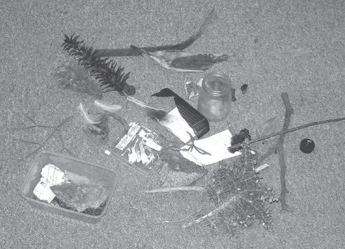
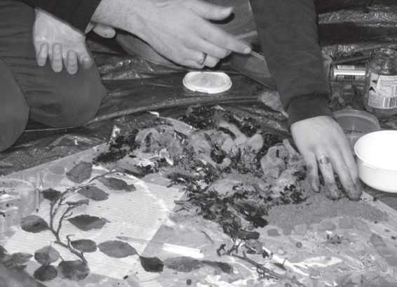

> [BREADCRUMB_CTX: 《Making: Anthropology, Archaeology, Art and Architecture》 > 2 The materials of life (Part 1)]

# 2 The materials of life

**2**

**THE MATERIALS OF LIFE**

**Touching objects, feeling materials**

Let me begin by describing an experiment I have carried out along with the students in the very first week of the 4 As course. For this experiment, I asked them to gather a selection of objects that they found lying around the ‘things’ on which they had chosen to focus their projects. They arrived with a motley assortment of odds and ends: there were coins, paper clips, drinks cans, cigarette butts, a rubber ball, the feather of a seagull, and much else besides. First we deposited all the stuff they had brought in a heap in the middle of the floor (Figure 2.1). We looked at the heap, from which a spider scuttled out across the carpet. It had arrived as a passenger with some item, but no one knew from which. Or was it actually a *part* of the item? Picking up each object in turn, we examined it, investigated its form, interrogated the finder on where it was found and why it had caught his or her attention, and attempted to reconstruct the story of how it had fetched up at that particular place. The coins, for example, told of pockets and purses and of countless transpositions from hand to till and back. The paper clips once fastened the documents of a busy official, while the cans – previously filled with liquid – had been held to thirsty lips through which, only moments before, had been inhaled the smoke of smouldering tobacco. From the tooth marks on its surface, it was apparent that the rubber ball, recovered from a sandy beach, had been the plaything of a dog, while the feather had once graced a bird in flight, high in the air. All of these objects, in short, evidenced other lives – human, canine, avian. And yet in becoming objects they had broken off from these lives – like fallen twigs from a tree – and were left lifeless, as so much bric-a-brac stranded on the riverbank. Only the spider escaped.

In the following week I asked the students to return to their project sites and to bring along, this time, a selection of *materials* gathered from the environs of these sites. This time many of them came with containers full of stuff like sand, gravel, mud and leaf litter. Why containers? Because, as we found as soon as we emptied out the contents, materials do not, of themselves, stay in place or hold to the bounds of any form, and have an inherent tendency to run amok. We are all familiar with Mary Douglas’s (1966: 44) celebrated definition of dirt as matter out of place, and sure enough, we quickly got our hands very dirty. This offered an experience of tactility that could not have been more different from the clinical detachment with which we had examined the objects of the previous week. Then, it was as if we had worn protective gloves, to ensure that there should be absolutely no exchange of substance between the object and the hands that held it. Nor should it be bent, broken or squashed. Our concern had been exclusively with the stillness of form, and like detectives, we were at pains to handle every object delicately, so as not to tamper with the evidence or compromise its value as data. With materials, on the other hand, the experience of tactility was all about grain and texture, about the feeling of contact between malleable substance and sensitive skin, about dry sand cupped in the palm and running through the fingers, wet mud sticking and caking as it dries out, the rough abrasion of gravel, and so on.

**FIGURE 2.1** An assortment of objects on the floor: from the 4 As class

I had myself come along with some materials, namely sheets of hardboard and a bucket of wallpaper paste. Having covered the boards with paste, everyone set to work mixing the materials they had brought and then smearing these mixtures, however they wished, onto the boards (Figure 2.2). The result was a rather astonishing series of artworks. I think what was most astonishing about them was the way in which they registered the traces of movement and flow: on the one hand the manual and bodily gestures of ourselves, as practitioners; on the other hand the particular flow patterns of the mixtures we had made. I suppose, in retrospect, that we should not have been so astonished by this; after all, it corresponds to our most commonplace experience in the kitchen. Next time you are making soup, pay attention to the way your stirring gesture with the spoon both induces and responds to viscosities and currents of the mixed ingredients in the pan. What is odd is that studies of the material culture of kitchens have generally concentrated on pots and pans, and spoons, to the virtual exclusion of the soup. The focus, in short, has been on objects rather than materials. Yet on second thoughts, this is not a division between what we find in the kitchen: objects here; materials there. It is rather a difference of perspective. Householders might think of pots and pans as objects, at least until they start to cook, but for the dealer in scrap metal, they are lumps of material.

**FIGURE 2.2** Smearing materials onto boards covered with paste: from the 4 As class

Likewise, we could return to the objects that the students brought in for our first session and ask: what would have happened if we had thought of all this stuff as materials? A coin: that’s copper, and we could have sought to explore its properties by hammering it, or seeing what happens when you heat it up or put it in a flame (the flame would turn green). The paper clip: that’s a length of wire, and we could unravel it and bend it to other purposes. The drinks can: that’s aluminium; feel how light it is! The cigarette butt: well there is still some tobacco inside. Light it, and it will exude smoke, and the smoke makes trails in the air that bend this way and that in response to the fluxes and rhythms of our own breathing. The ball: that’s made of rubber, and by applying pressure with the hands, we can feel its softness and springiness. We could even put it between our teeth and imagine what it feels like to be a dog. And of course, to think of the feather as a material is to recognise that it has grown along with the body of the bird of which it was once an integral part, mingling with the air in flight. In every case, by treating these erstwhile objects as materials we rescue them from the cul-de-sac into which they had been cast and restore them to the currents of life.

**Making and growing**