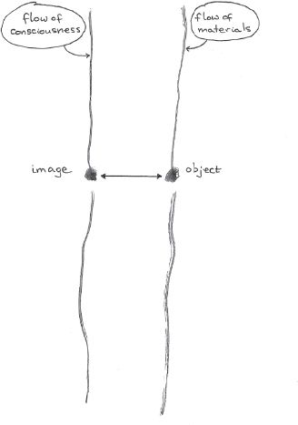

## 2 The materials of life (Part 2)

> [BREADCRUMB_CTX: 《Making: Anthropology, Archaeology, Art and Architecture》 > 2 The materials of life (Part 2)]

This chapter is about bringing things back to life. Its basic argument may be expressed by means of a simple diagram. Draw two lines: they need not be straight; indeed you can allow them to meander a little. However, they should proceed alongside one another, like the trails left by two people walking abreast. Each is a path of movement. Let one of these lines stand for the flow of consciousness, saturated as it is by light, sound and feeling. And let the other stand for the flow of materials as they circulate, mix and meld. Now imagine that each of these flows is momentarily stopped up. On the side of consciousness, this stoppage takes on the semblance of an *image*, like a fugitive suddenly caught in the glare of a spotlight. And on the side of materials it takes on the solid form of an *object*, like a boulder placed in the fugitive’s path, blocking his passage. On our diagram we could depict both stoppages by a point or blob on each respective line. Now draw a double ended arrow connecting the two blobs. Unlike the original pair of lines, this arrow is not the trace of a movement; it is notional rather than phenomenal, and depicts a connection of some kind between image and object. Now that our diagram is complete (Figure 2.3), we can sum up the argument of this chapter, and indeed of the entire book. It is to switch our perspective from the endless shuttling back and forth from image to object and from object to image, that is such a pronounced feature of academic writing in the fields of anthropology, archaeology, art and architecture, to the material flows and currents of sensory awareness in which images and objects reciprocally take shape. In terms of our diagram, this entails a rotation of 90 degrees, from the lateral to the longitudinal.

We will find this rotation cropping up again and again, in various connections. Indeed we have already encountered it in the last chapter, in our distinction between ethnographic documentation (lateral) and anthropological transformation (longitudinal). With regard to perception, it underpins the distinction between an optical and a haptic relation to the world – a distinction that explains the quite different experiences of tactility described above, showing that the optical relation is by no means limited to a perception mediated by the eye (nor is the haptic relation limited to the hands). With regard to creativity, it distinguishes the improvisatory creativity of labour that works things out as it goes along from the attribution of creativity to the novelty of determinate ends conceived in advance. It underpins the distinctions spelled out in Chapter 7 between interaction and correspondence and in Chapter 8 between articulate and personal knowledge. Most fundamentally, however, it crops up in connection with the question of what it means to make things.

We are accustomed to think of making as a *project*. This is to start with an idea in mind, of what we want to achieve, and with a supply of the raw material needed to achieve it. And it is to finish at the moment when the material has taken on the intended form. At this point, we say, we have produced an *artefact*. A nodule of stone has become an axe, a lump of clay a pot, molten metal a sword. Axe, pot and sword are instances of what scholars call *material culture*, a phrase that perfectly captures this theory of making as the unification of stuff supplied by nature with the conceptual representations of a received cultural tradition. ‘Material culture’, as Julian Thomas (2007: 15) puts it, ‘represents at once ideas that have been made material, and natural substance that has been rendered cultural.’ In the literature, the theory is known as *hylomorphism*, from the Greek *hyle* (matter) and *morphe* (form). Whenever we read that in the making of artefacts, practitioners impose forms internal to the mind upon a material world ‘out there’, hylomorphism is at work.

**FIGURE 2.3** Consciousness, materials, image, object: the diagram

I want to think of making, instead, as a process of *growth*. This is to place the maker from the outset as a participant in amongst a world of active materials. These materials are what he has to work with, and in the process of making he ‘joins forces’ with them, bringing them together or splitting them apart, synthesising and distilling, in anticipation of what might emerge. The maker’s ambitions, in this understanding, are altogether more humble than those implied by the hylomorphic model. Far from standing aloof, imposing his designs on a world that is ready and waiting to receive them, the most he can do is to intervene in worldly processes that are already going on, and which give rise to the forms of the living world that we see all around us – in plants and animals, in waves of water, snow and sand, in rocks and clouds – adding his own impetus to the forces and energies in play. The difference between a marble statue and a rock formation such as a stalagmite, for example, is not that one has been made and the other not. The difference is only this: that at some point in the formative history of this lump of marble, first a quarryman appeared on the scene who, with much force and with the assistance of hammers and wedges, wrested it from the bedrock, after which a sculptor set to work with a chisel in order, as he might put it, to release the form from the stone. But as every chip of the chisel contributes to the emergent form of the statue, so every drop of supersaturated solution from the roof of the cave contributes to the form of the stalagmite. When subsequently, the statue is worn down by rain, the form-generating process continues, but now without further human intervention.

To read making longitudinally, as a confluence of forces and materials, rather than laterally, as a transposition from image to object, is to regard it as such a form-generating – or *morphogenetic* – process. This is to soften any distinction we might draw between organism and artefact. For if organisms grow, so too do artefacts. And if artefacts are made, so too are organisms. What varies, among countless other things, is the extent of human involvement in the generation of form: but this variation is one of degree, not kind. This is not of course to deny that the maker may have an idea in mind of what he wants to make. He may even be seeking to copy a piece of work that already stands before him. Does this not distinguish the statue from the stalagmite, once and for all? Can we not speak, in a sense unique to artefacts, of their *design*? This is a question I will leave for later (see Chapter 5). Suffice it to say, at this point, that even if the maker has a form in mind, it is not this form that creates the work. It is the engagement with materials. And it is therefore to this engagement that we must attend if we are to understand how things are made. Time and again, scholars have written as though to have a design for a thing, you already have the thing itself. Some versions of conceptual art and architecture have taken this reasoning to such an extreme that the thing itself becomes superfluous. It is but a representation – a derivative copy – of the design that preceded it (Frascari 1991: 93). If everything about a form is prefigured in the design, then why bother to make it at all? But makers know better, and one of the purposes of this book is to bring them out of the shadows into which they have been cast by an uncritical application of the hylomorphic model, and to celebrate the creativity of their achievement.

**Baskets in the sand**