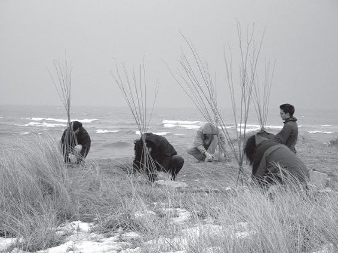
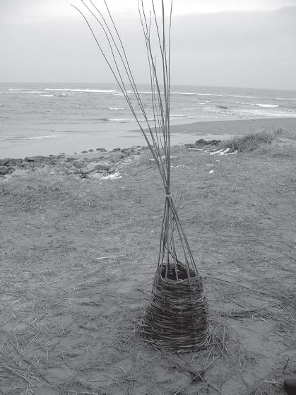

## 2 The materials of life (Part 3)

> [BREADCRUMB_CTX: 《Making: Anthropology, Archaeology, Art and Architecture》 > 2 The materials of life (Part 3)]

On a cold and windy day in February, the 4 As students and I were out on a sandy peninsula wedged between the beach and the estuary of the River Don, which flows into the sea on the northern flank of the city of Aberdeen. Patches of snow remained on the ground. We were learning to make baskets out of willow, under the direction of anthropologist and craftsperson Stephanie Bunn (see Bunn 2010: 49–50). To form a frame, an odd number of lengths of willow were stuck vertically into the ground, to form a rough circle, tied at the top. Horizontal pieces were then woven alternately in and out of the vertical frame so as gradually to build up a surface in the form of an inverted cone. Students worked at this either singly or in pairs (Figure 2.4). From the start, I think, many students were surprised by the recalcitrant nature of the material. In a finished basket, the willow seems to sit so naturally there, as if it had always been meant to fall into that shape and was merely fulfilling the role for which it was predestined. But the willow did not want to be bent into shape. Sometimes it put up a fight, springing back and striking the weaver in the face. One had to be careful and coaxing. Then we realised that it was actually this resistance, the friction set up by branches bent forcibly against each other, that held the whole construction together. The form was not imposed on the material from without, but was rather generated in this force field, comprised by the relations between the weaver and the willow. Indeed as novices, we had little control over the precise form and proportions of our baskets. Kneeling on the ground, our weaving involved quite muscular movements of the entire body, or at least from the knees upwards, so that the dimensions of the basket related directly to such bodily dimensions as arm-reach and shoulder-height. Students discovered they had muscles in places they had never imagined, partly because after a while they began to ache. But other forces, too, entered into the formative process. One of these was the wind. A persistent, strengthening wind was bending all the verticals of the frame in one direction, with an inclination that increased with height. No wonder, then, that many baskets, especially those woven nearest to the shore, tilted over somewhat, in an elegant but wholly unintended curve (Figure 2.5).

**FIGURE 2.4** Making baskets in the sand, near Aberdeen beach in north-east Scotland. (Courtesy of Raymond Lucas.)

We laboured for almost three hours, gradually developing a rhythm and a feel for the material. As the work progressed, however, we began to face another problem. How would we know when to stop? There is no obvious point when a basket is finished. The end dawned for us, not when the form came to match initial expectations, for we had none. It came rather with failing light and the imminent prospect of heavy rain, increasing chill and stiffness in the limbs, and the sense that each additional strand was becoming somehow superfluous. At that point it was time to insert a separately woven base and to cut the verticals at the height we had reached. At last, then, we could lift the woven construction from the ground, and turn it upside down to reveal that what we had made was indeed a basket. Each basket was different, uniquely reflecting the mood and temperament, as well as the physical stature, of its maker. Finally the students straggled off into the gathering dusk, proudly bearing homeward the baskets they had made. Later they would tell me that they had learned more from that one afternoon than from any number of lectures and readings: above all about what it means to make things, about how form arises through movement, and about the dynamic properties of materials.

**FIGURE 2.5** A near-complete basket. (Courtesy of Raymond Lucas.)

**On matter and form**

Perhaps it is unfair to use basketry as a way to criticise the hylomorphic model. The conclusion that the model does not work for weaving does not rule out the possibility that it might work perfectly well for branches of manufacture in which form is more ostensibly imposed on material. What about making bricks, for example? In forming the brick, prior to firing in the kiln, soft clay is pressed into a pre-prepared, rectangular mould. The mould, it seems, prescribes the form while the material – the clay – is initially formless. Surely, as the clay is pressed into the mould, form is united with material just as the logic of hylomorphism requires. But in a thesis entitled *L’individuation à la lumière des notions de Forme et d’Information*, the philosopher Gilbert Simondon shows that this is not so.1 For one thing, the mould is no geometric abstraction but a solid construction that has first to be built from a specific material (traditionally, a hardwood such as beech). For another thing, the clay is not raw. Having been dug out from beneath the topsoil, it has first to be ground, sieved to remove stones and other impurities, and then exhaustively kneaded before it is ready for use. In the moulding of a brick, then, form is not united with material. Rather, there is a bringing together or unification of two ‘transformational half-chains’ (*demi-chaînes de transformations*) – respectively building the mould and preparing the clay – to a point at which they reach a certain compatibility: the clay can take to the mould and the mould can take the clay (Simondon 2005: 41–42). At the moment of encounter, when the brick maker ‘dashes’ a clot of clay into the mould, the expressive force of the maker’s gesture, imparted to the clay, comes hard up against the compressive resistance of the hard wood of the mould’s walls. Thus the brick, with its characteristic rectangular outline, results not from the *im*position of form onto matter but from the *contra*position of equal and opposed forces immanent in both the clay and the mould. In the field of forces, the form emerges as a more or less transitory equilibration. Perhaps bricks are not so different from baskets after all (Figure 2.6).

Simondon’s central postulate of *individuation* holds that the generation of things should be understood as a process of morphogenesis in which form is ever emergent rather than given in advance. As Brian Massumi (2009: 37) explains, in a commentary on Simondon’s text, this is to assert ‘a primacy of processes of becoming over the states of being through which they pass’. Against the form-receiving passivity of matter posited by hylomorphism, Simondon took the essence of matter, or the material, to lie in *form-taking activity*. The hylomorphic model, Simondon (2005: 46) concludes, corresponds to the perspective of a man who stands outside the works and sees what goes in and what comes out but nothing of what happens in between, of the actual processes whereby materials of diverse kinds come to take on the forms they do. It is as though, in form and matter, he could grasp only the ends of two half-chains but not what brings them together, only a simple relation of moulding rather than the continuous modulation that goes on in the midst of form-taking activity, in the *becoming* of things.