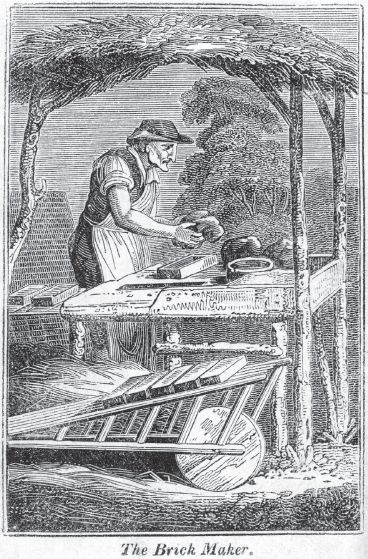

## 2 The materials of life (Part 4)

> [BREADCRUMB_CTX: 《Making: Anthropology, Archaeology, Art and Architecture》 > 2 The materials of life (Part 4)]

In their ‘treatise on nomadology’, philosopher Gilles Deleuze and psychoanalyst Félix Guattari have taken up Simondon’s crusade against hylomorphism, and, thanks to their influence, the issues it raises are beginning to percolate through to archaeology and anthropology. The trouble with the matter-form model, argue Deleuze and Guattari, is that in assuming ‘a fixed form and a matter deemed homogeneous’ it fails to acknowledge, on the one hand, the variability of matter – its tensions and elasticities, lines of flow and resistances – and, on the other hand, the conformations and deformations to which these modulations give rise. In reality, they insist, whenever we encounter matter ‘it is matter in movement, in flux, in variation’, with the consequence that ‘this matter-flow can only be *followed*’ (Deleuze and Guattari 2004: 450–451). Artisans or practitioners who follow the flow are, in effect, itinerants, wayfarers, whose task is to enter the grain of the world’s becoming and bend it to an evolving purpose. Theirs is an ‘intuition in action’ (ibid.: 452).

Whereas Simondon took his key example from brick making, however, Deleuze and Guattari appeal to metallurgy. For them, metallurgy highlights a particular insufficiency of the hylomorphic model, namely that it can only conceive of technical operations as sequences of discrete steps, with a clear threshold marking the termination of each step and the commencement of the next. But in metallurgy, these thresholds are precisely where the key operations take place. Thus, even as he beats out the form with hammer on anvil, the smith has periodically to return his iron to the fire: material variation spills over into the formative process and indeed continues beyond it, since it is only after forging that the iron is finally quenched. ‘Matter and form have never seemed more rigid than in metallurgy’, write Deleuze and Guattari, ‘yet the succession of forms tends to be replaced by the form of a continous development, and the variability of matters tends to be replaced by the matter of a continous variation’ (ibid.: 453). Instead of the concatenation of discrete operations to which analysts of techniques have given the name *chaîne opératoire*,2 we have here something more like an unbroken, contrapuntal coupling of a gestural dance with a modulation of the material. Even iron flows, and the smith has to follow it.

**FIGURE 2.6** A brick maker at work under a thatched shelter, his wheelbarrow beside him. The engraving is by an unknown artist, dating from 1827. (Courtesy of Mary Evans Picture Library.)

**The two faces of materiality**

When scholars speak of the ‘material world’ or, more abstractly, of ‘materiality’, what do they mean? Put the question to students of material culture, and you are likely to get contradictory answers. Let me offer a few instances. The first comes from Christopher Tilley, on the topic of stone. Contemplating a stone in its ‘brute materiality’, Tilley perceives a formless lump of matter. Yet we need a concept of materiality, he thinks, in order to understand how particular pieces of stone are given form and meaning within specific social and historical contexts (Tilley 2007: 17). Andrew Jones (2004: 330), likewise, holds that the notion of materiality both encompasses ‘the material or physical component of the environment’ and ‘emphasises how those material properties are enrolled in the life projects of humans’. Nicole Boivin (2008: 26) tells us that she uses the word materiality ‘to emphasise the physicality of the material world’, yet this physicality embraces the fact ‘that it offers possibilities for the human agent’. Introducing a collection of essays on the theme of materiality, Paul Graves-Brown (2000: 1) asserts that their common focus is on the question of ‘how the very material character of the world around us is appropriated by humanity’. And in almost identical terms, Joshua Pollard (2004: 48) explains that ‘by materiality I mean how the material character of the world is comprehended, appropriated and involved in human projects’.

In every case, there seem to be two sides to materiality. On one side is the raw physicality of the world’s ‘material character’; on the other side is the socially and historically situated agency of human beings who, in appropriating this physicality for their purposes, are alleged to project upon it both design and meaning in the conversion of naturally given raw material into the finished forms of artefacts. This duplicity in the comprehension of the material world precisely mirrors that to be found in much older debates surrounding the concept of human nature, which could refer at once to the raw substrate of basic instinct that humans were alleged to share with the ‘brutes’, and to a suite of characters – including language, intelligence and the capacity for symbolic thought – by which they were said to be elevated to a level of being over and above that of all other creatures. The appeal, in these debates, to the ‘*human* nature of human nature’ (Eisenberg 1972) did nothing to resolve this duplicity, but only served to reproduce it. Indeed the very notion of humanity, as we saw in the last chapter (p. 5), epitomises the predicament of a creature that can know itself and the world of which it is inextricably a part only by taking itself out of that world and re-inscribing itself on another level of being: mental rather than material; cultural rather than natural (Ingold 2010: 362–363). In just the same way, in the notion of materiality the world is presented both as the very bedrock of existence and as an externality that is open to comprehension and appropriation by a transcendent humanity. Materiality, like humanity, is Janus-faced.

Now it is not my intention, as archaeologist Bjørnar Olsen (2010: 16) alleges, to eliminate the word ‘materiality’ from our vocabulary or to ban its use. Just as with ‘humanity’, it would probably be difficult for us to manage without it. We do, however, need to be wary of the assumptions that it tends to bring in train, most particularly – as geographers Ben Anderson and John Wylie (2009: 319) warn – that the material world has by nature such properties of obduracy and consistency of shape as define the state of a *solid*. Olsen himself falls prey to this assumption when he appeals to the world’s ‘hard physicality’ (Olsen 2003: 88). Why so hard, so solid? Consider, for example, an ordinary pot. In its time it has seen service in numerous campaigns, from when it was first made to when, cracked and discarded, it was returned to the earth, only to be uncovered thousands of years later in an archaeological excavation. Yet through all of that, has it not remained steadfastly what it was? Was not the pot, as the hard and physical thing it is, always a pot? Not so, answers archaeologist Cornelius Holtorf (2002: 54), in his ‘Notes on the life history of a potsherd’. For the pot’s materiality, he claims, is no more and no less than the ways in which, throughout its history, it was variably enrolled in human life-projects. It could, in principle, be anything anyone wanted it to be. But in this very claim, Holtorf lurches from one side of materiality to the other – from the physicality of matter to the forms of its social appropriation. This move does nothing to soften, liquefy or enliven the material. If the pot has a life history (and this could be either ‘short’ or ‘long’, depending on whether we count from the moment of manufacture to that of discard or to that of eventual recovery), it is not the history of a life intrinsic to the stuff of which it was made. It is of the human life that has surrounded it and given it meaning.