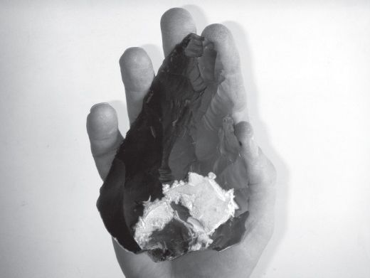
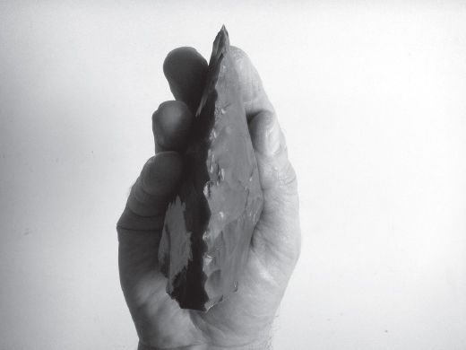

> [BREADCRUMB_CTX: 《Making: Anthropology, Archaeology, Art and Architecture》 > 3 On making a handaxe (Part 1)]

# 3 On making a handaxe

**3**

**ON MAKING A HANDAXE**

**The Acheulean biface**

One of the strangest enigmas of prehistory is a thing called a handaxe. I have before me, as I write, a replica made for me to order by the professional stone knapper, John Lord (Figures 3.1 and 3.2). It is a thing of great beauty, consummate craftsmanship and no obvious practical use at all. Of a size and shape that fits perfectly to the palm and outstretched fingers of an adult hand, I like just to hold it and feel its weight and texture. Wrought from a nodule of black flint, with some residual traces of white cortex, its form is of what prehistorians call a *biface*: that is, it has two convex faces, one bulging slightly more than the other, which meet around an edge that tapers from a thick butt towards a rounded tip. The two faces bear the scars of the technique by which it was made, involving the successive removal of flakes from an original core. This technique exploits the property of conchoidal fracture, that is, the tendency of flint to break off in slivers, issuing from a bulb-shaped cone at the point of impact, when struck at an oblique angle near a protruding edge. Since the ventral surface of each sliver is slightly convex, it leaves its mark on the core as an elongated concavity. Once the face is fully flaked, these concavities intersect to form an irregular pattern of well-defined ridges. The edge at which the two faces converge is surprisingly sharp, and has been trimmed through the addition of further serrations made by applying pressure through a punch of softer and less brittle material such as wood or antler.

That the thing is called a handaxe owes much to the circumstances surrounding the first substantial finds of prehistoric specimens, in the 1830s and 40s, at the site of Saint Acheul in northern France. Their discoverer was Jacques Boucher de Perthes, a customs officer from the nearby town of Abbeville. Believing them to be of great antiquity, de Perthes called them ‘antediluvian axes’ (*haches antediluviennes*). Ridiculed by his contemporaries, his claims subsequently found favour in a climate of thought that was growing increasingly accustomed to the idea that humankind had evolved over aeons of time. Thus it was that by the late nineteenth century, the site of Saint Acheul had come to stand for an entire epoch of prehistory, associated with the industry of making artefacts of just the kind that de Perthes had first uncovered there. In 1925, this industry was officially labelled ‘the Acheulean’, and the label – along with the designation of its iconic artefacts as handaxes – has remained ever since. Yet far from being confined to France, or even to northern Europe, Acheulean handaxes were turning up all over the place: elsewhere in Europe, and in Africa, the Near East and South Asia. Not only have they been found across all three continents of the Old World; they have also been dated to periods spanning well over a million years. The oldest known handaxes, albeit rather crudely made, have been recovered from sites in East Africa dating around 1.7–1.6 million years ago. In Europe, artefacts of the same kind were still being made as late as 128,000 years ago. And although, comparing earlier and later specimens, there is some evidence of progressive refinement towards greater balance and symmetry, through all that time the overall form remained virtually unchanged (Schick and Toth 1993; Wynn 1995; Roche 2005).

**FIGURE 3.1** Replica Acheulean handaxe, made by John Lord, face up. (Courtesy of Susanna Ingold.)

**FIGURE 3.2** The same handaxe, edge up. (Courtesy of Susanna Ingold.)

There seems little reason to doubt that the handaxe is an outcome of purposive activity and that it is, in this sense, a thing that has been made. It is true that conchoidal fractures can occur accidentally, for example on the seashore when stones are knocked against one another in the surf. But no accident, or series of accidents, could generate the systematic, patterned flaking of the handaxe. It is also true that chimpanzees have been observed to crack open hard-shelled nuts using a technique that bears comparison with the way stones may be split, by placing them on a hard surface and delivering a percussive blow from above. Knappers still use this technique to obtain the cores from which they work.1 Split-breaking, however, is quite different in both method and results from conchoidal fracture (Pelegrin 2005: 25). The latter requires a degree of bimanual dexterity and precision control that is beyond even the most rigorously trained ape, and that was equally beyond the capabilities of those ancestral hominins,2 of two million and more years ago, which seem to have made extensive use of split stone but never to have flaked it. Thus the Acheulean is an industry that is genuinely without parallel in the animal kingdom. In the fossil record, the industry is generally associated with the remains of hominins of the kind long known as *Homo erectus*, and we may reasonably infer that the makers of handaxes were, in the main, individuals of this species. But if they made them for a purpose, we have no idea of what that purpose was. Explanations range from the plausible, such as that they were used for cutting and scraping animal hides or vegetable matter, to the bizarre, including one theory that hunters used the peculiar aerodynamic properties of the ‘axe’, when hurled with a spin, to stun or topple unsuspecting prey (Calvin 1993). All we know for sure is that the one use to which the thing *cannot* have been put is as an axe, since to have done so would have caused more injury to the user’s hand than to whatever he or she might have been seeking to cut down.

For want of any better explanation, the majority of prehistorians have gone for the safe option of describing the artefact as a ‘general purpose tool’ (Wynn 1995: 14). The fundamental enigma of the handaxe, however, lies not in what it might have been used for, but in the stability of its form. To what can we ascribe this stability? When it comes to the tools of both contemporary and past human beings, it is commonly assumed that they are the products of intelligent design, as though their makers first ‘saw’, in their mind’s eye, the form of the completed object, and then set to work to execute it in the material. When we contemplate the form of the Acheulean handaxe, reflecting on its regularity and balance, it is hard not to see it likewise as the realisation of deliberate, self-conscious design. The bifacial form does not appear to be in any way prefigured in the raw material – comprising naturally irregular lumps of stone – or in the knapper’s relation to it. If the form is thus arbitrary, and imposed on the material, where could it reside save in the minds of makers, as part of a conceptually framed and socially transmitted tradition? Indeed, assertions to this effect are commonplace in archaeological writings. John Gowlett, for example, assures his readers that ‘*Homo erectus* of 700,000 years ago had a geometrically accurate sense of proportion and could impose this on stone in the external world’ (Gowlett 1984: 185). Likewise, having himself attempted to master the skills of handaxe making, Jacques Pelegrin contends that the regularity and symmetry of the biface furnish the clearest evidence that its makers were guided by a ‘pre-existing mental image … deserving of being termed a “concept”’ (Pelegrin 1993: 310). In short, it is supposed that like any modern artisan, the Acheulean handaxe maker must have started work with a model or representation of some kind, in the imagination, of the things to be produced. ‘The maker’, as Brian Fagan asserts, ‘had to envisage the shape of the artefact, which was to be produced from a mere lump of stone’ (Fagan 1989: 138).

**Instinct or intelligence**