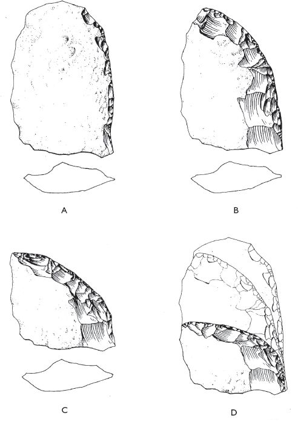

## 3 On making a handaxe (Part 3)

> [BREADCRUMB_CTX: 《Making: Anthropology, Archaeology, Art and Architecture》 > 3 On making a handaxe (Part 3)]

However, at a conference convened in 1990 to address the connections, in human evolution, between toolmaking and cognition, and between both and the faculty of language, this consensus was shattered. In a paper co-authored with the psychologist William Noble, prehistoric archaeologist Iain Davidson presented a radically alternative argument to account for the formation of the handaxe. What if it had never been the intention of the maker to produce any such thing? Suppose that *Homo erectus* had frequent need for razor-sharp instruments that were small and disposable, and not blunted by use. What better than a flake, newly struck from a core? By carrying around a core and perhaps a hammer-stone, flakes could be detached on the spot, as and when required. Only once the core had been whittled down to the point where it could no longer be profitably flaked would it eventually have been discarded. What archaeologists have assumed to be purposefully manufactured artefacts, Davidson and Noble argued, are merely these residual cores. They are leftovers (Davidson and Noble 1993: 372).

At the conference, this argument was greeted with scepticism if not dismay, nor has it garnered much support since. Five years later another contributor to the conference, Thomas Wynn, published a comprehensive rebuttal (Wynn 1995). The bifacial symmetry of the handaxe, Wynn argued, is far greater than could result from any haphazard process of flake detachment. Furthermore the production of this symmetrical form involved the removal of many tiny, trimming flakes that were too small to have been of any conceivable use. Finally, the fact that it has been possible in some cases to reconstruct whole cores by refitting axes to the ‘debitage’ of surrounding flakes indicates that they were made in one sitting rather than left over from a series of dispersed episodes. Wynn’s verdict is unequivocal:

The handaxe was an idea that was imposed on the material world and also shared by many individuals. It was a true cultural category. Stone knappers set out to produce handaxes as final products. They may also have been cores, but the shape itself was clearly intentional, and therefore provides us with a glimpse into the mind of the knappers.

(Wynn 1995: 12)

Jacques Pelegrin, combining his archaeological investigations with many years of practical experience in flint knapping, comes to much the same conclusions. The quality of work that is evident in a well-made handaxe, along with the regularity of shape, clearly indicates an intention on the part of the maker that was quite independent of the raw material. ‘For palaeohominins such as *Homo erectus*’, Pelegrin writes, ‘their elaborated knapping methods provide evidence that hundreds of thousands of years ago they possessed not only accurate motor skills but that *mental templates* framed the entire knapping process. Technical actions were subordinate to, and structured by, *geometric intentions*’ (Pelegrin 2005: 30, emphases added).

The evidence against the hypothesis that handaxe makers were mainly interested in producing flakes is indeed compelling.5 In proposing this hypothesis, however, Davidson and Noble were really concerned to exemplify a more fundamental point of principle. This is that we should not be lulled into conflating the final form of an artefact, as it is recovered from an archaeological site, with the ‘final form’ as it might have been envisaged by its erstwhile maker. The lump of stone that the archaeologist recovers today and classifies as a biface is one that, many millennia before, had been cast aside by its maker-cum-user. It would have been discarded, however, not when it was newly made but when it was of no further use. A modern analogy might be drawn with the familiar, industrially produced pencil. I would not myself throw away a newly bought pencil in mint condition. As I use it, however, it has periodically to be re-sharpened, and with every sharpening some of the pencil is shaved and its length reduced, until eventually it is too short to hold. Only then do I throw it away. An archaeologist of the future who, having analysed the contents of early twenty-first century waste bins, came to the conclusion that things conventionally called ‘pencils’ could not actually have been made for drawing because they were too short (and perhaps had some ritual or symbolic function instead), would be committing what Davidson and Noble (1993: 365) *call the finished artefact fallacy*.

Indeed, in this regard, flint tools are not so very different from pencils. They wear in use and may have to be sharpened by further flaking until they too are reduced to a stub and discarded (Figure 3.3). Harold Dibble, for example, has shown how apparently different types of flaked stone implement belonging to the so-called Mousterian industry associated with Neanderthal humans (*Homo sapiens neandertalensis*) of some 40,000 years ago, and variously classified as points and scrapers, could just as well be understood as representing successive stages of flake reduction (Dibble 1987a). As for the Acheulean, even if we agree, with Wynn and others, that handaxe makers were primarily interested in shaping cores and not in producing flakes, the danger of the fallacy remains. We cannot assume that the shapes of recovered cores are those that their makers originally had in mind and sought to impose on the material, or even that anything equivalent to the ‘mental templates’ and ‘geometric intentions’ of which Pelegrin speaks was ever present in their minds at all.

**Templates and geometry**

Recall Wynn’s assertion, to which I referred a moment ago, that ‘stone knappers set out to produce handaxes as final products’ (Wynn 1995: 12). How, then, do we know at what point the process of production ends? How can we tell a not-quite-finished axe from a finished one or, for that matter, from one that – having already crossed the finishing line – has already suffered the scars and abrasions of use? For a possible answer we can return to Holloway, who compares the fashioning of an axe to the construction of a sentence of language. To make a sentence we chain together words into a syntactically coherent whole; likewise, according to Holloway, ‘the process of making a stone tool, such as an Acheulean handaxe, is a concatenated activity, hierarchically organised’ (Holloway 1969: 402). Thus, an unfinished artefact is like an incomplete sentence. Try reading this last sentence with the final word, ‘sentence’, omitted. *An unfinished artefact is like an incomplete* … The effect is to reduce the remaining words to incoherence; they add up to nothing at all. So it is with the unfinished axe. To make it, the knapper has to deliver a number of blows, which differ in force and direction, and which alternate with other operations such as rotating the stone in the hands or turning it over so as to work on the other side. ‘Taking each motor event alone’, Holloway continues,

**FIGURE 3.3** Successive stages (A–D) in the reduction of a flaked stone scraper, replicated by Harold L. Dibble. ‘As reduction continues’, Dibble observes, ‘the retouch tends to get heavier, flake length and surface area decrease, and, typologically, the tool proceeds from a single-edged scraper to a transverse scraper’ (Dibble 1987b: 112). Reproduced from *American Antiquity* 52(1), 1987. (Courtesy of the Society for American Archaeology.)

… no one action is complete; each action requires a further one, and each is dependent in another way on the original plan. In other words, at each point of the action except the last, the piece is not ‘satisfactory’ in structure. Each unit action is meaningless by itself in the sense of the use of the tool; it is meaningful only in the context of the whole completed set of actions culminating in the final product. This exactly parallels language.

(1969: 402)