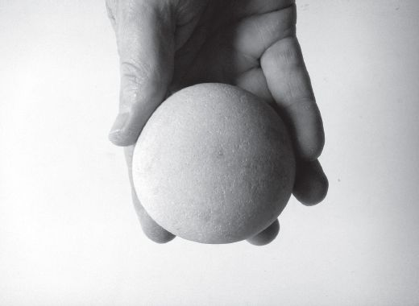
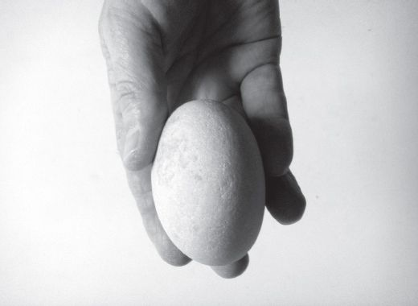

## 3 On making a handaxe (Part 4)

> [BREADCRUMB_CTX: 《Making: Anthropology, Archaeology, Art and Architecture》 > 3 On making a handaxe (Part 4)]

Thus, in Holloway’s understanding, the process of making has a clearly defined starting point, as well as an end point. The maker begins with both a plan and a finite set of component operations required to implement it. As the task proceeds, these components are assembled, bit by bit, to constitute a totality that corresponds precisely to the original design.6 But only with the last operation – like dropping in the final piece of the jigsaw – does the artefact come into its own as a coherent whole.

There can, in short, be no final product without an initial design; no completion without an origin. For finality can only be judged in relation to a project of assembly that is already prefigured at the outset, albeit in virtual form, in the mind of the maker. That is why Wynn is able to speak of the handaxe, within the space of the short passage cited above, as both a ‘final product’ and ‘an idea that was imposed on the material world’ (Wynn 1995: 12). Like Holloway, Wynn is appealing here to the hylomorphic model of making in its modern incarnation, entailing the active imposition of cultural form upon materials supplied by nature. At the start of the process, the maker has, on the one hand, a design in mind, and on the other, a formless lump of stone. At the end, design and stone are united in the complete lithic artefact.

In the absence of a prior conception of form, however, not only is it impossible to answer the question of whether a thing is finished, it is meaningless even to ask it. To demonstrate the point, let me introduce, alongside the handaxe, another piece of stone that I have before me as I write. It was recovered from a shingle beach, not far from my home in the north-east of Scotland. Composed of granite, it is extremely hard, yet its form is so beautifully rounded that in outward appearance – and certainly by comparison to the scarred and serrated handaxe – it looks almost soft. To the touch it is perfectly smooth. Resting on the table its form is that of a slightly squashed sphere, presenting a near-circular outline when viewed from above and near-elliptical outline from the side (Figures 3.4 and 3.5). Indeed in terms of its geometry, this stone is no less symmetrical than the biface. True, the symmetry is not perfect, but then, nor is the symmetry of any handaxe. Not until I picked it up, however, at once appropriating it as a conclusion to my own project of collection (driven as it was by certain formal and aesthetic standards), was the stone in any sense ‘finished’. Nor was it ever started. It was just *there*, forever subject to the continual grinding action, under the force of the waves, that has given rise to its current form.

**FIGURE 3.4** A stone recovered from a beach in north-east Scotland, in broad profile. (Courtesy of Susanna Ingold.)

**FIGURE 3.5** The same stone, in narrow profile. (Courtesy of Susanna Ingold.)

Clearly, no geometric intentions or mental templates guided the formation of this stone. Nor, *on the strength of its symmetry alone*, are we any more entitled to impute design to the handaxe. I have, however, already observed that unlike my stone, the patterned flaking of the biface cannot be attributed to any ordinary process of erosion. It could only have come about through deliberate and highly skilled activity. Even this, however, does not entitle us to invoke prior intentions in the form of design concepts or assembly plans. For the intentionality of skilled practice inheres in the action itself, in its qualities of attentiveness and response, whether or not any prior intentions are affixed to it (Ingold 2000: 415). It is true, as we shall see in the next chapter (p. 54), that human craftsmen have often made extensive use of both templates and geometry. These templates are not in the mind, however, but are artefacts themselves, cut from materials and used alongside other tools of trade.7 And the geometry is done at full scale, on site, using the body as a standard of measurement and string for drawing lines. As the art historian David Summers has shown, the apprehension of the measurable in terms of abstract geometries of ratio and proportion, in a virtual space of pure form detached from the materiality of things, is an accomplishment peculiar to the western tradition with specific roots in Aristotelian thinking (Summers 2003: 317). Rather than crediting *Homo erectus* with a cognitive style that is not even universal to human beings, let alone to hominins, and in the absence of evidence for the use of artefactual templates, it seems more reasonable to suggest that any templates or geometry guiding the making of handaxes were already built into the morphology and proportions of the bodies – and above all of the hands (Marzke 1997) – that made them. Indeed it is very easy to create a template for the handaxe, simply by placing the two hands together, palm to palm, and slightly cupped. The space enclosed between the palms almost perfectly matches the shape and volume of the biface. Yet I can form this space through a simple gesture, without having to call upon any mental imagery whatsoever.

**Liquid stone**

In short, Leroi-Gourhan may not have been so mistaken in tying the shape of the biface to the bodily conformation of the creatures he called Archanthropians, or in thinking of the handaxe as virtually an extension of the skeleton. There is no prima facie reason why the axe maker should have begun with a mental representation of any sort. As Davidson and Noble have shown, given the musculature and morphology of the hand, the gestural dynamics of flaking and the fracture properties of the material, it is almost inevitable that a handheld core, as it is reduced through the successive removal of flakes, will tend towards a bifacial form (Davidson and Noble 1993: 372). The form is not imposed on the material; it is rather an emergent outcome of the process of flake removal. Indeed, not only can the symmetry of the form be attributed to that of the body that made it; the same is true of its asymmetry, the cause of which lies in the difference between dominant and subdominant hands.

If this argument is accepted, however, then we have also to acknowledge that no handaxe can ever be truly finished save perhaps in the sense in which a pencil is finished, at the point of discard. Just as my stone, gathered from the beach, could only be considered complete in the context of my own project of collection, so also the handaxe can be regarded as a complete artefact only within the culture of collection of archaeologists, in which it can be shown to conform to one of a number of categorical types, namely the ‘Acheulean’. But unlike modern experimental archaeologists, who deliberately set out to produce exemplary replicas of the type, the original handaxe makers knew nothing of this taxonomy, and were not guided by it. In relation to its maker, every handaxe was not a finished artefact, not the expression or realisation of a pre-existing cultural category (Wynn 1995: 12), but the crystallisation of an ongoing current of skilled activity that was carried through from one piece to the next. Every piece is testimony to a life of working with the material.