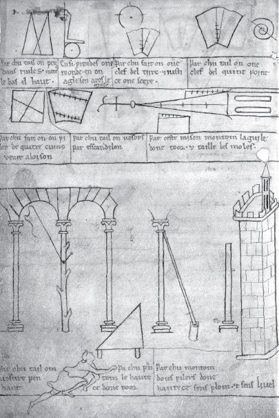

## 4 On building a house (Part 4)

> [BREADCRUMB_CTX: 《Making: Anthropology, Archaeology, Art and Architecture》 > 4 On building a house (Part 4)]

Precisely because this knowledge was both learned and passed on as a living tradition, in the spoken words and manifest deeds of practitioners, it has left little documentary trace. A rare exception is the sketchbook, with accompanying instructions, bequeathed by the French master mason, Villard de Honnecourt. Writing in the thirteenth century, Villard hopes that those who peruse his book will find in it ‘sound advice on the great techniques of masonry and on the devices of carpentry … as the discipline of geometry requires and instructs’ (in Barnes 2009: 35). One page from the sketchbook gives a good idea of what this geometric art entailed (Figure 4.1).4 The upper two rows give instructions, among other things, for measuring the diameter of a cylindrical shaft (rest the shaft against a wall, and rest a square with its short side on the shaft and its long side against the wall), for cutting the keystones and voussoirs for an arch, and for raising the spire of a tower. Below are three more drawings. The one on the left tells how to cut the voussoirs for a hanging arch. During construction, the pendant of the arch is temporarily supported by a tree trunk. Fix a nail on the trunk halfway from the base to the crown of the wall and tie a string to the nail. Stretching the string to points along the arch gives the angles of cut. The drawing in the middle shows how to obtain two pillars of the same height without the use of plumb line or level. Place a hinged post halfway between the two pillars so that it touches the top of one of them. Then swing it across to check the height of the other. On the right of the page is a drawing of a tower. To determine the height of the tower, set an instrument shaped as a right-angled isosceles triangle on the ground such that when you look up along the hypotenuse, from ground level, your line of sight strikes the top of the tower. The distance along the ground from the tip of the triangle to the base of the tower then equals the height (Barnes 2009: 140–145, see also Shelby 1972: 409–410; Bucher 1979: 122–124). What is striking about these procedures is not just their simplicity but their sheer physicality. In the practice of their geometry, masons and carpenters did not project onto stone and wood forms that had already been deduced through the power of abstract reason and rational calculation. They solved design problems as they went along, through the manipulation of the instruments and materials at their disposal, and drawing on a fund of ‘tricks of the trade’ – such as those illustrated by Villard – picked up on the way.

**FIGURE 4.1** A page from the portfolio of Villard de Honnecourt (sheet 20, verso). (Courtesy of the Bibliothèque nationale de France.)

**Plans in stone**

In that sense, as Shelby (1972: 409) shows, their geometry was not just practical but, more precisely, *constructive*. Their straight lines were not the notional point-to-point connectors of Euclid, but actual lengths of cord pegged out on site and at full scale (Pacey 2007: 63). Their points were nails or stakes, hammered into wood or ground. And the figures of their geometry were not empty outlines but solid, weighty pieces with tangible surfaces and edges, cut and shaped from wood or stone. And among these shapes, by far the most important were the templates or ‘moulds’ that were used as guides to stone cutting.5 These templates were usually made from thick planks of wood, though they were sometimes cut from canvas or parchment, or occasionally sheets of lead (Shelby 1971: 142–143; Pacey 2007: 35). The master mason would draw designs onto planks, and the carpenter would cut them out, after which they would be passed to the workmen on site, with the task of actually cutting the stone.

The art of cutting solids into pieces that fit together tightly is known technically as *stereotomy* – from the classical Greek *stereo*, solid, and *tomia*, to cut (Sanabria 1989: 266; Frampton 1995: 5). It is simple enough to build a wall of rectangular blocks, but in the construction of complex buildings with arches, vaults and pinnacles, medieval masons faced formidable stereotomical challenges. These challenges were not solved, however, through exact pre-calculation and precision cutting. They were rather solved through a combination of rule of thumb and creative extemporisation, leaving ample scope, as Shelby (1971: 154) notes, ‘for individual differences and the play of personal choice’. Although the constructive geometry of the masons laid down carefully prescribed steps that apprentices were taught to follow, none was so constraining as actually to preordain the course of action, nor were the rules they observed any substitute for the skill and inventiveness, born of long experience, on which the success of their enterprise finally depended (Shelby 1972: 420). ‘Rules of art can be useful’, observes philosopher Michael Polanyi (1958: 50), ‘but they do not determine the practice of an art; they are maxims, which can serve as a guide to an art only if they can be integrated into the practical knowledge of the art. They cannot replace this knowledge.’ The masons’ rules were maxims in this sense: they comprised resources for action, but did not determine it (see also Suchman 1987: 52; Ingold 2000: 35–36).

If masons were restricted in what they could do it was not, then, because the stereotomical puzzle of assembling a building from elementary solids admitted only one, mathematically correct solution. Though it might seem so to our modern eyes, great medieval buildings were not assembled like puzzles from pre-cut pieces, nor were they finished when the last piece was slotted into place. A better analogy, suggested by John Harvey (1974: 33), might be with the patchwork quilt. As patches are sewn into the quilt, so stones are added to the building piecemeal, each shaped and, if necessary, reshaped so as to fit the space prepared for it by previous ones, and in turn preparing the spaces for those that follow.6 Here is Hugh of St Victor once again, in his *Didascalicon* of 1127, describing the mason at work:

Take a look at what the mason does. When the foundation has been laid, he stretches out his string in a straight line, he drops his perpendicular, and then, one by one, he lays the diligently polished stones in a row. Then he asks for other stones, and still others, and if by chance he finds some that do not fit with the fixed course he has laid, he takes his file, smooths off the protruding parts, files down the rough spots, and the places that do not fit, reduces to form, and so at last joins them to the rest of the stones set into the row.

(Hugh of St Victor 1961: 140)

It seems from this account that the lineaments of the structure, far from being imposed upon the material, emerge from the process of building itself. But if that is so, then what need, if any, did the medieval mason have for designs or plans? Did there have to be, as Alberti (1988: 7) was later to insist, a ‘precise and correct outline, conceived in the mind, made up of lines and angles’, before the work of building could even begin?

The question of whether there existed plans or project drawings for complex medieval buildings such as cathedrals remains unresolved, and expert opinion is sharply divided. The architectural historian Francis Andrews, in an essay penned in 1925, answers definitively in the negative:

No church or other work was just the outcome of the mind of any single man who had sat down and deliberately designed it and having drawn it up then got up and supervised its execution… Such a man was not necessary… What was wanted and what was supplied was the man who would work earnestly and honourably and leave, so to speak, the designing to take care of itself. Hence there was no architect to make a design.

(Andrews 1974: 8–9)