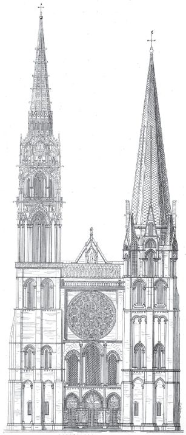

## 4 On building a house (Part 6)

> [BREADCRUMB_CTX: 《Making: Anthropology, Archaeology, Art and Architecture》 > 4 On building a house (Part 6)]

Chartres remains unfinished. As with every other surviving structure of its kind, the work of building and rebuilding continues to this day, albeit motivated by a characteristically modernist desire to preserve in perpetuity what is imagined to have been a historically completed form, the perfect realisation of an original design. This one building, then, stands as an embodiment both of the geometric craftsmanship of the thirteenth century and of the architectural conceits of the twentieth, and gives us a bridge across which we can return from the building practices of medieval times to the contemporary understanding of the building, from which I began this chapter, as the timeless expression of the architect’s vision. Turnbull’s objective is to lay to rest the idea that any ‘great divide’ separates the sites of technoscientific activity of the past, such as the cathedral works, and those of the present, such as the laboratory. ‘Technoscience then and now’, he claims, ‘results from site-specific, contingent and messy practices’ (Turnbull 1993: 332). But if this is true of the modern laboratory, then it is surely equally true of the sites of contemporary building. Just as science, however, has invested heavily in the distinction between speculative theory and experimental practice, so has architecture invested in that between design and construction. Thus in a recent, authoritative statement, Simon Unwin defines architecture as ‘the determination by which a mind gives intellectual structure to a building’, whereas building is ‘the performance of physical realization’, of which ‘*a* building’ is the product (Unwin 2007: 102). The architect, then, conceives the lineaments of the structure, while the builder’s task is to unite the structure with the material.

**FIGURE 4.2** Spot the difference! The west facade of Chartres Cathedral. Redrawn from Plate 407 of G. Dehio and G. von Bezold, *Die kirchliche Baukunst des Abendlandes: historisch und systematisch dargestellt*. From the collection of the University of Pittsburgh Digital Library, courtesy of Alison Stones.

These definitions, however, belie the creativity of the ‘messy practices’ that give rise to *real* buildings. Whether of sketching, tracing, modelling, staking out, digging, cutting, laying, fixing or joining, all involve care, judgement and aforethought, and are carried on within worldly fields of forces and relations. None can be placed unequivocally on one side or the other of any distinction of fundamental ontological import, such as between intellectual conception and mechanical execution. On what grounds then, if at all, can architecture be distinguished from building or, more generally, design from making? This is our topic for the next chapter.