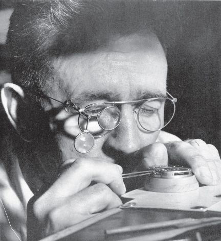

## 5 The sighted watchmaker (Part 4)

> [BREADCRUMB_CTX: 《Making: Anthropology, Archaeology, Art and Architecture》 > 5 The sighted watchmaker (Part 4)]

I am not of course suggesting that any scientist ever designed a bat, in the sense that an engineer might design an electronically guided missile system. Without design engineers, there would certainly be no missiles. Bats, on the other hand, would be around and would have evolved, without any scientists to observe them. *Designs for bats*, however, would not. And when a scientist like Dawkins claims that such a design is coded into the animal’s DNA, whence it controls its behaviour just as already wired-in electronics guide the missile, he is advancing an argument from design just as strong as any to be found in Paley’s natural theology. Indeed as David Turnbull has pointed out, and as we already saw in the last chapter, to the modern mind this argument seems so self-evident that it is barely questioned. Turnbull (1993: 319) summarises it thus: ‘the world is a very complex place, full of intricate mechanisms like the eye; therefore it had to have a designer’. The attribution of ultimate responsibility for the design to natural selection rather than God does not in the least affect the logic of the argument, namely that there can be no functional complexity without prior design.1 Turnbull’s concern, however, is with the design not of life forms but of architectures. And among architectural theorists just as among evolutionary biologists, the argument from design remains largely implicit, deeply embedded in the premises of their own enquiry.

It is true that some theorists, in their analyses of architectural design, have suggested a move analogous to the Darwinian move in biology. What if the forms of vernacular architecture, for example, could be understood as outcomes of the variation and selection of intergenerationally transmitted, recombinant elements? Design theorist Philip Steadman, for one, has drawn attention to the manifestly fallacious consequences of such a move. For the effect would be to erase altogether the creative contribution of traditional artisans to the forms they build. They would be reduced to mere intermediaries, destined to implement designs carried unknowingly in their heads. Their sole purpose, Steadman argues (1979: 188–189), would be to assist like midwives at the rebirth of the inherited design, introducing small, accidental errors – analogous to mutations – as they do so. But even though the effect of a literal application of the Darwinian analogy to the architectural arts would be to eliminate the creative agency of the human builder, it would still present us with an argument from design. That is to say, it is still assumed that forms issue from designs, albeit ones that their builders had no hand in shaping, of which they have no conscious awareness and that analytically trained design theorists are alone capable of articulating.

**FIGURE 5.1** The watchmaker at work. This photograph, which appeared in the in-house publication of the Elgin National Watch Company, *Watch Word*, in September 1949, shows company employee Les Linder making final adjustments to the movement of a railroad watch. I am grateful to librarian Betsy Vera and collections services manager William R. Blohm, of Gail Borden Public Library in Elgin, Illinois, for tracking down the photo and providing a copy.

We have already seen in the last chapter (p. 56), by way of Turnbull’s example of building the great Gothic cathedral of Chartres, how this argument both fails to account for workmanship and attributes powers to rules they cannot have. But the same counter-argument could be applied just as well, on a miniature rather than monumental scale, to the case of watchmaking. Picture for a moment the real watchmaker at work (Figure 5.1). There he is, in his workshop, delicately fitting together tiny cogs and springs, along with other components, under a close and observant eye. He may well have to use a magnifying glass to see well enough what he is doing. Before that, he may have had to manufacture the individual components, a task that calls for an equally close-up engagement with metal and precious stones. A watchmaker who was truly blind, but whose intellectual faculties were unimpaired, could in principle *design* a watch. He could, as Dawkins intimates, design the cogs and springs, and plan their interconnections. Yet the foresight that Dawkins attributes to the watchmaker will not *make* a watch. For that you also need skilled vision and manual dexterity. And just as medieval cathedral builders had to work things out as they went along, following flexible rules of thumb rather than procedures precisely laid down in advance, so too did the watchmakers of Paley’s day, else they would not have had to pay such close attention to what they were doing.

**The design of everyday life**

In this regard, the foresight required of the watchmaker is of a very different kind from that which the argument from design attributes to the designer. It lies not in the cogitation that literally comes *before sight* but in the very activity of *seeing forward*, not in *preconception* but in what the sociologist Richard Sennett, in his study of the work of the craftsman, calls *anticipation*: being ‘always one step ahead of the material’ (Sennett 2008: 175). The philosopher Jacques Derrida has resort to the same idea in reference to the art of drawing in which, he claims, the inscribing hand continually overtakes the cogitations of the head. To anticipate, he says, is ‘to take the initiative, to be out in front, to take (*capere*) in advance (*ante*)’ (Derrida 1993: 4). ‘If the mind wants to be involved in the process of making’, writes design theorist Lars Spuybroek (2011: 160), ‘it must not only be open but forward-looking, in the direction of as-yet-unknown creation.’ This is a matter not of predetermining the final forms of things and all the steps needed to get there, but of opening up a path and improvising a passage. To foresee, in this sense, is to see *into* the future, not to project a future state of affairs in the present; it is to look where you are going, not to fix an end point. Such foresight is about prophecy, not prediction. And it is precisely what enables practitioners to carry on.

To make a watch takes time. This time is not incidental, or collapsible into an instant or series of instants. It is rather a time of growth or formation, of ontogenesis. Thus the designing of the watch continues into its making – in the ways the pieces assembled there answer to one another in the generation of internal coherence. What the maker has to hand, to begin with, are cogs and springs, among other minute pieces. These pieces do not belong together, in preordained positions, by dint of some external necessity. They are no more parts of a watch than are twigs on the forest floor parts of a bird’s nest. Rather, as with the nest, pieces become parts only as the assembly proceeds and tends increasingly to cohere. They gradually acquire a feel for each other, they *settle*, holding each other in place ever more tightly as the work advances asymptotically towards closure without ever absolutely reaching it. The task of the maker is to bring the pieces into a sympathetic engagement with one another, so that they can begin – as I would say – to *correspond*. Peering through his eyeglass (Figure 5.1), the watchmaker inhabits a realm *in among* the pieces, rather than *above and beyond* them, adjusting each in relation to the others, and serving as a kind of go-between in their correspondence. Only as the work nears completion can the pieces be judged, with reasonable confidence, to be the parts of a whole.