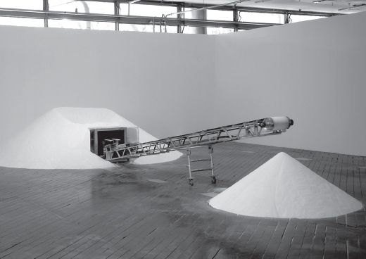
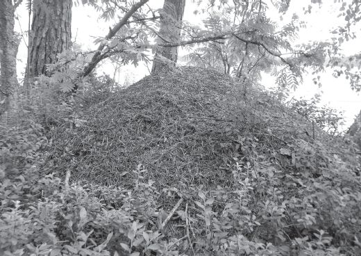

> [BREADCRUMB_CTX: 《Making: Anthropology, Archaeology, Art and Architecture》 > 6 Round mound and earth sky (Part 1)]

# 6 Round mound and earth sky

**6**

**ROUND MOUND AND EARTH SKY**

**Becoming earth**

If you heap stuff up over a period of time, always adding to the top of the pile and allowing it to settle of its own accord, it will generally form a mound, roughly circular in plan and conical or bell-shaped in elevation. On a miniature scale, we can observe this process of mound formation in the sand of an hourglass. On a gigantic scale, it can be witnessed in the formation of volcanic cones. From molehills to ants’ nests, mounds are among the commonest forms in nature. They often result from human activities too – think of shell middens, stone cairns, sandcastles, and heaps of compost, refuse and slag. In every case, the roundness of the form emerges spontaneously, due to the way in which the pressure of material added from above displaces material already deposited, equally in all directions. One could say that the mound builds up precisely because the material of which it is made is continually falling down. Each and every particle, as it falls, eventually finds its own more or less enduring place of rest. The Brazilian artist Laura Vinci has brought this process to life in a work that simultaneously demonstrates the dynamics of mound production – as a conveyor belt continually transports fine-ground marble from one heap to another – and comments on the environmental impact of industrial mining in the state of Minas Gerais. The work, entitled *Máquina do Mundo* (‘Machine of the World’), is described by the artist herself as an ‘anti-machine’ that overturns the values of permanence, solidity and timelessness associated with classical architecture and statuary by using the very material that epitomises these values – white marble – to enact the contrary principles of perdurance, transformation and the passage of time (Figure 6.1).

From a distance, the growing mound looks like a perfectly formed cone. Look closely at the surface, however, and it is awash with movement as every particle finds its way, jostling under the impact of all the others. Close examination of the surface of a growing ants’ nest likewise reveals it to be a hive of activity (Figure 6.2). In this respect the mound is the very opposite of the edifice. If Vinci’s *Máquina* is in reality an anti-machine, then the mound is truly an anti-building. In Chapter 4 I introduced the classical idea of the architect as one who lays the foundations on which others build (p. 50). In the construction of an architectural edifice each successive piece is carefully laid to rest upon the last in such a way that a static equilibrium is maintained. The permanence and integrity of the structure depend on the way in which additional material is locked into position through its abutment to what has already been set down, without causing further movement or displacement in the latter. In building a tower of stone blocks, for example, every layer of blocks has to be added so that it bears down precisely on the preceding layer, which bears in turn upon the layer before that, and so on right down to the foundations. Without fixed and solid foundations, the entire building process could not even begin. Ultimately, therefore, every edifice must rest upon foundations set in the earth. If the foundations give way, whether due to subsidence or tremors, the entire structure can come crashing down. If and when it does, the result will likely be a mound of stones!

**FIGURE 6.1** ‘The Machine of the World’ (*Máquina do Mundo*), an installation by the artist Laura Vinci. Photo by Denise Adams, reproduced by courtesy of the artist.

But the mound has no foundations. Nor is it ever complete. One can always carry on adding new material. The growth of the mound, as Vinci’s *Máquina* demonstrates, is never-ending. As it rises in height, it also expands at the base. But although every particle of the mound comes to rest on other particles, the mound as a whole does not rest upon the earth. In this regard, Vinci’s installation is a little misleading. For the purposes of display, it is placed on the pre-prepared floor of an interior gallery. One has little difficulty, then, in distinguishing the material of the floor, with its flat, solid and homogeneous surface, from the material of the mound that is ever-forming upon it. Outside this rather artificial situation, however, one cannot say with any assurance where the mound ends and the earth on which it rests begins. For the mound is as much *of* the earth as *on* it. Indeed its emergent form bears witness to the continual process wherein the accretion of material converts deposition into burial. Today’s deposit becomes tomorrow’s substrate, buried under later sediment. Like the compost heap or the ants’ nest, the mound, we could say, is *becoming earth* (Figure 6.2). Indeed, the mound forces us to acknowledge that the earth itself is not the solid and pre-existing substrate that the edifice builder takes it to be. It is rather the source of all life and growth. Plants grow in the earth, not on it, and from these, animals – including human beings – draw their subsistence. Metabolised and decomposed by the processes of life, materials drawn from the earth are eventually returned to it, fuelling further growth. In this sense, the earth is perpetually growing over, which is why archaeologists have to dig to discover evidence of past lives (Ingold 2008a: 31). Formed in the process of life becoming earth, the mound could be regarded as a growth or swelling, manifested as a bump on the ground surface. But it is not an edifice erected upon it.

**FIGURE 6.2** Becoming earth: a nest of forest ants, photographed on the shore of Lake Pielinen in eastern Finland. (Courtesy of Susanna Ingold.)

Now in many regions of the world, the earth is peppered with such bumps of a scale, location and composition that lead prehistorians to believe – not without reason – that they are the results of past human activity, although precisely what that activity may have entailed, or what its purpose could have been, often remain a mystery (Leary, Darvill and Field 2010). Yet most prehistorians, convinced that any kind of making or building involves the projection of form onto the material world, are predisposed to think of the mound as a sculptured earthwork, answering to the specifications of a preconceived design. It is as though the mound builders, as they piled up earth and stones, had an idea of how the work would finally look, and kept on piling until the height, diameter and contours of the accumulated material matched their expectations. As a thought experiment, let us imagine that we are equipped with a time machine that enables us to revisit the folk who, in the distant past, were living in and around those places where now there are round mounds.1 Let us ask them what they are doing. They may perhaps answer that they are burying their dead, or that they are meeting to resolve their affairs. They might say that they are conducting ceremonies to restore the fertility of the land. They might even claim to be depositing their rubbish, or simply building and rebuilding – as countless generations have done before – on the same spot.