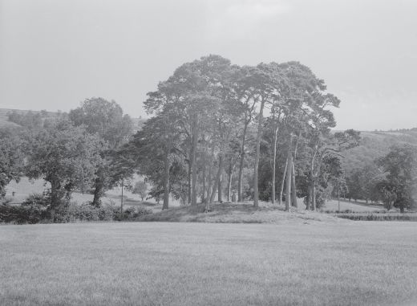

## 6 Round mound and earth sky (Part 2)

> [BREADCRUMB_CTX: 《Making: Anthropology, Archaeology, Art and Architecture》 > 6 Round mound and earth sky (Part 2)]

The one answer, however, that they would be most unlikely to give would be ‘building a mound’. Rather, the mound that confronts us today is the cumulative by-product of all kinds of activities, carried on over long periods of time and not only by human beings. Burrowing animals, from worms to rabbits, have played their part in its evolution. The roots of trees, bushes and grasses, threading through its volume, have helped to fix it. The weather, and above all the rain, has shaped it internally and externally, in the creation of patterns of drainage and run-off. Crucially, these organic and hydrological processes continue in the present as they have always done in the past. To observe the mound today is to witness their going on. The mound, we could say, exists in its *mounding*. This is to think of it not as a finished object, standing on foundations and set over and against its surroundings, but as a locus of growth and regeneration where materials welling up from the earth mix and mingle with the fluxes of the weather in the ongoing production of life. The mound has not turned its back on us, as we might suppose, hiding secrets within its dark, enclosed interior that we can discover only by tunnelling in. On the contrary, it is open to the world. As the ever-emergent outcome of the interplay of cosmic forces and vital materials, the mound is not built but grows (Figure 6.3).

**Mound and monument**

In the conventions of prehistory, round mounds are commonly classified and conserved as ancient monuments. This is to make two assumptions: first, that they were designed and built to last in perpetuity as a testimony to the endeavour of those who constructed or commissioned them; secondly, that having been built at a particular historical moment, they can be granted a certain antiquity. In other words we can, in principle, tell how old they are. Both assumptions, it seems to me, are false. Let me deal with each in turn: the first in this section; the second in the next.

History is littered with the products of monumental attempts to put an end to it. Countless edifices, intended by their architects to seal their immortality, lie buried and forgotten, lost in the mists of time. Others, rediscovered and excavated by archaeologists in the service of the modern project of nation building, have been given a new lease of life, in an idiom that nevertheless consigns the past to a bygone if heroic age. Indeed the paradox of monuments is that they can serve as memorials only because they have failed in the objective set for them by the powers that originally intended their construction. Had they succeeded – if, that is, their architects had managed, in the words of anthropologist Vincent Crapanzano (2004: 169), to ‘close memory to its beyond’ and thereby to render themselves eternal – then there would be no future generations to look back on them and marvel at how they had come to be built.2 Impressive in their permanence and solidity, monumental structures intended by their makers to confer everlasting life provide irrefutable evidence, to those who subsequently come across them, that the past is dead, over and done with. Like beached whales, they seem to have been left stranded on the shores of history, while time moves on. As it does so, the gap between a lost past and the vivid present grows ever wider. For while the monument speaks *for* itself, calling out the names or preserving the likenesses of those whom it commemorates, it also speaks *to* itself in the idiom and language of its time. To visit a monument is to eavesdrop on past conversations that we can no longer fully understand, or that are comprehensible only to specialist antiquarians. They were then, we are now.

**FIGURE 6.3** The mound mounding. The round mound of Pitnacree in Perthshire, viewed from the south. © Courtesy of Royal Commission on the Ancient and Historical Monuments of Scotland (J. M. Coles and D. D. A. Simpson). Licensor [www.rcahms.gov.uk](http://www.rcahms.gov.uk).

This is not to deny that the monument may hold memories for us. Perhaps it stands in a place we have often visited, and that generations of our families have visited previously. We might have old photographs to prove it, and looking longingly at the figures in the photos, we exclaim that ‘they are us!’ This kind of memory-work allows us to tell stories that flow as seamlessly from past to present as our own lives. Throughout, the monument stands as a focus. Yet what it records, if anything, is incidental to the stories we tell. We remember that we visited, as did others before us. It is the latter, and not the persons immortalised in the monument, that we draw into our conversations. ‘It is a common mistake’, as the historian Mary Carruthers (1998: 40) notes, ‘to confuse the activity of remembering with the “things” humans may use to locate and cue their memories.’ Carruthers is concerned with the liturgical processions of early medieval pilgrims as they went from site to site. For these pilgrims, it mattered little whether any physical record remained at each site of the personages or events with which it was associated. What was real and authentic about the sites, for them, lay not in the objects to be found there, but in ‘the *memory-work*, the thinking to which they gave clues’ (1998: 42). Sites of pilgrimage are places where the work of memory is carried on, not capsules in which to preserve its more durable relics. Conversely, as the fate of so many monuments reveals, the encapsulation of the past in such relics holds no guarantee that it will be remembered.

Now without doubt, round mounds are and have long been places of memory. The remembering goes on in the very activities that we – like our predecessors – carry on around them, in walking, cultivating, excavating and so on. Like sites of pilgrimage, many are known to have been holy places, often situated along lines of travel that have been in use from time immemorial. Yet most are so inconspicuous that they can scarcely be discerned today, and it often takes a trained or locally knowledgeable eye to see them. Their most extraordinary quality, as the historical geographer Kenneth Olwig observes with reference to the mounds that crop up all over the countryside of Jutland, in what is now Denmark, lies in ‘their unmarked anonymity and the absence of monumental signs’ (Olwig 2008). Convinced, however, that they must be monuments, and thus capsules for the past, generations of archaeologists have been impelled by a relentless search for some inner secret – a kernel of meaning that the original mound builders left inside as an enduring record of their lives and deeds. If only something spectacular could be found at the heart of the mound, we would at last know who built them and why! More often than not, however, excavation has been unrewarded by discovery. Though mounds might draw attention to themselves as places to dig, they often turn up no more than would be uncovered by digging anywhere else. For the archaeologists of today it is precisely in the finding, and not in what (if anything) is found, that the work of memory lies. This must have been equally true for people in the past. Perhaps it was in the very process of trying to find things, or alternatively of trying to get rid of them, that – over the millennia – mounds were formed.

**The antiquity of things**