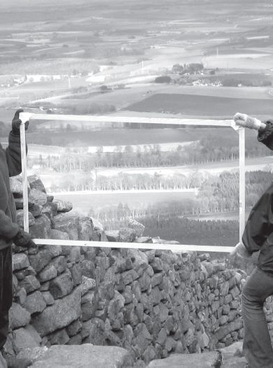
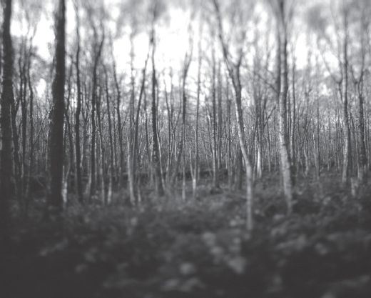

## 6 Round mound and earth sky (Part 6)

> [BREADCRUMB_CTX: 《Making: Anthropology, Archaeology, Art and Architecture》 > 6 Round mound and earth sky (Part 6)]

Of someone who is so caught up in the minutiae of life that they are unable to comprehend the overall picture, it is often said that they cannot tell the wood for the trees. To see the wood, it seems, you have to get out from among the trees and take a long view from a bare hilltop, or even from the air. Seen thus from afar, the wood appears to be laid like a mosaic over the contoured surface of the land. This was how the woods appeared to us from the summit of Mither Tap. But suppose that you rejoin us now, as we descend from the heights and re-enter the wood. Are we, once again, overwhelmed by minutiae? Do we see only individual trees rather than the wood as a whole? Not a bit of it! To enter the wood, and to find ourselves surrounded on all sides by trunks and branches, is not just to undergo a change of focus, from distant to close-up, but to experience a radically different perception of the world. In this perception, the wood ceases to appear as an aggregate of individual trees. Perhaps the Oxford English Dictionary gets closer to the mark when it defines the wood as ‘trees collectively *growing together*’ (Figure 6.5). In the twisting, turning, gnarling, knotting and branching of its roots, trunk and limbs, each tree bears testimony to a process of growth that is continually responsive to that of its neighbours, as well as to rainfall, wind and light, and the passage of the seasons. To perceive the wood from within is to become immersed in these ongoing entanglements of life. It is to see every tree not as a discrete, bounded individual but as something more like a bundle of fibrous threads, tightly wound along the trunk but splaying out above ground in the canopy and below in the roots. And it is to see the wood no longer as a mosaic of individual pieces but as a labyrinth of thread lines.

**FIGURE 6.4** A window on the landscape. Looking through a rectangular frame from the summit of Mither Tap, Aberdeenshire. In the foreground are the reconstructed walls of the ancient hill fort.

So entangled are these lines that it is scarcely possible to say with any certainty where any particular tree ends and the rest of the world begins. Is the bark a part of the tree? If so, then what of the insects which burrow in it, or the lichens that hang from it? And if insects are part of the tree, then why should we not also include the bird that nests there? Or even the wind, which causes the branches to wave and the leaves to rustle in characteristic ways? When seeds and leaves drop to the ground, do they not continue the life stories of the trees from which they fell? Thus the ground, too, is no mere surface, upon which trees stand like an army of soldiers on parade. To walk in the woods is to find your footing, at every step, in a morass of shrubs and foliage, fallen twigs and leaf litter, soil and stones. You seem always to be treading either on growing vegetation or on stuff that has been deposited, whether by the wind, the action of rainwater or simply having dropped from the trees above. The very ground underfoot, in short, is a tissue of lines of growth, erosion and decomposition. Far from separating the earth below from the sky above, the ground is a zone in which earth and sky intermingle in the perpetual generation of life.

**FIGURE 6.5** Trees growing together: a wind’s eye view of the wood. Photo taken in rural Aberdeenshire by Cristina Saez, reproduced by courtesy of the artist.

It is, paradoxically, in the depths of the woods that the world opens up most fully to our perception, for it forces us to cast aside the illusion, to which people in high places are prone, that the world we inhabit is spread out like a mosaic beneath our feet, with its forms and patterns already impressed upon the physical substrate of nature. As the philosopher Henri Lefebvre has written, this means abandoning the pretence that we are witnessing a scene that is given all at once, as a spectacle. ‘Go deeper’, Lefebvre advises, ‘be like the wind that shakes these trees’ (Lefebvre 2004: 80). This is to gain what we could call a wind’s-eye view of the woods. The eyes of the wind do not look *at* trees but roam *among* them, setting them ever so slightly in motion, tickling their surfaces and watching them come alive to the visual touch (Figure 6.5). They are the very same eyes as those that Pallasmaa calls ‘the eyes of the skin’: eyes that stroke the surfaces, contours and edges of things (Pallasmaa 1996: 29). These are eyes tuned not to the discrimination and identification of individual objects but to the registration of subtle variations of light and shade, and of the surface textures they reveal. Indeed, the environment they disclose is not one of objects at all. It is rather an environment of things, including swellings like mounds, growths like trees, outcrops like the tors of Bodmin Moor and the rocky peak of Mither Tap, and buildings such as those of the colony of Bennachie or the settlement on Leskernick Hill. Though we may *occupy* a world of objects, to the occupant the contents of the world appear already locked into their final forms, as though they had turned their backs on us. To *inhabit* the world, by contrast, is to join in the processes of formation. It is to participate in a dynamic world of energies, forces and flows. Such, I contend, is the world of earth and sky.