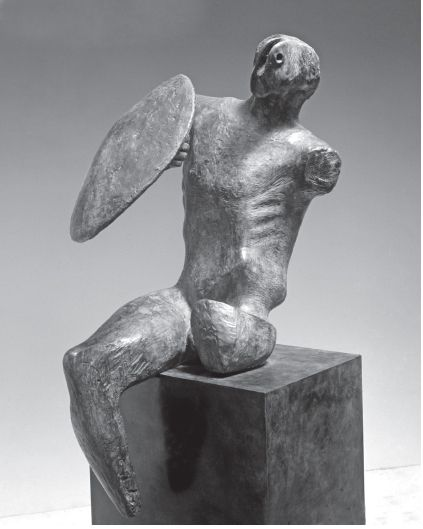
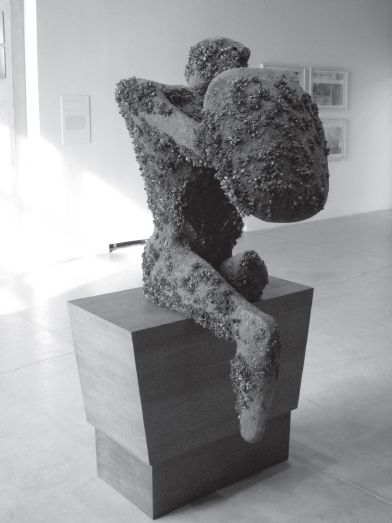

> [BREADCRUMB_CTX: 《Making: Anthropology, Archaeology, Art and Architecture》 > 7 Bodies on the run (Part 1)]

# 7 Bodies on the run

**7**

**BODIES ON THE RUN**

**Being alive**

In 1953, the British sculptor Henry Moore began work on a piece entitled *Warrior with Shield* (Figure 7.1). The idea for it, he said, came from finding a pebble on the seashore that reminded him of the stump of a leg, amputated at the hip. First he added the body, leg and one arm, to make a reclining, wounded warrior. Then he added a shield, altering the pose to make a seated figure, with a head that – in his own words – ‘has a blunted and bull-like power but also a dumb animal acceptance and forbearance of pain’ (in James 1966: 250). A year later, under somewhat controversial circumstances, Moore’s *Warrior* was purchased by the Toronto Art Gallery. Subsequently, in the mid-1980s, an apparently quite unconnected event occurred. A new species of zebra mussels (*Dreissena polymorpha*) was accidentally introduced into Lake St Clair, on the US/Canadian border, by way of bilge water from one or more transoceanic trading ships originating from ports along the Black Sea. The species found the plankton-rich waters of Lake St Clair and the adjoining Lake Erie much to their liking, and multiplied rapidly. Within a few years they had colonised virtually every firm surface in Lake Erie, to a density of up to 70,000 mussels per square metre, and by 1992 they had already spread via Lake Michigan to the Mississippi basin. It was an intervention by the artist Simon Starling, in 2006, that forged a link between these two events. Starling created a full-scale replica of Moore’s *Warrior* in steel, and then had it submerged in the waters of Lake Ontario. It remained there, on the lake bottom, until early in 2008, when it was raised from the depths. The surface of the figure was encrusted all over with mussels. The work was subsequently exhibited, under the title *Infestation Piece (Musselled Moore)*, at Toronto’s Power Plant Gallery of Contemporary Art (Figure 7.2).1

**FIGURE 7.1** *Warrior with Shield* by Henry Moore (1953–1954, bronze, height 155 cm). © The Henry Moore Foundation. All Rights Reserved, DACS 2012 / [www.henry-moore.org](http://www.henry-moore.org). Reproduced by permission.

For me, this piece makes a powerful statement about what it means for a body to be alive. The original *Warrior* is monumental in the strict sense of the term: closed in on itself, immobilised, presenting only its bronze-hard outer surfaces to our sight. Thrusting out its shield to the front, it tells us in no uncertain terms to back off. As Moore himself acknowledged, the figure has sunk into the solitude and paralysis of its own pain, solidly impervious to its environs. It belongs to another place and another time, as though caught in a battle fought thousands of years ago, or overcome by a volcanic eruption. Staring hollow-eyed at a world it neither knows nor even recognises, it will not respond to us, nor can we respond to it. On the lake bed, however, the figure has effectively been turned inside out. Under water, the surface in which it was once encased has become a substrate for life and growth, which in turn has been made possible by way of the continual exchange of substance with a nutrient-rich medium. Through the mussels that infest the surface, the figure seems to extrude itself into the surroundings, literally oozing from every pore, as though opened up from the inside. It has become a real living organism, albeit one sorely afflicted. Like a person whose body is covered in scabs, weals or boils, perhaps due to some acute infection, the musselled figure may be repulsive to look *at*, but we can at least look *with* it and feel some sympathy for its plight. It is of our time and place. Indeed it has become, in many ways, more mound-like than monumental, formed from a process of encrustation that carried on right up to the moment of its recovery from the water.

**FIGURE 7.2** Simon Starling, *Infestation Piece (Musselled Moore)*, 2007/8 (bronze, mussels, variable dimensions). Installation view, The Power Plant, Toronto, 2008. (Courtesy of Steve Payne.)

Every living organism, like the musselled Moore, is itself a site of infestation: a seething colony of lively, jostling materials alternately compressed into blobs and stretched into filaments that twist and coil around one another to form configurations of extraordinary complexity. The organism may look outwardly composed. Lift the lid, however, and you find something more like a compost heap than the formal architecture that anatomists and psychologists like to imagine. Indeed as a gathering together of materials in movement, the organism fully qualifies as a thing in the sense outlined in the last chapter. But it is not a thing that moves; it is rather composed (or better, composted) in movement. This is to say that it is fundamentally *animate*. Yet for just this reason, it would be wrong to describe it as embodied. It would be hard to imagine a figure more embodied, for example, than Moore’s *Warrior*. The figure is so completely wrapped up in itself that any residue of animate life has been stilled. Starling’s *Infestation Piece*, to the contrary, is animate precisely to the extent that its surfaces have opened up to the surrounding medium. Comparison of the two pieces vividly demonstrates how animacy and embodiment pull in opposite directions: where the former is a movement of opening, the latter is bent on closure. For the living, animate beings we are, argues dance philosopher Maxine Sheets-Johnstone, the term ‘embodiment’ is simply not experientially apposite. We do not, she insists, experience ourselves and one another as ‘packaged’ but as moving and moved, in ongoing response – that is in *correspondence* – with the things around us (Sheets-Johnstone 1998: 359; Ingold 2011b: 10). Of course we have bodies – indeed we *are* our bodies. But we are not wrapped up in them. The body is not a package, nor – to invoke another common analogy – a sink into which movements settle like sediment in a ditch.2 It is rather a tumult of unfolding activity. As such, according to dance anthropologist Brenda Farnell, it is something to think *from* rather than *about* (Farnell 2000: 413).

The change of perspective entailed here precisely parallels our earlier injunction, taken from Gilles Deleuze and Félix Guattari, to ‘follow the materials’ (Chapter 2, p. 25). To think from materials, they say, is to find ‘the consciousness or thought of the matter-flow’ (Deleuze and Guattari 2004: 454). As the artisan thinks *from* materials, so the dancer thinks *from* the body. In the living, dynamically composed body, person and organism are one. The body *is* the organism–person. But as noted above, the body is also a thing. Thus we should no longer speak of relations between people and things, because *people are things too*. To highlight the overlap between personhood and thinghood, as Jane Bennett observes (2010: 4), is to acknowledge ‘the extent to which the us and the it slip-slide into each other’. Or as the title of a recent article by archaeologists Timothy Webmoor and Christopher Witmore declares, ‘Things are us!’ (Webmoor and Witmore 2008). This is not to treat persons as anything less than what they are, let alone to compare them to objects rather than subjects. It is rather to find a way beyond this troublesome dichotomy. Objects and subjects can exist only in a world already thrown, already cast in fixed and final forms; things, by contrast, are in the throwing – they do not exist so much as carry on. And as the things they are, people too are ‘processes, brought into being through production, embroiled in ongoing social projects, and requiring attentive engagement’ (Pollard 2004: 60).