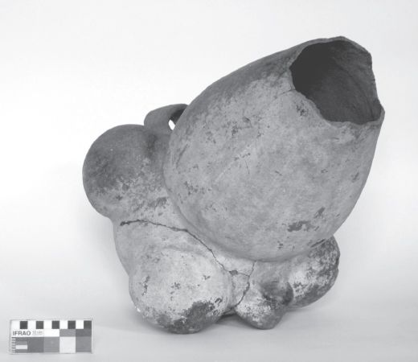

## 7 Bodies on the run (Part 2)

> [BREADCRUMB_CTX: 《Making: Anthropology, Archaeology, Art and Architecture》 > 7 Bodies on the run (Part 2)]

In this regard, persons are just like pots (Figure 7.3). In a study of ceramics from Northwest Argentina dating from the first millennium AD, Benjamin Alberti argues that it would be a mistake to assume that the pot is a fixed and stable object, bearing the imprint of cultural form upon the ‘obdurate’ matter of the physical world (Alberti 2007: 211, see also Alberti and Marshall 2009: 354). On the contrary, evidence suggests that pots were treated like bodies, and with the same concern: namely, to counteract chronic instability, to shore up vessels for life against the ever-present susceptibility to discharge that threatens their dissolution or metamorphosis. The living body, likewise, is only sustained thanks to continually taking in materials from its surroundings, and in turn discharging into them, in the processes of respiration and metabolism. Yet as with pots, the same processes that keep it alive also render it forever vulnerable to dissolution. That is why constant attention is necessary, and also why bodies and other things are poor containers. Left to themselves, materials can run riot. Pots crumble; bodies disintegrate. It takes effort and vigilance to hold things together, whether pots or people.

**FIGURE 7.3** La Candelaria-style ceramic vessel showing biomorphic ‘protrusions’, Northwest Argentina, first millennium AD, from the collection of the Museo de La Universidad Nacional de Tucumán. Photo by Benjamin Alberti, reproduced with permission.

**Much ado about agency**

We may conclude that things can exist and persist only because they *leak*: that is, because of the interchange of materials across the surfaces by which they differentiate themselves from the surrounding medium. The bodies of organisms and other things leak continually, indeed their lives depend on it. Now this propensity of things to leak, and for material flows to override or seep through their surfaces, bears crucially on the question of material agency. This question has been discussed ad nauseam, and it is beyond the scope of this chapter to review the literature that has amassed around it in any depth (for wide-ranging treatments, see Knappett and Malafouris 2008; Jones and Boivin 2010; Johannsen 2012) save to venture that it is largely beside the point. The question only arises on account of the reduction of things to objects consequent upon the application of the hylomorphic model. Cut off from the life-support system comprising the flux of vital materials, things suffer the fate of Moore’s *Warrior*. They suffocate and die. It is no wonder that theorists have been compelled to invoke a concept of object agency in a futile effort to resuscitate them! The appeal to agency, in other words, is a corollary of the logic of embodiment, of turning things in on themselves. To undo this logic is, once and for all, to exorcise the spectre of embodied agency and to bring things back to animate life. As a bundle of potentials in an ever-unfolding field of forces and energies, the body moves and is moved not because it is driven by some internal agency, wrapped up in the package, but because as fast as it is gathering or winding itself up, it is forever unravelling or unwinding, alternately breathing in and out.

Nowhere is the dead hand of objectification more clearly at work than in the essay that launched much of the current debate, Alfred Gell’s *Art and Agency* (1998). Here, the question is explicitly posed as one about the ascription of agency to what Gell does not hesitate to call ‘art objects’. The presumption is that in the making of such objects, intentions initially framed within the mind of the artist are projected onto the material: thus the intention is the cause, the artwork the effect. And the viewer, subsequently observing the work, is supposed to look through the work to the agency within and behind it (Knappett 2005: 128). But as we saw from Simondon’s example of making bricks, introduced in Chapter 2 (pp. 24–25), this scenario focuses on an arbitrary starting point (the image in the artist’s mind) and an equally arbitrary end point (the allegedly finished work), while missing out all that goes on in between. The living work of art, however, is not an object but a thing, and the role of the artist is not to give effect to a preconceived idea but to follow the forces and flows of material that bring the work into being. To view the work is to join the artist as a fellow traveller, to look *with* it as it unfolds in the world, rather than *behind* it to an originating intention of which it is the final product (Ingold 2011a: 216). The vitality of the work of art, then, lies in its materials, and it is precisely because no work is ever truly ‘finished’ (except in the eyes of curators and purchasers, who require it to be so) that it remains alive.

Indeed the entire question of agency rests on a false premise. Assuming that persons are capable of acting because they possess an agency, the question was one of how objects in the vicinity of these persons could nevertheless ‘act back’, causing them to do what they otherwise might not. The facile answer was to say that the objects, too, possess agency. The speed bump, for example, is credited with an agency that causes the driver to slow down (Latour 1999: 186–190). Yet the causal attribution of action to an ‘agency’, of which that action is the effect, is perverse, even for human beings. Take a thinker like Jane Bennett, who is convinced – as we are – that materials are inherently lively, but who remains so spellbound by the grammar of agency that she cannot bring herself to renounce it. ‘Why speak of the agency of assemblages?’ she asks herself. Why indeed? ‘No one really knows’, she goes on to admit, ‘what human agency is, or what humans are doing when they are said to perform as agents.’ It remains ‘something of a mystery’ (Bennett 2010: 34). In a curiously backhanded argument, however, she professes that since we have no idea what agency is or how it works for humans, we have no a priori reason to deny agency to non-humans. But if our aim, like Bennett’s, is to counter human exceptionalism, why not argue to the contrary, that there is absolutely no reason to credit humans with agency in the first place? Would it not make more sense to remove the wool from over our own eyes than to wrap the rest of the world up in it?