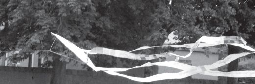
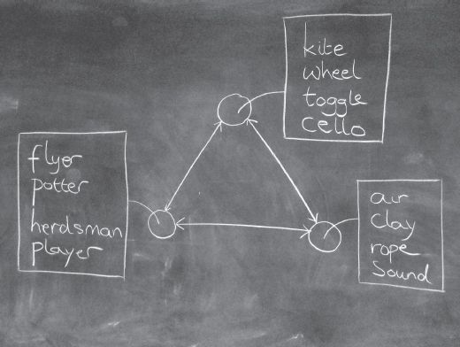
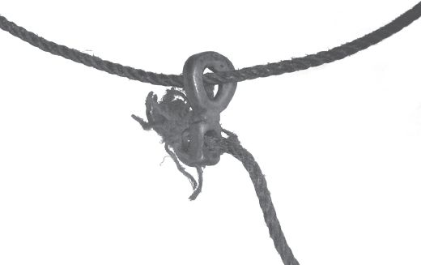

## 7 Bodies on the run (Part 4)

> [BREADCRUMB_CTX: 《Making: Anthropology, Archaeology, Art and Architecture》 > 7 Bodies on the run (Part 4)]

Here we have a person running; and there a kite flying. They are connected by a thread. So we have an interaction between a human being and a material object. At one moment the flyer makes the running while the kite is dragged along behind, but at the next it is the kite that pulls at the hand of the flyer, as if struggling to get away. This certainly seems to fit Pickering’s description of the dance as one ‘in which activity and passivity on both sides are reciprocally intertwined’ (2010: 195). But that cannot be the whole story. For if the kite is to act on the human flyer as well as the flyer to act on the kite – if, that is, the kite-object is to join the dance – then it must be endowed with some kind of agency. So where did this come from? So long as the kite remained indoors, it had been limp and lethargic. By what magic, then, was the power of agency contrived to jump into the kite at the moment it was carried out of doors? The answer, of course, hangs in the air. Because the air is invisible, we had temporarily forgotten about it. But now, all becomes clear. The kite’s flying is surely the combined effect of the flyer, the kite *and the air*. The dance of agency, it turns out, is a threesome in which each partner acts upon, and is in turn acted upon by, the other two (Figure 7.5). Take away any one partner, and the performance will fail. Even in the air, a kite will not fly without a flyer; even with a flyer, the kite will only fly in the air; even if the flyer is out in the air, there will be no flying without a kite. The air, then, was the missing link that activated the kite, allowing an action potential that was already immanent within it – in its very construction – to be expressed in motion.

**FIGURE 7.4** The kite in flight. The string can be seen on the left, harnessed to the main body of the kite, from which attached streamers, cut from strips of newspaper, flutter towards the right. (Courtesy of Susanna Ingold.)

In his efforts to show how mind emerges from practitioners’ engagements with the stuff of the material world, Malafouris also toys with the idea of the dance of agency. His key example is pottery. At the potter’s wheel, he writes, ‘brain, body, wheel and clay relate and interact with one another throughout the different stages of this activity’ (Malafouris 2008: 19). But does the potter dance with the wheel or with the clay, or with both at once? Curiously, when Malafouris (2004: 59) first introduces the idea, he has the potter dancing with the wheel, which may at one moment ‘subsume the plans of the potter and define the contours of activity’, but at another, ‘serve as a passive instrument for his or her manufacturing purposes’. Otherwise put, the wheel alternately governs and is governed by what the potter does. In a subsequent elaboration of the argument, however, the potter is dancing not with the wheel but with the clay. Noting that at any time, either potter or clay may take the lead, Malafouris nevertheless insists that the dance ‘is between equal partners’ (2008: 25). It is enacted, for example, in the grasping and fingering movements of the potter’s hands in the initial task of centring a lump of clay on the wheel. These movements may indeed be compared to dance. They observe a certain choreography. And as we saw in the comparable instance of metallurgy discussed in Chapter 2 (pp. 25–26), this gestural dance is coupled with a modulation in the material. But is it a dance of *agency*? Do potter, wheel and clay, as indicated in Figure 7.5, make up a threesome analogous to that comprising flyer, kite and air?

**FIGURE 7.5** The dance of agency, understood as a threesome in which the partners may be flyer–kite–air, potter–wheel–clay, herdsman–toggle–rope, or player–cello–sound. Chalk on blackboard. (Courtesy of Susanna Ingold.)

**The dance of animacy**

Let me return for a moment to the example of kite-flying.3 Following Pickering, we had assumed that what we were witnessing was an interaction between a person (the flyer) and an artefact (the kite). The question, then, was how the kite could exert any kind of agency, and in order to explain this we had to bring in the air. Our conclusion was that you cannot dance with a kite without introducing the air as a ‘third party’. There is, however, a snag in this argument. For how can air possibly be regarded as an agent? The very idea of agency, as we have seen, is the corollary of a logic of embodiment, of closing things up in themselves. But air cannot be closed. More than any other element, as the philosopher Luce Irigaray reminds us, air is ‘opening itself’ (Irigaray 1999: 8). The flow of air – the wind (*anemos*), the breath of life – is the very antithesis of embodied agency. But if the air cannot be closed upon itself, then no more, as we have seen, can the organism–person that lives and breathes. Thus even if we allow that in flying a kite, the flyer dances with the air, it cannot be a dance of agency. It can only be a *dance of animacy*. And in this dance, flyer and air do not so much interact as correspond. The kite, in effect, sets up a correspondence between the animate movements of the flyer and the currents of the aerial medium in which he or she is immersed. It is not that you need air to interact with a kite; rather, you need a kite to correspond with the air.

**FIGURE 7.6** Lasso and toggle. (Courtesy of Susanna Ingold.)

A moment’s reflection, moreover, indicates that the same is true of what happens at the potter’s wheel. This is not, as we have seen in the parallel case of brick making (Chapter 2, p. 25), an imposition of form on matter but a contraposition of equal and opposed forces immanent respectively in gesturing hands and wet clay, set up thanks to the rotations of the wheel. You do not, then, need clay to interact with the wheel, but you do need a wheel to correspond with the clay. In both cases, of pottery and kiteflying, the mindful or attentive bodily movements of the practitioner, on the one hand, and the flows and resistances of the material, on the other, respond to one another in counterpoint. As with any dance, this should be read not laterally, back and forth, but longitudinally as a movement in which partners take it in turns to lead and be led or – in musical terms – to play the melody and its refrain. In the dance of animacy, bodily kinaesthesia interweaves contrapuntally with the flux of materials within an encompassing, morphogenetic field of forces.