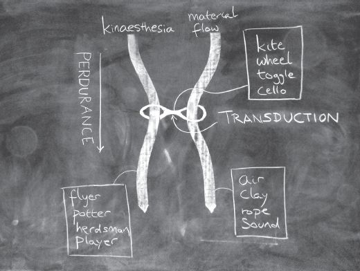
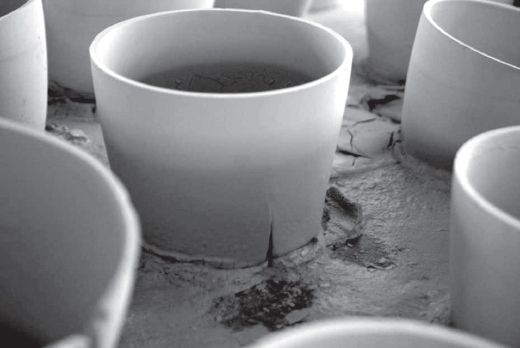

## 7 Bodies on the run (Part 5)

> [BREADCRUMB_CTX: 《Making: Anthropology, Archaeology, Art and Architecture》 > 7 Bodies on the run (Part 5)]

The kite puts me in mind of another example, familiar to me from my fieldwork among reindeer herdsmen in Finnish Lapland. This is the lasso (Ingold 1993). The operative component of the lasso is the toggle. You often find toggles, expertly crafted and sometimes beautifully decorated, in collections or exhibited in museums of Saami material culture. Traditionally carved from antler, the toggle has two holes: one small, the other larger. The small hole secures the end of a long rope that is looped through the larger one (Figure 7.6). In operation, of course, the toggle is nothing without the rope, and indeed without the herdsman for whom the manual-gestural skill of casting the lasso, requiring years of practice, is one of the most highly prized of the herding repertoire. It is a task that calls for intense concentration. But in the mindfulness of casting the lasso, do we witness an interaction between a person (the herdsman) and an artefact (the toggle) that has been endowed with agency thanks to the rope? Of course not! To argue along these lines would be as absurd as claiming that pottery entails an interaction between potter and wheel made possible by the intervention of clay. Rather, just as it is the wheel that allows the potter’s gestures to be carried over into the evolving contours of the clay, so the toggle allows the skilled gestures of the herdsman to be cast into the ever-emergent form of a flying noose.

Here is one more example to clinch the point. Apart from my ham-fisted attempts to throw a lasso, I also play the cello. There is a close parallel between the two (Ingold 2000: 413–414). Both call for finely honed manual-gestural skills; both carry forward a mindfulness that is immanent in the action itself, in its attentiveness to surrounding movements (of the conductor and other instrumentalists; of the throng of animals in the round-up enclosure); and both create sinuous forms – whether of the musical phrase or the flying noose – that are suspended in the current of ongoing activity. Moreover like the toggle for the herdsman, the cello is an artefact, a thing of great beauty that requires immense craftsmanship to make. But to perform music is not – or at least not just – to interact with a cello. It is to correspond with sound. In the performance, the player’s gestures describe a melodic line. What part, then, does the cello play in this? What does it do? And what, for that matter, does the toggle do? Or the kite? Or the potter’s wheel?

**Transduction and perdurance**

The answer is the same in every case. In the dance of animacy, cello, toggle, kite and wheel are all examples of what we could call *transducers*.4 That is to say, they convert the *ductus* – the kinetic quality of the gesture, its flow or movement – from one register, of bodily kinaesthesia, to another, of material flux. In the vibration of bowed strings, amplified by a soundbox, the cellist’s manual gesture is rendered audible, as melody. In the sliding of the toggle, the herdsman’s throw is cast as a loop of rope. In the rotation of the wheel, the potter’s hand and finger movements are registered in the contours of soft clay. And finally, in the kite, slicing the air like an axe through wood (see Chapter 3, p.45), following its undulations and torsions, the running of the flyer becomes a line of flight. In each case, the transducer slides along the thread of time, like a toggle on a rope, ever present on the threshold of emergence of things. It is this ever-presence that lends it an aura of immutability (Figure 7.7).

Consider the following, offered by Bjørnar Olsen as simple statements of the obvious: ‘Things are more persistent than thought. They evidently last longer than speech or gestures. Things are concrete and offer stability…’ (Olsen 2010: 158). Of transducers, all three statements may be broadly true. They are still there, changed but little after the performances they have mediated have come to a close. The toggle, for example, outlasts the throw of the lasso; the cello outlasts the concert. But the work of art lies not in the transducer but in what issues from it, and of such a work the question of its duration is not so easily answered. Let us return to the potter at the wheel. It is not just because it is made of the material stuff of clay that the pot lasts longer than the gestures which helped to shape it. The pot retains its form only because it has been fixed by subsequent processes of drying and firing (Ingold 2000: 418). In an installation by the artist Clare Twomey, tables were laid with rows of clay pots that had been thrown on the wheel but not yet fired. The pots were filled with water from a jug. Before the eyes of the viewer, they were seen to buckle, crack and collapse, as if in slow motion, discharging their contents over tabletops and floor to the accompaniment of the quiet tinkling of running water, while new ones were continually added in their place (Figure 7.8). In this enactment, every pot had become a living thing, not so much the fixed and final realisation of a prior design as the passing envoy of ever-replenished but ultimately forlorn hope.

**FIGURE 7.7** Transduction and perdurance. The movement of kinaesthetic awareness (respectively of the flyer, the potter, the herdsman and the player) is converted by way of a transducer (respectively kite, wheel, toggle and cello) into a corresponding flow of material (respectively of air, clay, rope and sound). In terms of this diagram, the perdurance – or ‘carrying on’ – of awareness and materials runs downwards, while transduction couples across. Chalk on blackboard. (Courtesy of Susanna Ingold.)

As this example shows, we cannot assume that pots are stable simply on account of some aspect of their ‘materiality’. Alberti’s study of ceramics from prehistoric Northwest Argentina has already taught us that despite the assertions of Olsen (2003: 88) and many others to the contrary, there is nothing intrinsically *hard* about the world of materials. Indeed for the people who originally made and used them, Alberti suggests, ceramics ‘may have been considered less stable and reliable even than other forms of discourse’ (Alberti 2007: 219). How long then, compared with these other discursive modalities – dialogical, gestural, verbal – do pots last? How long do bodies last? Which lasts longer, Moore’s *Warrior* or its mussel-infested double? If longevity be judged by the preservation of form, then no doubt the former wins. But if our concern is with the continuity of process – that is with the *perdurance* or life expectancy of a thing, or with how long it can keep on going – then the *Infestation* Piece is easily the victor, since it gained a new lease of life from its sojourn underwater, whereas the *Warrior*’s life was already over by the time the sculpture was completed. So, too, did Twomey’s pots come alive, if only for a brief while, when water was poured into them.5

**FIGURE 7.8** ‘Is it madness. Is it beauty.’ Close-up of installation by artist Clare Twomey. In the performance of this work, according to the artist’s statement, ‘the repetitive action of continually filling unfired ceramic bowls with water, that then collapse, isolates the notion of action and continued hope within the human condition’. Reproduced by courtesy of the artist.