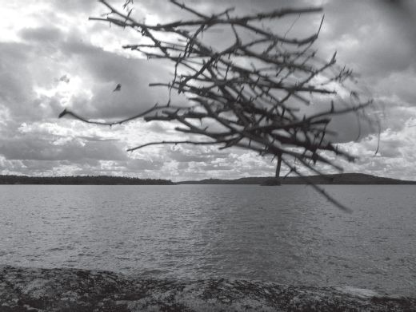
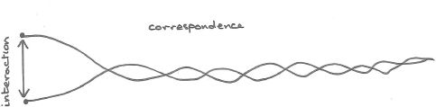

## 7 Bodies on the run (Part 6)

> [BREADCRUMB_CTX: 《Making: Anthropology, Archaeology, Art and Architecture》 > 7 Bodies on the run (Part 6)]

Joshua Pollard (2004: 51–53) describes how contemporary environmental artists have challenged our assumptions about the durability of things by producing works that are transitory and ephemeral. When Andy Goldsworthy, for example, throws a handful of sticks into the air, the resulting work lasts no longer than the gesture that animates it, and can be fixed only as a photographic record. Yet as a gathering of materials in motion, of sticks and air, it is undoubtedly a thing (Figure 7.9). For Goldsworthy, the strength of a work lies precisely in the ‘energies’ emanating from materials in their movement, growth and decay, and in the fleeting moments when they come together as one (quoted in Friedman 1996: 10). Here it is the materials that perdure, not the more or less transitory forms into which they are cast. Throwing, as Goldsworthy shows us, and as our experiments in kite-flying proved, is not so much the outward effect of an embodied agency as the propulsion of animate being as it spills out into the world. Such, indeed, is the propulsion of life itself.

**FIGURE 7.9** A bundle of sticks thrown in the air, on the shore of Lake Pielinen in eastern Finland. (Courtesy of Susanna Ingold.)

**Interaction and correspondence**

In the days before the keyboard severed all traces of writing from the hand, and before email lifted them from the page, people used to send handwritten letters to one another. In them, they would tell of their affairs, of how they were doing, at the same time answering to recollections and sentiments expressed in letters most recently received. For such a drawn-out exchange of letters, it was customary to use the word *correspondence*. This is a word to which I have also had recourse at a number of points in my argument, and I would like to conclude this chapter by explaining more fully what I mean by it. The case of letter writing highlights two aspects that I take to be central to correspondence: first, that it is a movement in real time; and second, that this movement is sentient. On the first point: writing letters takes time, as does waiting for them and reading them when they arrive. A correspondence is rather like a relay, in which each participant takes it in turns to pick up the baton and carry it forward, while others remain temporarily quiescent, awaiting their turn. They may of course wait forever, and gradually give up hope, yet there is no knowing whether, or when, a lapsed correspondence may be rekindled. Thus while letters may go back and forth, the correspondence has no starting point or end point. It simply carries on. On the second point: the lines of correspondence are lines of feeling, of sentience, evinced not – or not only – in the choice of words but in the manual gestures of the writing and their traces on the page. To read a letter is not just to read *about* one’s respondent, but to read *with* him or her. It is as though the writer was speaking from the page, and you – the reader – were there, listening.

Long ago, Alfred Schutz, phenomenologist of the social world, hit on much the same idea in his characterisation of social life as a process of ‘growing older together’. Sharing a community of time, Schutz maintained, every consociate participates in the on-rolling life of every other (Schutz 1962: 16–17). In a celebrated paper, he compared this participation to making music. The players in a string quartet, for example, are not exchanging musical ideas – they are not *interacting*, in that sense – but are rather moving along together, listening as they play, and playing as they listen, at every moment sharing in each other’s ‘vivid present’ (Schutz 1951). In our studies of everyday walking, my colleague Jo Vergunst and I came to a very similar conclusion (Lee and Ingold 2006). We found that walking abreast was generally experienced as a particularly companionable form of activity. Even while conversing, as they often did, companions would rarely make immediate eye-to-eye contact, at most inclining their heads slightly towards one another, while co-ordinating their gait and pace by means of peripheral vision, which is especially sensitive to movement. Direct face-to-face interaction, by contrast, was found to be far less sociable. A key difference is that in walking along together, companions share virtually the same visual field, whereas in face-to-face interaction, each can see what is behind the other’s back, opening up possibilities for deceit and subterfuge. As they turn to face one another, stopped in their tracks, each blocking the other’s path, they appear to be locked in a contest in which views are no longer shared but batted back and forth.

Now in a classic essay on ‘visual interaction’, dating from 1921, the sociologist Georg Simmel argued that eye-to-eye contact ‘represents the most perfect reciprocity in the entire field of human relationships’, inducing a kind of union between the persons involved. This union, he surmised ‘can only be maintained by the shortest and straightest line between the eyes’ (Simmel 1969: 146). Do lovers, then, look straight at one another? Not according to John Donne who, in his poem *Exstasie*, penned three centuries earlier, described their vision thus:

Our hands were firmely cimented  
With a fast balme, which thence did spring,  
Our eye-beames twisted, and did thred  
Our eyes, upon one double string;

(in Grierson 1947: 16)

Donne’s poem begins with the two lovers joined by the hands and yet entirely separate, over and against one another, lying immobile – ‘like sepulchrall statues’. The conjunction of their bodies was not enough to make them one. To achieve the union they crave, their souls must rise up from their bodily moorings and stream out through the eyes, whence they twist around one another in a space between, ‘hung ’twixt her, and mee’, as between two opposed armies. Negotiating there, on their double eye-beams, while the bodies they have exited remain stationary, they eventually achieve a blend wherein each soul speaks with the other’s voice. Only when they have thus come into unison can the two souls descend back into the bodies from whence they came, bringing about the desired unity of body and soul in the consummation of love and its ensuing bounty.

We do not have to subscribe to Donne’s complex and somewhat esoteric metaphysics to appreciate the force of the distinction he draws between the ‘overagainstness’ (the word Donne used was *entergraft*) of embalmed, cemented bodies and the entwinement of evanescent, light-borne souls. In our terms, this is the distinction between interaction and correspondence – that is, between the dance of agency and the dance of animacy (Figure 7.10). A straight line drawn between two points, as Simmel describes eye-to-eye contact, leaves each point motionless and unfeeling. Such contact may be rational, but it cannot be sentient. Like walkers who have turned in discord to square up to one another, or passengers in that kind of carriage known as the *vis-à-vis*, or indeed like Donne’s lovers as they hold hands, or even Moore’s *Warrior*, there is no way forward. The implication of the prefix *inter*-, in ‘interaction’, is that the interacting parties are closed to one another, as if they could only be connected through some kind of bridging operation. Any such operation is inherently detemporalising, cutting across the paths of movement and becoming rather than joining along with them. In correspondence, by contrast, points are set in motion to describe lines that wrap around one another like melodies in counterpoint. Think, for example, of the entwined melodic lines of the string quartet. The players may be seated opposite one another, and their bodies fixed in place. But their movements and the ensuing sounds correspond, seeking a blend not unlike that of Donne’s souls in ecstasy, neither here nor there but in-between.

