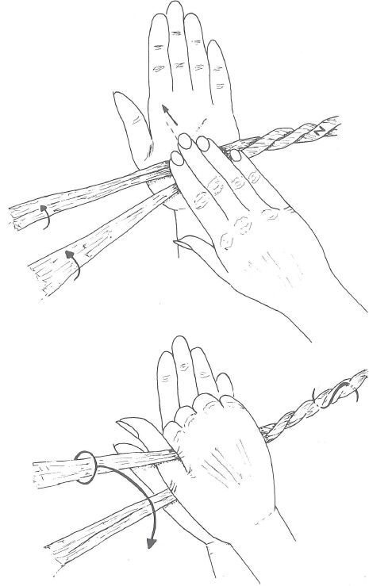
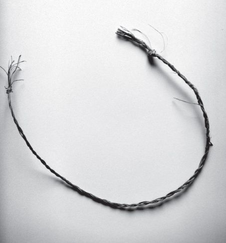

## 8 Telling by hand (Part 6)

> [BREADCRUMB_CTX: 《Making: Anthropology, Archaeology, Art and Architecture》 > 8 Telling by hand (Part 6)]

I took the leaves of a palm – yes, palm trees grow even in cold and windswept Aberdeen, and we had one in our garden until two hard winters in a row, 2009–2010 and 2010–2011, finished it off – and holding a leaf between the thumb and forefinger of the left hand, I pinched the edge between the thumbnail and the pad of the third finger of my right. Using the nail to slice the edge of the leaf, I then pulled it away in a millimetre-thin but leaf-long strip. Having in this way made a sufficient quantity of strips I left them to soak overnight in a bucket of water and brought them along to my 4 As class the next day. We had been reading Wendrich’s description of Egyptian string-winding and had also watched the accompanying video of the basket maker at work. With these as guides, we set to work with our palm-leaf fibres. The technique is to lay the two bundles of fibres comprising each strand across the outstretched palm of the left hand, and then to bring up the flattened palm of the right so that it slides over the left from base to tip. As it does so, it rolls and twists the two strands. But as the right hand nears the end of its slide, its thumb and forefinger pick up the distal strand and pull it over to the basal position, nearest the wrist, allowing the originally basal strand to slide up to the distal. The effect is to half-twist the two strands in the reverse direction (Figure 8.1). This elementary double movement – slide-roll and pickup-pullover – is then repeated over and over again, while continually introducing additional fibres into the strand-bundles as necessary. Needless to say, our efforts were laboured and clumsy, and we could only look on in envy at the way in which the string of the basket maker in the video seemed to spool out effortlessly from his hands as they rolled and pulled, rolled and pulled, in a steady, almost hypnotic rhythm. Nevertheless, string was made (Figure 8.2), and we were astonished by its strength and pliability.

What did we learn? Four things, really: about how the hands get to know materials, or acquire a ‘feel’ for them; about how they impart a rhythm to these materials in the iteration of their own movements, and how the materials, in turn, carry a memory of their manipulation; about how the forces and energies bound into the materials through these gestural movements hold them together – that is, how the friction of opposed torsions makes things stick; and about the correspondence of materials in making. I will conclude this section with a few words on each of these four lessons.

**FIGURE 8.1** Hand movements in making string. Reproduced from Wendrich (1999: 299), courtesy of the author.

**FIGURE 8.2** A length of string wound from palm-leaf fibres. (Courtesy of Susanna Ingold.)

First, our experiment offered an experience of tactility quite different from that of the blindfold inspection of objects or artefacts, where the task of exploring fingertips is to extract the form of the object and to cast it as an image in the mind. Here, the whole hand was in play (and not just one hand but both), including the palms, and the impressions were of texture rather than form, in an entwinement of bodily sensing and material flexion that could carry on indefinitely. We had already touched upon this difference in our experiments with objects and materials described in Chapter 2 (p. 18), and our exercise of making string seemed only to lend further weight to it. One of the reasons, we discovered, why we found the task so difficult was that our soft scholars’ hands, unused to the abrasions of agrarian toil, were so smooth that they tended to slip over the bundles of fibres in our palms rather than rolling them. Friction, then, is essential to technically effective tactility (Wendrich 1999: 300). The experience, secondly, offered vivid confirmation of the conclusion to which both Boas and Leroi-Gourhan had independently arrived, of the relation between rhythmic movement and emergent form. There is, as Sennett observes (2008: 176), a ‘rhythm involved in concentration’, which is far from the dull routine of rote habituation. As long as concentration is sustained and the rhythm remains unbroken, then the string will be even. But when it lapses, causing the rhythm to falter, jar or miss a beat, then the string will kink and bend. Thus, in its inclinations and dispositions, its regularities and imperfections, the string retains a complete and unflinching record of the gestures that went into its formation. Nothing escapes it. As the ‘cord’ in re-*cord* reminds us, and as we already saw in Chapter 6 (pp. 81–82), there is memory in a length of string (Figure 8.2), and to remember is to rewind it.

Third, as in our experiments in basketry (see Chapter 2, pp. 22–23), the twist of the string was generated in a kind of force field that included both the forces imparted by our manual movements and those intrinsic to the material itself. The fibres have no inherent inclination to twist. The string coheres not because of the inertia of materials but because of the contrary forces of torque and friction imparted to them by the hands. Making string is rather like winding two spirals at once, which are parts of a larger spiral that is simultaneously wound in the opposite direction. As a result of this contrariness, a dynamic equilibrium is sustained. Bodies are wound and held together in much the same way. They are a tissue of twisted fibres at every level of resolution from the DNA of the chromosomes to the coils of the guts, and to the vocal cords and heartstrings. There is an ancient etymological connection between the Latin words for the heart, *cor*, and for cord or string, *chorda*, and both – in ‘learning by heart’ as in rewinding – are involved in the production of memory (Carruthers 1990: 172). Topologically, the heart is a tube twisted into a knot. But as source of feeling it also puts us in mind of the twisted eye-beams of Donne’s lovers, with whom we brought the last chapter to a close. And this was our fourth lesson. For the eye-beams show that a perception that inheres in the entwinement of materials and awareness rather than in the projection of objects as images – that is, in this sense, haptic rather than optical – is by no means confined to the modality of the tactile. As Gilles Deleuze and Félix Guattari remind us (2004: 543–544), ‘the eye itself may fulfill this nonoptical function’. Conversely of course, as in the blindfold inspection of objects, the hands can fulfil an optical one. Projection is optical, but telling is haptic – whether by hand or by eye. It is feeling-full. The strands of our string, as they twisted around one another, had a feel for each other in their correspondence no less than that of eye-beams or heartstrings. They are but species of the same phenomenon. The language of feeling is as appropriate, and as literal, for the twisted eye-beams of lovers as it is for the entwined strands of string.

**The regression of the hand**