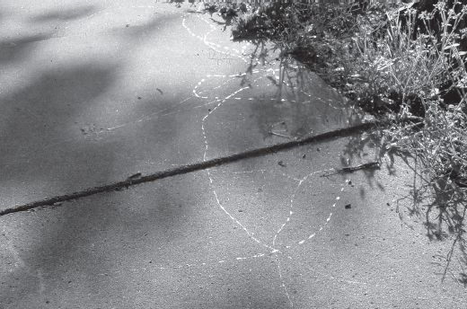

## 9 Drawing the line (Part 5)

> [BREADCRUMB_CTX: 《Making: Anthropology, Archaeology, Art and Architecture》 > 9 Drawing the line (Part 5)]

Where the network has nodes, the meshwork – as Lars Spuybroek intimates here – has knots. Knots are places where many lines of becoming are drawn tightly together. Yet every line overtakes the knot in which it is tied. Its end is always loose, somewhere beyond the knot, where it is groping towards an entanglement with other lines, in other knots. What is life, indeed, if not a proliferation of loose ends! It can only be carried on in a world that is not fully joined up, not fully articulated. Thus the very continuity of life – its sustainability, in current jargon – depends on the fact that nothing ever quite fits. As we saw in Chapter 4 in the specific case of medieval cathedral building, the world is not assembled like a jigsaw puzzle in which every ‘building block’ slots perfectly into place within an already pre-ordained totality. To be sure, we are always being told these days that the world we inhabit is built from blocks: thus biologists speak of the building blocks of cellular organisms, psychologists of the building blocks of thought, physicists of the building blocks of the universe itself.7 But a world built from perfectly fitting blocks could harbour no life at all. The reality, again as in the case of the cathedral, is more akin to a quilt in which ill-fitting elements are sewn together along irregular edges to form a covering that is always provisional, as elements can at any time be added or taken away.

**FIGURE 9.1** Slug trails, photographed in the early morning on an Aberdeen pavement.

Gilles Deleuze and Félix Guattari (2004: 526) take up the history of the quilt in developing their idea of a topology that is smooth rather than striated, showing how early embroidered fabrics gave way to a patchwork technique where scraps of leftover material or fragments salvaged from worn-out garments were sewn together. With its regular and rectilinear intersections of woof and weft, fabric – for Deleuze and Guattari – is the epitome of the striated. But in the patchwork, ‘an amorphous collection of juxtaposed pieces that can be joined together in an infinite number of ways’, the principle of striation is subordinated to that of the smooth. No material better exemplifies the principle of the smooth, however, than felt. Comprised of a mélange of entangled woollen fibres, with no consistent orientation and extending without limit and in all directions, felt – say Deleuze and Guattari – is everything that fabric is not. It is an anti-fabric (ibid.: 525). Could the same, then, not be said of the meshwork? Are the wayward trails left by slugs in their nocturnal meanderings not comparable to the fibres of felt, which in turn seem reminiscent of the tracks worn in the ground, in their pastoral wanderings, by the very sheep upon whose backs the wool was grown? This is indeed what Deleuze and Guattari would have us believe. Yet the constitutive lines of the smooth, they say, are *abstract*, as distinct from lines that are either *geometric or organic*. In order to appreciate what they are getting at, we need to examine these three kinds of line a little more closely.

**The abstract line**

We begin with the line of geometry – the Euclidean line – that inhabits a mathematical space defined by the regular intersection of dimensional co-ordinates. Like both Alberti’s lineament and its contemporary counterpart, the computer-generated line (Pallasmaa 2009: 100), it is defined as the connection between two points. As its name implies, the geometric line has its origin in the practices by which the surveyors of ancient Egypt measured the earth after every annual flood of the Nile. They would stretch a cord between stakes hammered in the ground (Ingold 2007: 159). From this, too, as philosopher Michel Serres (1995: 59) reminds us, comes the legal notion of *contract*: a ‘cord that draws or tracts us together’. The stretched cord, string or thread, however, retains a certain tactility: you can *feel* the tension; pluck it, and it vibrates. As textile artist Victoria Mitchell has put it, taut thread is a kind of ‘hinge’ between feeling and form, between bodily kinesis and speculative reason (Mitchell 2006: 345). But as geometry was drawn into the art and science of optics, and as the earth-measurer’s cord was joined by the optical instruments of the seafarer, the once tangible, taut thread morphed into its intangible and insensible spectre, the ray of light. For long, both thread and ray, the material line and its spectral double, appeared together, like a thing and its shadow. Even Alberti thought of lines of sight as threads, like those of a veil stretched between the eye and the thing seen, yet so fine that they could not be split (Alberti 1972: 38). But as a vector of projection, the geometric line was eventually divested of all remnants of tactility. We can recognise it today in Georg Simmel’s (1969: 146) definition of eye-to-eye contact: ‘the shortest and straightest line between the eyes’ (see Chapter 7, p. 106).

In making connections and setting limits, the geometric line lies at the root of law, reason and analytic thought. It is laconic and always to the point. Organic lines, by contrast, trace the envelopes or contours of things as though they were contained within them: they are outlines. They are also separators, dividing the surfaces on which they are drawn between what is on one side of the line and what is on the other: in this sense they are analogous to cuts (Rawson 1979: 34; Maynard 2005: 63–64). Such lines, however, have no presence on or in things themselves. I might draw an egg in outline as an oval, the trunk of a tree as two parallel lines or the sky as an arc, but would look in vain to find their counterparts on egg or trunk, or in the heavens. Or I might want to draw an apple or the border between a meadow and a ploughed field, yet as Maurice Merleau-Ponty observes in his essay ‘Eye and mind’ (1964: 182), I would be deluded to think that the outer contour of the apple or the field boundary is actually present, ‘such that, guided by points taken from the real world, the pencil or brush would only have to pass over them’. For if we look, there are no lines to be seen. ‘*Lines?* I see no lines’, the great artist Francisco Goya – himself a consummate draughtsman – is reputed to have declared (cited in Laning 1971: 32). This and similar observations have led numerous authorities (reviewed in Maynard 2005: 99) to conclude that *line does not exist in nature*, and therefore that the lines of drawing have only a symbolic connection to their referents, based on artifice or convention rather than phenomenal experience. ‘Line itself’, asserts artist and curator Deanna Petherbridge in her magisterial survey of histories and theories of drawing practice, ‘does *not* exist in the observable world. Line is a representational convention…’ (Petherbridge 2010: 90).

In short, if the geometric line is the mark of reason, then the outline looks more like a cultural construct: the visible expression of a process by which the mind, according to a well-worn anthropological paradigm (Leach 1964), more or less arbitrarily divides the continuum of nature into discrete objects that can be identified and named. The lines of those familiar ‘join-the-dot’ puzzles, designed for children, manage to be both geometric and organic simultaneously, at once connecting points and outlining objects. Rather as children join the dots, surveyors make maps, outlining such features as riverbanks and coasts (Ingold 2007: 86). But the lines of the meshwork – such as the slime trails of slugs (Figure 9.1) – are not outlines, nor are they point-to-point connectors. To my eyes, however, they seem entirely real and indeed natural. Surely, there *are* lines in the observable world, for they are unmistakably *there*. In what conceivable sense, then, can they be said to be abstract?