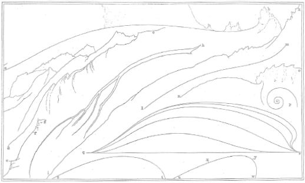

## 9 Drawing the line (Part 6)

> [BREADCRUMB_CTX: 《Making: Anthropology, Archaeology, Art and Architecture》 > 9 Drawing the line (Part 6)]

For an answer we can return to Kandinsky. In his essay ‘On the spiritual in art’, Kandinsky insists that abstraction does not mean draining a work of content so as to leave only an empty outline or a pure geometrical form. On the contrary, it means removing all those figurative elements that refer only to the externalities of things, that is to their outward appearances, in order to reveal what he called their ‘inner necessity’ (Kandinsky 1982: 160). By this he meant the life force that animates them and that, since it animates us too, allows us to join with them and experience their affects and pulsations from within. In a charming sketch penned in 1935, Kandinsky (ibid.: 774–775) asks us to consider the similarities and differences between a line and a fish. They do have certain things in common: both are animated by forces internal to them that find expression in the linear quality of movement. A fish streaking through the water could be a line. Yet the fish remains a creature of the external world – a world of organisms and their environments – and depends on this world to exist. The line, by contrast, does not. The line is no more, and no less, than life itself. That, says Kandinsky, is why he prefers the line to the fish, at least in his painting (Ingold 2011a: 208). And this, too, is why Deleuze and Guattari, following Kandinsky, can say of ‘*a line that delimits nothing, that describes no contour*, that no longer goes from point to point but passes between points, … that is without outside or inside, form or background, beginning or end and that is alive as a continuous variation’, that it is *abstract* (Deleuze and Guattari 2004: 549, 550–551 fn. 38). Such is the line of the river current, or of the ebb and flow of the tide, as distinct from the riverbank or coastline plotted on the cartographer’s chart.

In words attributed to Leonardo da Vinci, Merleau-Ponty writes that the secret of drawing any thing is to discover ‘the particular way in which a certain flexuous line, which is, so to speak, its generating axis, is directed through its whole extent’.8 Such a line, he continues, is neither here nor there, neither in this place nor that, but ‘always between or behind whatever we fix our eyes upon’ (Merleau-Ponty 1964: 183). One could almost treat line as a verb, and say that in the thing’s growing – in its issuing forth, in its making itself visible, as Paul Klee (1961: 76) would say – *it lines*. That would certainly accord with the view of the nineteenth century draughtsman-critic John Ruskin. In his massive three-volume compendium *The Stones of Venice* (1851–1853), Ruskin assembled a collection of what he called ‘abstract lines’ into a single figure, combining his observations of things great and small, from a glacier and a mountain ridge, through a spruce bough, to a willow leaf and a nautilus shell (Figure 9.2). In every case, he contended, the line is ‘expressive of action or *force* of some kind’ (Ruskin 1903: 268). These lines of action and force, as he would go on to explain in his treatise of 1857 on *The Elements of Drawing*, are to be discerned in ‘the animal in its motion, the tree in its growth, the cloud in its course, the mountain in its wearing away’. Thus he went on to advise the novice: ‘try always, whenever you look at a form, to see the lines in it which have had power over its past fate and will have power over its futurity. Those are its *awful* lines; see that you seize on those, whatever else you miss’ (Ruskin 1904: 91). Wisdom, for Ruskin, lay in grasping not just the way things are but *the way they are going* – that is, in anticipation – and this meant concentrating not on the outlines of shape but on the centrelines of force. These are the awful lines. If they abstract from the real, as Spuybroek points out (2011: 115), it is not by reduction but by the precise registration of its variation. The awesome power of such lines lies precisely in their capacity to break the bounds that otherwise hold things captive within their envelopes, thus releasing them into the fullness of their being.

**FIGURE 9.2** Abstract lines. Reproduced from Ruskin (1903), Plate VII, facing page 268.

Such are the lines that comprise the meshwork and that, for Deleuze and Guattari, constitute the topology of the smooth. It is a topology, they argue, that is haptic rather than optical, that relies not on points that might be connected geometrically, nor on objects that might be outlined organically, but on the tactile and sonorous qualities of a world of wind and weather, where there is no horizon separating earth and sky, no intermediate distance, no perspective or contour (Deleuze and Guattari 2004: 421). We have already encountered this world in Chapter 6: it is what we called the *earth-sky*, in contradistinction to the landscape. In the *landscape*, the geometric line defines the disposition of elements and the organic line delimits their projected forms. The abstract line, however, anticipates the becoming of things in the earth-sky world. In such a world, lines are not imposed by representational convention, nor are they plotted between points. They are rather laid down in growth and movement. Look *at* nature, as landscape, and there are, as Goya said, no lines to be seen. They exist only in its graphic representations. Look *with* it, however, as a manifold of earth and sky, join in the movements of its formation, and lines are everywhere. For they are the very lines along which we and other creatures live.

**Lines and beasts**

In what must be one of the founding statements of architectural modernism, Le Corbusier headed his manifesto for urban planning, *The City of Tomorrow*, with the following declaration: ‘Man walks in a straight line because he has a goal and knows where he is going; he has made up his mind to reach some particular place and he goes straight to it’ (Le Corbusier 1947: 11). And a man who does not? His way, says Le Corbusier, is that of the pack donkey, who has no thought in its scatter-brained head save to follow the line of least resistance, wherever it goes. The pack donkey’s way is always winding, never straight, governed, Le Corbusier contends, by feeling, not by reason. When we look at the layout of almost every continental city, we find in its meandering streets that the donkey has been there first, lumbering along in its aimless and distracted way, and creating tracks in the process along which people then settled. But in a modern city, fit for the age of the automobile, there can be no place for these wriggling, zigzag lines. They are difficult and dangerous, and induce paralysis. A modern city, Le Corbusier insisted, can only live by the straight line (ibid.: 16).

I will return to Le Corbusier in a moment. But first let me introduce a contemporary compatriot whose influence was equally far-reaching, extending far beyond his discipline of anthropology as did Le Corbusier’s beyond his of architecture. I refer of course to Claude Lévi-Strauss. In his memoir, *Tristes Tropiques*, Lévi-Strauss recounts the stories of his travels among the Nambikwara, an indigenous people of Brazilian Amazonia. One chapter, entitled ‘A writing lesson’ (Lévi-Strauss 1955: 294–300), folds together two concurrent stories, both of which are about lines. The first is about inscriptions on paper; the second about the paths of animals. I shall summarise each very briefly.