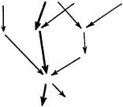

> [BREADCRUMB_CTX: 《The Shape of Time》 > NOTES (Part 1)]

# NOTES

Notes

One
. THE HISTORY OF THINGS

1
. I owe my first concern with the problems set forth here to the works and person of the late A. L. Kroeber. Our correspondence began in 1938 soon after I read his remarkable study (with A. H. Gayton) on the Nazca pottery of southern coastal Peru, “The Uhle Pottery Collections from Nasca,”
University of California Publications in American Archaeology and Ethnology, 24
(1927). It is a statistical analysis based upon the assumption that undated items belonging to the same form-class can be arranged in correct chronological order by shape-design correlations on the postulate that in one form-class simple formulations are replaced by complex ones. See also A. L. Kroeber, “Toward Definition of the Nazca Style,” ibid.,
43
(1956), and my review in
American Antiquity, 22
(1957), 319–20. Professor Kroeber’s later volume entitled
Configurations of Culture Growth
(Berkeley, 1944) explored more general historic patterns, especially the clustered bursts of achievement marking the history of all civilizations. These themes continued as Kroeber’s principal interest in the book of lectures entitled
Style and Civilizations
(Ithaca, 1956).

In an arresting review G. E. Hutchinson, the biologist, compared Kroeber’s
Configurations
to internal or free oscillations in animal populations by subjecting Kroeber’s work to mathematical expressions like those used in population studies. The review is reprinted in
The Itinerant Ivory Tower
(New Haven, 1953), pp. 74–77, from which I quote: “The great man, born to the period where
dN/dt
is maximal [where
N
is the degree of pattern saturation] can do much. His precursors have provided the initial technical inspiration; much still remains to be done. If he were born to

the tradition later he would, with the same native ability, appear less remarkable, for there is less to do. Earlier the work would have been harder; he would perhaps be highly esteemed by a small body of highly educated critics, but would never attain the same popular following as if he had worked at the time of maximum growth of the tradition. The rising and falling that we see in retrospect is thus to be regarded as a movement to and from a maximum in a derived curve. The integral curve giving the total amount of material produced seems to depend little on individual achievement, being additive, and therefore is less easily appreciated. We are less likely to think of 1616 as the date by which most Elizabethan drama has been written than as the date of Shakespeare’s death.”

2
. Meyer Schapiro, “Style,”
Anthropology Today
(Chicago, 1953), pp. 287–312, reviews the principal current theories about style, concluding dispiritedly that “A theory of style adequate to the psychological and historical problems has still to be created.”

3
. A leading figure among younger architectural historians in Italy, Zevi observes in his book-length article on “Architecture” (as published in the American edition of the Italian
Encyclopedia of World Art, 1
[New York, 1959], cols. 683 –84) that the recent union between the history of art and studio or drafting-room work, which is now being accomplished in European art education, could not begin until the historians escaped from old misconceptions about art itself, and until historians were ready to “give critical support to the creative experience of contemporary artists.” He regards the problem of constructing an artistic education on historical principles as “one of the most vigorous cultural battles of the 1950’s” in Europe and America. That battle is still far from over in America. Its continuation appears as foolish now as it was wasteful in the past.

4
. Writing in 1935 (“‘Stilgeschichte’ and ‘Sprachgeschichte’ der bildenden Kunst,”
Sitzungsberichte der bayrischen Akademie der Wissenschaft en, 31
), Julius von Schlosser referred with feeling to the modern Mannerism being propagated by the “Kopisten, Nachahmer, Industriellen … von unserem heutigen Dekadententum.”

5
.
Ion
, tr. Jowett,
Dialogues of Plato
(New York, 1892), vol. 1.

6
. See Emil Kaufmann,
Architecture in the Age of Reason
(Cambridge, Mass., 1955), pp. 95–100.

7
. Paul Menzer, “Kants Ästhetik in ihrer Entwicklung,”
Abhandlungen der deutschen Akademie der Wissenschaften zu Berlin, Kl. für Gesellschaft swissenschaft en
, Jahrgang 1950 (1952).

8
. Harlow Shapley,
Of Stars and Men
(New York, 1958), p. 48.

9
. H. Hubert and M. Mauss, “La Représentation du temps dans la religion,”
Mélanges d’histoire des religions
(Paris, Alcan, 2nd ed., 1929), pp. 189–229. On mythopoetic transformations of historical personages, see for example V. Burch,
Myth and Constantine the Great
(Oxford, 1927).

10
. Anne Hersman,
Studies in Greek Allegorical Interpretation
(Chicago, 1906).

11
. Erwin Panofsky,
Studies in Iconology
(New York, 1938).

12
. Friedrich Matz,
Geschichte der griechischen Kunst
(Frankfurt, 1950), 2 vols. The introduction is an exposition of
Strukturforschung
, for which an English approximation might be “studies of form-field relations.”

13
. E. Panofsky,
Renaissance and Renascences
(Stockholm, 1960), has commented at some length on the end of the modern age in the present century.

Two
. THE CLASSING OF THINGS

1
. A. Riegl,
Die Spätrömische Kunstindustrie
(Vienna, 1901–23), 2 vols.

2
. The term itself arose according to Croce (“La teoria dell’arte come pura visibilità,”
Nuovi saggi di estetica
[Bari, 1926], pp. 233–58) in conversation among Hans von Marées, Conrad Fiedler, and Adolf Hildebrand in Munich. The date was probably about 1875. Wölfflin’s most celebrated work is
Kunstgeschichtliche Grundbegriffe
(Munich, 1915).

3
.
Mathematics Dictionary
, ed. Glenn James and R. C. James (Princeton, 1959), pp. 349–50. Professor Oystein Ore, of Yale University, to whom I showed this chapter after he told me about the work he is completing on graph theory, wrote the following assessment: “In attempting to give a systematic presentation of so complex a subject matter one would be inclined, as in the natural sciences, to look to the mathematicians for some pattern to serve as a descriptive principle. The mathematical concepts of series and sequences came to mind but after some thought these appear to be too special for the problem at hand. However, the less known field of networks or directed graphs seems to be considerably more suitable.

“We are concerned with the variety of stages in the creativity of the human race. From one stage one moves to another in the development. There are a variety of directions which may be selected. Some represent actual happenings. Others are only possible steps among many available ones. Similarly each stage may have occurred among several possible steps leading to the same result.

“This one may picture in a general way by the mathematical concept of a directed graph or network. Such a graph consists of a number of points or vertices or stages. Some of these are connected by a directed line, an edge or a step. At each stage there is therefore a number of alternative edges which may be followed, and also a number of incoming edges from which this stage could have resulted. The actual development corresponds to a (directed) path in the graph and it is only one among many possible ones.

“One may ask whether the graphs we should like to consider are of a special type among the many directed graphs which can be constructed. There seems to be one essential restriction, that the graphs shall be acyclic, that is, there exists no cyclic directed path returning to its original stage. This essentially corresponds to the observation about human progress that it never returns to the previous conditions.”

4
. T. S. Eliot, “Tradition and the Individual Talent,”
Selected Essays, 1917–32
(New York, 1932), p. 5. Also,
Points of View
(London, 1941), pp. 25–26.