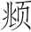
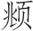
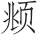

> [BREADCRUMB_CTX: 《长物志（精）--中华经典名著全本全注全译 (中华书局)》 > 古今优劣]

# 古今优劣

**【题解】**

论书法，文震亨还是贵古贱今，但在绘画上却分出古今各有优劣。文震亨罗列了一大串的画家名单，提到明朝的名画家时，文震亨认为他们画艺达到了极致，并不无自豪地提到自己的先祖文徵明与文嘉。文徵明、沈周、唐寅、仇英在画史上合称“吴门四家”。今天我们最熟悉的可能是唐寅，唐伯虎点秋香的故事老少皆知，但实为后人戏说，于史无证。唐寅才华横溢，一生却遭际坎坷，远没有文学作品中演绎得那么风流潇洒。明代还有一个独特的画家，文震亨却没有提到，即徐渭，徐渭擅长水墨花卉，用笔放纵，文震亨推崇“纯重雅正”，应是不喜欢徐渭的风格。

文震亨提到的明代之前的一些画家，不仅画艺高超，而且在绘画发展史上多具有里程碑式的作用。东晋顾恺之在当时被人称为“才绝，画绝，痴绝”，可惜无真迹流传，流传至今的《女史箴图》《洛神赋图》《列女仁智图》等均为唐宋摹本。唐代吴道子被后世尊称为画圣，是中国山水画的祖师，创造了笔间意远的山水“疏体”。唐阎立本流传下来的《步辇图》现在是无价之宝。宋代的米芾书法、绘画堪称一绝，可惜绘画没有留存下来。文震亨对名家书画一一道来，不知生活于明代的他是否见到了哪些真迹呢？

书学必以时代为限，六朝不及晋魏，宋元不及六朝与唐。画则不然，佛道、人物、仕女、牛马，近不及古；山水、林石、花竹、禽鱼，古不及近。如顾恺之①、陆探微②、张僧繇③、吴道玄④，及阎立德、立本⑤，皆纯重雅正，性出天然。周昉⑥、韩幹⑦、戴嵩⑧，气韵骨法，皆出意表，后之学者，终莫能及。至如李成⑨、关仝⑩、范宽⑪、董源⑫、徐熙⑬、黄筌⑭、居寀⑮、二米⑯，胜国松雪⑰、大痴⑱、元镇⑲、叔明诸公⑳，近代唐、沈及吾家太史、和州辈，皆不藉师资，穷工极致，借使二李复生，边鸾再出，亦何以措手其间？故蓄书必远求上古，蓄画始自顾、陆、张、吴，下至嘉隆名笔，皆有奇观。惟近时点染诸公，则未敢轻议。

**【注释】**

①顾恺之（约345—406）：字长康，小字虎头，晋陵无锡（今江苏无锡）人。因在文学和绘画方面成就颇高，被称为三绝：才绝、画绝和痴绝。

②陆探微（？—约485）：南朝宋吴（今江苏苏州）人。正式以书法入画的创始人，把东汉张芝的草书体运用到绘画上，与顾恺之并称“顾陆”。

③张僧繇：吴（今江苏苏州）人。南北朝梁画家。长于写真，并擅画佛像、龙、鹰，多作卷轴画和壁画。与顾恺之、陆探微、吴道子并称为画家四祖。主要作品有《二十八宿神形图》《梁武帝像》等。

④吴道玄：即吴道子（约680—759）。又名道玄，阳翟（今河南禹县）人。唐代著名画家，画史尊称“画圣”。开元年间以善画被召入宫廷，曾随张旭、贺知章学习书法，通过观赏公孙大娘舞剑，体会用笔之道。擅佛道、神鬼、人物、山水、鸟兽、草木、楼阁等，尤精于佛道、人物，长于壁画创作。主要作品有《送子天王图》等。

⑤阎立德（约596—656）：本名阎让，字立德，雍州万年（今陕西西安）人。阎立德曾受命营造唐高祖山陵，督造翠微、玉华两宫，营建昭陵，主持修筑唐长安城外郭和城楼等。绘画以人物、树石、禽兽见长。主要作品有《文成公主降蕃图》《王会图》《古帝王图》等。阎立本（？—673）：阎立德之弟，雍州万年（今陕西西安）人。善于图画，工人物、车马、台阁，尤擅写真，笔力圆劲雄浑，长于刻画人物性格神情。代表作品有《步辇图》《历代帝王图》《凌烟阁功臣二十四人图》等。

⑥周昉：字仲朗、景玄，京兆（今陕西西安）人。出身显贵，先后任越州、宣州长史。能书，擅画人物、佛像，尤其擅长画贵族妇女，容貌端庄，体态丰肥，色彩柔丽，为当时宫廷士大夫所喜爱。是中唐时期继吴道子之后而起的重要人物画家。代表作品有《五星真形图》《杨妃出浴图》《妃子数鹦鹉图》《簪花仕女图》等。

⑦韩幹（约706—783）：京兆蓝田（今陕西蓝田）人，一作大梁（今河南开封）人。唐代画家。擅绘肖像、人物、鬼神、花竹，尤工画马，后代画马名家如李公麟、赵孟都曾向他学习。代表作品有《牧马图》《照夜白图》等。

⑧戴嵩：唐代画家。擅画田家、川原之景，画水牛尤为著名，与韩幹之画马，并称“韩马戴牛”。传世作品有《斗牛图》。

⑨李成（919—967）：字咸熙，五代、宋初画家，五代时避乱居青州益都（今山东青州），人称李营丘。擅画山水，多画郊野平远旷阔之景，画法简练，气象萧疏，好用淡墨，有“惜墨如金”之称。画山石如卷动之云，后人称为“卷云皴”；画寒林创“蟹爪”法。对北宋的山水画的发展有重大影响，北宋时期被誉为“古今第一”。作品有《读碑窠石图》《寒林平野图》《晴峦萧寺图》《茂林远岫图》等。

⑩关仝（约907—960）：一作关同、关穜，长安（今陕西西安）人。五代时画家。在山水画的立意造境上显露出自己独具的风貌，被称为“关家山水”。代表作品有《关山行旅图》《山溪待渡图》等。

⑪范宽（950—1032）：字仲立、中立，原名中正。擅画山水，为山水画“北宋三大家”之一。代表作品有《溪山行旅图》《雪山萧寺图》《雪景寒林图》等。

⑫董源（？—962）：又名董元，字叔达，江西钟陵（今江西进贤）人。五代绘画大师，南派山水画开山鼻祖。擅画山水，兼工人物、禽兽。存世作品有《夏景山口待渡图》《潇湘图》等。

⑬徐熙（？—975）：金陵（今江苏南京）人，一说钟陵（今江西进贤）人。善画花竹林木，蝉蝶草虫。与黄筌齐名，世称“黄徐”。有“黄家富贵，徐熙野逸”之评，形成五代、宋初花鸟两大流派。代表作品有《玉堂富贵图》《石榴图》《春燕戏花图》等。

⑭黄筌（约903—965）：字要叔，成都（今四川成都）人。五代十国西蜀画家。擅画花、竹、翎毛、佛道、人物和山水，是一位技艺全面的画家，以画品“富贵”流布后世。现存的真迹有《珍禽图》。

⑮居寀（cǎi）：即黄居寀（933—？）。字伯鸾，黄筌子。五代、宋初成都（今四川成都）人。擅绘花竹禽鸟，精于勾勒，用笔劲挺工稳，填彩浓厚华丽，其园竹翎毛形象逼真，妙得自然。作品有《竹石锦鸠图》《山鹧棘雀图》等。

⑯二米：指宋代米芾、米友仁父子。米芾（1051—1107），初名黻，后改芾，字元章，世称米南宫、米襄阳、米颠等，初籍太原（今山西太原），后徙襄阳（今湖北襄樊），定居润州（今江苏镇江市）。与蔡襄、苏轼、黄庭坚合称“宋四家”。书画自成一家，枯木竹石，山水画独具风格。在书法上也颇有造诣，擅篆、隶、楷、行、草等书体，长于临摹古人书法，达到乱真程度。主要作品有《多景楼诗》《虹县诗》《研山铭》《拜中岳命帖》等。米友仁（1069？—1151）：一名尹仁，字元晖，小名寅哥、鳌儿，晚号懒拙老人。米芾长子，善书画，世称“小米”。传世真迹有《云山得意图》《潇湘奇观图》等。诗文作品有《临江仙》《小重山》《渔家傲（和晏元献韵）》等。

⑰胜国：本朝对前朝的称呼，此处即元朝。松雪：即赵孟（1254—1322），字子昂，号松雪道人、水精宫道人，湖州（今浙江湖州）人。能诗善文，以书法和绘画成就最高。长于山水、木石、花竹、人马，画法精致。创“赵体”书，与欧阳询、颜真卿、柳公权并称“楷书四大家”。主要作品有《松雪斋文集》《秋郊饮马图》等。

⑱大痴：即黄公望（1269—1354）。本姓陆，名坚，常熟（今江苏常熟）人。出继黄氏为义子，改姓黄，名公望，字子久，号一峰、大痴道人等。黄公望工书法，通音律，善诗词散曲。尤擅画山水，为“元末四大家”之首。传世画作有《富春山居图》《水阁清幽图》等。

⑲元镇：即倪瓒（1301？—1374？）。初名倪珽，字泰宇，别字元镇，号云林子、荆蛮民、幻霞子，常州无锡（今江苏无锡）人。擅画山水和墨竹，师法董源，受赵孟影响。早年画风清润，晚年变法，平淡天真。书法从隶书入，有晋人风度，亦擅诗文。存世作品有《渔庄秋霁图》《六君子图》《容膝斋图》等。

⑳叔明：即王蒙（1308—1385）。字叔明，一作叔铭，号黄鹤山樵、香光居士，湖州（今浙江湖州）人。赵孟外孙。作品以繁密见胜，重峦叠嶂，长松茂树，气势充沛，变化多端。喜用解索皴和牛毛皴，干湿互用，寄秀润清新于厚重浑穆之中。兼攻人物、墨竹，并擅行楷，与黄公望、倪瓒、吴镇称“元季四家”。存世作品有《青卞隐居图》《葛稚川移居图》《夏山高隐图》《丹山瀛海图》《太白山图》等。

唐、沈：即明代唐寅与沈周。唐寅（1470—1524），字伯虎、子畏，号六如居士，吴县（今江苏苏州）人。山水画宗法李唐、刘松年，融会南北画派，笔墨细秀，布局疏朗，风格秀逸清俊。人物画师承唐代传统，色彩艳丽清雅，体态优美，造型准确。亦工写意人物，笔简意赅，饶有意趣。其花鸟画长于水墨写意，洒脱秀逸。书法奇峭俊秀，取法赵孟。绘画上与沈周、文徵明、仇英并称“吴门四家”，又称“明四家”。诗文上，与祝允明、文徵明、徐祯卿并称“吴中四才子”。代表作品有《落霞孤鹜图》《杏花茅屋图》《春山伴侣图》《秋风纨扇图》等。沈周（1427—1509），字启南，号石田、白石翁，长洲（今江苏苏州）人。吴门画派的创始人，“明四家”之一。是明代中期文人画“吴派”的开创者。在元明以来文人画领域有承前启后的作用。传世作品有《庐山高图》《秋林话旧图》《沧州趣图》。吾家太史、和州：即文徵明、文嘉父子。文徵明（1470—1559），文震亨的曾祖。文徵明诗、文、书、画无一不精，人称“四绝”，其与沈周共创“吴派”。文嘉（1501—1583），字休承，号文水，文徵明次子，长洲（今江苏苏州）人。能诗，工书，小楷清劲，亦善行书。精于鉴别古书画，工石刻，为明一代之冠。画得徵明一体，善画山水，笔法清脆，颇近倪瓒，着色山水具幽澹之致，间仿王蒙皴染，亦颇秀润，兼作花卉，吴门派代表画家。主要作品有《钤山堂书画记》《和州诗》等。

二李：即唐代李思训、李昭道父子。李思训（651—716），字建睍。擅长山水画，后世尊为“北宗”之祖。书画称一时之绝。尤以山水著称，誉为盛唐第一。山水树石，笔格遒劲，金碧辉映，为一家之法。开元初，官右武卫大将军。画史上称“大李将军”。主要作品有《江帆楼阁图》《九成宫纨扇图》等。李昭道（675—758），字希俊，陇西成纪（今甘肃秦安）人。李思训之子。擅长青绿山水，世称“小李将军”。兼善鸟兽、楼台、人物，并创海景，画风巧赡精致。传世作品有《春山行旅图》等。

边鸾：唐京兆（今陕西西安）人。最长于花鸟折枝之妙，善用颜色，能得心应手地表现鸟雀羽毛的万态变化，春花绽放的千种姿容。传世作品有《梅花山茶雪雀图》。

嘉隆名笔：明代嘉靖至隆庆年间（约1522—1572）的名家。

**【译文】**

书法的优劣应以年代为准，六朝的不及魏晋，宋元不及六朝和唐代。绘画则不同，佛道、人物、仕女、牛马，近代不及古代；山水、林石、花竹、禽鱼，古代不及近代。比如顾恺之、陆探微、张僧繇、吴道子及阎立德、阎立本，都厚重雅正，天然质朴。周昉、韩幹、戴嵩，气韵骨法，都出人意料，后世学习他们的人，都不能企及。至于李成、关仝、范宽、董源、徐熙、黄筌、黄居寀、米芾父子，元代赵孟、黄公望、倪瓒、王蒙，以及本朝的唐寅、沈周、文徵明、文嘉这些人，都不借助师长，画艺达到了极致，即使唐代的李思训、李昭道复活，边鸾再生，又怎能立足于他们之中？所以收藏书法一定要寻求上古时期的作品，收藏绘画则从顾恺之、陆探微、张僧繇、吴道子开始，下至本朝嘉靖、隆庆年间的名家，其中有不少佳作。现今的诸位画家，我不敢轻易评论。