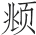

> [BREADCRUMB_CTX: 《长物志（精）--中华经典名著全本全注全译 (中华书局)》 > 绢素]

# 绢素

**【题解】**

绢素指未曾染色的白绢。绢素质地良好，书写顺畅，是很好的书写材料，所以绢素常用来代指书籍或信件。汉乐府《饮马长城窟行》就有：“客从远方来，遗我双鲤鱼。呼儿烹鲤鱼，中有尺素书。”宋晏殊《蝶恋花》词曰：“欲寄彩笺兼尺素，山长水阔知何处。”文震亨列举了唐至明代的绢，对之进行了仔细辨别，在文末文震亨说董其昌用白绢作画有士大夫气，显然不是肯定的语言，这里能看出文人与士大夫有着身份的不同，文震亨更多地表现出文人趣味。

古画绢色墨气，自有一种古香可爱，惟佛像有香烟熏黑，多是上下二色。伪作者，其色黄而不精采①。古绢，自然破者，必有鲫鱼口②，须连三四丝，伪作则直裂。唐绢丝粗而厚，或有捣熟者，有独梭绢③，阔四尺余者。五代绢极粗如布。宋有院绢④，匀净厚密，亦有独梭绢，阔五尺余，细密如纸者。元绢及国朝内府绢俱与宋绢同⑤。胜国时有宓机绢⑥，松雪、子昭画多用此⑦，盖出嘉兴府宓家，以绢得名，今此地尚有佳者。近董太史笔⑧，多用砑光白绫⑨，未免有进贤气⑩。

**【注释】**

①精采：有神采。

②鲫鱼口：参差不齐的裂口。

③独梭绢：绘画所用较为稀薄的绢。

④院绢：宋代画院之绢。

⑤国朝：本朝。内府绢：皇家织染局所制者。

⑥宓（mì）机绢：浙江嘉兴宓姓所织之绢。

⑦松雪：即元代书画家赵孟（1254—1322）。字子昂，号松雪道人，简称松雪。工书法，尤精于正、行书和小楷。擅画，工山水、人物、鞍马以及墨竹和花鸟。书法作品有《洛神赋》《道德经》等，画作有《重江叠嶂》《东洞庭》等。子昭：即盛懋，字子昭。善画人物、山水、花鸟。画山石多用披麻皴或解索皴，笔法精整，设色明丽。主要代表作有《秋林高士图》《秋江待渡图》《沧江横笛图》《溪山清夏图》和《松石图》等。

⑧董太史：即董其昌（1555—1636）。字玄宰，号思白，别号香光居士，松江华亭（今上海松江区）人。擅画山水，笔致清秀中和，恬静疏旷。用墨明洁隽朗，温敦淡荡。青绿设色，古朴典雅。以佛家禅宗喻画，倡“南北宗”论，为“华亭画派”杰出代表，兼有“颜骨赵姿”之美。其画及画论对明末清初画坛影响甚大。书法出入晋唐，自成一格，能诗文。代表作品有《岩居图》《明董其昌秋兴八景图册》《昼锦堂图》《白居易琵琶行》《草书诗册》《烟江叠嶂图跋》等。

⑨砑（yà）光白绫：以石磨之，使发光泽的白绫。砑，碾磨物体，使紧密光亮。

⑩进贤气：士大夫气。

**【译文】**

古画的绢色、用墨，有一种古色古香，惹人喜爱，只有佛像画因香烟熏染呈黑色，上下两部分深浅不同。伪造的古画，色彩发黄，没有神采。古绢，自然破损的，一定有参差不齐的裂口，有一些丝缕相连，伪造的则裂口整齐。唐代的绢丝粗而厚，有的是熟绢，也有独梭绢，宽四尺有余。五代的绢粗厚如布。宋代画院之绢，匀净厚密，也有独梭绢，五尺多宽，细密如纸。元代的绢和本朝的内府绢，与宋代的绢相同。元朝时有宓机绢，赵孟和盛懋的画，多用此绢，此绢因为产于嘉兴府宓家，因此得名，现在当地还有很好的绢。近代董其昌，多用磨光的白绢作画，未免有士大夫气。