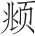
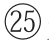
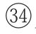

> [BREADCRUMB_CTX: 《长物志（精）--中华经典名著全本全注全译 (中华书局)》 > 名家 (Part 1)]

# 名家

**【题解】**

本篇题为“名家”，文震亨将历代书法家、画家列举一通，我们看到的是密密麻麻的名字，先是历代书法名家，后是历代绘画名家，有书画皆擅者，所以书法家与画家中有相互重复的名字。

既为名家，读者较为熟悉，不必赘述，却能看出文震亨对传统审美趣味的追随。有趣的是结尾列举的明代画家，文震亨认为他们是歪门邪道，何谓歪门邪道？是笔墨纵横还是过于创新？郑颠仙画人物颇野放，张复阳师法吴镇，画风水墨淋漓，钟钦礼、蒋三松、张平山、汪海云均为浙派画家，学习戴进，都有所变化，但多纵笔粗豪，画风以豪放见长，秀逸不足，狂放过之。这些画家固有一些草率之笔，但也显露出自己的个性。文震亨的论述显露出其保守性，也许是他视书画为风雅之事，所以对粗豪之作不肯接受吧。

书画名家，收藏不可错杂，大者悬挂斋壁，小者则为卷册，置几案间。邃古篆籀①，如锺②、张③、卫④、索⑤、顾⑥、陆⑦、张⑧、吴⑨，及历代不甚著名者，不能具论。

**【注释】**

①邃古：远古。篆籀（zhòu）：篆文和籀文。篆文，篆体字。籀文，我国古代书体的一种。也叫“籀书”“大篆”。因著录于《史籀篇》而得名，字体多重叠。春秋、战国间通行于秦国，与篆文近似。今存石鼓文即这种字体的代表。

②锺：即锺繇（151—230）。字元常，颍川长社（今河南长葛）人。曹魏重臣。锺繇擅篆、隶、真、行、草等多种书体，尤精于楷、隶，被后世尊为“楷书鼻祖”。主要作品有《贺捷表》《力命表》《宣示表》《荐季直表》等。

③张：即张芝（？—约192）。字伯英，弘农（今河南灵宝）人，一说为敦煌（今甘肃敦煌西）人。东汉著名书法家，被誉为“草书之祖”，其书法被誉为“一笔书”。擅长草书中的章草，将古代当时字字区别、笔画分离的草法，改为上下牵连富于变化的新写法，富有独创性。今无墨迹传世，仅北宋《淳化阁帖》中收有他的《八月帖》等刻帖。

④卫：即卫瓘（220—291）。字伯玉，西晋河东安邑（今山西夏县西北）人。善隶书及章草。不仅兼工各体，还能学古人之长，是颇有创意的书法家。《顿首州民帖》是卫瓘唯一传世的书法作品，此帖已基本上去掉了书法中的波磔之笔势，从此帖已可看出章草向今草的过渡。

⑤索：即索靖（239—303）。字幼安，敦煌（今甘肃敦煌西）人。西晋将领、著名书法家，“敦煌五龙”之一。善章草，传东汉张芝之法，其书险峻坚劲，自成一家。主要作品有《索子》《草书状》《出师颂》《月仪帖》等。

⑥顾：即顾恺之（约345—406）。字长康，小字虎头，晋陵无锡（今江苏无锡）人。因在文学和绘画方面成就颇高，被称为三绝：才绝、画绝和痴绝。

⑦陆：即陆探微（？—约485）。南朝宋吴（今江苏苏州）人。正式以书法入画的创始人，把东汉张芝的草书体运用到绘画上。与顾恺之并称“顾陆”。

⑧张：即张僧繇。吴（今江苏苏州）人。南北朝梁画家，与顾恺之、陆探微、吴道子并称为“画家四祖”。

⑨吴：即吴道子（约680—759）。又名道玄，阳翟（今河南禹县）人。唐代著名画家，画史尊称“画圣”。

**【译文】**

名家的书画，也不要收藏太杂，大幅的悬挂室壁，小幅的集为卷册，置于几案之间。远古的篆文与籀文，如锺繇、张芝、卫瓘、索靖、顾恺之、陆探微、张僧繇、吴道子，还有历代不甚著名的，不能一一列举。

书则右军①、大令②、智永③、虞永兴④，褚河南⑤、欧阳率更⑥、唐玄宗⑦、怀素⑧、颜鲁公⑨、柳诚悬⑩、张长史⑪、李怀琳⑫，宋高宗⑬、李建中⑭、二苏⑮、二米⑯、范文正⑰、黄鲁直⑱、蔡忠惠⑲、苏沧浪⑳、黄长睿、薛道祖、范文穆、张即之、先信国，赵吴兴、鲜于伯机、康里子山、张伯雨、倪元镇、杨铁崖、柯丹丘、袁清容、危太素。

**【注释】**

①右军：指王羲之（303—361，一说321—379）。字逸少，琅邪临沂（今山东临沂）人。初为秘书郎，累迁至右军将军、会稽内史，故人称王右军。

②大令：即王献之（344—386）。字子敬，小名官奴，琅邪临沂（今山东临沂）人。官至中书令，人称王大令。

③智永：本名王法极，字智永，王羲之七世孙，号“永禅师”。善书，书有家法。创“永字八法”，为后代楷书立下典范。

④虞永兴：即虞世南（558—638）。字伯施，会稽余姚（今浙江余姚）人。善书法，与欧阳询、褚遂良、薛稷合称“初唐四大家”。所编《北堂书钞》为唐代四大类书之一。

⑤禇河南：即褚遂良（596—658，一说597—659）。字登善，钱塘（今浙江杭州）人，一作阳翟（今河南禹县）人。博涉文史，尤工书法。初学虞世南，后取法王羲之，传世墨迹有《孟法师碑》《雁塔圣教序》等。

⑥欧阳率更：即欧阳询（557—641）。字信本，潭州临湘（今湖南长沙）人。曾官至太子率更令、弘文馆学士，故又称“欧阳率更”。精通书法，与虞世南、褚遂良、薛稷三位并称“初唐四大家”。有楷书《九成宫醴泉铭》《皇甫诞碑》《化度寺碑》，行书《仲尼梦奠帖》《行书千字文》等。

⑦唐玄宗：即李隆基（685—762）。712—756年在位。前期励精图治，国力强盛，史称“开元盛世”。后期贪图享乐，任用非人，国事日非，导致“安史之乱”，后退位为太上皇。玄宗多才艺，知音律，善书法，工诗能文。

⑧怀素（737—799）：俗姓钱，字藏真，长沙（今湖南长沙）人。以“狂草”名世，史称“草圣”。自幼出家为僧，经禅之暇，爱好书法，与张旭齐名，合称“颠张狂素”，形成唐代书法双峰并峙的局面。传世书法作品有《自叙帖》《苦笋帖》《圣母帖》等。

⑨颜鲁公：即颜真卿（709—784？）。字清臣，小名羡门子，别号应方，京兆万年（今陕西西安）人。颜真卿书法精妙，擅长行、楷。初学褚遂良，后师从张旭，得其笔法。其正楷端庄雄伟，行书气势遒劲，创“颜体”楷书，对后世影响很大。与赵孟、柳公权、欧阳询并称“楷书四大家”。又与柳公权并称“颜柳”。

⑩柳诚悬：即柳公权（778—865）。字诚悬，京兆华原（今陕西耀州区）人。以楷书著称，初学王羲之，后来遍观唐代名家书法，吸取了颜真卿、欧阳询之长，融会新意，自创独树一帜的“柳体”，以骨力劲健见长。传世碑刻有《金刚经刻石》《玄秘塔碑》《冯宿碑》等，行、草书有《伏审帖》《十六日帖》《辱向帖》等。

⑪张长史：即张旭（685？—759？）。字伯高，一字季明，吴（今江苏苏州）人。擅长草书，喜欢饮酒，世称“张颠”，与怀素并称“颠张醉素”，与贺知章、张若虚、包融并称“吴中四士”，又与贺知章等人并称“饮中八仙”。其草书与李白的诗歌、裴旻的剑舞并称“三绝”。主要作品有《古诗四帖》《肚痛帖》等。

⑫李怀琳：活动于7世纪，唐太宗时待诏文林馆。草书《嵇康与山巨源绝交书》相传为李怀琳仿作，共159行，1209字，现藏日本。

⑬宋高宗：即赵构（1107—1187）。字德基。宋朝第十位皇帝（1127—1162年在位）。精于书法，善真、行、草书，笔法洒脱婉丽，自然流畅，颇得晋人神韵。著有《翰墨志》，传世墨迹有《洛神赋》等。

⑭李建中（945—1013）：字得中，号严夫、民伯，京兆（今陕西西安）人。性怡淡，简静，风神雅秀，不重名利，曾作西京留司御史台，人称“李西台”。好游山水，多留题。善书札，草、隶、篆、籀俱妙。传世书迹有《土母帖》《李西台六帖》等。

⑮二苏：即苏轼、苏辙。苏轼（1036—1101），字子瞻、和仲，号铁冠道人、东坡居士，眉州眉山（今四川眉山市）人。北宋中期文坛领袖，在诗、词、散文、书、画等方面取得很高成就。因乌台诗案被贬黄州，后又被贬惠州、儋州等地。写有《赤壁赋》《后赤壁赋》《念奴娇·赤壁怀古》等名作。苏辙（1039—1112），字子由，一字同叔，晚号颍滨遗老，眉州眉山（今四川眉山市）人。苏辙与父亲苏洵、兄长苏轼齐名，合称“三苏”。善书，书法潇洒自如，工整有序。著有《栾城集》等行于世。

⑯二米：即米芾及其子米友仁。米芾（1051—1107），初名黻，后改芾，字元章。米芾与蔡襄、苏轼、黄庭坚合称“宋四家”。画作自成一家，枯木竹石，山水画独具风格。书法也颇有造诣，擅篆、隶、楷、行、草等书体，长于临摹古人书法，达到乱真程度。主要作品有《多景楼诗》《虹县诗》《研山铭》《拜中岳命帖》等。米友仁（1069—1151），一名尹仁，字元晖，小名寅哥、鳌儿，晚号懒拙老人，米芾长子，世称“小米”。主要作品有《临江仙》《小重山》《渔家傲（和晏元献韵）》等。

⑰范文正：即范仲淹（989—1052）。字希文，吴县（今江苏苏州）人。曾官参知政事，主持“庆历新政”。诗、词、散文俱佳。他倡导的“先天下之忧而忧，后天下之乐而乐”思想和仁人志士节操，对后世影响深远。有《范文正公文集》传世。

⑱黄鲁直：即黄庭坚（1045—1105）。字鲁直，号山谷道人、涪翁，洪州分宁（今江西修水）人。生前与苏轼齐名，世称“苏黄”。书法独树一格，为“宋四家”之一。书法作品有《松风阁诗帖》《诸上座帖》等。

⑲蔡忠惠：即蔡襄（1012—1067）。字君谟，兴化军仙游（今福建仙游）人。诗文清妙，书法浑厚端庄，淳淡婉美，自成一体，为“宋四家”之一。有《蔡忠惠集》等传世。

⑳苏沧浪：即苏舜钦（1008—1048）。字子美，号沧浪翁，开封（今河南开封）人。提倡古文运动，善于诗词，与宋诗“开山祖师”梅尧臣合称“苏梅”。诗多指摘时弊，语言明快豪放。亦工散文。有《苏学士集》。

黄长睿：即黄伯思（1079—1118）。字长睿，别字霄宾，号云林子，邵武（今福建邵武）人。著有《法帖刊误》二卷。

薛道祖：即薛绍彭。字道祖，号翠微居士。与米芾齐名，人称“米薛”。工正、行、草书，笔致清润遒丽，具晋、唐人法度，现存世书迹有《诗卷》《兰亭临写本》及《昨日帖》《随事吟帖》《晴和帖》等。

范文穆：即范成大（1126—1193）。字至能，一字幼元，早年自号此山居士，晚号石湖居士，吴县（今江苏苏州）人。今有《石湖集》《揽辔录》《吴船录》《吴郡志》《桂海虞衡志》等著作传世。

张即之（1186—1263）：字温夫，号樗寮，和州历阳（今安徽和县）人。工书，其墨迹为金人所珍爱。学米芾而参用欧阳询、褚遂良笔法，尤善写大字，劲挺雄强，别具一格。存世书迹有《报本庵记》《书杜诗卷》等。

先信国：即文天祥（1236—1283）。初名云孙，字宋瑞，又字履善，道号浮休道人、文山，吉州庐陵（今江西吉安）人。坚持抗元，兵败被俘，囚拘燕京四年终不屈，被害。诗、文、词俱沉郁悲壮，忠义凛然。有《文山全集》。

赵吴兴：即赵孟（1254—1322）。字子昂，号松雪道人，又号水晶宫道人，湖州（今浙江湖州）人。博学多才，能诗善文，通经济之学，工书法，精绘艺，擅金石，通律吕，解鉴赏，尤其以书法和绘画的成就最高。

鲜于伯机：即鲜于枢（1246—1302）。字伯机，号困学山民等，渔阳（今天津蓟州区）人。晚年营室名“困学之斋”。好诗歌与古董，文名显于世，书法成就最著，尤工草书。有《困学斋杂录》《困学斋诗集》。

康里子山：即康里巎巎（náo, 1295—1345）。字子山，号正斋、恕叟。书法用锋灵妙，流畅圆秀，有王献之、米芾草书遗意。有草书《张旭笔法卷》等作品。

张伯雨：即张雨（1283—1350）。旧名张泽之，又名张嗣真，字伯雨，号贞居子、句曲外史。博学多闻，善谈名理。诗文、书法、绘画，清新流丽，有晋、唐遗意。年二十弃家为道士，居茅山。传世书迹有《台仙阁记》等。

倪元镇：即倪瓒（1301或1306—1374）。初名倪珽，字泰宇，别字元镇，号云林子等，无锡（今江苏无锡）人。擅画山水和墨竹，师法董源，受赵孟影响。早年画风清润，晚年变法，平淡天真。书法从隶书入，有晋人风度，亦擅诗文。存世作品有《渔庄秋霁图》《六君子图》《容膝斋图》《清閟阁集》。

杨铁崖：即杨维桢（1296—1370）。字廉夫，号东维子、铁崖，会稽（今浙江绍兴）人。工诗文，著有《铁崖古乐府》《逸编注》《咏史注》等。

柯丹丘：即柯九思（1290—1343）。字敬仲，号丹丘生、五云阁吏，台州仙居（今浙江仙居）人。博学能诗文，善书，素有诗、书、画三绝之称。他的绘画以“神似”著称，擅画竹，并受赵孟影响，主张以书入画，行、楷是其所长。他的存世书迹有《老人星赋》《读诛蚊赋诗》《重题兰亭独孤本》等。

袁清容：即袁桷（jué，1266—1327）。字伯长，号清容居士，庆元（今浙江宁波）人。诗词、考据、史学均精通。有《清容居士集》《延祐四明志》等。追封陈留郡公，谥文清。

危太素：即危素（1303—1372）。字太朴，一字云林。元至正元年（1335），出任经筵检讨，参与编修宋、辽、金三部历史，并注释《尔雅》。善诗文、书法。著有《说学斋稿》《元海运志》《危太朴文集》等。

**【译文】**

历代书法名家有晋人王羲之、王献之、南北朝智永、唐人虞世南、褚遂良、欧阳询、唐玄宗、怀素、颜真卿、柳公权、张旭、李怀琳，宋代宋高宗、李建中、苏轼和苏辙兄弟、米芾和米友仁父子、范仲淹、黄庭坚、蔡襄、苏舜钦、黄伯思、薛绍彭、范成大、张即之、文天祥，元人赵孟、鲜于枢、康里巎巎、张雨、倪瓒、杨维桢、柯九思、袁桷、危素。

我朝则宋文宪濂①、中书舍人燧②、方逊志孝孺③、宋南宫克④、沈学士度⑤、俞紫芝和⑥、徐武功有贞⑦、金元玉琮⑧、沈大理粲⑨、解学士大绅⑩、钱文通溥⑪、桑柳州悦⑫、祝京兆允明⑬、吴文定宽⑭、先太史讳徵明⑮、王太学宠⑯、李太仆应祯⑰、王文恪鏊⑱、唐解元寅⑲、顾尚书璘⑳、丰考功坊、先两博士彭嘉、王吏部穀祥、陆文裕深、彭孔嘉年、陆尚宝师道、陈方伯鎏、蔡孔目羽、陈山人淳、张孝廉凤翼、王徵君穉登、周山人天球、邢侍御侗、董太史其昌。又如陈文东璧、姜中书立纲，虽不能洗院气，而亦铮铮有名者。

**【注释】**

①宋文宪濂：即宋濂（1310—1381）。初名寿，字景濂，号潜溪，浦江（今浙江金华）人。与高启、刘基并称为“明初诗文三大家”。明初时受朱元璋礼聘，被尊为“五经”师，为太子朱标讲经。奉命主修《元史》。后以年老辞官还乡，后因长孙宋慎牵连胡惟庸案而被流放茂州，途中于夔州病逝。其作品大部分被合刻为《宋学士文集》。

②中书舍人燧：即宋燧。字仲珩，宋濂次子。因受胡惟庸案牵连，受连坐而死。工篆、隶、真、草。传世书法作品极少。

③方逊志孝孺（1357—1402）：即方孝孺。字希直，一字希古，号逊志，浙江台州府宁海人。曾以“逊志”名其书斋，因其故里旧属缑城里，故称“缑城先生”。因拒绝为发动“靖难之役”的燕王朱棣草拟即位诏书，被朱棣灭十族。主要作品有《逊志斋集》《方正学先生集》。

④宋南宫克：即宋克（1327—1387）。字仲温、克温，自号南宫生，长洲（今江苏苏州）人。善书法，小楷、章草气韵隽秀。时有宋广，亦善草写，人称“二宋”。传世墨迹有章草《急就章》《公䜩诗》《李白行路难》《书孙过庭书谱》等。

⑤沈学士度：即沈度（1357—1434）。字民则，号自乐，华亭（今上海松江区）人。永乐时以善书入翰林，擅篆、隶、楷、行等书体。有墨迹《教斋箴》《四箴铭》等传世。

⑥俞紫芝和：即俞和（1307—1382）。字正中，号紫芝，钱塘（今浙江杭州）人。不乐仕进。诗书均有时名，书学赵孟，往往人莫能辨。其诗多以手迹流传，清钱熙彦《元诗选补遗》编录五十九首。

⑦徐武功有贞：即徐有贞（1407—1472）。初名珵，字元玉，又字元武，晚号天全翁，吴县（今江苏苏州）人。因受封武功伯，世称徐武功。

⑧金元玉琮：即金琮（1449—1501）。字元玉，自号赤松山农，上元（今江苏南京）人。少聪颖，好吟咏，善书画，年十二、三即能大书。初法赵孟，晚学张雨，书法偏向于厚重一路，倾向沉稳的风格。是作赵孟伪书画的能手。

⑨沈大理粲：即沈粲（1379—1453）。字民望。善真、草书，飘逸遒劲，自成一家。尤长于诗，有集二千余首。有《草书千字文卷》《草书古诗轴》《梁武帝草书状卷》《重建华亭县治记》等传世。

⑩解学士大绅：即解缙（1369—1415）。字大绅，一字缙绅，号春雨、喜易，江西吉安府吉水人。文章雅劲奇古，诗豪宕丰赡，书法小楷精绝，行、草皆佳，尤其擅长狂草，与徐渭、杨慎一起被称为明朝三大才子，著有《解学士集》《天潢玉牒》等。

⑪钱文通溥：即钱溥（1408—1488）。字原溥，号遗庵、九峰。曾入内阁整理国家藏书与修《寰宇通志》《大明一统志》。著有《朝鲜杂志》《朝鲜使略》等。

⑫桑柳州悦：即桑悦（1447—1503）。字民怿，号思玄居士，常熟（今江苏常熟）人。为人怪妄，好为大言，以孟子自况，工于辞赋，所著《南都赋》《北都赋》颇为有名。