## 名家 (Part 2)

> [BREADCRUMB_CTX: 《长物志（精）--中华经典名著全本全注全译 (中华书局)》 > 名家 (Part 2)]

⑬祝京兆允明：即祝允明（1461—1527）。字希哲，长洲（今江苏苏州）人。因长相奇特而自嘲丑陋，又因右手有枝生手指，故自号枝山，世人称为“祝京兆”。楷书早年精谨，师法赵孟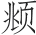、褚遂良，草书师法李邕、黄庭坚、米芾，功力深厚，晚年尤重变化，风骨烂漫。与同郡徐祯卿、唐寅、文徵明称“吴中四才子”。

⑭吴文定宽：即吴宽（1435—1504）。字原博，号匏庵，世称匏庵先生。著有《匏庵集》，擅书法，作书姿润中时出奇崛。

⑮先太史讳徵明：即文徵明（1470—1559），文震亨的曾祖。文徵明诗、文、书、画无一不精，人称“四绝”，其与沈周共创“吴派”。主要作品有《真赏斋图》《绿荫草堂图》《甫田集》等。

⑯王太学宠：即王宠（1494—1533）。字履仁、履吉，号雅宜山人，长洲（今江苏苏州）人。博学多才，工篆刻，善山水、花鸟。诗文声誉很高，尤以书名噪一时，书善小楷，行草尤为精妙。著有《雅宜山人集》，传世书迹有《诗册》《杂诗卷》《千字文》《古诗十九首》《李白古风诗卷》等。

⑰李太仆应祯：即李应祯（1431—1493）。初名甡，字应祯，以字行，更字贞伯，号范庵。书宗欧阳询，平正婉和，清润端方，自成一家。

⑱王文恪鏊（ào）：即王鏊（1450—1524）。字济之，号守溪，晚号拙叟，学者称其为震泽先生，吴县（今江苏苏州）人。博学有识鉴，经学通明，制行修谨，文章修洁。善书法，多藏书。主要作品有《姑苏志》《震泽集》《震泽长语》等。

⑲唐解元寅：即唐寅（1470—1524）。字伯虎、子畏，号六如居士，吴县（今江苏苏州）人。绘画上与沈周、文徵明、仇英并称“吴门四家”，又称“明四家”。诗文上，与祝允明、文徵明、徐祯卿并称“吴中四才子”。代表作品有《落霞孤鹜图》《杏花茅屋图》《春山伴侣图》《秋风纨扇图》等。

⑳顾尚书璘：即顾璘（1476—1545）。字华玉，号东桥居士，世称“东桥先生”，上元（今江苏南京）人。主要作品有《顾华玉集》《浮湘稿》《息园诗文稿》《缓恸集》等。

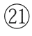丰考功坊：即丰坊（1494—？）。字人叔、存礼，后更名道生，更字人翁，号南禺外史，鄞县（今浙江宁波）人。曾被委任为南京吏部考功主事，故有丰考功之称。博学工文，兼通书法。嗜收藏，家有万卷楼，藏书数万卷。著有《易辨》《古书世学》《十三经训诂》《万卷楼遗集》等。

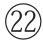先两博士彭嘉：即文彭和文嘉。文彭（1498—1573），字寿承，号三桥，长洲（今江苏苏州）人。文徵明长子。以明经廷试第一，授秀水训导。官南京国子监博士。工书画，尤精篆刻，能诗，有《博士诗集》。文嘉（1501—1583），字休承，号文水，长洲（今江苏苏州）人。文徵明之子，能诗，工书，小楷清劲，亦善行书。精于鉴别古书画，工石刻，为明一代之冠。画得徵明一体，善画山水，笔法清脆，颇近倪瓒，着色山水具幽澹之致，间仿王蒙皴染，亦颇秀润，兼作花卉，为吴门派代表画家。主要作品有《钤山堂书画记》《和州诗》等。

王吏部穀祥：即王穀祥（1501—1568）。字禄之，号酉室，长洲（今江苏苏州）人。善写生，渲染有法度，意致独到，即一枝一叶，亦有生色。为士林所重。与文徵明交游甚密，在吴中以词翰著名。

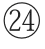陆文裕深：即陆深（1477—1544）。初名荣，字子渊，号俨山，南直松江府上海人。书法遒劲有法，如铁画银钩。代表作有《瑞麦赋》。

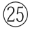彭孔嘉年：即彭嘉年（1505—1566）。字孔嘉，号隆池山樵。家贫嗜酒，以贫困终，著有《龙池山樵集》。

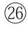陆尚宝师道：即陆师道（1511—1574）。字子传，号元洲、五湖道人。师事文徵明，工小楷、古篆，著有《五湖集》等。

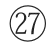陈方伯鎏：即陈鎏（1506—1575）。字子兼，号雨泉，吴县（今江苏苏州）人。诗文冲远有致，书法尤精绝。工小楷。著有《已宽堂集》。

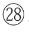蔡孔目羽：即蔡羽（？—1541）。字九逵，因居江苏吴县（今江苏苏州）洞庭西山，自号林屋山人，又称左虚子、消夏居士。好古文，善书法，长于楷、行，以秃笔取劲，姿尽骨全。主要作品有《林屋集》《南馆集》《太薮外史》等。

陈山人淳：即陈淳（1483—1544）。字道复、复甫，号白阳、白阳山人，长洲（今江苏苏州）人。善诗画。诗被喻为潇散闲雅，恬淡自然。著有《陈白阳集》。代表画作有《红梨诗画图》《山茶水仙图》《葵石图》《罨画图》。

张孝廉凤翼：即张凤翼（1527—1616）。字伯起，号灵墟，别署灵墟先生、泠然居士。与弟燕翼、献翼并有才名，时人号为“三张”。为人狂诞，擅作曲。所著戏曲有传奇《红拂记》《祝发记》《窃符记》《灌园记》《扊扅记》《虎符记》，合题《阳春六集》。

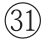王徵君稺登：即王稺登（1535—1612）。字伯谷，号松坛道士。少有才名，长益骏发，名满吴会。擅长书法，行、草、篆、隶皆精，有名作《黄浦夜泊》存世。著有《吴社编》《弈史》《吴郡丹青志》等作品。

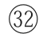周山人天球：即周天球（1514—1595）。字公瑕，号幻海，太仓（今江苏太仓）人。从文徵明游，得承其书法，闻名吴中。尤擅大小篆、古隶、行楷，一时丰碑大碣，皆出其手。书法传世作品有《桃花书屋》《五言律诗轴》《五律扇面》《行书陋室铭轴》等。绘画作品有《水仙图》。

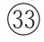邢侍御侗：即邢侗（1551—1612）。字子愿，号知吾，自号啖面生、方山道民等。善画，能诗文，工书，书法为海内外所珍视。与董其昌、米万钟、张瑞图并称“晚明四大家”。

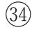董太史其昌：即董其昌（1555—1636）。字玄宰，号思白、香光居士等。擅画山水，笔致清秀中和，恬静疏旷。用墨明洁隽朗，温敦淡荡。青绿设色，古朴典雅。以佛家禅宗喻画，倡“南北宗”论，为“华亭画派”杰出代表，兼有“颜骨赵姿”之美。其画及画论对明末清初画坛影响甚大。书法出入晋唐，自成一格，能诗文。存世作品有《岩居图》《明董其昌秋兴八景图册》《昼锦堂图》《白居易琵琶行》《草书诗册》《烟江叠嶂图跋》等。

陈文东璧：即陈璧。字文东，号谷阳生。以文学知名，工书，尤善篆、隶、真、草，流畅快健，富于绳墨。

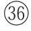姜中书立纲：即姜立纲（1444—1499）。字廷宪，号东溪。曾以“善书”闻名海内，并远播日本，日本京都国门上的大字亦为其所书，被誉为“一代书宗”。清代《三希堂法帖》收有他的墨迹。

**【译文】**

本朝的有宋濂、宋燧、方孝孺、宋克、沈度、俞和、徐有贞、金琮、沈粲、解缙、钱溥、桑悦、祝允明、吴宽、文徵明、王宠、李应祯、王鏊、唐寅、顾璘、丰坊、文彭和文嘉、王穀祥、陆深、彭嘉年、陆师道、陈鎏、蔡羽、陈淳、张凤翼、王穉登、周天球、邢侗、董其昌。另有陈璧、姜立纲，虽不能去除画院气，但也是铮铮有名的人。

画则王右丞①、李思训父子②、周昉③，董北苑④、李营邱⑤、郭河阳⑥、米南宫⑦、宋徽宗⑧、米元晖⑨、崔白⑩、黄筌⑪、居寀⑫、文与可⑬、李伯时⑭、郭忠恕⑮、董仲翔⑯、苏文忠⑰、苏叔党⑱、王晋卿⑲、张舜民⑳、杨补之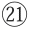、杨季衡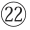、陈容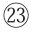、李唐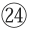、马远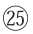、马逵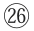、夏珪、范宽、关仝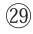、荆浩、李山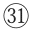、赵松雪、管仲姬、赵仲穆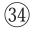、赵千里、李息斋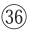、吴仲圭、钱舜举、盛子昭、陈珏、陈仲美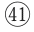、陆天游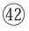、曹云西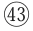、唐子华、王元章、高士安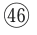、高克恭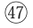、王叔明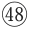、黄子久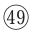、倪元镇、柯丹邱、方方壶、戴文进、王孟端、夏太常、赵善长、陈惟允、徐幼文、张来仪、宋南宫、周东村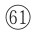、沈贞吉、恒吉、沈石田、杜东原、刘完庵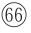、先太史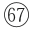、先和州、五峰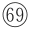、唐解元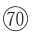、张梦晋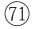、周官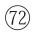、谢时臣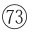、陈道复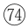、仇十洲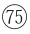、钱叔宝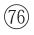、陆叔平，皆名笔不可缺者。他非所宜蓄，即有之，亦不当出以示人。又如郑颠仙、张复阳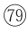、钟钦礼、蒋三松、张平山、汪海云，皆画中邪学，尤非所尚。

**【注释】**

①王右丞：即王维（701？—761）。字摩诘，号摩诘居士，太原祁县（今山西祁县）人。王维参禅悟理，学庄信道，精通诗、书、画、音乐等，以诗名盛于开元、天宝间，尤长五言，多咏山水田园，与孟浩然合称“王孟”，有“诗佛”之称。书画特臻其妙，后人推其为南宗山水画之祖。著有《王右丞集》《画学秘诀》，存诗约400首。

②李思训父子：指唐代李思训、李昭道父子。李思训（651—716），字建睍。书画称一时之绝，尤以山水称著，誉为盛唐第一。山水树石，笔格遒劲，金碧辉映，为一家之法。开元初，官右武卫大将军。画史上称“大李将军”。主要作品有《江帆楼阁图》《九成宫纨扇图》等。李昭道（675—758），字希俊，李思训之子。擅长青绿山水，世称“小李将军”。兼善鸟兽、楼台、人物，并创海景，画风巧赡精致。传世作品有《春山行旅图》等。

③周昉：字仲朗、景玄，京兆（今陕西西安）人。出身显贵，先后任越州、宣州长史。能书，擅画人物、佛像，尤其擅长画贵族妇女，容貌端庄，体态丰肥，色彩柔丽，为当时宫廷士大夫所喜爱，是中唐时期继吴道子之后而起的重要人物画家。代表作有《五星真形图》《杨妃出浴图》《妃子数鹦鹉图》《簪花仕女图》等。

④董北苑（934—约962）：又名董元，字叔达。五代绘画大师，南派山水画开山鼻祖。擅画山水，兼工人物、禽兽。存世作品有《夏景山口待渡图》《潇湘图》《夏山图》《溪岸图》《寒林重汀图》《龙宿郊民图》《平林霁色图卷》等。

⑤李营邱：即李成（919—967）。字咸熙，五代时避乱居青州益都（今山东青州），人称李营丘。擅画山水，多画郊野平远旷阔之景。作品有《读碑窠石图》《寒林平野图》《晴峦萧寺图》《茂林远岫图》等。

⑥郭河阳：即郭熙（1023—约1085）。字淳夫，河阳温县（今河南温县）人。熙宁间为图画院艺学，后任翰林待诏直长。工画山水，取法李成，山石用状如卷云的皴笔，画树枝如蟹爪下垂，笔势雄健，水墨明洁，早年风格工巧，晚年转为雄壮。后人把他与李成并称“李郭”。存世作品有《早春图》《关山春雪图》《窠石平远图》《幽谷图》等。有画论，其子郭思编为《林泉高致》。

⑦米南宫：即米芾（1051—1107），因其曾官礼部员外郎，因称。南宫，专指礼部。

⑧宋徽宗：即赵佶（1082—1135）。号宣和主人，宋朝第八位皇帝（1100—1126年在位），在艺术上的造诣极高。利用皇权推动绘画，使宋代的绘画艺术有了空前发展。主要作品有《宣和画谱》《宋徽宗诗》《书牡丹诗》《芙蓉锦鸡图》等。他还自创一种书法字体被后人称为“瘦金体”，他热爱画花鸟画自成“院体”。靖康元年（1126），宋徽宗与钦宗被金人掳去，后死于五国城。

⑨米元晖：即米友仁（1069？—1151），一名尹仁，字元晖，小名寅哥、鳌儿，晚号懒拙老人。米芾长子，善书画，与其父齐名，世称“小米”。主要作品有《临江仙》《小重山》《渔家傲（和晏元献韵）》等。

⑩崔白（1004—1088）：字子西，濠梁（今安徽凤阳东北）人。擅花竹、翎毛，亦长于佛道壁画，画佛道鬼神、山水、人物亦精妙绝伦，尤长于写生。有《双喜图》《寒雀图》《竹鸥图》等传世。

⑪黄筌（约903—965）：字要叔，成都（今四川成都）人。五代十国西蜀画家。擅画花、竹、翎毛、佛道、人物和山水，是一位技艺全面的画家，以画品“富贵”流布后世。现存的真迹有《写生珍禽图》。

⑫居寀：即黄居寀（933—？）。字伯鸾，成都（今四川成都）人。黄筌子。擅绘花竹禽鸟，精于勾勒，用笔劲挺工稳，填彩浓厚华丽，其园竹翎毛形象逼真，妙得自然。传世作品有《竹石锦鸠图》《山鹧棘雀图》等。

⑬文与可：即文同（1018—1079）。字与可，号笑笑居士、笑笑先生，人称石室先生，梓州永泰（今四川盐亭）人。以学名世，擅诗文书画，深为文彦博、司马光等人赞许，尤受其从表弟苏轼敬重。善画竹，开创“湖州竹派”。作品有《丹渊集》等。

⑭李伯时：即李公麟（1049—1106）。字伯时，号龙眠居士，舒州（今安徽安庆）人。好古博学，长于诗，精鉴别古器物。尤以画著名，凡人物、释道、鞍马、山水、花鸟，无所不精，时推为“宋画中第一人”。传世作品有《五马图》《维摩居士像》《免胄图》等。

⑮郭忠恕（？—977）：字恕先，又字国宝，洛阳（今河南洛阳）人。五代末期至宋代初期的画家，兼精文字学、文学，善写篆、隶书和“八分体”，以楷书最为著名。代表作品有《雪霁江行图》等。

⑯董仲翔：即董羽。字仲翔，五代南唐画家。原为画院待诏，后入宋图画院为艺学。其作品有《腾云出波龙图》《踊雾戏水龙图》《战沙龙图》《穿山龙图》等。著有《画龙辑议》。

⑰苏文忠：即苏轼（1036—1101）。字子瞻、和仲，号铁冠道人、东坡居士，眉州眉山（今四川眉山市）人。北宋中期文坛领袖，在诗、词、散文、书、画等方面取得很高成就。卒后御赐谥号文忠。

⑱苏叔党：即苏过（1072—1123）。字叔党，号斜川居士，眉州眉山（今四川眉山市）人。苏轼第三子，随侍苏轼，时与唱和，受其影响最大。在兄弟三人中，文学成就最高，人称“小东坡”。善作画，绘枯木竹石图，苏轼称他“时出新意作山水”。楷书古劲，有楷书石刻在定州天宁寺壁。著有《斜川集》。

⑲王晋卿：即王诜（shēn，约1048—约1104）。字晋卿，太原（今山西太原）人，居开封（今河南开封）。擅画山水，喜作烟江云山、寒林幽谷，存世作品有《渔村小雪图》《烟江叠嶂图》《溪山秋霁图》等。

⑳张舜民（约1034—1100）：字芸叟，号浮休居士、碇斋，邠州（今陕西彬县）人。累官龙图阁待制。著有《画墁集》。

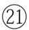杨补之：即杨无咎（1097—1171）。字补之，杨一作扬，一说名补之，字无咎，自号逃禅老人、清夷长者、紫阳居士。绘画尤擅墨梅。水墨人物画师法李公麟。书学欧阳询，笔势劲利。今存《逃禅词》一卷，词多题画之作，风格婉丽。

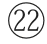杨季衡：杨补之的侄子，画家。

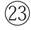陈容：字公储，号所翁，福唐（今福建福清）人。南宋著名画家。陈容不仅擅画龙，还擅长画松、竹、鹤，偶亦画虎，垂老笔力简易精妙，故世有“所翁龙”“所翁鹤”和“所翁竹”之称。传世作品有《霖雨图》《墨龙图》《云龙图》等。

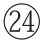李唐（1066—1150）：字晞古，河阳三城（今河南孟州）人。南宋画家。初以卖画为生，宋徽宗赵佶时入画院。南渡后以成忠郎衔任画院待诏。擅长山水、人物。存世作品有《万壑松风图》《清溪渔隐图》《烟寺松风》《采薇图》等。

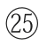马远（1140—1225）：字遥父，号钦山，祖籍河中（治今山西永济西），生长钱塘（今浙江杭州）。南宋绘画大师。存世作品有《踏歌图》《水图》《梅石溪凫图》《西园雅集图》等。

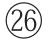马逵：马远之兄，宁宗朝画院待诏。工画山水、人物、花果、禽鸟。尤长于禽鸟，毛羽灿然，飞鸣之态生动逼真，胜于马远，其他不及马远。

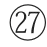夏珪：又名圭，字禹玉，钱塘（今浙江杭州）人。与李唐、刘松年、马远被合称为“南宋四大家”。早年工人物画，后以山水画著称。是北派山水代表人物之一。现存作品有《长江万里图》《山水十二景》《西湖柳艇图》《溪山清远图》《江山佳胜图》等。

范宽（950—1032）：原名中正，字中立，耀州华原（今陕西耀州区）人。性疏野，嗜酒好道。擅画山水，为山水画“北宋三大家”之一。存世作品有《溪山行旅图》《雪山萧寺图》《雪景寒林图》等。