## 名家 (Part 3)

> [BREADCRUMB_CTX: 《长物志（精）--中华经典名著全本全注全译 (中华书局)》 > 名家 (Part 3)]

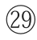关仝（约907—960）：一作关同、关穜，长安（今陕西西安）人。五代后梁杰出画家。在山水画的立意造境上独具风貌，被称为“关家山水”。代表作品有《关山行旅图》《山溪待渡图》等。

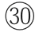荆浩（约850—911）：字浩然，号洪谷子，河内沁水（今山西沁水）人。五代后梁著名画家，是北方山水画派之祖。因避战乱，常年隐居太行山。著有《笔法记》，为山水画理论的经典之作，提出气、韵、景、思、笔、墨的绘景“六要”。作品有《匡庐图》《雪景山水图》等。

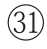李山：金世宗大定（1161—1189）中出任汾州（今山西汾阳）节度使，善画山水、树石，师法郭熙、王诜，笔势纵横，挥洒自如，不失法度。传世作品有《风雪松杉图》。

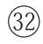赵松雪：即赵孟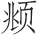（1254—1322）。字子昂，号松雪道人，又号水晶宫道人，湖州（今浙江湖州）人。博学多才，能诗善文，通经济之学，工书法，精绘艺，擅金石，通律吕，解鉴赏，尤其以书法和绘画的成就最高。

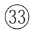管仲姬：即管道昇（1262—1319）。字仲姬，乌程（今浙江吴兴）人。赵孟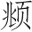之妻，被封吴兴郡夫人，世称管夫人。所写行楷与赵孟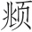颇相似，所书《璇玑图诗》笔法工绝。精于诗。擅画墨竹梅兰。代表作品有《墨竹谱》《水竹图卷》《秋深帖》《山楼绣佛图》。

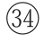赵仲穆：即赵雍（1289？—？）。字仲穆，吴兴（今浙江湖州）人。赵孟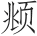之子。擅山水，尤精人物鞍马。书善正、行、草，亦长篆书。精鉴赏。传世作品有《兰竹图》《溪山渔隐》《饮中八仙图》等。

赵千里：即赵伯驹（1119—1185）。字千里。宋朝宗室，宋太祖七世孙。宋室南渡后流寓钱塘（今浙江杭州），后以画扇为宋高宗赵构赏识并予召见。工画山水、花果、翎毛，笔致秀丽，尤长金碧山水。代表作品《风云期会图》《春山图》《阿阁图》《后赤壁图》《汉宫图》《江山秋色图》等。

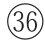李息斋：即李衎（kàn, 1245—1320）。字仲宾，号息斋道人，晚年号醉车先生，宛平（今北京）人。善画墨竹，双钩竹尤佳，和赵孟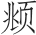、高克恭并称为元初画竹三大家，著有《竹谱详录》。存世作品有《四清图》《竹石大轴》《沐雨图轴》。

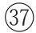吴仲圭：即吴镇（1280—1354）。字仲圭，号梅花道人，嘉兴（今浙江嘉兴）人。擅画山水、梅花、竹石，与黄公望、倪瓒、王蒙合称“元四家”。作品有《渔父图》《双桧平远图》《洞庭渔隐图》《芦花寒雁图》等。

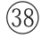钱舜举：即钱选（1239—1299）。字舜举，号玉潭，又号巽峰，霅川翁，别号清癯老人、川翁、习懒翁等。宋末元初画家，与赵孟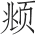等合称为“吴兴八俊”。工诗，善书画。他提倡绘画中的“士气”，在画上题写诗文或跋语，萌芽了诗、书、画紧密结合的文人画的鲜明特色。代表作品有《八花图》《浮玉山居图》《山居图》《秋江待渡图》等。

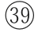盛子昭：即盛懋。字子昭，嘉兴（今浙江嘉兴）人。元代画家，善画人物、山水、花鸟。画山石多用披麻皴或解索皴，笔法精整，设色明丽。代表作有《秋林高士图》《秋江待渡图》《沧江横笛图》《溪山清夏图》和《松石图》等。

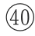陈珏（jué）：字桂岩，临安钱塘（今浙江杭州）人。南宋画院待诏，擅画山水、人物。作品见于著录的有《观瀑图》等。

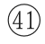陈仲美：即陈琳，字仲美。得赵孟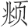指授，注重摹习古法，又有所创新，画名独步一时。唯一存世之作是《溪凫图》。

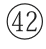陆天游：即陆广。字季弘，号天游生，吴（今江苏苏州）人。擅画山水，取法黄公望、王蒙，风格轻淡苍润，萧散有致。能诗，工小楷。存世作品有《丹台春晓图》等。

曹云西：即曹知白（1272—1355）。字又玄、贞素，号云西，人称贞素先生，华亭（今上海松江区）人。善画山水，师法李成、郭熙，从中演变成一种清疏简淡的风格。作品多以柔细之笔勾皴山石，极少渲染。早年笔墨较秀润，晚年变为苍秀简逸，为黄公望、倪瓒所推重。存世作品有《疏松幽岫》《雪山清霁》等图。

唐子华：即唐棣（1296—1364）。字子华，号遁斋，湖州归安（今江苏吴兴）人。工山水，近学赵孟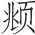，远师李成、郭熙，亦工诗文。传世作品有《霜浦归渔图》《携琴远眺图》《雪港捕渔图》等。

王元章：即王冕（？—1359）。字元章，号煮石山农、梅花屋主等，绍兴诸暨（今浙江诸暨）人。一生爱好梅花，种梅、咏梅，又攻画梅。所画梅花花密枝繁，生意盎然，劲健有力，对后世影响较大。存世画迹有《南枝春早图》《墨梅图》《三君子图》等。能治印，创用花乳石刻印章，篆法绝妙。

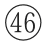高士安：字颜敬，元代画家。

高克恭：字彦敬，号房山道人，祖籍大同（今山西大同），居燕京（今北京），晚年寓钱塘（今浙江杭州）。工山水，擅林峦烟景。初学米芾、米友仁，晚年兼法董源，笔墨苍润，甚得赵孟推重。也写墨竹，风格近文同。存世作品有《云横秀岭》《春云晓霭》等。

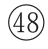王叔明：即王蒙（1308—1385）。字叔明，一作叔铭，号黄鹤山樵、香光居士，湖州（今浙江吴兴）人。赵孟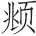外孙。作品以繁密见胜，重峦叠嶂，长松茂树，气势充沛，变化多端。喜用解索皴和牛毛皴，干湿互用，寄秀润清新于厚重浑穆之中。兼攻人物、墨竹，并擅行楷。存世作品有《青卞隐居图》《葛稚川移居图》《夏山高隐图》《丹山瀛海图》《太白山图》等。

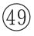黄子久：即黄公望（1269—1354）。本姓陆，出继温州平阳黄氏为义子，因改姓黄，名公望，字子久，号一峰、大痴道人等。黄公望工书法，通音律，善诗词散曲。尤擅画山水，得赵孟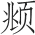指授，名列“元四家”之首。传世画作有《富春山居图》《水阁清幽图》等。

倪元镇：即倪瓒（1301？—1374？）。初名倪珽，字泰宇，别字元镇，号云林子、荆蛮民、幻霞子，常州无锡（今江苏无锡）人。擅画山水和墨竹，师法董源，受赵孟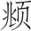影响。早年画风清润，晚年变法，平淡天真。书法从隶书入，有晋人风度，亦擅诗文。存世作品有《渔庄秋霁图》《六君子图》《容膝斋图》《清閟阁集》。

柯丹邱：即柯九思（1290—1343）。字敬仲，号丹丘、丹丘生、五云阁吏，台州仙居（今浙江台州）人。博学能诗文，善书，素有诗、书、画三绝之称。他的绘画以“神似”著称，擅画竹，并受赵孟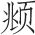影响，主张以书入画，行楷是其所长。他的存世书迹有《老人星赋》《读诛蚊赋诗》《重题兰亭独孤本》等。

方方壶：即方从义（约1302—1393）。字无隅，号方壶、不芒道人、金门羽客、鬼谷山人等，贵溪（今江西贵溪）人。擅长水墨云水，所作大笔水墨云山，苍润浑厚，富于变化，自成一格。工诗文，善古隶、章草。作品今存有《神岳琼林》《武夷放棹》《山阴云雪》等。

戴文进：即戴进（1389—1462）。字文进，号静庵、玉泉山人，钱塘（今浙江杭州）人。擅画山水、人物、花鸟、虫草，为“浙派”绘画开山鼻祖。作品有《春山积翠图》《风雨归舟图》《三顾茅庐图》《达摩至惠能六代像》等。

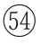王孟端：即王绂（1362—1416）。字孟端，号友石生、九龙山人等，无锡（今江苏无锡）人。以书画著称。山水师王蒙，风格苍郁。又善墨竹，笔势纵横，人称其墨竹“明朝第一”。存世画迹有《墨竹图》《竹鹤双清图》《潇湘秋意图》《枯木竹石图》《江山渔乐图》等。

夏太常：即夏昶（1388—1470）。字仲昭，号自在居士、玉峰，昆山人，后人誉其画竹高手。传世作品有《湘江风雨图卷》《满林春雨图轴》《墨竹图轴》。

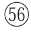赵善长：即赵原。一名元，字善长，号丹林，山东莒城（今山东莒县）人，徙居苏州。入明后因避朱元璋讳而改作原。擅长绘画，师法董源、王蒙。工山水，善用枯笔浓墨，郁郁苍苍。明初征至中书，画历代功臣。因应对不称明太祖旨意，被处死。有《合溪草堂图》《晴川送客图》《溪亭送客图》《陆羽烹茶图》等传世。

陈惟允：即陈汝言（？—1371）。字惟允，号秋水，祖籍江西，元末其父流寓吴中，居吴县（今江苏苏州）。能诗，擅山水，兼工人物。后受胡惟庸案所累被杀。有《荆溪图》《百丈泉图》《仙山图》《罗浮山樵图》《雪景山水》《密山柴门》等作品传世。

徐幼文：即徐贲（1335—1379？）。字幼文，自号北郭生，其先蜀人，徙居长洲（今江苏苏州），遂为吴人。擅画山水，笔墨清润，亦精墨竹，存世画迹有《蜀山图》等。

张来仪：即张羽（1333—1385）。字来仪，更字附凤，号静居，浔阳（今江西九江）人。山水画法宗法米氏父子，诗作笔力雄放俊逸，著有《静居集》。

宋南宫：即宋克（1327—1387）。字仲温、克温，自号南宫生，长洲（今江苏苏州）人。善书法，小楷、章草气韵隽秀。时有宋广，亦善草写，人称“二宋”。传世墨迹有章草《急就章》《公宴诗》《李白行路难》《书孙过庭书谱》等。

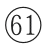周东村：即周臣（1460—1535）。字舜卿，号东村，吴县（今江苏苏州）人。能诗擅画，所绘山水，峰峦崚嶒，笔法严整。亦学马远、夏圭，运笔奔放遒劲。兼工人物，各极意态。唐寅、仇英出于其门下。代表作品有《春山游骑图》《春泉山隐图》等。

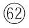沈贞吉（1400—？）：号南斋，又号陶然道人。吴门画派沈周的伯父，吴门画派的先驱。

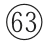恒吉：即沈恒吉。沈贞吉的弟弟，字同斋，吴门画派著名画家。

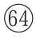沈石田：即沈周（1427—1509）。字启南，号石田、白石翁，长洲（今江苏苏州）人。明代绘画大师，“吴门画派”的创始人，“明四家”之一。沈周在元明以来文人画领域有承前启后的作用，与文徵明、唐寅、仇英并称“明四家”。传世作品有《庐山高图》《秋林话旧图》《沧州趣图》。

杜东原：即杜琼（1397—1474）。字用嘉，号东原耕者、鹿冠道人，人称东原先生，吴县（今江苏苏州）人。明经博学，旁及翰墨书画皆精。山水宗董源，层峦秀拔，亦工人物。好为诗，其诗于评画尤深。著《东原集》《耕余杂录》。

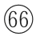刘完庵：即刘珏（1410—1472）。字廷美，号完庵，长洲（今江苏苏州）人。工书画，能诗文。主要作品有《秋山读书图》《仿倪瓒山水图》《夏云欲雨图》《寒严积雪图》等。

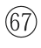先太史：此指文徵明（1470—1559），文震亨的曾祖。

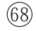先和州：此指文嘉（1501—1583）。字休承，号文水，长洲（今江苏苏州）人。文徵明次子。工诗画篆刻，所画山水，笔墨秀润，萧然简远。有《钤山堂书画记》《和州诗》。

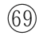五峰：此指文伯仁（1502—1575）。字德承，号五峰、摄山长、五峰山人、五峰樵客，长洲（今江苏苏州）人。文徵明侄子。工画山水，效王蒙，笔力清劲。画作有《万山飞雪图》《都门柳色图》《秋山游览图》等。

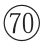唐解元：即唐寅（1470—1524）。字伯虎、子畏，号六如居士等，吴县（今江苏苏州）人。科举中解元，故有唐解元之称。

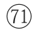张梦晋：即张灵。字梦晋，吴县（今江苏苏州）人。与唐寅为邻，年岁相仿佛，同为府学生员，又同以狂才见黜于乡党，故最为交厚。画作受唐寅影响极大。传世作品有《秋林高士图》《渔乐图》等。

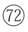周官：字懋夫。与张灵同时，善画人物，精于白描。所图八仙，不仅衣冠古雅，而神态自若。

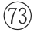谢时臣（1487—？）：字思忠，号樗仙，苏州（今江苏苏州）人。工山水，师法吴镇，得沈周笔意而稍变。多作长卷巨幛，峰峦雄伟。尤善画水，江河湖海，种种皆妙。笔墨纵横自如，富有气势。有《溪山揽胜图》《策杖寻幽图》《武当霁雪图》《谪仙玩月图》等传世。

陈道复：即陈淳（1483—1544）。字道复、复甫，号白阳、白阳山人，长洲（今江苏苏州）人。善诗画。著有《陈白阳集》。代表画作有《红梨诗画图》《山茶水仙图》《葵石图》《罨画图》。

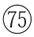仇十洲：即仇英（1493—1560）。字实父，号十洲，太仓（今江苏太仓）人。“明四家”之一。擅画人物，尤长仕女，既工设色，又善水墨、白描，能运用多种笔法表现不同对象。主要作品有《汉宫春晓图》《桃园仙境图》《赤壁图》《玉洞仙源图》等。

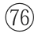钱叔宝：即钱穀（1508—？）。字叔宝，号罄室，长洲（今江苏苏州）人。善画山水、兰竹。

陆叔平：即陆治（1496—1576）。字叔平，因居包山，自号包山，吴县（今江苏苏州）人。游祝允明、文徵明门。山水喜仿宋人，而时出己意，焦墨皴擦，风骨峻削。主要作品有《端阳即景图》《彭泽高踪图》《花溪鱼隐图》等。

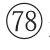郑颠仙：明人。擅长绘画，画人物颇野放。

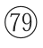张复阳（约1403—1490）：名复，以字行，号南山。工书法，善画山水，师法吴镇，画风多作写意，水墨淋漓。

钟钦礼：即钟礼。字钦礼，号南越山人，浙江上虞人。书法学赵孟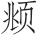，善画云山、草虫。

蒋三松：字三松，号徂来山人、三松居士。善画山水人物，工人物，为“浙派”名家之一。传世作品有《芦洲泛艇图》《秋溪曳杖图》《无尽溪山图》等。

张平山：即张路（1464—1538）。字天驰，号平山，河南祥符（今河南开封）人。绘人物，师法吴伟，山水学戴进“狂态”，用笔豪放纵逸，水墨酣畅淋漓，亦工鸟兽、花卉，为“浙派”名家。

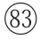汪海云：字德初。工绘事，山水、人物，出入于戴进、吴伟，但多草率之笔。尤长于翎毛，豪放不羁，自谓其笔意飘若海云，因自号海云。

**【译文】**

历代著名的画家有唐人王维、李思训和李昭道父子、周昉，宋人董源、李成、郭熙、米芾、宋徽宗、米友仁、崔白、黄筌、黄居寀、文同、李公麟、郭忠恕、董羽、苏轼、苏过、王诜、张舜民、杨无咎、杨季衡、陈容、李唐、马远、马逵、夏珪、范宽、关仝、荆浩，金代的李山，元人赵孟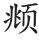、管道昇、赵雍、赵伯驹、李衎、吴镇、钱选、盛懋、陈珏、陈琳、陆广、曹知白、唐棣、王冕、高士安、高克恭、王蒙、黄公望、倪瓒、柯九思、方从义、戴进、王绂、夏昶，本朝赵原、陈汝言、徐贲、张羽、宋克、周臣、沈贞吉、沈恒吉、沈周、杜琼、刘珏、文徵明、文嘉、文伯仁、唐寅、张灵、周官、谢时臣、陈淳、仇英、钱穀、陆治，都是名家，收藏不可缺少。其他的画作都不宜收藏，即便收藏了，也不应当拿出来给人看。另外像本朝郑颠仙、张复阳、钟钦礼、蒋三松、张平山、汪海云诸人，都是绘画中的歪门邪道，更不应该崇尚。